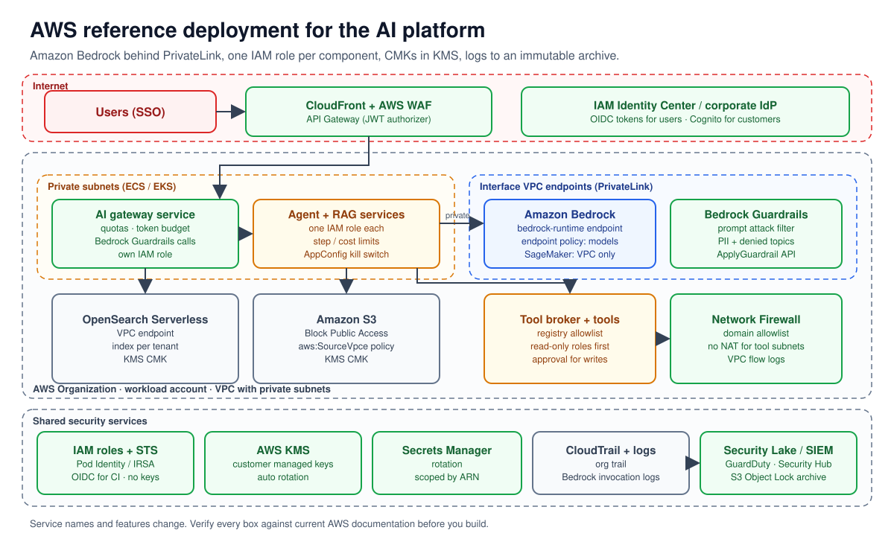

# AWS AI Security: Amazon Bedrock and SageMaker

> **Module:** 09 · Enterprise AI Security Architecture · **Weeks:** 25 · **Time:** ~10 hours
> **You will:** map the reference architecture onto AWS, secure Amazon Bedrock and SageMaker AI with identity, private networking, customer-managed keys, logging and guardrails, and prove the design with the architecture reviewer.

| | |
|---|---|
| **Prerequisites** | [01 Reference architecture](01-enterprise-ai-reference-architecture.md); basic AWS (IAM, VPC, S3) |
| **Lab** | [`lab/`](lab/) with [`architectures/secure_aws.yaml`](lab/architectures/secure_aws.yaml) and [`vulnerable_aws.yaml`](lab/architectures/vulnerable_aws.yaml) |
| **Maps to** | OWASP LLM02, LLM06, LLM10 · CIS Controls v8 (3, 5, 6, 8, 12) · AWS Generative AI Security Scoping Matrix · NIST AI RMF MANAGE |

> **Service names and features change fast.** Every AWS service, API and setting named here was correct to the best of our knowledge when written. Check the current AWS documentation before you rely on any of it.

---

## 1. Why this matters

- **2019, Capital One:** an attacker used a server-side request forgery (SSRF) bug to reach the EC2 instance metadata service, took the instance role's temporary credentials, and the role could read far too many S3 buckets. Data on about 100 million people was exposed. The lesson for AI apps: agents and tools that fetch URLs are SSRF machines, and over-permissioned roles turn a bug into a breach.
- **2024, "LLMjacking" (Sysdig):** attackers used stolen cloud credentials to call hosted model services, including on AWS, and resold the access. The victim paid the bill. Static keys plus no budget alerts equals someone else's free AI.
- **2025, Amazon Q Developer extension (AWS security bulletin):** a malicious prompt that told the agent to delete files and cloud resources was merged into a release of the VS Code extension. AWS removed that version and published a security bulletin; read it for the details. The lesson: agent instructions are code and need supply-chain controls.
- **Leaked access keys in public repositories** are found by automated scanners very quickly, which is why AWS and GitHub run secret scanning. A model API key is just another key.

The AWS model itself is rarely the weak point. **Your IAM, network and logging choices are.**

---

## 2. Understand it

### 2.1 The AWS AI services you will meet

| Service | What it is | You control |
|---|---|---|
| **Amazon Bedrock** | Managed API to foundation models from several providers, plus Knowledge Bases (managed RAG), Agents, Guardrails, model evaluation, and custom models (fine-tuning) | IAM, network path, keys for your resources, logging, guardrail config, data you send |
| **Amazon Bedrock AgentCore** | Newer building blocks for running agents (runtime, gateway for tools, identity, memory). Check the current feature list and status. | Same as above, plus tool access policies |
| **Amazon SageMaker AI** | Build, train and host your own models (renamed from "Amazon SageMaker"; check the current name) | Almost everything: VPC, containers, IAM, keys, endpoints, patching of your images |
| **Amazon Q** | SaaS assistants for business and developers | Mostly identity, data connectors and admin settings |

AWS publishes a **Generative AI Security Scoping Matrix** with five scopes: (1) consumer apps, (2) enterprise apps, (3) pre-trained models through an API, (4) fine-tuned models, (5) self-trained models. The higher the scope, the more you own. Bedrock is usually scope 3 or 4; SageMaker training from scratch is scope 5.



### 2.2 Identity and IAM

- **Workloads** use **IAM roles** with temporary credentials from STS. On EKS use **EKS Pod Identity** or **IRSA** (IAM roles for service accounts). On ECS use **task roles**. CI uses **OIDC federation** (e.g. GitHub Actions → IAM role), not stored keys.
- **Humans** use **IAM Identity Center** (SSO) with permission sets, MFA, and short sessions.
- **Least privilege for models:** allow only `bedrock:InvokeModel` / `bedrock:InvokeModelWithResponseStream` on the **specific model or inference-profile ARNs** you approved. Deny model management actions to runtime roles.
- **Guardrails through IAM:** Bedrock supports IAM condition keys that can require a specific guardrail on model calls. Check the current condition-key list before using it.
- **Organization guardrails:** **Service control policies (SCPs)** can deny Bedrock in unapproved regions, deny model invocation that does not come through your VPC endpoint, and deny turning off CloudTrail.

Example identity policy (illustrative; replace the region and model id):

```json
{
  "Version": "2012-10-17",
  "Statement": [{
    "Sid": "InvokeOnlyTheApprovedModel",
    "Effect": "Allow",
    "Action": ["bedrock:InvokeModel", "bedrock:InvokeModelWithResponseStream"],
    "Resource": "arn:aws:bedrock:eu-west-1::foundation-model/EXAMPLE-APPROVED-MODEL-ID"
  }]
}
```

Example SCP statement (illustrative; test in a sandbox first, SCPs can lock people out):

```json
{
  "Sid": "DenyModelCallsOutsideOurVpcEndpoint",
  "Effect": "Deny",
  "Action": ["bedrock:InvokeModel", "bedrock:InvokeModelWithResponseStream"],
  "Resource": "*",
  "Condition": {"StringNotEquals": {"aws:SourceVpce": "vpce-0example0example0"}}
}
```

### 2.3 Private networking

Bedrock is a regional AWS API, so there is no "public network access" switch on the model itself. On AWS, "private" means:

1. Create **interface VPC endpoints (AWS PrivateLink)** for the Bedrock endpoints you use (for example the runtime endpoint; agent and knowledge-base runtimes have their own).
2. Attach an **endpoint policy** that allows only your roles and approved models.
3. **Deny calls that do not use the endpoint** (SCP or identity policy with `aws:SourceVpce`).
4. Give the app subnets **no internet route** for model traffic. Tool subnets get egress only through **AWS Network Firewall** (domain allowlist) or no egress at all.

For **SageMaker AI**: run training jobs and endpoints **in your VPC**, enable **network isolation** for containers that do not need any network, disable direct internet access for notebooks, and encrypt inter-container traffic for distributed training.

For **RAG stores**: OpenSearch Serverless collections with VPC endpoints and a network policy that blocks public access; S3 with **Block Public Access** and bucket policies that require your VPC endpoint.

### 2.4 Encryption with customer-managed keys

- Use **AWS KMS customer managed keys** for S3 document buckets, OpenSearch collections, Bedrock resources that support CMK (for example custom models, knowledge bases, agents; check the current list), invocation-log buckets and SageMaker volumes and artifacts.
- Turn on **automatic key rotation** and give each key an owner.
- The **key policy** is your second access-control layer: a role with S3 access but no `kms:Decrypt` on the key cannot read the data. CloudTrail records every use of the key.

### 2.5 Logging and detection

| What | AWS service | Note |
|---|---|---|
| Who called which API (control plane, and Bedrock API calls) | **AWS CloudTrail** organization trail | Check which Bedrock calls are management vs data events and enable what you need |
| Prompts and responses | **Bedrock model invocation logging** to CloudWatch Logs and/or S3 | **Off by default.** If you turn it on, the logs contain user data: restrict, encrypt, set retention, consider redaction |
| Evidence that cannot be edited | S3 **Object Lock** in a separate log-archive account | WORM storage |
| Threat findings and posture | **GuardDuty**, **Security Hub**, **AWS Config** rules | Add your own detections for AI events |
| Cost abuse | **AWS Budgets**, **Cost Anomaly Detection**, Bedrock service quotas | Your LLMjacking alarm |
| Central search | **Amazon Security Lake** or your SIEM | Correlate with gateway logs by request ID |

### 2.6 Guardrails

**Amazon Bedrock Guardrails** can apply content filters (including a **prompt attack** filter), denied topics, word filters, **sensitive information filters** (PII detection with block or mask, custom regex), and contextual grounding checks. The **ApplyGuardrail** API lets you use the same guardrail on text from **any** model, including models outside Bedrock. Treat it as a **soft** layer: tune it, measure false positives, and alert on its findings.

### 2.7 Data retention and use

According to AWS documentation at the time of writing, Bedrock does not store or log your prompts and completions, does not use them to train AWS models, and does not share them with the model providers. Model invocation logging is **your** opt-in copy. Verify the current terms, record them in your data-flow record (control `DATA-04`), and remember: fine-tuning data, knowledge-base sources and logs you create are stored in **your** resources and follow **your** retention.

---

## 3. Defend it

| Layer | AWS control | Type | What it buys you |
|---|---|---|---|
| L1 | IAM Identity Center for people; IAM roles + STS for workloads; OIDC for CI; no IAM user keys | **Hard** | No long-lived keys to steal |
| L2 | Model-ARN-scoped policies; SCPs for regions, endpoint use and CloudTrail protection | **Hard** | A stolen role cannot use other models or turn off evidence |
| L3 | PrivateLink endpoints + endpoint policies; no internet route for model and data subnets; Network Firewall allowlist for tools | **Hard** | No public path to models or data; no exfiltration path |
| L4 | KMS CMKs with rotation on S3, OpenSearch, Bedrock resources, logs | **Hard** | Two-key access; auditable and revocable |
| L5 | Secrets Manager with rotation for any remaining third-party keys | **Hard** | No secrets in code, env vars or prompts |
| L6 | Bedrock Guardrails on input and output | Soft | Lower attack success; detection signals |
| L7 | CloudTrail org trail, invocation logging (redacted copy), Object Lock archive, Security Hub, budgets and anomaly alerts | Process | You see attacks and cost abuse; evidence survives |
| L8 | Architecture review in CI (this lab), AWS Config rules, Well-Architected reviews | Process | Gaps caught before production |

### Design patterns worth knowing

- **Multi-account landing zone.** Separate AWS accounts for AI workloads per environment, a **log-archive** account and a **security-tooling** account, set up with AWS Organizations (often via Control Tower). The workload account cannot delete the logs.
- **Model access as code.** Approved models are a list in IaC that feeds IAM policies and endpoint policies. Adding a model is a reviewed pull request.
- **Guardrail by default.** The gateway attaches the approved guardrail to every call, and an IAM condition (where available) makes calls without it fail.
- **Invocation-log split.** Raw invocation logs go to a locked, short-retention bucket for investigations; a redacted copy feeds dashboards.

### What does NOT work on its own

- "The Bedrock endpoint is HTTPS, so it is private." TLS is not a network boundary. Use PrivateLink plus policies.
- A security group alone for egress. Domains behind CDNs change IPs; use a domain-aware firewall or no egress.
- Turning on invocation logging and sending it to the same account the app runs in, readable by developers. You just created a sensitive-data store.
- Bedrock Guardrails as your only injection defense.

---

## 4. Hands-on lab

**Scenario:** you must approve the AWS design of the ops assistant before it goes to production.

### Step 1: Review the secure AWS design

```powershell
python 09-enterprise-architecture/lab/reviewer.py 09-enterprise-architecture/lab/architectures/secure_aws.yaml
```

Expected output:

```text
Architecture review: ops-assistant-aws (aws)
------------------------------------------------------------------------------
PASS     critical IAM-04   Users authenticate with enterprise SSO (OIDC/SAML) at the AI gateway
PASS     critical NET-04   All traffic to models, RAG and tools passes the AI gateway (no bypass path)
PASS     critical DATA-03  Tenant and document permissions are enforced server-side during retrieval
PASS     high     IAM-01   Workloads use short-lived credentials, never static keys
PASS     high     IAM-02   Runtime identities have least privilege (no wildcards, no admin)
PASS     high     NET-01   Model endpoints are reached privately; public network access is off
PASS     high     NET-02   Data stores (vector, object, logs) are private
PASS     high     NET-03   Agent and tool runtimes have deny-by-default egress
PASS     high     TOOL-01  Agents reach tools only through an MCP/tool gateway with an allowlist registry
PASS     high     AGT-01   Side-effecting (write) actions need human approval
PASS     high     AGT-02   Agents have step and cost limits and a working kill switch
PASS     high     LOG-01   Control-plane audit and model-invocation logs flow to a central SIEM
PASS     high     SEC-01   Secrets live in a secrets manager, never in config, images or prompts
PASS     medium   IAM-03   One identity per component (no shared service identity)
PASS     medium   DATA-01  Confidential AI data is encrypted with customer-managed keys
PASS     medium   DATA-02  Encryption keys rotate automatically
PASS     medium   DATA-04  Provider data use and retention settings are reviewed and recorded
PASS     medium   GR-01    Input guardrail detects prompt attacks (soft layer, for alerting)
PASS     medium   GR-02    Output guardrail screens for sensitive data and unsafe links
PASS     medium   LOG-02   AI logs are redacted, tamper-resistant and retained long enough
PASS     medium   OPS-01   Rate limits, token quotas and budgets protect against abuse
------------------------------------------------------------------------------
open: 0 critical, 0 high, 0 medium, 0 low | accepted: 0
GATE: PASS
```

Now open [`secure_aws.yaml`](lab/architectures/secure_aws.yaml) and, for every component, write in your journal the **real AWS setting** that makes its YAML value true. Example: `model.public_network_access: false` → "interface VPC endpoint for bedrock-runtime + SCP denying calls without `aws:SourceVpce`".

### Step 2: Compare with the hackathon build

```powershell
python 09-enterprise-architecture/lab/reviewer.py 09-enterprise-architecture/lab/architectures/vulnerable_aws.yaml
```

Find the findings that match the Capital One and LLMjacking lessons: `IAM-01` (static key in EC2 user data), `IAM-02` (`bedrock:*`, `s3:*`), `NET-03` (open egress), `OPS-01` (no quotas or budgets).

### Step 3: Break it yourself

Copy `secure_aws.yaml` to `architectures/my_aws.yaml` and predict each result before running.

1. Add the flow `- {from: internet, to: rag, note: "temporary debug endpoint"}`. Expected:

   ```text
   Architecture review: ops-assistant-aws (aws)
   ------------------------------------------------------------------------------
   FAIL     critical NET-04   All traffic to models, RAG and tools passes the AI gateway (no bypass path)
                             why: reachable from the internet without the AI gateway: rag, vectors
                             fix: On aws: API Gateway or ALB plus your gateway service in front; private subnets for everything behind it
   ------------------------------------------------------------------------------
   open: 1 critical, 0 high, 0 medium, 0 low | accepted: 0
   GATE: FAIL (open critical/high findings)
   ```

   (The `PASS` lines are not shown.) Why does `vectors` appear too, although you only exposed `rag`?
2. Change `role-agent` to `credential: static_key`. Which AWS mechanism would you use to *prevent* this in a real organization? (Hint: an SCP or an AWS Config rule that flags IAM users with access keys.)
3. Add `"bedrock:*"` to `role-rag`. Then change it to `"bedrock:InvokeModel on titan-embed"`. Why does the reviewer accept a wildcard in the *resource* part but not in the *action* part?
4. Set `model_invocation_logs: false`. Which control fails? What would an incident responder lose?

### Step 4: Collect real evidence (optional, needs your own AWS sandbox)

Only in an account you own, with read-only credentials. These calls change nothing. Check the AWS CLI reference for current syntax.

```powershell
aws bedrock get-model-invocation-logging-configuration
aws bedrock list-guardrails
aws ec2 describe-vpc-endpoints --filters Name=service-name,Values=com.amazonaws.eu-west-1.bedrock-runtime
aws cloudtrail describe-trails
aws iam generate-credential-report; aws iam get-credential-report
```

For each output, write which control in [`control_matrix.yaml`](lab/control_matrix.yaml) it is evidence for.

### Stretch goals

- Write a small script that reads the JSON from `describe-vpc-endpoints` and sets `private_endpoint: true/false` for the model component in your YAML. This is the first step to generating the architecture file from reality instead of writing it by hand.
- Add an `aws_scp_denies_public_bedrock` field and a check that only passes on AWS when the field is true. How do you keep the matrix cloud-neutral while allowing cloud-specific checks?

---

## 5. Real-world scenarios

**Scenario A: the surprise Bedrock bill.**
Finance sees a large Bedrock charge from a region the company never uses.
- *What went wrong:* an IAM user access key leaked from a CI log; no SCP limited regions; no budget alert.
- *Investigate:* CloudTrail for Bedrock calls by access key ID, source IP and region; when the key was created and last used; where it appears in code and CI logs.
- *Fix:* deactivate the key, then delete it; move CI to OIDC federation; SCP that denies Bedrock outside approved regions; Cost Anomaly Detection and budget alarms; secret scanning on repos and logs.

**Scenario B: the agent that could read every bucket.**
A support agent's tool fetches "attachment URLs". A tester gives it the instance metadata URL and receives role credentials. The role has `s3:GetObject` on `*`.
- *What went wrong:* SSRF through a tool, plus an over-broad role (the Capital One pattern).
- *Investigate:* tool logs for internal or metadata addresses; CloudTrail for the role's S3 reads from unusual sources.
- *Fix:* require IMDSv2 and a hop limit of 1 on instances; no internet egress for tools except an allowlist; block link-local and private ranges in the fetch tool; scope the role to one bucket prefix.

**Scenario C: invocation logs became the leak.**
A team enables Bedrock model invocation logging to debug answer quality. The log bucket is readable by all developers. Prompts contain customer data.
- *What went wrong:* a new sensitive data store was created without classification, access review or retention.
- *Investigate:* S3 access logs and CloudTrail data events for the bucket; who read which objects.
- *Fix:* move logs to a restricted log-archive account with KMS, Object Lock and short retention; give developers a redacted copy; add the store to the data inventory.

---

## 6. Common mistakes

- Using one IAM role for the whole app (gateway, RAG, agent, tools).
- Granting `bedrock:*` "because the model list changes".
- Creating VPC endpoints but never denying calls that bypass them.
- Turning on invocation logging without deciding who may read it and for how long.
- Running SageMaker notebooks with direct internet access and broad execution roles.
- Forgetting that Knowledge Bases, agents and tools have their **own** roles that need least privilege too.

---

## 7. Interview preparation

<details><summary><b>Q1. How do you give an application on EKS access to Bedrock without keys?</b></summary>

Use EKS Pod Identity (or IRSA): the pod's service account maps to an IAM role, and the SDK gets temporary STS credentials automatically. The role allows only `bedrock:InvokeModel*` on the approved model ARNs. No access keys exist, so none can leak. CI deploys through OIDC federation to a deploy role, also without keys.
</details>

<details><summary><b>Q2. Bedrock has no "disable public access" switch. How do you make model access private?</b></summary>

Create interface VPC endpoints (PrivateLink) for the Bedrock endpoints in use, restrict them with endpoint policies (principals, models), and then deny model calls that do not come through the endpoint using `aws:SourceVpce` in an SCP or identity policy. Model and data subnets have no internet route. That gives both a private path and enforcement that the private path is the only one.
</details>

<details><summary><b>Q3. What is the difference between CloudTrail and Bedrock model invocation logging?</b></summary>

CloudTrail records API activity: who called which API, when, from where, with what result. Model invocation logging records the request and response *content* (prompts, completions, metadata) to CloudWatch Logs or S3, and it is off by default. CloudTrail is your audit trail; invocation logs are sensitive data you must protect, retain carefully and usually redact.
</details>

<details><summary><b>Q4. Where do customer-managed KMS keys add real security, and where are they just compliance?</b></summary>

They add security when the key policy is a separate gate (a role with S3 access but no `kms:Decrypt` cannot read), when key use is monitored in CloudTrail, and when you can disable the key to cut off access quickly (crypto-shredding). They are "just compliance" if every role has `kms:*` on every key. Design key policies by data zone and by role.
</details>

<details><summary><b>Q5. How would you enforce that every Bedrock call uses an approved guardrail?</b></summary>

Two ways together: the AI gateway attaches the guardrail ID and version to every call (or calls ApplyGuardrail), and, where Bedrock's IAM condition keys support it, runtime roles may only invoke models with the approved guardrail. Then monitor: alert on calls without the guardrail and on guardrail interventions. Remember it is a soft control.
</details>

<details><summary><b>Q6. Explain the AWS Generative AI Security Scoping Matrix in one minute.</b></summary>

It sorts gen-AI use into five scopes: consumer apps, enterprise apps, pre-trained models via API, fine-tuned models, and self-trained models. As you move up, you own more: from just usage policy and data handling, to the app, to training data, model artifacts and hosting. It helps decide which controls and which governance apply to a given use case.
</details>

<details><summary><b>Q7. How do you secure a SageMaker training job?</b></summary>

Run it in your VPC with private subnets, enable network isolation if it needs no network, use a least-privilege execution role scoped to the exact S3 prefixes, encrypt volumes and output with KMS CMKs, enable inter-container encryption for distributed training, pin and scan the container image, and log the job's API calls. Treat training data provenance as part of the review.
</details>

<details><summary><b>Q8. A developer wants to use a third-party model API (not Bedrock) from AWS. What changes?</b></summary>

Now data leaves AWS to another provider: I need a data-flow review and the provider's data terms, an egress allowlist to that domain only, the API key in Secrets Manager with rotation, a gateway in front for quotas, logging and guardrails (ApplyGuardrail can still screen text), and an entry in the AI inventory. Private connectivity may not exist, so the egress firewall is the boundary.
</details>

<details><summary><b>Q9. How do you detect LLMjacking on AWS?</b></summary>

Budgets and Cost Anomaly Detection on Bedrock spend; CloudTrail alerts for Bedrock calls from unusual identities, regions or IPs; alerts on calls that change invocation logging or guardrails; GuardDuty findings for credential misuse; and gateway metrics that should match provider metrics (traffic at the provider that did not pass your gateway is a red flag).
</details>

<details><summary><b>Q10. What SCPs would you put on an AI workload account?</b></summary>

Deny use of AI services outside approved regions; deny model invocation without the VPC endpoint; deny stopping or deleting CloudTrail and Config; deny creating IAM users and access keys; deny disabling S3 Block Public Access; deny leaving the organization. I test each in a sandbox OU first, because SCPs can break legitimate access.
</details>

<details><summary><b>Q11. Scenario: invocation logs show prompts with customer PII. What do you do?</b></summary>

Treat it as a data-handling issue: restrict access immediately, check who read the logs, set or shorten retention, encrypt with a dedicated key, and decide whether the logs are needed at all. Add redaction before logging (or use guardrail PII masking), document the store in the privacy assessment, and check whether any notification duty applies.
</details>

<details><summary><b>Q12. How do Bedrock Knowledge Bases change your tenant-isolation design?</b></summary>

The managed service does retrieval for you, but it does not know your tenants unless you tell it. I must set metadata on ingestion (tenant, groups) and apply retrieval filters built from the verified token on every query, or use separate knowledge bases per tenant for strong isolation. Then test with canary documents. The knowledge base's own role must only read its source bucket prefix.
</details>

<details><summary><b>Q13. Explain to an executive why "we use Bedrock, so AWS handles security" is wrong.</b></summary>

"AWS secures the model service itself. We decide who can use it, what data we send, which actions our AI can take, where the logs go and who can read them. Most AI breaches so far came from those choices, for example a leaked key or a public database, not from the model provider."
</details>

---

## 8. Checklist (definition of done)

- [ ] I can explain how each `secure_aws.yaml` value maps to a real AWS setting.
- [ ] I can write an IAM policy that allows one model and an SCP that forces the VPC endpoint.
- [ ] I know which logs are off by default and what turning them on creates.
- [ ] I did the four "break it" exercises and predicted each result first.
- [ ] Week 25 journal entry: AWS reference design diagram, three decisions as short ADRs, residual risks.

## 9. References

Always check the current version of these pages.

- Amazon Bedrock security, https://docs.aws.amazon.com/bedrock/latest/userguide/security.html
- Amazon Bedrock data protection, https://docs.aws.amazon.com/bedrock/latest/userguide/data-protection.html
- Amazon Bedrock Guardrails, https://docs.aws.amazon.com/bedrock/latest/userguide/guardrails.html
- Amazon Bedrock and interface VPC endpoints, https://docs.aws.amazon.com/bedrock/latest/userguide/vpc-interface-endpoints.html
- Bedrock model invocation logging, https://docs.aws.amazon.com/bedrock/latest/userguide/model-invocation-logging.html
- Security in Amazon SageMaker AI, https://docs.aws.amazon.com/sagemaker/latest/dg/security.html
- AWS Generative AI Security Scoping Matrix, https://aws.amazon.com/ai/generative-ai/security/scoping-matrix/
- AWS shared responsibility model, https://aws.amazon.com/compliance/shared-responsibility-model/
- Service control policies, https://docs.aws.amazon.com/organizations/latest/userguide/orgs_manage_policies_scps.html
- Sysdig, *LLMjacking* (2024), https://sysdig.com/blog/llmjacking-stolen-cloud-credentials-used-in-new-ai-attack/
