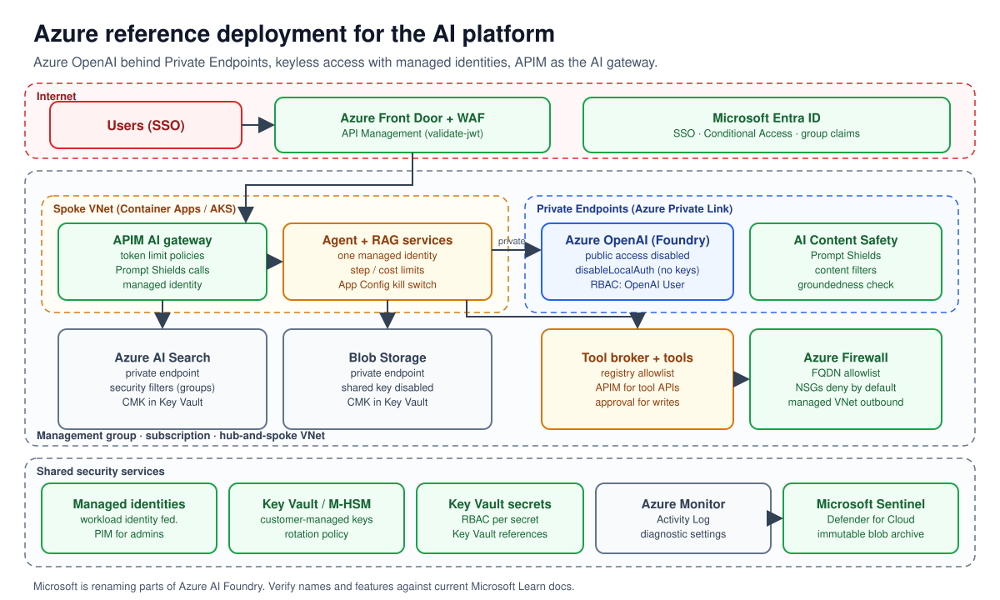

# Azure AI Security: Azure AI Foundry and Azure OpenAI

> **Module:** 09 · Enterprise AI Security Architecture · **Weeks:** 26 · **Time:** ~10 hours
> **You will:** map the reference architecture onto Azure, secure Azure OpenAI and Azure AI Foundry with Entra ID, managed identities, Private Endpoints, customer-managed keys, Azure Monitor and Azure AI Content Safety, and prove it with the reviewer.

| | |
|---|---|
| **Prerequisites** | [01 Reference architecture](01-enterprise-ai-reference-architecture.md); basic Azure (Entra ID, VNets, RBAC) |
| **Lab** | [`lab/`](lab/) with [`architectures/secure_azure.yaml`](lab/architectures/secure_azure.yaml) |
| **Maps to** | OWASP LLM Top 10 2026: LLM01, LLM02, LLM03 Excessive Agency [2025: LLM06], LLM06 Unbounded Consumption [2025: LLM10] · OWASP Agentic ASI03 · CIS Controls v8 (3, 5, 6, 8, 12) · Microsoft AI shared responsibility model · NIST AI RMF MANAGE |

> **Names change often on Azure.** "Azure AI Studio" became "Azure AI Foundry", and Microsoft continues to rename parts of this product family. Policy names, log categories and features also change. Check the current Microsoft Learn documentation before you rely on any detail here.

---

## 1. Why this matters

- **2023, Microsoft AI research (found by Wiz):** an Azure Storage SAS token with full-account scope and a far-future expiry was published in a GitHub repo for AI models. About 38 TB of internal data was exposed. One over-broad, long-lived token was enough.
- **2023, Storm-0558:** a threat actor used a stolen Microsoft signing key to forge authentication tokens and read email at many organizations. The US Cyber Safety Review Board's 2024 report called it preventable. For AI platforms the lesson is the same: **token validation and key protection are the foundation**.
- **2025, Microsoft Digital Crimes Unit legal action (Storm-2139):** Microsoft took legal action against a group that used stolen customer credentials to access Azure OpenAI and generate harmful content. Key-based access that can be stolen and reused is a real attack path; this is why `disableLocalAuth` matters.
- **2025, "EchoLeak" in Microsoft 365 Copilot (CVE-2025-32711):** a crafted email could make Copilot exfiltrate data with no user click. Microsoft fixed it on the server side. Even a SaaS copilot has a data-flow architecture you must understand.

---

## 2. Understand it

### 2.1 The Azure AI services you will meet

| Service | What it is | You control |
|---|---|---|
| **Azure OpenAI** (in Azure AI Foundry) | OpenAI models hosted by Microsoft in your Azure resource and region | Identity, network, keys, content filter config, logging, data you send, deployments |
| **Azure AI Foundry** | Portal and resources (hubs/projects) to build AI apps and agents, with a model catalog and agent service | Workspace network isolation, connections, identities, who can deploy |
| **Azure AI Search** | Search and vector index used for RAG | Network, keys, security filters (document-level trimming), index per tenant |
| **Azure AI Content Safety** | Classifiers: content categories, **Prompt Shields** (user prompt attacks and document attacks), groundedness detection, protected material | Thresholds, where you call it, what you do with results |
| **Azure Machine Learning** | Train and host your own models | Almost everything, like IaaS |
| **Azure API Management (APIM)** | API gateway with AI-specific features (token limits, token metrics, load balancing, semantic caching, content safety policy) | The AI gateway itself |



### 2.2 Identity: Entra ID everywhere, no keys

- **Users** sign in with **Microsoft Entra ID** (SSO, MFA, **Conditional Access**). The gateway (APIM `validate-jwt` policy) checks the token and passes user, tenant and group claims on.
- **Workloads** use **managed identities** (system- or user-assigned). Prefer one **user-assigned** managed identity per component, so the identity survives redeployment and is easy to audit.
- **Turn off key auth.** Azure AI services accept API keys by default. Set **`disableLocalAuth: true`** so only Entra ID tokens work. A stolen key then becomes useless. (Azure Policy has built-in definitions for this; check the current names.)
- **RBAC with narrow roles:** for example *Cognitive Services OpenAI User* to call deployments, not *Contributor* or *Owner*. Scope assignments to the resource, not the subscription.
- **Humans who administer** use **Privileged Identity Management (PIM)** for just-in-time elevation.
- **CI/CD** uses **workload identity federation** (for example GitHub Actions OIDC to a federated credential) instead of client secrets.
- **Agents** should have their own identities. Microsoft has announced **Entra Agent ID** for agent identities; check its current status.

### 2.3 Private networking

- Create **Private Endpoints** (Azure Private Link) for Azure OpenAI / AI services, AI Search, Storage and Key Vault, with **private DNS zones** so names resolve to private IPs.
- Set **`publicNetworkAccess: Disabled`** on each resource. Check the "trusted Azure services" exception settings: they can open paths you did not expect.
- Put **APIM in a VNet** (internal mode) as the AI gateway. Backends accept traffic only from it.
- For Foundry hubs and Azure ML workspaces, use **managed virtual network isolation** with the **allow only approved outbound** mode, so compute can reach only the destinations you list.
- Control egress from your own compute with **Azure Firewall** FQDN rules and NSGs (network security groups).
- Microsoft is adding a **network security perimeter** feature for PaaS services; check which services it supports today.

### 2.4 Encryption with customer-managed keys

- Use **customer-managed keys** in **Azure Key Vault** (or **Managed HSM**) for Azure OpenAI / AI services, AI Search and Storage.
- Key Vault needs **soft delete and purge protection** for CMK scenarios. Use a **key rotation policy**.
- The resource's managed identity needs only *wrap/unwrap* rights on that key. Different data zones get different keys.

### 2.5 Logging and detection

| What | Azure feature | Note |
|---|---|---|
| Control-plane changes (who created a deployment, changed network rules) | **Activity Log** | Export it to a Log Analytics workspace and keep it longer than the default |
| Data-plane requests | **Diagnostic settings** on the AI resource (resource logs) to Log Analytics | Choose the log categories you need; check the current list |
| Prompts and completions, token usage | **APIM** logging and token-metric policies | This stores content: restrict, retain, redact |
| SIEM and detections | **Microsoft Sentinel** | Correlate APIM, AI resource, Entra sign-in and Activity logs |
| Posture and AI threat alerts | **Microsoft Defender for Cloud** (including threat protection for AI workloads; check current coverage) | Alerts can use Prompt Shields signals |
| Evidence that cannot be changed | **Immutable blob storage** for archives | WORM retention |
| Configuration drift | **Azure Policy** (audit/deny effects) | Built-ins exist for private link, local auth, CMK on AI services |

### 2.6 Guardrails: Azure AI Content Safety

- **Content filters** are applied to Azure OpenAI deployments by default (hate, sexual, violence, self-harm, with severity thresholds). You can adjust them within the limits Microsoft allows.
- **Prompt Shields** detect **user prompt attacks** (jailbreaks) and **document attacks** (indirect injection hidden in documents you pass in). Send retrieved documents as documents, not as part of the user prompt, so the right detector runs.
- **Groundedness detection** checks whether an answer is supported by the sources. **Protected material detection** flags known copyrighted text and code.
- All of these are **soft** layers. Log their results to Sentinel and keep hard controls behind them.

### 2.7 Data retention and use

According to Microsoft's documentation at the time of writing: prompts and completions sent to Azure OpenAI are not used to train models and are not available to OpenAI; Microsoft may store data for **abuse monitoring** for a limited period (documented as up to 30 days) unless your organization is approved for **modified abuse monitoring**; stateful features (for example stored files for fine-tuning, batch jobs or agent threads) keep data in your resource. Verify the current terms and record your decision (`DATA-04`).

---

## 3. Defend it

| Layer | Azure control | Type | What it buys you |
|---|---|---|---|
| L1 | Entra ID SSO + Conditional Access for people; managed identities for workloads; federation for CI; `disableLocalAuth` | **Hard** | No keys to steal; tokens bound to identity and policy |
| L2 | Narrow RBAC roles at resource scope; PIM for admins | **Hard** | A compromised app cannot manage deployments |
| L3 | Private Endpoints + `publicNetworkAccess: Disabled`; APIM internal; managed VNet approved-outbound; Azure Firewall | **Hard** | No public path; no exfiltration path |
| L4 | CMK in Key Vault / Managed HSM with purge protection and rotation | **Hard** | Auditable, revocable data at rest |
| L5 | AI Search security filters from Entra group claims, or index per tenant | **Hard** | No cross-tenant retrieval |
| L6 | Content filters, Prompt Shields, groundedness detection | Soft | Lower attack success; detection signals |
| L7 | Activity Log + diagnostic settings + APIM logs to Sentinel; Defender for Cloud; immutable archive | Process | Detection, investigation, evidence |
| L8 | Azure Policy deny/audit for private link, local auth, CMK; architecture review in CI | Process | Drift and gaps are caught automatically |

### Design patterns worth knowing

- **APIM as the AI gateway.** Token-based rate limits per subscription or per user, token metrics, load balancing across deployments, managed identity to the backend (no keys in APIM), and a content safety policy. Check current policy names: they have been renamed as features grew.
- **Hub-and-spoke with a landing zone.** AI workloads in spoke VNets; Azure Firewall and shared private DNS in the hub; subscriptions per environment under management groups with Azure Policy assignments.
- **Security trimming in AI Search.** Store allowed group IDs on each document; build the filter from the verified token's group claims on every query. For strong isolation, use one index (or one search service) per tenant.
- **Policy-driven guardrails.** Assign Azure Policy initiatives that *deny* public network access and key auth on AI resources in production subscriptions.

### What does NOT work on its own

- Keeping API keys "secret" in Key Vault while key auth stays enabled. Turn key auth off.
- A private endpoint while `publicNetworkAccess` is still `Enabled`. You added a door; you did not close the old one.
- Relying on default content filters as your injection defense.
- Logging prompts in APIM to a workspace that every developer can query.

---

## 4. Hands-on lab

**Scenario:** the Azure team presents its design of the ops assistant. You review it, then try two common mistakes to see how the reviewer reacts.

### Step 1: Review the secure Azure design

```powershell
python 09-enterprise-architecture/lab/reviewer.py 09-enterprise-architecture/lab/architectures/secure_azure.yaml
```

Expected: every control `PASS` and `GATE: PASS` (same format as the AWS run in lesson 02). Open [`secure_azure.yaml`](lab/architectures/secure_azure.yaml) and write the real Azure setting behind each value, for example: `identities.*.credential: short_lived` → "managed identity + `disableLocalAuth: true`".

### Step 2: Break it: re-open public access

Copy `secure_azure.yaml` to `architectures/my_azure.yaml`. In the `model` component change `public_network_access: false` to `true`. Predict, then run:

```powershell
python 09-enterprise-architecture/lab/reviewer.py 09-enterprise-architecture/lab/architectures/my_azure.yaml
```

Expected output (`PASS` lines not shown):

```text
Architecture review: ops-assistant-azure (azure)
------------------------------------------------------------------------------
FAIL     high     NET-01   Model endpoints are reached privately; public network access is off
                          why: model public network access is on
                          fix: On azure: Private Endpoints (Azure Private Link) for Azure OpenAI / AI services; publicNetworkAccess Disabled
------------------------------------------------------------------------------
open: 0 critical, 1 high, 0 medium, 0 low | accepted: 0
GATE: FAIL (open critical/high findings)
```

The private endpoint still exists, but the old public door is open. This is the most common Azure AI misconfiguration.

### Step 3: Break it: a typo

Restore the value, then misspell the key: `public_network_acess: false`. A naive checker would read "setting not present" and might even pass. Run the reviewer again. Expected:

```text
INVALID architecture file 09-enterprise-architecture/lab/architectures/my_azure.yaml:
  components.2.public_network_acess: Extra inputs are not permitted
GATE: FAIL (fix the file first)
```

The exit code is 2. **Fail closed:** a file the reviewer cannot fully understand never passes.

### Step 4: More "predict, then run" exercises

1. Remove the `encryption_key` from `vectors`. Which control fails? Why is it only `medium`?
2. Give `mi-agent` and `mi-rag` the same identity (`identity: mi-agent` on `rag`). Which control fails, and what would you lose in an incident?
3. Set the gateway's `guardrails.input` to `[]`. Is the gate still `PASS`? Discuss: should a missing Prompt Shields integration block a release?

### Step 5: Collect real evidence (optional, needs your own Azure sandbox)

Read-only commands; check the Azure CLI reference for current syntax.

```powershell
az cognitiveservices account show -n <account> -g <rg> --query "{public:properties.publicNetworkAccess, localAuthDisabled:properties.disableLocalAuth}"
az network private-endpoint list -g <rg> -o table
az role assignment list --assignee <managed-identity-principal-id> -o table
az monitor diagnostic-settings list --resource <ai-resource-id>
```

Map each result to a control id in [`control_matrix.yaml`](lab/control_matrix.yaml).

### Stretch goals

- Write an Azure Policy assignment plan (which built-in definitions, which effect, which scope) that would make `NET-01`, `IAM-01` and `DATA-01` impossible to break in production subscriptions.
- Extend the reviewer with a `local_auth_disabled` field for Azure model endpoints, and a check that applies only when `cloud == "azure"`. Add a mutation test.

---

## 5. Real-world scenarios

**Scenario A: the key that outlived the employee.**
A contractor copied an Azure OpenAI key for testing. Months after leaving, the key is used from an unknown country to generate harmful content. Microsoft contacts you about abuse.
- *What went wrong:* key auth enabled; keys never rotated; no alert on unusual usage.
- *Investigate:* resource logs and APIM logs by caller IP; Activity Log for key listing (`listKeys`) operations; when keys were last regenerated.
- *Fix:* regenerate both keys, then set `disableLocalAuth: true`; move all apps to managed identity; Azure Policy to deny key auth; alerts on usage from outside your gateway.

**Scenario B: the Foundry project that could reach the internet.**
A data scientist's compute in a Foundry project downloads a "helpful" package and a model file from the internet. The model file runs code when loaded.
- *What went wrong:* managed network allowed all internet outbound; no artifact scanning; no approved registry.
- *Investigate:* outbound logs; which packages and model files were pulled; scan the artifacts.
- *Fix:* approved-outbound-only mode with a short allowlist; private package and model registries; prefer safe model formats (for example safetensors) and scan artifacts (see [Module 06](../06-ai-devsecops/)).

**Scenario C: search results from another business unit.**
An HR assistant and a finance assistant share one AI Search index. A finance user's question returns HR salary snippets.
- *What went wrong:* no security filter on the query; index shared across data zones.
- *Investigate:* the query the app sends; whether documents carry group fields; reproduce with canary documents.
- *Fix:* security trimming with group IDs from the token on every query; separate indexes for different data classifications; CI tests with canaries.

---

## 6. Common mistakes

- Leaving API key authentication on "just for the batch job".
- Assigning *Contributor* to the app's managed identity because "the SDK needed it".
- Private DNS zones missing or linked to the wrong VNet, so traffic still goes to the public IP.
- Forgetting the Activity Log's default retention and losing control-plane history.
- Sending retrieved documents inside the user prompt, so the document-attack detector never sees them as documents.

---

## 7. Interview preparation

<details><summary><b>Q1. How do you call Azure OpenAI from an app without any secret?</b></summary>

Give the app a managed identity, assign it the *Cognitive Services OpenAI User* role on the specific resource, and use Entra ID token authentication in the SDK. Then set `disableLocalAuth: true` on the resource so keys stop working. CI uses workload identity federation. There is nothing to store, rotate or leak.
</details>

<details><summary><b>Q2. You created a Private Endpoint for Azure OpenAI. Are you done?</b></summary>

No. Also set `publicNetworkAccess` to `Disabled` (or tightly restricted), make sure private DNS resolves to the private IP from the app's VNet, review "trusted services" bypass settings, and restrict who can create new endpoints. Then verify from outside that the public endpoint refuses connections.
</details>

<details><summary><b>Q3. What are Prompt Shields, and how do you use them correctly?</b></summary>

Classifiers in Azure AI Content Safety that detect user prompt attacks (jailbreaks) and document attacks (indirect injection in content you pass in). Use them on both the user input and every retrieved document or tool result, send their verdicts to Sentinel, and tune thresholds. They are a soft layer: authorization, tool policy and egress control must still stop the harmful action if a shield misses.
</details>

<details><summary><b>Q4. How would you build the AI gateway on Azure?</b></summary>

Azure API Management in a VNet: `validate-jwt` against Entra ID, token-based limits per user or tenant, token metrics, backend pool across deployments and regions with circuit breaking, managed identity to Azure OpenAI, a content safety policy or a call to Content Safety, and logging to Log Analytics with redaction. Backends accept traffic only from APIM.
</details>

<details><summary><b>Q5. How do you isolate tenants in Azure AI Search?</b></summary>

Weak-to-strong options: security filters on a shared index using group or tenant fields built from token claims on every query; one index per tenant; one search service per tenant for the strongest isolation and separate keys. Choose by data sensitivity and cost, and test with canaries. Never rely on the prompt.
</details>

<details><summary><b>Q6. What does Azure Policy add that a design review does not?</b></summary>

Continuous enforcement. A design review checks the plan once; Azure Policy with *deny* effects stops anyone from creating a public or key-enabled AI resource later, and *audit* effects show drift. I assign policy initiatives at management-group scope so new subscriptions inherit them.
</details>

<details><summary><b>Q7. What do you need before enabling customer-managed keys for Azure OpenAI?</b></summary>

A Key Vault or Managed HSM with soft delete and purge protection, a key with a rotation policy, the resource's managed identity granted wrap/unwrap on that key only, monitoring of key operations, and a tested plan for key loss (losing the key can make data unrecoverable). Decide key granularity per data zone.
</details>

<details><summary><b>Q8. A team wants to stop Microsoft's abuse monitoring from storing prompts. What do you say?</b></summary>

Microsoft offers modified abuse monitoring for approved customers and use cases; it requires an application and approval. I would check whether the use case qualifies, record the decision and the current terms in our data-flow record, and remind the team that our own logs (APIM, diagnostics) may store prompts too, so retention there matters as much.
</details>

<details><summary><b>Q9. Which logs would you need to investigate a suspected prompt-injection data leak?</b></summary>

APIM logs (request, user, tokens, possibly redacted content) with correlation IDs; Content Safety / Prompt Shields results; AI resource diagnostic logs; tool broker and approval logs; Entra sign-in logs for the user; Activity Log for any config changes; and the RAG retrieval log showing which documents were in context. All in Sentinel, correlated by request ID.
</details>

<details><summary><b>Q10. How do you secure Azure AI Foundry hubs and projects?</b></summary>

Managed VNet with approved-outbound-only mode, private endpoints for the hub and its dependent resources (storage, Key Vault, container registry), identity-based connections instead of keys, least-privilege project roles, CMK where required, and diagnostic logging. Control who can deploy models and who can add connections, because connections carry access to data.
</details>

<details><summary><b>Q11. Scenario: Defender for Cloud raises a jailbreak alert on your Azure OpenAI resource. What next?</b></summary>

Find the request in APIM and resource logs, identify the user and session, check whether any tool call or data access followed, and review the output that was returned. If it was only text with no impact, tune and track. If tools ran or data left, follow the incident playbook: contain (block user, kill switch), assess impact, and add the payload to the regression suite.
</details>

<details><summary><b>Q12. Explain the Microsoft AI shared responsibility model briefly.</b></summary>

It splits AI responsibilities across platform (model, infrastructure), application (prompts, plugins, data connections, safety systems) and usage (users, data, policies) layers, for IaaS, PaaS and SaaS AI. The more managed the service, the more Microsoft runs; but identity, data, configuration and how users use the AI remain the customer's job in every model.
</details>

<details><summary><b>Q13. Explain to an executive why we disable API keys on AI services.</b></summary>

"A key is like a password that anyone holding it can use, from anywhere, and keys get copied into code and chat messages. Attackers have used stolen AI keys to run up bills and produce harmful content in other companies' names. With keys turned off, only our approved applications and people, checked by our identity system, can use the AI."
</details>

---

## 8. Checklist (definition of done)

- [ ] I can map every `secure_azure.yaml` value to a real Azure setting.
- [ ] I can explain why `disableLocalAuth` and `publicNetworkAccess: Disabled` are both needed.
- [ ] I ran the two break exercises and saw the reviewer fail closed on the typo.
- [ ] I can design APIM as an AI gateway and name its key policies (checked against current docs).
- [ ] Week 26 journal entry: Azure reference design, three ADRs, residual risks, and differences from my AWS design.

## 9. References

Always check the current version of these pages.

- Data, privacy and security for Azure OpenAI, https://learn.microsoft.com/legal/cognitive-services/openai/data-privacy
- Configure virtual networks for Azure AI services, https://learn.microsoft.com/azure/ai-services/cognitive-services-virtual-networks
- Azure OpenAI with managed identities, https://learn.microsoft.com/azure/ai-services/openai/how-to/managed-identity
- Prompt Shields, https://learn.microsoft.com/azure/ai-services/content-safety/concepts/jailbreak-detection
- AI gateway capabilities in Azure API Management, https://learn.microsoft.com/azure/api-management/genai-gateway-capabilities
- AI shared responsibility model, https://learn.microsoft.com/azure/security/fundamentals/shared-responsibility-ai
- Azure security baseline for Azure OpenAI, https://learn.microsoft.com/security/benchmark/azure/baselines/azure-openai-security-baseline
- Wiz Research, *38TB of data accidentally exposed by Microsoft AI researchers* (2023), https://www.wiz.io/blog/38-terabytes-of-private-data-accidentally-exposed-by-microsoft-ai-researchers
- Cyber Safety Review Board, review of the Summer 2023 Microsoft Exchange Online intrusion (2024), published by CISA: https://www.cisa.gov/
