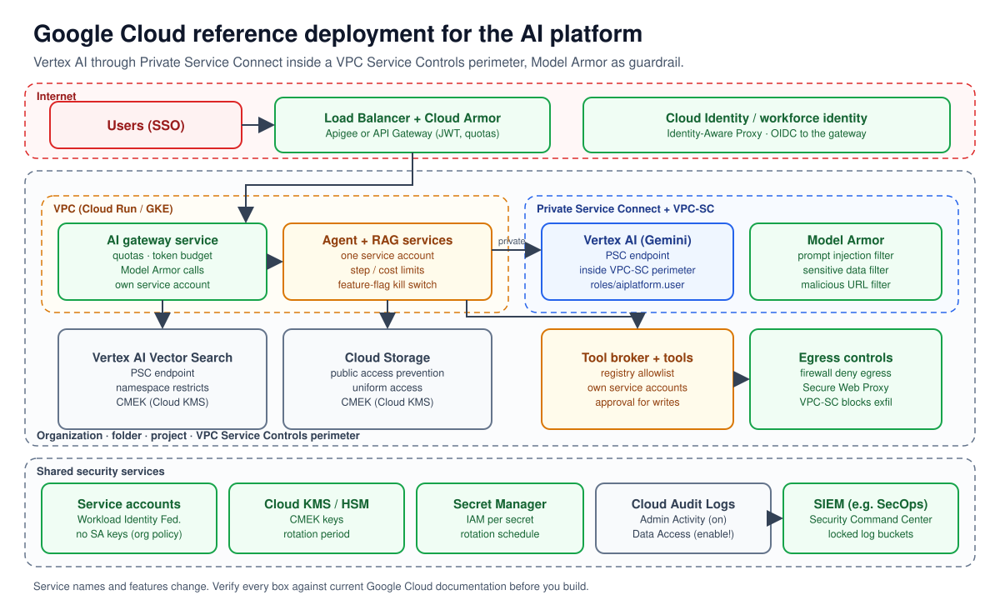

# Google Cloud AI Security: Vertex AI

> **Module:** 09 · Enterprise AI Security Architecture · **Weeks:** 27 · **Time:** ~10 hours
> **You will:** map the reference architecture onto Google Cloud, secure Vertex AI with IAM and service accounts, VPC Service Controls and Private Service Connect, CMEK, Cloud Audit Logs and Model Armor, and practice drift review with time-bound risk exceptions.

| | |
|---|---|
| **Prerequisites** | [01 Reference architecture](01-enterprise-ai-reference-architecture.md); basic Google Cloud (projects, IAM, VPC) |
| **Lab** | [`lab/`](lab/) with [`secure_gcp.yaml`](lab/architectures/secure_gcp.yaml) and [`drifted_gcp.yaml`](lab/architectures/drifted_gcp.yaml) |
| **Maps to** | OWASP LLM Top 10 2026: LLM01, LLM02, LLM03 Excessive Agency [2025: LLM06], LLM09 Vector and Embedding Weaknesses [2025: LLM08] · OWASP Agentic ASI03 · CIS Controls v8 (3, 6, 8, 12) · Google SAIF · NIST AI RMF MANAGE |

> **Check the current docs.** Google Cloud renames AI products often (for example, the products around Vertex AI Search and Agent Builder). Features, defaults and data-retention terms also change. Verify every detail against current Google Cloud documentation.

---

## 1. Why this matters

- **2024, Vertex AI research by Palo Alto Networks Unit 42:** researchers reported two issues: abusing custom-job permissions to gain more privileges in a project, and a malicious model deployed in a project that could be used to steal other fine-tuned models. Google fixed them. AI platforms run **customer code and customer models**, so service-account permissions are the blast radius.
- **2024, "ConfusedFunction" (Tenable):** deploying a Cloud Function created a build step that ran with a default service account holding broad permissions, which allowed privilege escalation. Google changed the default behavior. **Default service accounts with broad roles** are a recurring Google Cloud lesson.
- **Default service accounts and the Editor role:** Google Cloud historically gave the default Compute Engine service account the broad *Editor* role. Google now recommends an organization policy that stops these automatic grants. Many older projects still have them.
- **Data Access audit logs are off by default** for most Google Cloud services. Many investigations find that nobody can say *who read which data*, because the logs were never turned on.

---

## 2. Understand it

### 2.1 The Google Cloud AI services you will meet

| Service | What it is | You control |
|---|---|---|
| **Vertex AI** (Gemini and partner models, Model Garden) | Managed model APIs and endpoints in your project and region | IAM, network path (PSC, VPC-SC), CMEK, logging, safety settings, data you send |
| **Vertex AI custom training and endpoints** | Train and serve your own models | Containers, service accounts, VPC, CMEK, artifacts |
| **Vertex AI Vector Search / Vertex AI Search** | Vector index and managed search for RAG (product names change: check) | Network, filtering (namespaces / restricts), access control, CMEK |
| **Vertex AI Agent Engine, Agent Development Kit (ADK)** | Building and running agents | Agent identity, tools, limits |
| **Model Armor** | Screening service for prompts and responses: prompt injection and jailbreak, sensitive data, malicious URLs, responsible-AI filters | Templates, thresholds, where you call it |
| **Gemini Developer API / Google AI Studio** | A *different* developer API with *different* terms from Vertex AI | Check which one your teams use: enterprise data belongs on Vertex AI under your organization's terms |



### 2.2 Identity and IAM

- **People** sign in with Cloud Identity / Google Workspace or a federated **workforce identity**. Internal web apps sit behind **Identity-Aware Proxy (IAP)**.
- **Workloads** run as **service accounts attached** to Cloud Run, GKE (via **Workload Identity Federation for GKE**) or Vertex jobs. They never use downloaded keys.
- **No service-account keys:** enforce the org policy constraint **`iam.disableServiceAccountKeyCreation`**. For CI or other clouds use **Workload Identity Federation**.
- **No automatic Editor grants:** enforce **`iam.automaticIamGrantsForDefaultServiceAccounts`**, and do not run AI workloads as default service accounts.
- **Narrow roles** at the smallest scope: for example `roles/aiplatform.user` for calling models, not `roles/editor`. Use **IAM Conditions** for time- or resource-based limits, and **deny policies** for guardrails that should never be granted.
- **One service account per component** (gateway, RAG, agent, each tool). Separate accounts for ingestion (writes the index) and retrieval (reads it).

### 2.3 Private networking: PSC and VPC Service Controls

Two different tools, often used together:

| Tool | What it does | Think of it as |
|---|---|---|
| **Private Service Connect (PSC)** | Gives Google APIs or a Vertex AI endpoint a **private IP inside your VPC** | "A private door" |
| **VPC Service Controls (VPC-SC)** | Draws a **service perimeter** around projects. Calls to protected APIs (for example `aiplatform.googleapis.com`, `storage.googleapis.com`) from outside the perimeter are denied, and data cannot be copied to projects outside it | "A wall around the data, enforced by the API itself" |

VPC-SC is Google Cloud's strongest **anti-exfiltration** control: even a valid stolen credential cannot read a protected bucket from outside the perimeter (unless an access level or ingress rule allows it). Start in **dry-run mode**, read the violation logs, then enforce.

Egress from your own compute: VPC **firewall egress deny** rules, no Cloud NAT for tool subnets, or **Secure Web Proxy** with a domain allowlist.

### 2.4 Encryption with CMEK

- Use **customer-managed encryption keys (CMEK)** in **Cloud KMS** for Vertex AI resources that support it (check the list), Cloud Storage buckets, Vector Search indexes and log buckets. **Cloud HSM** for hardware-backed keys; **Cloud EKM** if keys must stay outside Google.
- Set a **rotation period** on each key.
- Use the org policy **`gcp.restrictNonCmekServices`** to require CMEK for listed services in production folders.

### 2.5 Logging and detection

| Log | Default | What to do |
|---|---|---|
| **Admin Activity** audit logs (config changes) | Always on | Route to a central, locked log bucket |
| **Data Access** audit logs (who read or called what) | **Off** for most services | **Enable** for `aiplatform.googleapis.com` and your data services in production |
| **Policy Denied** logs (VPC-SC violations) | On | Alert on them: they show exfiltration attempts and misconfigurations |
| Request-response logging for endpoints | Off | If you enable it, the logs contain user data: restrict, retain, redact |

Send everything through **aggregated log sinks** at organization or folder level to a **log bucket with a locked retention policy** and to your SIEM (for example Google Security Operations). **Security Command Center** adds posture findings and threat detection; check its current AI-specific features.

### 2.6 Guardrails: Model Armor and safety settings

- **Model Armor** screens prompts and responses with **templates**: prompt injection and jailbreak detection, sensitive data protection (via Sensitive Data Protection), malicious URL detection, and responsible-AI filters. It is called through an API, so it can protect any model, not only Gemini.
- **Gemini safety settings** filter harmful content categories on the model side.
- Both are **soft** layers. Log their verdicts and alert on them.

### 2.7 Data governance and retention

Google documents that it does not use customer data to train its models without permission (the Vertex AI "training restriction"). Google also documents **data caching** for some Gemini models (which you can turn off per project) and **abuse-monitoring logging** in some cases. Read the current Vertex AI *generative AI and data governance* page, decide which settings you need (for example for a zero-data-retention requirement), and record the decision (`DATA-04`).

---

## 3. Defend it

| Layer | Google Cloud control | Type | What it buys you |
|---|---|---|---|
| L1 | Workforce identity + IAP for people; attached service accounts + Workload Identity Federation for workloads and CI | **Hard** | No keys to steal |
| L2 | Org policies: no SA key creation, no automatic Editor grants, require CMEK; narrow roles; deny policies | **Hard** | Safe defaults across all projects |
| L3 | VPC Service Controls perimeter (dry-run → enforced); PSC endpoints; egress deny + Secure Web Proxy | **Hard** | Stolen credentials cannot exfiltrate; no public path |
| L4 | CMEK in Cloud KMS / HSM with rotation | **Hard** | Auditable, revocable data at rest |
| L5 | Vector Search namespace filtering or per-tenant indexes, built from verified claims | **Hard** | No cross-tenant retrieval |
| L6 | Model Armor templates; Gemini safety settings | Soft | Lower attack success; detection signals |
| L7 | Data Access logs on; aggregated sinks; locked log buckets; SCC; SIEM detections | Process | Detection and evidence |
| L8 | Architecture review with dated exceptions (this lab); drift checks | Process | Drift is visible and risk has an owner |

### Design patterns worth knowing

- **Resource hierarchy as a security tool.** Organization → folders (by environment and sensitivity) → projects. Org policies and IAM at folder level give every new AI project safe defaults.
- **One perimeter per data zone.** Put confidential AI data and the Vertex AI project in one VPC-SC perimeter; let traffic in only through defined ingress rules (the gateway's service account, the CI deployer).
- **Restricted API endpoint.** Use the restricted Google APIs address (VIP) or a PSC endpoint for the VPC-SC bundle, so workloads can only reach APIs that the perimeter protects.
- **Separate projects** for ingestion, serving and logging, so a compromise of the serving project cannot rewrite the index or delete the logs.

### What does NOT work on its own

- IAM alone against exfiltration. A valid but stolen token passes IAM; VPC-SC is the wall.
- PSC without VPC-SC. You have a private door, but the public API is still usable from anywhere with a credential.
- Turning on VPC-SC in enforced mode on day one. You will break things and someone will "temporarily" remove the perimeter. Use dry-run first.
- Assuming Data Access logs exist when you need them.

---

## 4. Hands-on lab

**Scenario:** the GCP design passed review six months ago. Since then teams made "temporary" changes and filed risk exceptions. You run the quarterly drift review.

### Step 1: Confirm the approved design still passes

```powershell
python 09-enterprise-architecture/lab/reviewer.py 09-enterprise-architecture/lab/architectures/secure_gcp.yaml
```

Expected: every control `PASS` and `GATE: PASS`.

### Step 2: Review the drifted design

The exceptions have expiry dates, so the result depends on the review date. Fix the date to make the run repeatable:

```powershell
python 09-enterprise-architecture/lab/reviewer.py 09-enterprise-architecture/lab/architectures/drifted_gcp.yaml --today 2026-06-01
```

Expected output (`PASS` lines not shown):

```text
Architecture review: ops-assistant-gcp-drifted (gcp)
------------------------------------------------------------------------------
FAIL     critical NET-04   All traffic to models, RAG and tools passes the AI gateway (no bypass path)
                          why: reachable from the internet without the AI gateway: model | exception by vp-data@acme.example rejected: critical findings cannot be risk-accepted
                          fix: On gcp: Apigee or API Gateway / Load Balancing with Cloud Armor in front; backends private
FAIL     high     NET-03   Agent and tool runtimes have deny-by-default egress
                          why: agent egress=allow_all | exception by platform-lead@acme.example EXPIRED on 2026-03-31
                          fix: On gcp: VPC firewall egress deny rules; Secure Web Proxy allowlist; VPC Service Controls
ACCEPTED medium   GR-01    Input guardrail detects prompt attacks (soft layer, for alerting)
                          why: ai-gateway has no prompt_attack input filter | accepted by ciso@acme.example until 2026-09-30: Model Armor false positives on runbook text; tuning ticket SEC-1234 open
------------------------------------------------------------------------------
open: 1 critical, 1 high, 0 medium, 0 low | accepted: 1
GATE: FAIL (open critical/high findings)
```

Three exception outcomes in one report:

- `GR-01` is **accepted**: valid approver, not expired, medium severity.
- `NET-03` is **open again**: its exception expired on 2026-03-31.
- `NET-04` is **open**: critical controls cannot be risk-accepted, no matter who signs.

Now run the same command with `--today 2026-10-01`. What happens to `GR-01`?

### Step 3: Fix the drift the right way

In a copy (`architectures/my_gcp.yaml`), fix the two open findings. Then explain each fix in Google Cloud terms:

1. The notebook flow `internet -> model`: data scientists need model access. Instead of a bypass, route them through the gateway (IAP-protected notebook, gateway service account) or give them a separate sandbox project **outside** the production perimeter with synthetic data.
2. The agent's `egress: allow_all`: the vendor API is one domain. Use Secure Web Proxy with that one domain, then set `egress: deny_by_default`.

Run the reviewer on your copy (with `--today 2026-06-01`, as in step 2) until the gate passes with `GR-01` still `ACCEPTED`. Without `--today` the reviewer uses the real date, and the `GR-01` exception may already have expired. (The test `test_accepted_medium_finding_does_not_block_the_gate` does the same thing in code.)

### Step 4: Predict, then run

1. Change the `GR-01` exception's approver but keep the expiry. Does the reviewer care *who* approves? Should it? (Hint: in the stretch goals you can add an approver allowlist.)
2. Add an exception for `DATA-03` (tenant isolation). What happens, and why is that the right policy?
3. Remove the `exceptions:` list entirely. Which findings change status?

### Step 5: Collect real evidence (optional, needs your own Google Cloud sandbox)

Read-only; check the gcloud reference for current syntax.

```powershell
gcloud org-policies describe iam.disableServiceAccountKeyCreation --project=<project>
gcloud iam service-accounts keys list --iam-account=<sa-email> --managed-by=user
gcloud projects get-iam-policy <project> --format=json      # look at auditConfigs for Data Access logs
gcloud access-context-manager perimeters list --policy=<policy-id>
gcloud kms keys list --keyring=<ring> --location=<region>
```

### Stretch goals

- Add an approver allowlist per severity to the reviewer (for example, `high` exceptions need the CISO). Add tests.
- Add a `vpc_sc_perimeter` field to the architecture and a GCP-only check that the model and data stores are inside the same perimeter.
- Make the reviewer warn 30 days **before** an exception expires.

---

## 5. Real-world scenarios

**Scenario A: the stolen service-account key.**
A JSON key for the RAG service account is found in a public repo. It has `roles/storage.objectViewer` on the document bucket.
- *What went wrong:* key creation was allowed; keys were used instead of attached service accounts.
- *Investigate:* Data Access logs (if enabled!) for the key ID; VPC-SC Policy Denied logs for calls from outside the perimeter; when the key was created and by whom.
- *Fix:* delete the key; enforce `iam.disableServiceAccountKeyCreation`; move to attached SAs and Workload Identity Federation; enable Data Access logs; VPC-SC so stolen credentials cannot read from outside.

**Scenario B: "VPC-SC broke our pipeline".**
After enforcing a perimeter, the nightly ingestion job fails. Under pressure, an engineer removes the project from the perimeter "until Monday".
- *What went wrong:* enforcement without a dry-run period; no ingress rule for the ingestion identity; no change control on perimeter membership.
- *Investigate:* Policy Denied logs show exactly which identity and method were blocked.
- *Fix:* restore the perimeter; add a narrow ingress rule for the ingestion service account and method; alert on perimeter changes; dry-run before every perimeter change.

**Scenario C: developers on the wrong API.**
A team builds a prototype with the Gemini Developer API and a personal API key, then ships it. Enterprise data now flows under different terms, outside the organization's controls.
- *What went wrong:* no inventory of which AI APIs are in use; no egress control on developer machines and CI.
- *Investigate:* egress and proxy logs for the developer API domain; code search for API keys.
- *Fix:* move to Vertex AI in a governed project; egress allowlist; add the use case to the AI inventory ([Module 07](../07-ai-governance/)).

---

## 6. Common mistakes

- Running Vertex jobs as the default Compute Engine service account.
- Enabling PSC and believing the public API is now blocked.
- Forgetting Data Access logs, then having no evidence during an incident.
- One giant perimeter with many ingress exceptions: the wall becomes a fence with holes.
- Using one service account for ingestion and retrieval.

---

## 7. Interview preparation

<details><summary><b>Q1. What is VPC Service Controls, and why is it important for AI data?</b></summary>

It is a service perimeter around projects that the Google APIs themselves enforce. Requests to protected services from outside the perimeter are denied, and data cannot be copied to resources outside it, even with valid credentials. For AI, it protects training data, indexes, model artifacts and Vertex AI calls against exfiltration with stolen credentials, which IAM alone cannot do.
</details>

<details><summary><b>Q2. PSC vs VPC-SC: what is the difference?</b></summary>

PSC gives you a private IP endpoint for Google APIs or a Vertex AI endpoint inside your VPC: a private path. VPC-SC is a perimeter that decides which callers and projects may use protected APIs: an enforcement boundary. You usually use both: PSC so traffic stays private, VPC-SC so nothing outside the perimeter can use the data.
</details>

<details><summary><b>Q3. How do you remove service-account keys from a Google Cloud organization?</b></summary>

Inventory user-managed keys; replace each use with an attached service account (on Google Cloud) or Workload Identity Federation (CI, other clouds, on-prem); then enforce `iam.disableServiceAccountKeyCreation` at the organization or folder; and delete the old keys after confirming nothing uses them (check the key's last-used information and logs).
</details>

<details><summary><b>Q4. Which audit logs would you enable for Vertex AI in production?</b></summary>

Admin Activity is always on. I would enable Data Access logs (DATA_READ and DATA_WRITE as needed) for `aiplatform.googleapis.com` and the data services (Cloud Storage, the vector store), keep Policy Denied logs, and route all of them through an aggregated sink to a locked log bucket and the SIEM. Request-response logging only if needed, with restricted access and redaction.
</details>

<details><summary><b>Q5. How would you enforce CMEK across all AI projects?</b></summary>

Org policy `gcp.restrictNonCmekServices` on production folders for the services that support CMEK, plus `gcp.restrictCmekCryptoKeyProjects` to require keys from a central key project (check current constraint names). Keys in Cloud KMS with rotation, IAM on keys per data zone, and monitoring of key use.
</details>

<details><summary><b>Q6. What is Model Armor, and where does it go in the architecture?</b></summary>

A Google Cloud service that screens prompts and responses for prompt injection and jailbreaks, sensitive data, malicious URLs and harmful content, configured with templates. The AI gateway calls it on user input, retrieved documents and model output. It is a soft layer that also feeds detection; hard controls remain in IAM, VPC-SC, the tool broker and retrieval filters.
</details>

<details><summary><b>Q7. How do you do tenant isolation with Vertex AI Vector Search?</b></summary>

Store tenant and group tokens as restricts (namespaces) on each datapoint at ingestion, and apply filters built from the verified token on every query, or use separate indexes per tenant for strong isolation. Keep ingestion and query identities separate. Test with canary vectors per tenant.
</details>

<details><summary><b>Q8. Scenario: Policy Denied logs show many VPC-SC violations from an unknown IP using your RAG service account. What do you do?</b></summary>

Treat it as a likely credential compromise: the perimeter worked, but the identity is exposed. Check for user-managed keys on that SA and disable them; review recent Data Access logs inside the perimeter for that SA; rotate any related secrets; look for how the credential leaked (repo, CI logs, workstation). Then keep the alert as a detection rule.
</details>

<details><summary><b>Q9. Why are default service accounts risky for AI workloads?</b></summary>

They are often broad (historically *Editor* on the project) and shared by many services, so any code running as them, including untrusted model or training code, inherits wide access. Use dedicated service accounts per component with narrow roles, and disable automatic grants with org policy.
</details>

<details><summary><b>Q10. What is the difference between the Gemini Developer API and Vertex AI from a governance view?</b></summary>

They are different products with different terms, controls and admin features. Vertex AI runs in your Google Cloud project under your organization's IAM, VPC-SC, CMEK, logging and data-governance terms. The developer API is aimed at individual developers. Enterprise data should go through Vertex AI (or another approved enterprise service) and the use case should be in the AI inventory.
</details>

<details><summary><b>Q11. How do you introduce VPC-SC without breaking production?</b></summary>

Design the perimeter around data zones, add access levels and ingress/egress rules for known identities, run in dry-run mode, analyze the dry-run violation logs for a few weeks, fix legitimate flows, then enforce. Put perimeter configuration in IaC with review and alert on any change.
</details>

<details><summary><b>Q12. A business owner asks for a 6-month exception to skip the input guardrail because of false positives. How do you handle it?</b></summary>

GR-01 is a soft, medium-severity control, so a time-bound exception is acceptable if the hard controls (authZ, broker, egress) are in place. I would require an owner, a tuning plan with a ticket, a shorter expiry (for example 3 months), and monitoring that still logs prompt-attack signals. The reviewer honors it until it expires. I would not accept the same for a critical control.
</details>

<details><summary><b>Q13. Explain to an executive what VPC Service Controls protects us from.</b></summary>

"Even if someone steals a valid password for one of our systems, VPC Service Controls stops them from reading our AI data from outside our network or copying it to their own cloud account. It is a wall around our most sensitive data that the cloud provider enforces for us."
</details>

---

## 8. Checklist (definition of done)

- [ ] I can map every `secure_gcp.yaml` value to a real Google Cloud setting.
- [ ] I can explain PSC vs VPC-SC and when to use dry-run mode.
- [ ] I fixed the drifted design so the gate passes with only the valid exception accepted.
- [ ] I know which audit logs are off by default and how to turn them on.
- [ ] Week 27 journal entry: GCP reference design, three ADRs, residual risks, and how it differs from AWS and Azure.

## 9. References

Always check the current version of these pages.

- Vertex AI and VPC Service Controls, https://cloud.google.com/vertex-ai/docs/general/vpc-service-controls
- Vertex AI customer-managed encryption keys, https://cloud.google.com/vertex-ai/docs/general/cmek
- Vertex AI audit logging, https://cloud.google.com/vertex-ai/docs/general/audit-logging
- Generative AI on Vertex AI: data governance, https://cloud.google.com/vertex-ai/generative-ai/docs/data-governance
- Model Armor overview, https://cloud.google.com/security-command-center/docs/model-armor-overview
- Private Service Connect, https://cloud.google.com/vpc/docs/private-service-connect
- VPC Service Controls overview, https://cloud.google.com/vpc-service-controls/docs/overview
- Organization policy constraints, https://cloud.google.com/resource-manager/docs/organization-policy/org-policy-constraints
- Shared responsibility and shared fate on Google Cloud, https://cloud.google.com/architecture/framework/security/shared-responsibility-shared-fate
- Google Secure AI Framework (SAIF), https://saif.google/
