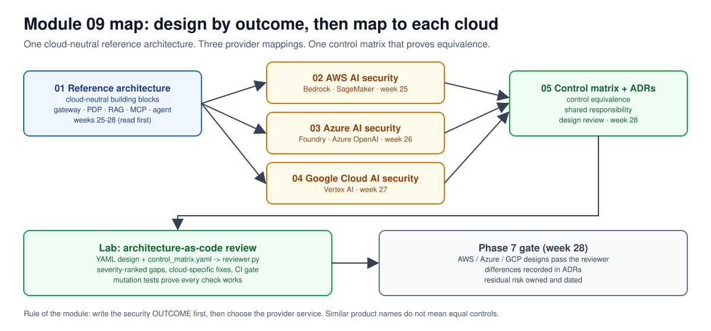
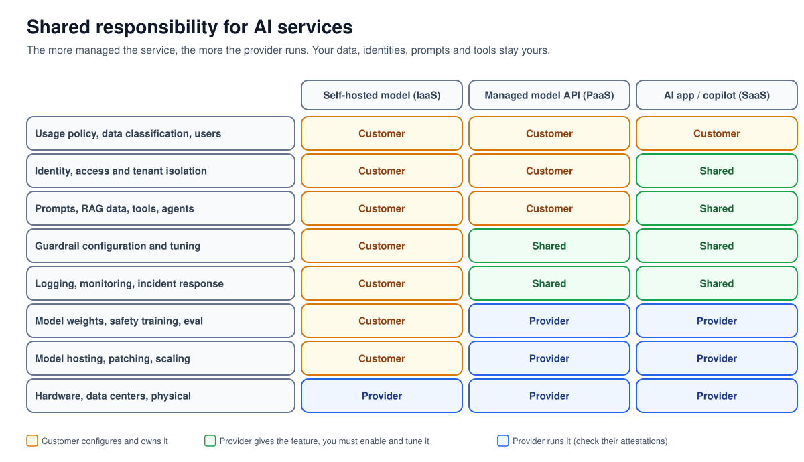

# Multi-Cloud Control Matrix, Shared Responsibility and Architecture Decisions

> **Module:** 09 · Enterprise AI Security Architecture · **Weeks:** 28 · **Time:** ~10 hours
> **You will:** prove that one security outcome is met on AWS, Azure and Google Cloud, explain who is responsible for what in managed AI services, record decisions as ADRs, and run a design review that ends in a clear gate decision.

| | |
|---|---|
| **Prerequisites** | Lessons [01](01-enterprise-ai-reference-architecture.md)–[04](04-gcp-ai-security.md) |
| **Lab** | [`lab/control_matrix.yaml`](lab/control_matrix.yaml), [`lab/reviewer.py`](lab/reviewer.py), [`lab/test_control_matrix.py`](lab/test_control_matrix.py) |
| **Maps to** | NIST AI RMF (GOVERN, MANAGE) · ISO/IEC 42001 (AI management system) · CIS Controls v8 · CSA AI Controls Matrix (check the current version) |

---

## 1. Why this matters

- **2019, Capital One on AWS:** the cloud provider's services worked as designed. The breach came from the customer's side of the shared-responsibility line: a web application bug and an over-permissioned role.
- **2024, Snowflake customer accounts:** attackers (tracked by Mandiant as UNC5537) used stolen credentials to log in to many customers' Snowflake accounts that had no MFA. Investigations reported no breach of Snowflake's own platform. Identity configuration was the customers' job.
- **2024, Moffatt v. Air Canada (British Columbia Civil Resolution Tribunal):** the airline was held responsible for wrong refund advice given by its website chatbot. You cannot hand accountability for an AI's output to the AI, or to its vendor.
- **2023, Microsoft AI research SAS token:** a customer-side token setting, not a flaw in Azure Storage, exposed 38 TB of data.

Every one of these is a **"we thought someone else handled that"** failure. A control matrix and a clear shared-responsibility map stop that thinking.

---

## 2. Understand it

### 2.1 Outcome first, product second

The most common multi-cloud mistake is to compare **product names** ("Bedrock = Azure OpenAI = Vertex AI"). Instead, write the **security outcome** first, then find how each cloud delivers it, then record what is different.



Example: outcome **NET-01 "model endpoints are reached privately; public access is off"**.

| | AWS | Azure | Google Cloud |
|---|---|---|---|
| Private path | Interface VPC endpoint (PrivateLink) | Private Endpoint (Private Link) | Private Service Connect |
| "Close the public door" | No switch on Bedrock. Deny calls without `aws:SourceVpce` (SCP / identity policy); data-perimeter patterns | `publicNetworkAccess: Disabled` on the resource | VPC Service Controls perimeter (enforced at the API) |
| Anti-exfiltration with stolen credentials | Partial: endpoint and resource policies, SCPs | Partial: network rules; network security perimeter (check status) | Strong: VPC-SC blocks use from outside the perimeter |
| Equivalence | **Partial**: needs extra policy work | **Equivalent** for the path | **Equivalent**, plus stronger exfiltration control |

So the honest statement is **"equivalent outcome, different mechanisms, with these gaps"**, never "the same".

### 2.2 Differences that matter in AI platforms

| Topic | What differs | Why you care |
|---|---|---|
| Key-based auth | Azure AI services accept keys unless `disableLocalAuth` is set. AWS has added API-key options for Bedrock (check current docs). Google has developer API keys outside Vertex AI. | Keys can be stolen and reused anywhere. Find and disable or restrict them on every cloud. |
| Content logging defaults | Bedrock invocation logging is opt-in; Google Data Access logs are off by default; Azure needs diagnostic settings | "We have logs" must be checked per cloud. |
| Provider retention | Abuse-monitoring storage, caching and stateful features differ (check current terms) | Privacy assessments and contracts differ per provider. |
| Guardrails | Bedrock Guardrails, Prompt Shields, Model Armor detect different things with different quality | Measure each with **your own** evaluation set; never assume equal detection. |
| Perimeters | VPC-SC (Google) has no exact equivalent; AWS uses data-perimeter policies; Azure is adding network security perimeter | The same attack (stolen credential from outside) has different outcomes. |
| Agent and tool services | AgentCore, Foundry Agent Service, Agent Engine: young, fast-changing products | Re-review often; keep your own broker and policies. |

### 2.3 The control matrix as code

The lab's [`control_matrix.yaml`](lab/control_matrix.yaml) has 26 controls in eight families (identity, network, data, guardrails, gateway, tools-agents, logging, operations). Each row has:

- `id`, `family`, `title`, `severity`,
- `outcome`: the cloud-neutral statement,
- `responsibility`: `customer`, `shared` or `provider`,
- `check`: the reviewer function that tests an architecture file,
- `owasp_llm` (OWASP Top 10 for LLM Applications **2026** numbering), `owasp_asi` (OWASP Top 10 for Agentic Applications 2026), `owasp_mcp` (OWASP MCP Top 10, beta) and `cis_v8` mappings. A test checks that every id is a valid id of its list,
- `clouds.aws|azure|gcp.services` and `.evidence`: how to deliver it and what proof an auditor wants.

Because it is code, it has **tests** ([`test_control_matrix.py`](lab/test_control_matrix.py)): every control must map to all three clouds, have evidence, have an automated check, and every check must belong to exactly one control. The matrix can never quietly lose a cloud or a check.

### 2.4 Shared responsibility for AI services



All three providers publish shared-responsibility models (AWS shared responsibility model, Microsoft's AI shared responsibility model, Google's "shared fate"). The pattern for AI:

- **Always yours, in every model:** your data and its classification, your users and identities, your configuration, your prompts, RAG data, tools and agents, how people use the AI, and your incident response.
- **Shared:** guardrails (provider builds the feature, you enable and tune it), logging (provider produces logs, you route, keep and watch them), network isolation features.
- **Provider's:** model training and safety tuning (for managed models), hosting infrastructure, physical security. You verify these with their attestations (SOC 2, ISO 27001, ISO/IEC 42001 where offered), not by trust.

The `responsibility` column in the matrix records this per control. In the lab matrix, most AI controls are `customer` or `shared`: **managed AI does not mean managed security.**

### 2.5 Architecture decision records (ADRs)

An ADR is a short document that records **one** significant decision. Michael Nygard's original format has Title, Status, Context, Decision and Consequences. For security architecture, add options, residual risk, owner and review date:

```markdown
# ADR-007: Enforce a VPC Service Controls perimeter around the Vertex AI project

- Status: Accepted (2026-05-04)   Owner: platform-security   Review by: 2026-11-04
- Context: Confidential runbooks and tenant data are embedded in Vector Search. A stolen
  service-account credential must not be usable from outside our network (control NET-01,
  NET-02). Ingestion runs nightly from a CI project.
- Options:
  1. IAM only (simple; does not stop stolen credentials).
  2. PSC only (private path; public API still usable with a credential).
  3. VPC-SC perimeter + PSC (strong; needs ingress rules and a dry-run period).
- Decision: Option 3. Dry-run for 3 weeks, then enforce. Ingress rule only for the
  ingestion service account and the deploy identity.
- Security consequences: exfiltration with stolen credentials blocked; Policy Denied logs
  become a detection source. New integrations need a perimeter change (reviewed).
- Residual risk: an insider with access inside the perimeter; tracked in RISK-031.
- Portability impact: no direct equivalent on AWS/Azure; see matrix NET-01 notes.
```

Write ADRs for decisions that are **hard to reverse** or **change the risk**: provider choice, isolation model per tenant, key ownership, logging of content, exceptions to controls.

### 2.6 Portability without losing controls

- An **AI gateway** gives apps one API and makes switching models easier. Good.
- But an abstraction that hides provider-specific security (for example, it cannot pass a guardrail ID or a private endpoint) **removes** controls. Bad.
- Multi-cloud **adds** attack surface: more identities, more consoles, more logs. Choose it for a reason (regulation, resilience, a model only available on one cloud), and record that reason in an ADR, together with an **exit strategy**.

### 2.7 Ten requirements that do not depend on the cloud

Whatever the provider, the design must show:

1. Central identity and short-lived credentials (human, CI/CD, runtime, ingestion, retrieval, MCP server and agent identities kept separate).
2. Private network paths where feasible, and controlled egress.
3. Encryption in transit and at rest, with a managed key lifecycle (owner, rotation, separation of duties, backup and recovery).
4. Separate environments (dev / test / prod) in separate accounts, subscriptions or projects.
5. Data classification and **residency**: which region holds which data, and no cross-region or cross-provider transfer without a data-flow review.
6. Centralized audit logs with retention and access control.
7. Model and dataset inventory with provenance ([Module 06](../06-ai-devsecops/)).
8. Per-tenant authorization and isolation.
9. Quotas, budgets and abuse monitoring.
10. Backup, recovery, incident response and an **exit strategy** from each provider.

---

## 3. Defend it

| Layer | Control | Type | What it buys you |
|---|---|---|---|
| L1 | Outcome-based control matrix with per-cloud mapping and evidence | Process | No "same name, different control" mistakes |
| L2 | Automated architecture review in CI against the matrix; fail on critical/high | **Hard** (for the pipeline) | Gaps blocked before production |
| L3 | Matrix tests: every control maps to all clouds and has a check | **Hard** (for the matrix) | The matrix cannot silently decay |
| L4 | Cloud-native preventive policy: SCPs, Azure Policy (deny), Org Policy | **Hard** | Settings cannot drift in production |
| L5 | Time-bound exceptions with owner and expiry; no exceptions for critical | Process | Accepted risk is visible and temporary |
| L6 | ADRs for significant decisions, with review dates | Process | Decisions are explainable and revisited |
| L7 | Evidence collection per control (screenshots are not enough: exports, queries, test results) | Process | Audits are fast and honest |

### The design-review checklist

Use it in every AI design review. Each line maps to a control id so findings land in the same matrix.

| Area | Question | Control |
|---|---|---|
| Identity | Do users sign in with enterprise SSO, and is the tenant taken from the token? | IAM-04 |
| Identity | Are there any static keys (cloud keys, model API keys, SA keys)? | IAM-01 |
| Identity | Does each component have its own least-privilege identity? | IAM-02, IAM-03 |
| Identity | Does every non-human identity (agent, MCP server, pipeline) have a named owner? | IAM-05 |
| Identity | Do agents and tool gateways use their own identity or token exchange, never the user's token? | IAM-06 |
| Network | Can anything reach the model, index, agent or tools without the gateway? | NET-04 |
| Network | Are model endpoints and data stores private, with the public door closed? | NET-01, NET-02 |
| Network | Can agents and tools reach only allowlisted destinations? | NET-03 |
| Data | Is retrieval filtered server-side by tenant and groups before ranking? | DATA-03 |
| Data | Are confidential stores on customer-managed keys with rotation? | DATA-01, DATA-02 |
| Data | Have we recorded the provider's retention, caching and training terms? | DATA-04 |
| Guardrails | Are input and output screened, and are the results logged? | GR-01, GR-02 |
| Gateway | Does the gateway route only to approved models per data class, also during failover? | GW-01 |
| Gateway | Are response and semantic caches keyed by tenant? | GW-02 |
| Tools/agents | Is there one tool gateway with a registry, schemas and tenant checks? | TOOL-01 |
| Tools/agents | Do writes need a human who sees the exact action? | AGT-01 |
| Tools/agents | Are there step and cost limits and a tested kill switch? | AGT-02 |
| Logging | Do control-plane and model logs reach the SIEM? | LOG-01 |
| Logging | Are logs redacted, immutable and kept at least a year? | LOG-02 |
| Operations | Are there per-user/tenant quotas and budget alerts? | OPS-01 |
| Operations | Are remaining secrets in a secrets manager and rotated? | SEC-01 |
| Operations | Does the red-team suite run on every change and on a schedule, and is drift detected? | OPS-02 |
| Governance | Is the use case in the AI inventory, with a risk owner? | Module 07 |
| Governance | Are exceptions dated, owned and below critical? | reviewer exceptions |
| Decisions | Is there an ADR for the provider choice, isolation model and logging of content? | ADRs |

#### The architect's questions (add them to every AI design review)

The checklist above is about **controls**. These twelve questions are about **design reasoning**. They are adapted, in our own words, from the architect review checklist in the *AI Security Architecture Study Guide* (see "Further reading" in the module README). A reviewer should be able to answer each one from the design pack, not from memory.

| # | Question | Good answer looks like | Links to |
|---|---|---|---|
| 1 | Trifecta: does any single agent session have private data, untrusted input **and** an outbound channel? | One leg is removed, or a human gate sits on the outbound action | NET-03, AGT-01 |
| 2 | Where is every authorization decision made? | In code (PDP / broker), with the **end user's** identity, never by the model | DATA-03, TOOL-01 |
| 3 | Can you list every source that enters the context and its trust level? | A context trust map: system, user, internal-verified, external-untrusted | GR-01 |
| 4 | For each tool: narrowest scope, who approves it, is its definition pinned? | Registry entry with owner, scope, side-effect class, hash of the description | TOOL-01 ([Module 04](../04-mcp-security/)) |
| 5 | Does each agent have its own identity, and do downstream systems see the delegated user? | Agent identity + token exchange; audience-bound tokens | IAM-03, IAM-06 |
| 6 | Blast radius: if this agent is fully compromised, what is the worst outcome? | A short, written answer, and a design change that makes it smaller | AGT-01, AGT-02 |
| 7 | Do approvers see the real action (not the model's summary), and is approval fatigue managed? | Exact tool, arguments and untrusted sources shown; two people for high risk | AGT-01 |
| 8 | Is generated code or tool execution sandboxed, with no ambient secrets and restricted egress? | Sandbox per run, no network by default | NET-03 ([Module 05](../05-agent-security/)) |
| 9 | Are memory and RAG writes validated, scoped per tenant and user, and reversible? | Provenance, TTL, rollback; deletion propagates to embeddings | DATA-03 ([Module 03](../03-rag-security/)) |
| 10 | Can you trace any action end to end and stop an agent in under a minute? | Correlation IDs across components; a tested kill switch with a drill record | LOG-01, AGT-02 |
| 11 | Are models, prompts, MCP servers and dependencies inventoried, pinned and verified? | AI-BOM; approved-model routing; signed artifacts | GW-01 ([Module 06](../06-ai-devsecops/)) |
| 12 | Do automated red-team and regression evaluations gate every model, prompt or tool change? | The suite runs in CI on those changes and on a schedule | OPS-02 |

**Gate decision:** *pass* (no open critical/high), *pass with conditions* (open mediums with dated tickets), or *fail*. Write it down with the reviewer's name and date.

### What does NOT work on its own

- A matrix that lists product names without outcomes or evidence.
- A provider's compliance report as proof that **your** configuration meets a control.
- A one-time review without continuous enforcement (policy) and re-review on change.
- ADRs written after the fact to justify a decision nobody questioned.

---

## 4. Hands-on lab

### Step 1: Export the matrix for people who use spreadsheets

```powershell
python 09-enterprise-architecture/lab/reviewer.py --csv
```

Expected output (first lines):

```text
id,family,severity,responsibility,title,aws,azure,gcp
IAM-01,identity,high,customer,"Workloads use short-lived credentials, never static keys",IAM roles with STS temporary credentials; EKS Pod Identity or IRSA; IAM OIDC federation for CI,Managed identities; Entra workload identity federation; disableLocalAuth on Azure AI services,Attached service accounts; Workload Identity Federation (also for GKE); org policy iam.disableServiceAccountKeyCreation
IAM-02,identity,high,customer,"Runtime identities have least privilege (no wildcards, no admin)",Scoped IAM policies (e.g. bedrock:InvokeModel on named model ARNs); IAM Access Analyzer; SCPs,Azure RBAC with narrow built-in roles (e.g. Cognitive Services OpenAI User); PIM for humans,Narrow IAM roles (e.g. roles/aiplatform.user) at resource level; IAM recommender; deny policies
IAM-03,identity,medium,customer,One identity per component (no shared service identity),One IAM role per service or pod (EKS Pod Identity); separate roles per agent,One user-assigned managed identity per component; Entra Agent ID for agents (check current status),One service account per workload; Workload Identity Federation for GKE per namespace or KSA
```

Redirect it to a file (`> matrix.csv`) and open it in a spreadsheet. The YAML stays the source of truth.

### Step 2: Run all the module's tests

```powershell
python -m pytest 09-enterprise-architecture
```

Expected last line: `271 passed` (the time differs per machine; the count includes the gateway and posture labs from lessons 06 and 08). Read [`test_control_matrix.py`](lab/test_control_matrix.py) and [`test_reviewer.py`](lab/test_reviewer.py). Which test would fail if someone deleted the `gcp` mapping of `LOG-01`? Which would fail if someone wrote a new check but forgot to link it to a control?

### Step 3: Break the matrix (predict first)

1. In `control_matrix.yaml`, delete the `azure:` block of `GR-02`. Run the tests. Which tests fail?
2. Change `check: key_rotation` of `DATA-02` to `check: key_rotations`. Which test fails, with what message?
3. Add a typo field `sevrity: low` to any control. What happens, and why is "fail closed" the right behavior for a matrix too?

Undo your changes afterwards (or use a copy).

### Step 4: Write two ADRs

Pick two decisions from your AWS, Azure and GCP designs (weeks 25–27), for example "index per tenant vs shared index with filters" and "log prompt content or metadata only". Use the ADR format above. Each must name the options, the security consequences, the residual risk, an owner and a review date.

### Step 5: Run a design review

Use the checklist on one of your three designs (or on `vulnerable_aws.yaml` as a practice target). Record a gate decision: pass, pass with conditions, or fail.

### Stretch goals

- Add an `equivalence: full | partial | gap` field per cloud to the matrix (and to the tests). Fill it honestly for NET-01 using section 2.1.
- Add a fourth column, `onprem`, for a self-hosted Kubernetes deployment. Which tests must change? What does that teach you about designing the schema?
- Import the CSV into the risk register template in [`00-program/templates/risk-register.csv`](../00-program/templates/risk-register.csv) (in your own copy) and link each open finding to a risk.

---

## 5. Real-world scenarios

**Scenario A: "it's the same on every cloud".**
A company moves its RAG assistant from Google Cloud to Azure. On Google Cloud, a VPC-SC perimeter blocked use of data from outside. The Azure design copies the private endpoints but nobody closes public network access.
- *What went wrong:* product mapping instead of outcome mapping; the anti-exfiltration outcome was lost in migration.
- *Investigate:* compare the matrix rows before and after the move; test from outside with a valid token.
- *Fix:* `publicNetworkAccess: Disabled`, Azure Policy deny, record the remaining gap (no perimeter equivalent) in an ADR with compensating controls.

**Scenario B: the auditor's question.**
An auditor asks: "Show me that only approved models can be called in production on all three clouds." The team has a slide, not evidence.
- *What went wrong:* the matrix had no evidence column; nothing was automated.
- *Investigate:* for each cloud, what policy enforces it (IAM resource ARNs, Azure deployments + RBAC, Org Policy / IAM) and how to export it.
- *Fix:* add evidence per control; automate exports; link them to the matrix row.

**Scenario C: the forgotten exception.**
A "temporary" exception to allow agent internet egress was granted for a vendor pilot. The pilot ended; the egress stayed for a year.
- *What went wrong:* no expiry date, no owner, no re-review.
- *Fix:* exceptions in the architecture file with expiry (the reviewer ignores expired ones); calendar review; alert 30 days before expiry.

---

## 6. Common mistakes

- Listing services, not outcomes, in the matrix.
- Marking a control as "provider" responsibility because the provider *offers* the feature. If you have to enable it, it is at least *shared*.
- Writing ADRs without options or consequences ("we chose X").
- Treating multi-cloud as resilience without testing failover and without the extra identity and logging work.
- Letting the matrix and the real deployment drift apart. Generate the architecture file from IaC where possible.
- Copying the same secrets into every cloud without one owner for their lifecycle (creation, rotation, revocation).
- Sending prompts or documents across regions or providers (for example to a model only available elsewhere) without a data-flow and residency review.
- Using long-lived static keys in CI/CD on any cloud when federation (OIDC) is available.

---

## 7. Interview preparation

<details><summary><b>Q1. How do you compare security controls across AWS, Azure and Google Cloud?</b></summary>

Start from outcomes, not products. For each outcome I list the mechanism on each cloud, the evidence that proves it, and the differences (equivalent, partial, gap). Example: private model access is PrivateLink plus a `aws:SourceVpce` deny on AWS, Private Endpoint plus `publicNetworkAccess: Disabled` on Azure, and PSC plus a VPC-SC perimeter on Google Cloud, where VPC-SC also adds stronger anti-exfiltration.
</details>

<details><summary><b>Q2. Explain shared responsibility for a managed model API.</b></summary>

The provider secures and runs the model, the hosting infrastructure and the service itself, and offers security features. I own identity and access, network configuration, which data I send, my prompts, RAG data, tools and agents, guardrail configuration, logging and monitoring of my use, and incident response for my application. Guardrails and logging are shared: the provider builds them, I must enable, tune and watch them.
</details>

<details><summary><b>Q3. What is an ADR, and what makes a good security ADR?</b></summary>

A short record of one significant decision: context, options, decision, consequences. A good security ADR names the threat or control it serves, compares real options, states the security consequences and the residual risk, has an owner and a review date, and is written before or at the time of the decision.
</details>

<details><summary><b>Q4. Why put the control matrix in code with tests?</b></summary>

So it is reviewable in pull requests, can drive automation (the reviewer, CSV exports, GRC imports), and cannot decay silently. Tests enforce that each control maps to every cloud with evidence and an automated check. It turns a document into a living part of the platform.
</details>

<details><summary><b>Q5. When is multi-cloud a good idea for AI, and what does it cost in security?</b></summary>

Good reasons: regulatory or data-residency needs, a model only available on one cloud, negotiating leverage, or tested resilience. Costs: more identity systems, more networks, more logs, more policies, more people who need expertise, and more places for drift. I'd require an ADR with the reason and an exit plan, and a matrix that proves equivalent outcomes.
</details>

<details><summary><b>Q6. How do you avoid a portability layer that weakens security?</b></summary>

Make sure the gateway or SDK passes through provider security features: guardrail IDs, private endpoints, managed identities, region pinning, logging context. Test that disabling a provider control is visible. Accept some provider-specific code where it carries security value. Portability is a goal, not a reason to remove controls.
</details>

<details><summary><b>Q7. What evidence would you give an auditor for "only approved models are used"?</b></summary>

Policy exports (IAM policies with model ARNs, Azure deployments and RBAC assignments, Google IAM and org policies), gateway routing config listing approved models, logs showing calls only to those models over a period, and the change history (pull requests) for adding a model with approvals. Plus the AI inventory entry for each model.
</details>

<details><summary><b>Q8. How should risk exceptions work for AI platform controls?</b></summary>

Exceptions are written next to the architecture, with control id, reason, approver, compensating controls and an expiry date. The reviewer honors them only while valid. Critical controls (tenant isolation, gateway bypass, user authentication) cannot be excepted. Expiring exceptions trigger re-review. All exceptions show up in the risk register.
</details>

<details><summary><b>Q9. Scenario: two clouds, two guardrail products. The business asks which is "better". How do you answer?</b></summary>

With data: build an evaluation set from our own traffic patterns (benign and attack, including indirect injections in documents), run both, measure detection and false-positive rates and latency, and look at operational features (logging, tuning). Then say that neither is a security boundary; the hard controls behind them matter more.
</details>

<details><summary><b>Q10. What goes into a design-review gate decision?</b></summary>

The list of findings with severity, the status of each (fixed, open with ticket, accepted with expiry), the decision (pass, pass with conditions, fail), the reviewer and date, and links to ADRs and evidence. Critical or high open findings mean fail unless a policy-allowed, time-bound exception exists.
</details>

<details><summary><b>Q11. How do you keep the architecture file honest (matching reality)?</b></summary>

Generate as much as possible from IaC or cloud APIs (for example from `terraform show -json` or resource inventories), compare declared and observed state regularly, and fail CI when they differ. Hand-written fields (like data classification) get an owner and review.
</details>

<details><summary><b>Q12. Explain to an executive why "we use a big cloud provider, so we are compliant" is wrong.</b></summary>

"The provider proves that *their* part is secure, like their data centers and the AI service itself. We are responsible for how we set it up and use it: who has access, what data we put in, what the AI is allowed to do. Several large breaches happened on secure cloud platforms because the customer's part was set up wrong."
</details>

---

## 8. Checklist (definition of done: Phase 7 gate)

- [ ] `python -m pytest 09-enterprise-architecture` passes, and I can explain the matrix tests.
- [ ] My AWS, Azure and GCP designs pass the reviewer (or have only dated, non-critical exceptions).
- [ ] I can explain three provider differences that change the security outcome.
- [ ] I wrote at least two ADRs with options, consequences, residual risk, owner and review date.
- [ ] I ran a design review with the checklist **and** the twelve architect's questions, and recorded a gate decision.
- [ ] Week 28 journal entry and the Phase 7 gate in [`00-program/assessment-rubric.md`](../00-program/assessment-rubric.md).

## 9. References

- AWS shared responsibility model, https://aws.amazon.com/compliance/shared-responsibility-model/
- Microsoft AI shared responsibility model, https://learn.microsoft.com/azure/security/fundamentals/shared-responsibility-ai
- Google Cloud shared responsibility and shared fate, https://cloud.google.com/architecture/framework/security/shared-responsibility-shared-fate
- AWS Generative AI Security Scoping Matrix, https://aws.amazon.com/ai/generative-ai/security/scoping-matrix/
- Cloud Security Alliance, AI Controls Matrix (check the current version), https://cloudsecurityalliance.org/
- Michael Nygard, *Documenting Architecture Decisions* (2011), https://cognitect.com/blog/2011/11/15/documenting-architecture-decisions
- ADR community templates and tools, https://adr.github.io/
- NIST AI Risk Management Framework, https://www.nist.gov/itl/ai-risk-management-framework
- ISO/IEC 42001:2023 AI management systems, https://www.iso.org/standard/81230.html
- Moffatt v. Air Canada, 2024 BCCRT 149 (decision of the BC Civil Resolution Tribunal)
