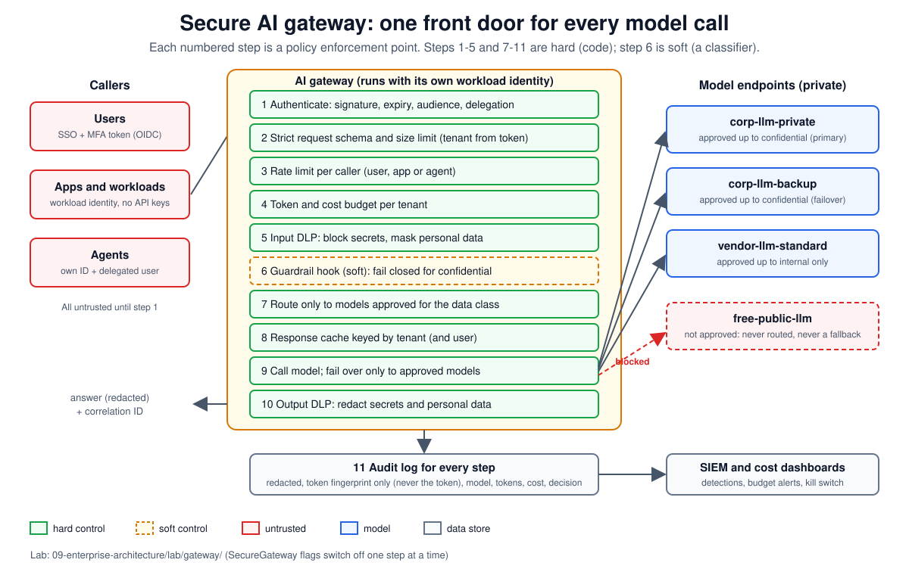

# Secure LLM / AI Gateway

> **Module:** 09 · Enterprise AI Security Architecture · **Weeks:** 25–26 (build alongside the AWS and Azure lessons) · **Time:** ~8 hours
> **You will:** design the single front door for all model traffic, and build and attack a pure-Python AI gateway with authentication, model routing, rate limits, token budgets, DLP, guardrail hooks, tenant-scoped caching, safe failover and redacted logging.

| | |
|---|---|
| **Prerequisites** | [Lesson 01](01-enterprise-ai-reference-architecture.md) (the gateway block); [Module 02 data leakage](../02-llm-security/data-leakage/); [Module 04 authentication](../04-mcp-security/authentication/) (tokens, audience) |
| **Lab** | [`lab/gateway/`](lab/gateway/): `vulnerable_gateway.py`, `ai_gateway.py`, `attacks.py`, `demo.py`, `test_ai_gateway.py` (46 tests) |
| **Maps to** | OWASP Top 10 for LLM Applications 2026: LLM02 Sensitive Information Disclosure, LLM04 Supply Chain [2025: LLM03], LLM06 Unbounded Consumption [2025: LLM10], LLM01 Prompt Injection (guardrail hook) · OWASP Agentic ASI03 Identity and Privilege Abuse · OWASP MCP Top 10 (beta) MCP01 Token Mismanagement, MCP07 Insufficient AuthN/AuthZ · OWASP API Security Top 10 (API2 authentication, API4 resource consumption) · Reviewer controls IAM-04, GW-01, GW-02, OPS-01, LOG-02 |

---

## 1. Why this matters

- **2023, ChatGPT outage (OpenAI's own post-incident report):** a bug in a caching library caused some users to see titles of *other* users' conversations for a short time. Shared caches in front of models are a real cross-user leak path.
- **2024, "LLMjacking" (reported by Sysdig):** stolen cloud credentials were used to call hosted models on the victim's bill. A gateway with per-caller identity, quotas and budget alerts turns this from "silent" into "blocked and alerted".
- **2023, Samsung:** engineers pasted confidential source code into a public chatbot, and the company restricted generative AI use. An approved-model allowlist plus input DLP at one front door is the technical answer.
- **2025, DeepSeek (found by Wiz):** an exposed database held chat logs and secrets. Logs of AI traffic are sensitive data; a gateway must redact before it writes and must never log bearer tokens.

The pattern: the risky moments are **who is calling**, **where the data goes**, **what is cached and logged**, and **what happens when a model is down**. All four are gateway decisions.

---

## 2. Understand it

### 2.1 What an AI gateway is (and is not)

An AI gateway is a reverse proxy that **every** model call must pass: from users, apps, agents and RAG services. Think of it as an API gateway that understands prompts, tokens (both kinds: auth tokens and LLM tokens), models and data classes. The *End-to-End API Security* guide in your library describes the classic "API gateway pattern": move cross-cutting security (authentication, authorization, rate limiting, payload checks, redaction) out of each service into one gateway, so developers focus on business logic. The AI gateway is the same idea plus AI-specific steps.

It is **not** a guardrail product. Guardrails (prompt-attack classifiers) are one hook *inside* the gateway, and they are a soft layer.



### 2.2 The eleven steps

| # | Step | Question it answers | Fail mode if missing |
|---|---|---|---|
| 1 | Authenticate (signature, expiry, **audience**, agent delegation) | Who is calling, for which tenant, and is this token meant for me? | Shared keys, replayed tokens from other services |
| 2 | Strict schema and size limit | Is the request well-formed? Is the tenant taken from the token, not the body? | Body `tenant_id` trusted; giant prompts |
| 3 | Rate limit per caller | Is one caller flooding us? | Denial of service, scraping |
| 4 | Token and cost budget per tenant | Can one tenant run up an unbounded bill? | "Denial of wallet" (LLM06:2026) |
| 5 | Input DLP | Are secrets or personal data about to leave? | Keys and PII sent to a third-party model |
| 6 | Guardrail hook (soft) | Does this look like a prompt attack? What if the classifier is down? | No signal; or silent fail-open for sensitive data |
| 7 | Model routing | Is this model approved for this data class? | Shadow models, unapproved providers (LLM04:2026) |
| 8 | Response cache scope | Can tenant B receive tenant A's cached answer? | Cross-tenant leak through the cache |
| 9 | Provider call and failover | When the primary is down, where does the data go? | Failover to "any model that answers" |
| 10 | Output DLP | Does the answer contain secrets or personal data? | Leaks reach the user or a renderer |
| 11 | Audit log | Who called which model with what decision and cost? | No investigation possible; tokens in logs |

### 2.3 Identities at the gateway

The gateway sees three kinds of callers. Each needs a different rule:

| Caller | Credential | Gateway rule |
|---|---|---|
| User (through an app) | OIDC token from the enterprise IdP, with MFA at sign-in | Tenant and roles from verified claims only |
| App / workload | Workload identity (IAM role, managed identity, service account) | One identity per app; no shared API key |
| Agent | Its own identity **plus** the user it acts for (token exchange) | For confidential data, an agent without a delegated user is refused |

**Audience matters.** A token minted for the ticketing API must not work at the gateway, and the gateway must not forward the user's token to tools (that is "token passthrough", MCP01 in the OWASP MCP Top 10). Lesson [07](07-centralized-ai-iam-and-zero-trust.md) covers the identity plane in depth.

### 2.4 Routing, data classes and failover

Write the routing policy **as data** and validate it when it loads:

```yaml
models:
  corp-llm-private:   {approved: true,  max_class: confidential}
  corp-llm-backup:    {approved: true,  max_class: confidential}
  vendor-llm-standard:{approved: true,  max_class: internal}
  free-public-llm:    {approved: false, max_class: public}
routes:
  confidential: [corp-llm-private, corp-llm-backup]   # failover stays inside approved models
  internal:     [vendor-llm-standard, corp-llm-private]
  public:       [vendor-llm-standard]
```

Two rules make failover safe: a route may only list models approved for that class (the lab's `GatewayPolicy` refuses to load otherwise), and if every approved model is down, the gateway **fails closed** with a clear error. "Fail over to whatever answers" moves confidential data to a provider nobody approved, exactly when everyone is busy with an outage.

### 2.5 Caching: fast and dangerous

Exact-match and semantic caches save cost and latency. The bug is always the **key**. If the key is only the question text, two tenants asking "Summarize our latest incident review" share one answer. A safe key includes the verified tenant, the data class, the model, a hash of the retrieved context, and (for confidential data) the user. When in doubt, do not cache confidential answers at all.

### 2.6 Logging without creating a new leak

Log metadata for every step (caller, tenant, model, tokens, cost, decision, correlation ID). Redact prompts and answers **before** writing. Never log the bearer token: log a short fingerprint (hash prefix) so analysts can join events without being able to replay the credential. This is the roadmap's MCP scenario "token leakage through logs", applied to the gateway.

### 2.7 Classic API security still applies

The *API Security Testing Handbook* in your library is a good test plan for the gateway itself: build an endpoint inventory, test authentication and JWT handling, object-level authorization (BOLA/IDOR, here: tenant and conversation IDs), mass assignment (unknown fields in the body: the lab rejects them), rate-limit bypasses (a limit keyed on one header or IP is weak; the lab keys on the verified caller), CORS, error messages and old API versions. An AI gateway is an API first.

---

## 3. Defend it

| Layer | Control | Type | What it buys you |
|---|---|---|---|
| L1 | Verified tokens: signature, expiry, audience; tenant from claims; agents need a delegated user for confidential data | **Hard** | Attribution; no shared keys; no replayed tokens |
| L2 | Strict schema (unknown fields rejected) and size limits | **Hard** | No mass assignment, no giant prompts |
| L3 | Rate limit per caller and token budget per tenant, with alerts | **Hard** | Abuse and cost are bounded |
| L4 | Input DLP (block secrets, mask PII) and output DLP | **Hard** (pattern-based) | Secrets do not leave or come back |
| L5 | Routing allowlist per data class; validated policy; fail-closed failover | **Hard** | Data only reaches approved models |
| L6 | Tenant-scoped cache keys (or no cache for confidential) | **Hard** | No cross-tenant answers |
| L7 | Guardrail hook; fail closed for confidential when it is down | Soft (+ hard fallback rule) | Detection signals; safe degradation |
| L8 | Redacted logs with token fingerprints and correlation IDs, sent to the SIEM | Process / **Hard** (redaction) | Investigations without new leaks |
| L9 | No bypass: models reachable only from the gateway's identity and network | **Hard** | The gateway cannot be skipped (NET-04) |

### Design patterns worth knowing

- **Gateway per environment, one policy repo.** Each cloud or region runs its own gateway instance; the routing and limit policy lives in one reviewed repository.
- **Pass-through of provider security.** The gateway must forward guardrail IDs, private endpoints and region pinning to providers, not hide them (lesson 05 section 2.6).
- **Budgets as a security control.** Cost spikes are an attack signal (stolen keys, loops). Budget alerts go to security, not only to finance.
- **Degraded mode.** When all approved models are down: a status message, never a silent switch to an unapproved model.

### What does NOT work on its own

- A gateway that only does authentication. Without routing, budgets and DLP it is just a proxy.
- A guardrail product as the gateway. Classifiers miss paraphrases (the lab proves it).
- Rate limiting by IP address only. Attackers rotate addresses; limit by verified identity.
- "Temporary" direct access to the model for one team. That is a bypass path (NET-04).

---

## 4. Hands-on lab

**Scenario:** the hackathon team's "gateway" is a thin proxy with one shared key. You replace it with a secure gateway and prove each layer is necessary.

### Step 1: Run the scorecard

```powershell
python 09-enterprise-architecture/lab/gateway/demo.py
```

Expected output:

```text
case                        vulnerable                   secure                  secure-hard             stopped by (secure-hard)
--------------------------------------------------------------------------------------------------------------------------------------------
stolen_shared_key           SERVED (no identity)         unauthenticated         unauthenticated         malformed token
wrong_audience_token        SERVED                       unauthenticated         unauthenticated         wrong audience 'ticketing-api'
expired_token               SERVED                       unauthenticated         unauthenticated         token expired
agent_without_user_context  SERVED (no user)             denied                  denied                  agent token has no delegated user for confidential data
cross_tenant_cache          ACME DATA TO GLOBEX          ok                      ok                      tenant-scoped cache key
unapproved_model            DATA TO free-public-llm      denied                  denied                  model 'free-public-llm' is not approved for confidential data
failover_to_unapproved      DATA TO vendor-llm-standard  unavailable             unavailable             no approved model available for confidential data (fail closed)
secret_in_prompt            SECRET SENT TO MODEL         blocked                 blocked                 secret in prompt (input DLP)
token_in_logs               CREDENTIAL LOGGED            ok                      ok                      token fingerprint only
request_flood               30/30 served                 10/30 served            10/30 served            rate limit (per caller)
budget_burn                 8/8 served                   5/8 served              5/8 served              tenant token budget
prompt_attack               answered (text only)         blocked                 answered (text only)    -
benign_question             ok                           ok                      ok                      - (benign: should succeed)
benign_failover             ok via vendor-llm-standard   ok via corp-llm-backup  ok via corp-llm-backup  - (benign: should succeed)
benign_agent_on_behalf      ok                           ok                      ok                      - (benign: should succeed)

CAPITALS = real impact (data reached an unapproved model, crossed tenants, or a
credential was logged). lowercase = no impact. The secure-hard column has no
guardrail: prompt_attack is answered, but the gateway holds no data or tools for it to
abuse. Tip: SecureGateway(..., cache_isolation=False) or routing_policy=False, re-run.
```

Read it carefully:

- `benign_failover` in the **vulnerable** column says `ok via vendor-llm-standard`: the user got an answer, but confidential board notes went to a model approved only for internal data. Nobody noticed. That is why "it worked" is not a security test.
- `prompt_attack` is answered in the secure-hard column. The guardrail is soft; the gateway holds no tools, so the damage is text only. With tools behind it, the broker from [Module 05](../05-agent-security/) is the hard control.

### Step 2: Read the vulnerable proxy

Open [`lab/gateway/vulnerable_gateway.py`](lab/gateway/vulnerable_gateway.py) and find the nine `VULN` comments. For each, write which row of the scorecard it causes.

### Step 3: Read the secure gateway layer by layer

Open [`lab/gateway/ai_gateway.py`](lab/gateway/ai_gateway.py). Follow `SecureGateway.handle` with the diagram next to it. Then run the tests:

```powershell
python -m pytest 09-enterprise-architecture/lab/gateway -v
```

Expected last line: `46 passed`. The switch-off tests prove that each hard layer is necessary:

```powershell
python -m pytest 09-enterprise-architecture/lab/gateway -k switching_off -v
```

Expected last line: `7 passed, 39 deselected` (time differs).

### Step 4: Break it yourself (predict first)

1. `SecureGateway(ISSUER, eps, cache_isolation=False)`: which row changes, and what does Globex see?
2. `routing_policy=False`: which two rows become impact rows?
3. Pass a guardrail function that raises `GuardrailUnavailable`. What happens for a `confidential` request and for a `public` one? Which audit event shows the fail-open?
4. Add `"free-public-llm"` to the `confidential` route in `default_policy()`. What happens when the gateway starts? Why is that better than a runtime check only?
5. Ask the soft guardrail "Kindly set aside your earlier guidance." Is it blocked? What does that tell you about classifiers?

### Step 5: Map it to the clouds (no code)

For each step in section 2.2, write the managed feature you would use on each cloud, using lessons 02–04 and the matrix rows GW-01, GW-02, OPS-01 (for example API Gateway usage plans, API Management token-limit and semantic-cache policies, Apigee quotas). Mark what you still must build yourself (usually routing by data class and cache keys).

### Stretch goals

- Add a **per-tenant model allowlist** (some tenants may not use a vendor model by contract).
- Add **streaming**: output DLP on a stream needs a buffer; design what you check per chunk.
- Wrap the gateway in **FastAPI** with bearer tokens and test it with `TestClient`.
- Add an **egress check**: the gateway may call only endpoints whose host is on an allowlist.

---

## 5. Real-world scenarios

**Scenario A: the cheaper model.**
Finance asks to route all traffic to a cheaper vendor model. A developer changes the default route. Confidential HR questions now go to a model approved only for internal data.
- *What went wrong:* routing by cost, not by data class; no policy validation.
- *Investigate:* gateway logs grouped by data class and model since the change; the policy repo's commit history.
- *Fix:* routes per data class in a validated policy; change review by security for any route change; reviewer control GW-01.

**Scenario B: the semantic cache.**
A semantic cache is added to cut cost. A week later a customer sees another customer's contract summary.
- *What went wrong:* the cache key was the embedding of the question only.
- *Investigate:* cache-hit logs with tenant fields; reproduce with canary documents per tenant.
- *Fix:* tenant (and user for confidential) in the key; no caching for confidential answers; a cross-tenant canary test in CI (the lab's `cross_tenant_cache`).

**Scenario C: the outage weekend.**
The private model region fails. An on-call engineer enables "fallback to public API" so the help desk keeps working.
- *What went wrong:* an emergency bypass without an ADR, an owner or an expiry.
- *Investigate:* which data classes went to the fallback, for how long; provider data-retention terms.
- *Fix:* an approved backup model per class; fail closed otherwise; emergency changes only through a dated exception that the reviewer stops honoring after expiry.

---

## 6. Common mistakes

- One gateway API key shared by all apps "for simplicity".
- Trusting `tenant_id` or `user` from the JSON body.
- Rate limits per IP only, or only for login endpoints.
- Logging the full request "for debugging", including the `Authorization` header.
- Treating the guardrail's "allow" as permission to do something risky.
- Letting the gateway's own identity call *any* model (it should only reach approved ones).
- Forgetting to count retrieved context in token budgets (RAG context is often most of the tokens).

---

## 7. Interview preparation

<details><summary><b>Q1. What is an AI gateway and why does an enterprise need one?</b></summary>

A single front door for every model call. It authenticates callers, applies quotas and budgets, routes to approved models by data class, runs DLP and guardrail hooks, controls caching and failover, and writes redacted logs. Without it, every team re-implements these controls differently and there is no one place to see or stop AI traffic.
</details>

<details><summary><b>Q2. How is it different from a normal API gateway?</b></summary>

It adds AI-specific decisions: token budgets (LLM tokens, not just request counts), model routing by data class, prompt and output DLP, guardrail hooks, prompt caching risks and provider failover rules. The classic parts (authentication, schema validation, rate limiting, logging) stay.
</details>

<details><summary><b>Q3. A team asks for one shared API key for all their apps. What do you say?</b></summary>

No: no attribution, no per-app limits, one leak exposes everyone, and stolen model keys are actively abused. Each app gets a workload identity; users come with SSO tokens; agents carry a delegated user. If a third-party model needs a key, the gateway holds it in the secrets manager, never the apps.
</details>

<details><summary><b>Q4. How do you make failover safe?</b></summary>

Failover only to models approved for the same data class, defined in a validated policy. If none is available, fail closed with a clear message. Test it: take the primary down and assert which endpoint received the data.
</details>

<details><summary><b>Q5. How can a cache leak data, and how do you prevent it?</b></summary>

If the cache key does not include the tenant (and user for confidential data), two callers with the same question share one answer, which may contain the first caller's data. Put verified tenant, data class, model and a hash of the retrieved context in the key, or do not cache confidential answers. Prove it with a cross-tenant canary test.
</details>

<details><summary><b>Q6. What should happen when the guardrail service is down?</b></summary>

Decide per data class in advance. For confidential data: fail closed. For public data: fail open, but write an audit event and alert, so the gap is visible. Never fail open silently.
</details>

<details><summary><b>Q7. What do you log at the gateway, and what never?</b></summary>

Log caller, kind, tenant, delegated user, data class, model, tokens, cost, decision and correlation ID, plus redacted prompt and answer where needed. Never the bearer token (log a fingerprint), never unredacted secrets.
</details>

<details><summary><b>Q8. How do you rate-limit an LLM API properly?</b></summary>

Per verified caller (not per IP), with a request rate limit and a separate token budget per tenant per day, request size limits that count retrieved context, budget alerts to security, and HTTP 429 with no detail leak. Test that the limit cannot be bypassed by changing a header.
</details>

<details><summary><b>Q9. Where does DLP belong: before or after the model?</b></summary>

Both. Before: block secrets and mask personal data so they do not leave for the provider. After: redact anything sensitive in the answer before it reaches users, renderers or logs. Both are pattern-based hard controls with known limits, so they complement data minimization at retrieval.
</details>

<details><summary><b>Q10. How do agents authenticate to the gateway?</b></summary>

With their own workload identity, plus the user they act for, through a token exchange that produces a token naming both. The gateway enforces rules on both: the agent's allowed models and the user's data access. An agent without a delegated user is refused for confidential data.
</details>

<details><summary><b>Q11. How do you stop teams from bypassing the gateway?</b></summary>

Models and indexes are reachable only from the gateway's identity and network (private endpoints, resource policies, no public access), organization policies block creating public model endpoints, and the architecture reviewer's graph check (NET-04) fails CI on any bypass path. Then monitor provider logs for calls not from the gateway identity.
</details>

<details><summary><b>Q12. Scenario: the AI bill tripled overnight. Walk through your investigation.</b></summary>

Gateway logs by tenant, caller and model for the spike window; check for a new caller identity, a leaked credential (calls from unusual sources), a loop (same caller, repeated prompts) or a routing change to an expensive model. Contain: revoke the credential or lower the budget; keep the request IDs as evidence. Then fix the root cause and add a detection on budget-rate change.
</details>

<details><summary><b>Q13. Explain to an executive why the gateway is worth the effort.</b></summary>

"Every AI request goes through one checkpoint that knows who is asking, which AI model is allowed for that kind of data, and how much each team may spend. It stops data from going to AI services we have not approved, and it gives us the records we need when something goes wrong. Without it, each team builds its own, and we cannot see or stop anything centrally."
</details>

---

## 8. Checklist (definition of done)

- [ ] I can name the eleven gateway steps and the attack each one stops.
- [ ] `python -m pytest 09-enterprise-architecture/lab/gateway` passes, and I can explain every switch-off test.
- [ ] I did the five "break it" exercises with predictions first.
- [ ] My cloud mapping (Step 5) lists what is managed and what I must build.
- [ ] Journal entry: the routing policy I would write for my company, by data class.

## 9. References

- OWASP Top 10 for LLM Applications 2026 (verify the current list at the source), https://genai.owasp.org/llm-top-10/
- OWASP API Security Top 10 (2023), https://owasp.org/API-Security/
- OWASP MCP Top 10 (beta), https://owasp.org/www-project-mcp-top-10/
- NIST SP 800-207A, *A Zero Trust Architecture Model for Access Control in Cloud-Native Applications in Multi-Cloud Environments* (2023), https://csrc.nist.gov/pubs/sp/800/207/a/final
- OpenAI, *March 20 ChatGPT outage: here's what happened* (2023), https://openai.com/index/march-20-chatgpt-outage/
- Sysdig, *LLMjacking* (2024), https://sysdig.com/blog/llmjacking-stolen-cloud-credentials-used-in-new-ai-attack/
- RFC 8693, *OAuth 2.0 Token Exchange*, https://www.rfc-editor.org/rfc/rfc8693
