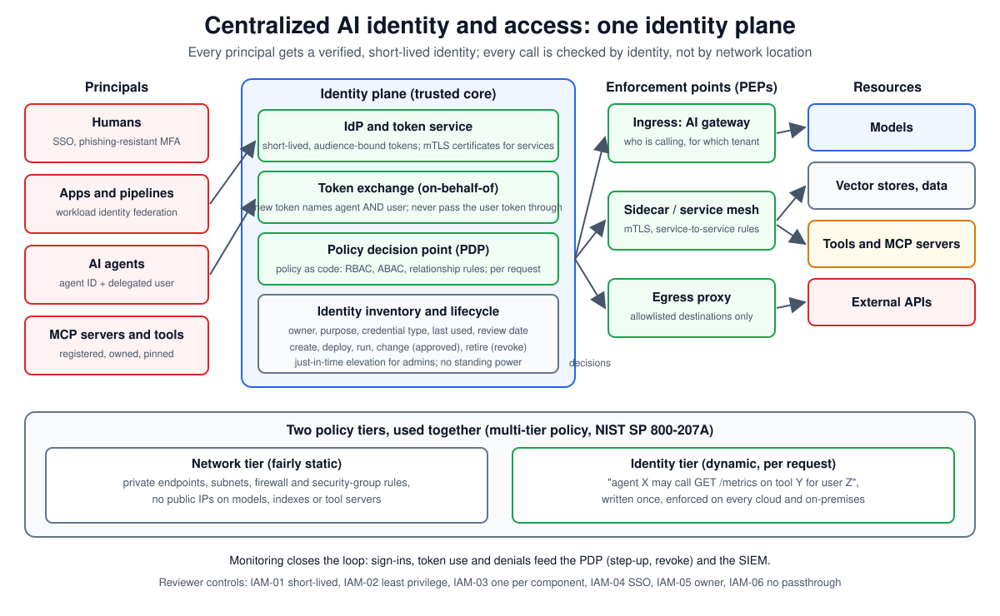

# Centralized AI Identity and Access Management (Zero Trust for AI)

> **Module:** 09 · Enterprise AI Security Architecture · **Weeks:** 26–27 · **Time:** ~7 hours
> **You will:** design one identity plane for users, apps, agents and MCP servers; apply zero trust to AI workloads using NIST SP 800-207A's multi-tier policy model; and check identity controls (ownership, no token passthrough, delegation) with the reviewer and the gateway labs.

| | |
|---|---|
| **Prerequisites** | [Lesson 01](01-enterprise-ai-reference-architecture.md); [Module 04 authentication](../04-mcp-security/authentication/); [Module 05 agent identity](../05-agent-security/agent-identity/) |
| **Lab** | [`lab/reviewer.py`](lab/reviewer.py) controls IAM-01..IAM-06; [`lab/gateway/`](lab/gateway/) (agent delegation, audience checks); [`lab/posture.py`](lab/posture.py) (identity drift) |
| **Maps to** | OWASP Agentic Top 10 2026: ASI03 Identity and Privilege Abuse, ASI07 Insecure Inter-Agent Communication, ASI10 Rogue Agents · OWASP MCP Top 10 (beta): MCP01 Token Mismanagement and Secret Exposure, MCP02 Privilege Escalation via Scope Creep, MCP07 Insufficient Authentication and Authorization, MCP09 Shadow MCP Servers · OWASP LLM Top 10 2026: LLM03 Excessive Agency [2025: LLM06] · NIST SP 800-207 and 800-207A · CIS Controls v8 (5, 6) |

---

## 1. Why this matters

- **2023, Storm-0558 (Microsoft; reviewed by the US Cyber Safety Review Board):** attackers obtained a consumer signing key and forged tokens that were accepted for enterprise email. Token validation and key management are the identity plane's crown jewels.
- **2024, Midnight Blizzard at Microsoft (Microsoft's own disclosure):** attackers used a legacy test OAuth application with high privileges to reach corporate mailboxes. A forgotten non-human identity with too much power was the path.
- **2024, Snowflake customer accounts (Mandiant, UNC5537):** stolen credentials worked because many accounts had no MFA. Identity configuration is the customer's side of shared responsibility.
- **2024, LLMjacking (Sysdig):** stolen cloud credentials were used to call hosted models. In AI platforms, a leaked workload credential is directly a model-access credential.

The pattern: **non-human identities with too much power, no owner and long lives.** AI adds many more of them (agents, MCP servers, pipelines, notebooks), which is why AI IAM must be centralized.

---

## 2. Understand it

### 2.1 Who are the principals in an AI platform?

| Principal | Example | Typical weakness | Target state |
|---|---|---|---|
| Human user | engineer using the ops assistant | no MFA, standing admin rights | SSO, phishing-resistant MFA, RBAC/ABAC, just-in-time admin |
| App / workload | RAG service, gateway | static API keys in config | workload identity (IAM role, managed identity, service account), short-lived |
| CI/CD pipeline | deploy job | long-lived cloud keys in CI variables | OIDC federation from the CI system, scoped to repo and branch |
| AI agent | ops agent | shares the app's identity; acts with its own power, not the user's | its own identity + delegated user (token exchange); task-scoped tokens |
| MCP server / tool | metrics tool | unknown owner; receives the user's raw token | registered, owned, audience-bound tokens; no passthrough |

The SANS *Securing the Agentic Cloud (2026)* report in your library calls this mix of human, non-human and agentic identities a "three-body problem": the interactions, not just the numbers, make attribution hard. The ISC2-style study guide in your library uses the picture of an "identity iceberg": non-human identities far outnumber people and are reviewed far less.



### 2.2 Zero trust, applied to AI (NIST SP 800-207 and 800-207A)

Zero trust (SP 800-207) means: no implicit trust from network location or ownership; every access decision is per request, least privilege, based on identity and context. **SP 800-207A** applies this to cloud-native, multi-cloud applications. Its key ideas, in our words:

1. **Assume the attacker is already inside.** Network perimeters are not enough.
2. **Identity-based segmentation.** Each service presents a short-lived, cryptographically verifiable identity (for example a SPIFFE ID in an X.509 certificate), connections are encrypted and mutually authenticated (mTLS), and service-to-service calls are authorized by identity. End users authenticate with phishing-resistant MFA, and a verifiable token representing the user travels with the request and is checked at each hop.
3. **Enforcement must be non-bypassable.** The publication describes enforcement points (ingress, sidecar and egress proxies) that should behave like a security kernel: always invoked, verifiable, independent of application code.
4. **Multi-tier policies.** Network-tier policies (subnets, firewall rules, ports) stay, fairly static. Identity-tier policies ("service A may call GET /public on service B") sit on top and are dynamic. Using both gives a better posture than either alone.
5. **Identity-tier policy advantages:** it follows the workload across clouds ("write once, enforce everywhere"), it is human-readable, and it can be tested and managed as policy as code in CI/CD.
6. **Monitoring is part of the architecture.** Every user request and the chain of service calls behind it is monitored, and the telemetry feeds back into access decisions (tighten rights, step-up authentication).

For AI this translates to:

| SP 800-207A idea | AI platform design |
|---|---|
| Ingress proxy as PEP | The AI gateway (lesson 06) verifies user, app and agent identities |
| Sidecar / mesh with mTLS | Gateway, RAG, broker and agent runtime talk over mTLS with per-service identities |
| Egress proxy | Agents and tools reach only allowlisted destinations (NET-03) |
| User token checked at each hop | Exchanged, audience-bound tokens; never the raw user token passed through (IAM-06) |
| Policy as code in CI/CD | PDP policies (OPA/Cedar style) and the control matrix, reviewed in pull requests |
| Monitoring feeds policy | Denials, token misuse and unusual tool chains feed detections and step-up rules |

### 2.3 Delegation: the agent acts *for* someone

When an agent calls a tool for Alice, the tool must be able to answer two questions: *which agent* is calling, and *for which user*. Three options:

| Option | What downstream sees | Verdict |
|---|---|---|
| Pass Alice's token through | Alice only; the agent is invisible; the token is reusable anywhere it is valid | **Never** (MCP01; the MCP specification forbids token passthrough) |
| Agent uses only its own identity | The agent only; it may read what Alice may not (confused deputy) | OK only with a broker that checks Alice's rights from verified claims |
| Token exchange (OAuth 2.0 Token Exchange, RFC 8693) | A new short-lived token for that tool's audience naming the agent **and** Alice | **Preferred** |

Add resource indicators (audience binding, RFC 8707) so a token for tool A is useless at tool B, and sender-constrained tokens (DPoP or mTLS-bound) where your stack supports them, so a stolen token cannot simply be replayed.

### 2.4 The identity lifecycle for non-human identities

| Stage | Control | Reviewer / lab |
|---|---|---|
| Request and create | Tied to an AI inventory entry; named owner and purpose | IAM-05 |
| Provision | Short-lived credentials; narrow permissions; one identity per component | IAM-01, IAM-02, IAM-03 |
| Use | Monitored; per-request authorization; budgets | LOG-01, OPS-01 |
| Change | Permission changes go through review (drift is detected) | `posture.diff_architecture` |
| Review | Periodic certification by the owner; unused access removed | `posture.overdue("access_review")` |
| Retire | Revoke tokens and keys, not just disable the account | `removed_identity` drift item |

The SANS report describes the same idea for agents as five stages: creation (register in an inventory), deployment (validate against baselines), execution (enforce trust boundaries), modification (change approval) and decommissioning (remove access quickly).

### 2.5 Authorization models you will meet

| Model | Basis | AI example |
|---|---|---|
| RBAC | Role membership | "operators may request changes" |
| ABAC | Attributes of user, resource, action, environment | "allow if data class is internal and user's department matches" |
| ReBAC | Relationships between objects | Document-level permissions in RAG ("member of the folder that owns the doc") |
| Policy-based (PBAC) | Central policy engine evaluates every request | The broker asks the PDP before a payments tool runs |

Just-in-time access replaces standing privilege: admin rights for the model registry or the guardrail configuration are granted for one task, approved, and expire.

---

## 3. Defend it

| Layer | Control | Type | What it buys you |
|---|---|---|---|
| L1 | One enterprise IdP for humans (SSO + phishing-resistant MFA); federation for CI and workloads | **Hard** | Central revocation; no local accounts |
| L2 | Short-lived, audience-bound credentials for every workload, agent and MCP server | **Hard** | Stolen tokens are short-lived and single-purpose |
| L3 | Token exchange for delegation; no token passthrough | **Hard** | Downstream sees agent + user; no confused deputy |
| L4 | PDP with policy as code; PEPs at ingress, mesh and egress | **Hard** | Per-request decisions, testable policies |
| L5 | mTLS between services with identity-tier rules, on top of network-tier rules | **Hard** | Network position alone grants nothing |
| L6 | Identity inventory with owners; access reviews; deprovisioning | Process | No orphaned agents or keys |
| L7 | Identity detections: new credentials on service principals, consent grants, token use from new contexts, unusual tool chains | Process | Abuse is noticed |
| L8 | Just-in-time admin for model registry, guardrail config and policy repo | **Hard** | No standing power to change the rules |

### What does NOT work on its own

- A vault full of long-lived secrets. Centralizing secrets reduces sprawl, not lifetime or blast radius; move to dynamic credentials and federation.
- "Internal network = trusted." The attacker is assumed inside.
- One identity per *team* for all its agents. Attribution and least privilege both disappear.
- Impossible-travel alerts as the only identity detection. Watch state changes (new credentials, consent grants, role activations) instead.

---

## 4. Hands-on lab

### Step 1: Review only the identity controls of the hackathon design

From the repository root:

```powershell
python -c "import sys; sys.path.insert(0, '09-enterprise-architecture/lab'); from reviewer import *; print(format_report(review(load_architecture('09-enterprise-architecture/lab/architectures/vulnerable_aws.yaml'), families=['identity'])))"
```

Expected output:

```text
Architecture review: ops-assistant-hackathon (aws)
------------------------------------------------------------------------------
FAIL     critical IAM-04   Users authenticate with enterprise SSO (OIDC/SAML) at the AI gateway
                          why: ai-gateway user_auth=api_key
                          fix: On aws: IAM Identity Center or external IdP; Amazon Cognito; JWT authorizers on API Gateway or ALB OIDC auth
FAIL     high     IAM-01   Workloads use short-lived credentials, never static keys
                          why: static credentials: role-app
                          fix: On aws: IAM roles with STS temporary credentials; EKS Pod Identity or IRSA; IAM OIDC federation for CI
FAIL     high     IAM-02   Runtime identities have least privilege (no wildcards, no admin)
                          why: role-app has broad permissions ['bedrock:*', 'es:*', 's3:*']
                          fix: On aws: Scoped IAM policies (e.g. bedrock:InvokeModel on named model ARNs); IAM Access Analyzer; SCPs
FAIL     high     IAM-05   Every non-human identity has a named owner (no orphaned agents or keys)
                          why: no owner: role-app
                          fix: On aws: IAM role tags (owner, purpose, review-by) enforced by AWS Config rules or tag policies; IAM Access Analyzer unused-access findings
FAIL     high     IAM-06   Agents and tool gateways never pass the user's token through to downstream services
                          why: agent forwards the user's token (downstream_auth=passthrough)
                          fix: On aws: One IAM role per agent via STS AssumeRole with session tags for the user; Amazon Bedrock AgentCore Identity (check current features); OAuth token exchange at your broker
FAIL     medium   IAM-03   One identity per component (no shared service identity)
                          why: identity role-app shared by ai-gateway, rag, agent
                          fix: On aws: One IAM role per service or pod (EKS Pod Identity); separate roles per agent
------------------------------------------------------------------------------
open: 1 critical, 4 high, 1 medium, 0 low | accepted: 0
GATE: FAIL (open critical/high findings)
```

One identity (`role-app`) causes five of the six findings. That is the usual shape of real AI platform reviews.

### Step 2: Write the identity table for your own design

In your `my_aws.yaml` (or Azure/GCP), give every identity an `owner` and a `kind` (`workload`, `agent`, `mcp_server`, `ci`), and set `downstream_auth` on the agent and the MCP gateway. Re-run the reviewer until IAM-01..IAM-06 pass. Then write, as YAML comments, the real cloud setting behind each value.

### Step 3: Prove delegation at the gateway

```powershell
python -m pytest 09-enterprise-architecture/lab/gateway -k "agent or audience" -v
```

The `agent_without_user_context` and `wrong_audience_token` tests show two identity rules working at the front door: an agent without a delegated user cannot read confidential data, and a token minted for another API is refused.

### Step 4: Find identity drift

```powershell
python -m pytest 09-enterprise-architecture/lab/test_posture.py -k "identity or permission" -v
```

These tests add an identity without an owner and widen a permission in an "observed" copy of a design; `posture.diff_architecture` reports each change with its control (IAM-05, IAM-02). Then run `python 09-enterprise-architecture/lab/assess.py` and find the two `removed_identity` lines: why must "removed" trigger a check that credentials were revoked?

### Step 5: Draw your multi-tier policy (no code)

For the ops assistant, write three network-tier rules (subnets, private endpoints, egress) and five identity-tier rules in the form "*identity* may *action* on *resource* when *condition*". Mark which rule would stop each abuse case A1–A12 from [Module 10](../10-capstone-project/01-capstone-brief-and-requirements.md).

### Stretch goals

- Add a `review_by` date to `Identity` and a check that fails when it has passed (you will need to pass `today` into the check, as exceptions do).
- Add an `expires_in_minutes` field and fail when an agent credential lives longer than one hour.
- In the gateway lab, add an `act` claim chain (agent calling agent) and refuse delegation chains longer than two.

---

## 5. Real-world scenarios

**Scenario A: the orphaned pilot agent.**
A team built an agent for a vendor pilot with a service account that can read all support tickets. The pilot ended; the account stayed for nine months and was found in a breach investigation.
- *What went wrong:* no owner, no expiry, no deprovisioning step.
- *Investigate:* last-used data for the account; all calls in the period; where its keys were stored.
- *Fix:* owner and purpose at creation (IAM-05); quarterly access reviews; delete identities with their AI inventory entry.

**Scenario B: the forwarded token.**
An MCP server for calendars receives the user's full SSO token from the agent. A bug in that server logs it. Anyone with log access can now call every API that accepts the token.
- *What went wrong:* token passthrough (MCP01) plus logging of secrets.
- *Investigate:* which audiences accepted the leaked token; token lifetime; log access list.
- *Fix:* token exchange with audience binding (IAM-06); short lifetimes; log fingerprints only; revoke the sessions.

**Scenario C: "it's inside the VPC".**
A RAG service accepts any request from inside the cluster without authentication. A compromised notebook pod queries all tenants' indexes.
- *What went wrong:* network-tier trust only.
- *Investigate:* mesh telemetry for calls to the RAG service by source identity.
- *Fix:* mTLS with identity-tier policy ("only the gateway identity may call /search"), plus tenant claims checked by the RAG service.

---

## 6. Common mistakes

- Treating agents as "features of an app" instead of principals with their own identity.
- Using the same identity for ingestion (writes the index) and retrieval (reads it).
- Long-lived cloud keys in CI when OIDC federation is available.
- Granting a whole team read access to a whole vault path.
- Writing identity rules with IP addresses that break every time a workload moves.
- Forgetting that revoking an account does not always revoke tokens that were already issued.

---

## 7. Interview preparation

<details><summary><b>Q1. What does "centralized AI IAM" mean in practice?</b></summary>

One identity plane for every principal that touches AI: users through SSO, apps and pipelines through workload identity federation, agents with their own identities and delegated users, MCP servers registered with owners. One PDP with policy as code, enforcement at the gateway, the mesh and the egress proxy, and one inventory with owners, reviews and deprovisioning.
</details>

<details><summary><b>Q2. Explain NIST SP 800-207A's multi-tier policies.</b></summary>

Network-tier policies (subnets, firewall rules, ports) are kept but fairly static; identity-tier policies (which service identity may call which method on which service, for which user) are dynamic and enforced by proxies such as ingress, sidecar and egress. Together they give a better posture than either alone, and identity-tier policies move with the workload across clouds.
</details>

<details><summary><b>Q3. Why is token passthrough dangerous for agents and MCP servers?</b></summary>

The downstream service cannot tell the agent from the user, cannot apply agent-specific limits, and receives a token that may work at many other services. If that server is malicious or buggy, the token is stolen. Use token exchange for a short-lived, audience-bound token naming both the agent and the user.
</details>

<details><summary><b>Q4. How would you give 2,000 agents identities without chaos?</b></summary>

Issue identities only through a pipeline tied to the AI inventory (owner, purpose, environment, review date generated automatically); attested, short-lived credentials (SPIFFE-style or cloud workload identity); no ambient credentials mounted by default; mTLS with identity rules; and metrics: share of workloads on short-lived identity, median credential lifetime, identities without owners trending to zero.
</details>

<details><summary><b>Q5. What is a confused deputy in an AI system?</b></summary>

An agent or tool with more rights than the user it serves, tricked (for example by prompt injection) into using those rights for the user. Prevent it by authorizing with the user's identity at each hop (delegation) or a broker that checks the user's rights, plus least privilege for the agent itself.
</details>

<details><summary><b>Q6. Which identity detections matter most for AI platforms?</b></summary>

State changes: new credentials or secrets on service principals, new OAuth consents, role activations, new MCP server registrations, agent identities used from new contexts, unusual tool sequences, spikes in denied calls and in token spend. Correlate them into one identity timeline.
</details>

<details><summary><b>Q7. Your vault holds 9,000 secrets, many never rotated. What next?</b></summary>

Scope vault policies per workload and environment, alert on unusual read volume, move to dynamic credentials (database and cloud credentials issued on demand with short leases), federate pipelines and workloads so nothing is stored, and give every remaining static secret an owner, rotation interval and retirement date.
</details>

<details><summary><b>Q8. How do you right-size permissions across many cloud accounts?</b></summary>

From telemetry: build used-permission profiles per role from access logs, fix dangerous trust policies first (roles assumable by anyone), roll out generated policies in monitor mode, then enforce; add organization-level guardrails against wildcard admin actions, and keep it right with IaC policy checks and a monthly unused-permission report.
</details>

<details><summary><b>Q9. How do you stop a stolen bearer token from being useful?</b></summary>

Short lifetimes, audience binding, sender-constrained tokens (DPoP or mTLS-bound) where supported, detection on context mismatch at token refresh, and fast revocation of sessions. For AI agents, task-scoped tokens that expire when the task ends.
</details>

<details><summary><b>Q10. Where do RBAC, ABAC and ReBAC fit in an AI platform?</b></summary>

RBAC for coarse roles (operator vs viewer), ABAC for context (data class, department, device, tenant), ReBAC for document-level permissions in RAG (inherited from folders and groups). A central PDP can combine them; enforcement happens at the gateway, retrieval and broker.
</details>

<details><summary><b>Q11. Scenario: an agent read HR documents its user should not see. Investigate.</b></summary>

Check whose identity the retrieval used (agent's own or delegated), whether the retrieval filter used the user's groups, and whether the agent's identity has broad read rights. Root cause is usually "agent identity with its own power and no per-user check". Fix with delegation or a broker that filters by the user's verified claims, and narrow the agent's rights.
</details>

<details><summary><b>Q12. Explain to an executive why AI agents need their own identities.</b></summary>

"Each AI agent can take actions in our systems, like an employee. If they all share one login, we cannot tell which one did what, we cannot limit each one to its job, and we cannot switch one off without switching off all of them. Giving each agent its own identity, with a named owner, is how we keep control."
</details>

---

## 8. Checklist (definition of done)

- [ ] I can list the five kinds of principals and the target credential for each.
- [ ] I can explain multi-tier (network + identity) policies from SP 800-207A with an AI example.
- [ ] My own design passes IAM-01..IAM-06 in the reviewer.
- [ ] I wrote three network-tier and five identity-tier rules for the ops assistant.
- [ ] Journal entry: the delegation option I chose for agents and why.

## 9. References

- NIST SP 800-207, *Zero Trust Architecture* (2020), https://csrc.nist.gov/pubs/sp/800/207/final
- NIST SP 800-207A, *A Zero Trust Architecture Model for Access Control in Cloud-Native Applications in Multi-Cloud Environments* (2023), https://csrc.nist.gov/pubs/sp/800/207/a/final
- RFC 8693, *OAuth 2.0 Token Exchange*, https://www.rfc-editor.org/rfc/rfc8693 · RFC 8707, *Resource Indicators for OAuth 2.0*, https://www.rfc-editor.org/rfc/rfc8707 · RFC 9449, *DPoP*, https://www.rfc-editor.org/rfc/rfc9449
- SPIFFE, https://spiffe.io/
- Model Context Protocol, authorization specification (token passthrough guidance), https://modelcontextprotocol.io/
- OWASP Top 10 for Agentic Applications 2026 and OWASP MCP Top 10 (beta): verify ids at https://genai.owasp.org/ and https://owasp.org/www-project-mcp-top-10/
- US Cyber Safety Review Board, *Review of the Summer 2023 Microsoft Exchange Online Intrusion* (2024), https://www.cisa.gov/resources-tools/resources/CSRB-review-summer-2023-microsoft-exchange-online-intrusion
- Microsoft Security Response Center, *Microsoft actions following attack by nation state actor Midnight Blizzard* (2024), https://msrc.microsoft.com/blog/
