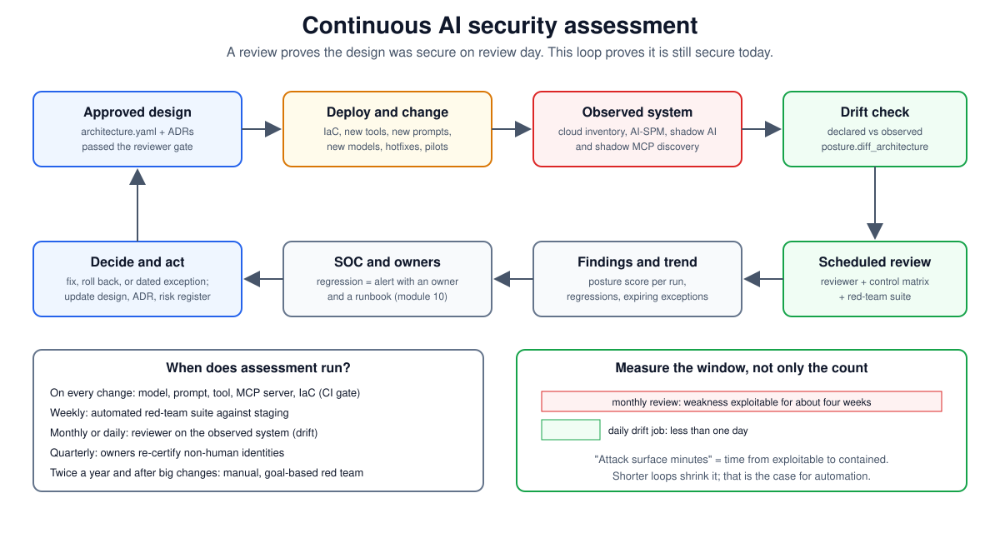

# Continuous AI Security Assessment and AI Security Operations

> **Module:** 09 · Enterprise AI Security Architecture · **Weeks:** 28 (with lesson 05) · **Time:** ~7 hours
> **You will:** turn a one-time design review into a continuous loop (posture management, scheduled red-team runs, drift detection, exception expiry), measure how long weaknesses stay open, and connect the platform to security operations and incident response.

| | |
|---|---|
| **Prerequisites** | Lessons [01](01-enterprise-ai-reference-architecture.md) and [05](05-multi-cloud-control-matrix-and-shared-responsibility.md); [Module 06](../06-ai-devsecops/) (CI gates); [Module 02 security testing](../02-llm-security/security-testing/) (attack suites) |
| **Lab** | [`lab/posture.py`](lab/posture.py), [`lab/assess.py`](lab/assess.py), [`lab/test_posture.py`](lab/test_posture.py) (12 tests); reviewer control OPS-02 |
| **Maps to** | OWASP LLM Top 10 2026: LLM01, LLM04 Supply Chain [2025: LLM03] (change-triggered testing) · OWASP Agentic ASI10 Rogue Agents · OWASP MCP Top 10 (beta) MCP08 Lack of Audit and Telemetry, MCP09 Shadow MCP Servers · NIST AI RMF (MEASURE, MANAGE) · NIST SP 800-207A (monitoring framework) · NIST SP 800-61 Rev. 3 · CIS Controls v8 (7, 8, 18) |

---

## 1. Why this matters

- **2023, Microsoft AI research SAS token (Wiz):** the over-broad storage token was public for a long time before it was found. The problem was not only the mistake, but how long nobody noticed it.
- **2024, ShadowRay (Oligo):** exposed AI compute dashboards were attacked in the wild. Internet-facing AI infrastructure that nobody tracks is a standing target.
- **2024, Snowflake customer accounts (Mandiant):** accounts without MFA were a configuration state that could have been found by routine posture checks long before the attacks.
- **Hypothetical, but typical (this lab's `drifted_gcp.yaml`):** six months after a clean review, a guardrail was detached, agent egress was opened "for one week", and a notebook called the model directly. Each change was small; together they failed the gate.

A review proves the design was secure **on review day**. Continuous assessment proves it is **still** secure.

---

## 2. Understand it

### 2.1 The loop



1. **Approved design:** the architecture file, ADRs and the matrix, passed through the reviewer gate.
2. **Deploy and change:** IaC, new tools, prompts, models, hotfixes, pilots.
3. **Observed system:** what is really running, from cloud inventories and AI security posture management (AI-SPM) tools, including shadow AI and shadow MCP servers.
4. **Drift check:** declared vs observed (`posture.diff_architecture`).
5. **Scheduled review:** the reviewer on the observed system, plus the red-team suite.
6. **Findings and trend:** posture score per run, regressions, expiring exceptions.
7. **SOC and owners:** a regression is an alert with an owner and a runbook.
8. **Decide and act:** fix, roll back, or a dated exception; update the design and the risk register.

### 2.2 What "AI security posture management" covers

AI-SPM is a family of tools (cloud-native and third-party; features change fast, so check current offerings) that continuously discover and assess AI assets. Whatever the product, the questions are the same:

| Question | Evidence | Lab equivalent |
|---|---|---|
| What AI exists? (models, endpoints, indexes, agents, MCP servers, notebooks) | Inventory export | the `observed` architecture file |
| Is it configured as approved? | Configuration checks | reviewer on the observed file |
| What changed since approval? | Diff over time | `diff_architecture` |
| Is any of it reachable in ways it should not be? | Path analysis | NET-04 graph check |
| Which identities can reach it, and are they owned? | Identity inventory | IAM-05, `added_identity` drift |
| Is it still resistant to known attacks? | Red-team suite results | [Module 02](../02-llm-security/security-testing/) harness, OPS-02 |

### 2.3 Cadence: when to assess

| Trigger or schedule | What runs | Why |
|---|---|---|
| Every change to model, prompt, tool, MCP server or IaC | Acceptance and attack suites; reviewer in CI | Model behavior changes with "just wording" |
| Weekly | Automated red-team suite against staging | New payloads, provider model updates |
| Daily to monthly | Reviewer on the observed system (drift) | Console changes and "temporary" fixes |
| Quarterly | Owners re-certify non-human identities | Orphaned agents and keys |
| Twice a year and after big changes | Manual, goal-based red team | People find what suites do not |

The lab's `posture.overdue` encodes this cadence and lists what is late.

### 2.4 Measure the window: attack surface minutes

The SANS *Securing the Agentic Cloud (2026)* report proposes **attack surface minutes**: the time between a weakness becoming exploitable and controls containing it, similar to dwell time but for exposure. It is the metric that tells you when periodic scanning must become continuous monitoring and when manual triage must become automated containment. In the lab, the same notebook bypass is open for about four weeks with a monthly review and less than a day with a daily drift job.

Other useful posture metrics: open findings by severity per run (the lab's score), regressions per month, mean time to remediate, exceptions past expiry (should be zero), share of AI assets in the inventory, share of non-human identities with owners.

### 2.5 From assessment to AI security operations

Continuous assessment produces signals; **security operations** acts on them. The platform must give the SOC:

| SOC need | Platform source |
|---|---|
| Who called which model with which data | Gateway logs (lesson 06) |
| What the agent proposed, what was approved and executed | Broker and approval logs ([Module 05](../05-agent-security/)) |
| Which documents were retrieved, with trust labels | RAG retrieval logs ([Module 03](../03-rag-security/)) |
| Identity state changes | IdP and cloud audit logs (lesson 07) |
| Drift and regressions | This lesson's posture job |
| A fast stop | Kill switches per agent and per tool, credential revocation |

The SANS report describes response for agents as four layers acting **in parallel**: identity (revoke the agent's credentials, end sessions), network (block egress, isolate the workload), application (disable tools, freeze state) and data (restrict access, turn on extra logging). It also argues for **confidence-calibrated response**: low-impact, high-confidence actions may run autonomously; high-impact actions always need a human checkpoint; behavioral anomalies with low confidence trigger automatic containment and a human review before release.

AI incident response and an AI-assisted SOC are practiced in [Module 10 lesson 03](../10-capstone-project/03-red-team-and-incident-exercise.md) and the optional [Module 10 lesson 05](../10-capstone-project/05-ai-soc-monitoring-extension.md).

### 2.6 Where this is heading (short outlook)

The *AI Cybersecurity Roadmap 2026–2030* in your library frames the next years as: visibility first (know what AI you have), then agent identity, then defending against AI-driven attacks, then an AI-assisted SOC that takes on parts of detection and response in stages (AI-assisted, then AI-supervised, then autonomous only inside a tightly limited "blast radius"), then resilience. Two of its warnings are worth remembering as an architect: a model's **confidence is not an authorization**, and human control should sit beside every layer, not only at the end. Treat the dates in any such roadmap as one author's forecast, not a standard.

---

## 3. Defend it

| Layer | Control | Type | What it buys you |
|---|---|---|---|
| L1 | Change-triggered testing: model, prompt, tool and IaC changes re-run the suites in CI | **Hard** (for releases) | Regressions blocked before production |
| L2 | Scheduled drift check: declared vs observed, with control links | **Hard** (detective, automated) | "Temporary" changes become findings |
| L3 | Scheduled reviewer and red-team runs with a posture trend | Process | Regressions are visible and owned |
| L4 | Exception alerts before expiry; expired exceptions count as FAIL | **Hard** (reviewer logic) | Risk acceptance stays temporary |
| L5 | AI-SPM / inventory discovery of shadow AI and shadow MCP servers | Process | Unknown assets get an owner or are removed |
| L6 | SOC detections and runbooks for regressions and AI incidents; kill switches | Process | Fast, practiced containment |
| L7 | Metrics: attack surface minutes, time to remediate, exceptions past expiry | Process | You can prove the loop works |

### What does NOT work on its own

- A yearly penetration test of an AI system whose prompts change weekly.
- Dashboards without owners: a regression nobody is paged for is not a control.
- Scanning only infrastructure: prompts, tool descriptions and routing policies drift too.
- Letting the posture tool "auto-fix" production without change control.

---

## 4. Hands-on lab

### Step 1: Run the posture job

```powershell
python 09-enterprise-architecture/lab/assess.py
```

Expected output:

```text
1) DRIFT: approved design (secure_gcp) vs observed system (drifted_gcp)
   removed_component  docs                         in the design but not deployed: update the design or the inventory
   removed_component  tool-metrics                 in the design but not deployed: update the design or the inventory
   changed_setting    agent.egress                 'deny_by_default' -> 'allow_all' [NET-03]
   changed_setting    ai-gateway.guardrails.input  ['prompt_attack', 'pii'] -> [] [GR-01]
   changed_setting    ai-gateway.guardrails.output ['pii', 'secrets', 'url_allowlist'] -> ['pii', 'secrets'] [GR-02]
   added_flow         internet->model              new data flow [NET-04]
   removed_flow       mcp-gateway->audit-logs      flow in the design is gone
   removed_flow       mcp-gateway->tool-metrics    flow in the design is gone
   removed_flow       rag->docs                    flow in the design is gone
   removed_identity   sa-tool-metrics              identity removed: check that its credentials were revoked
   removed_identity   wif-github-deploy            identity removed: check that its credentials were revoked
   new_exception      GR-01                        approved by ciso@acme.example until 2026-09-30 [GR-01]
   new_exception      NET-03                       approved by platform-lead@acme.example until 2026-03-31 [NET-03]
   new_exception      NET-04                       approved by vp-data@acme.example until 2026-12-31 [NET-04]

2) POSTURE TREND: the same reviewer, run on a schedule
   2026-01-05  score 100  open: -                        accepted: -        new failures: -
   2026-06-01  score  65  open: NET-03, NET-04           accepted: GR-01    new failures: NET-03, NET-04
   2026-10-01  score  62  open: GR-01, NET-03, NET-04    accepted: -        new failures: GR-01

3) EXCEPTIONS that need a decision (checked on 2026-09-10, warn 30 days ahead)
   GR-01   expiring  (+20 days)
   NET-03  expired   (-163 days)

4) OVERDUE ASSESSMENTS on 2026-06-01
   access_review, architecture_review, manual_red_team

5) ATTACK SURFACE MINUTES for the notebook bypass (internet -> model)
   monthly review: exploitable for 40,410 minutes
   daily drift job (found next morning 07:00): 1,320 minutes
```

Read it carefully:

- The **GR-02 drift** (the URL allowlist was removed from output filters) does **not** fail the reviewer, because GR-02 only requires PII and secrets filters. Drift detection finds changes that your checks do not cover. Decide: is this acceptable, or should GR-02 get stricter?
- On 2026-10-01 the score drops again with **no new change**: the GR-01 exception expired. Time alone can change your posture.
- The removed identities matter: "removed from the design" does not prove "credentials revoked".

### Step 2: Run the tests

```powershell
python -m pytest 09-enterprise-architecture/lab/test_posture.py -v
```

Expected last line: `12 passed`.

### Step 3: Break it yourself (predict first)

1. Add a component `{id: team-notebook, type: frontend, zone: public}` to a copy of `drifted_gcp.yaml`. Which drift item appears, and which control does it point to?
2. Change the `when` dates in `assess.py` so the last run is 2026-09-01. Does GR-01 still fail? Why?
3. In `secure_gcp.yaml`, set `assessment: {redteam_schedule: none}`. Run `python 09-enterprise-architecture/lab/reviewer.py 09-enterprise-architecture/lab/architectures/secure_gcp.yaml`. Which control fails, and does the gate still pass? Is "medium" the right severity for your organization?

### Step 4: Design the SOC hand-off (no code)

For three drift kinds (`added_flow` from the internet, `changed_setting` on egress, `added_identity` without owner), write: the alert name, severity, owner, first three runbook steps, and the evidence to preserve. Compare with the playbook format in [Module 10 lesson 03](../10-capstone-project/03-red-team-and-incident-exercise.md).

### Stretch goals

- Generate the "observed" file from a real source: a subset of `terraform show -json` or a cloud inventory export.
- Store posture runs in a CSV and draw the score trend.
- Make the drift job open a ticket (a file in `tickets/`) for each item with a control link, and close it when the drift disappears.

---

## 5. Real-world scenarios

**Scenario A: the guardrail that was "temporarily" detached.**
False positives annoyed users, so a team detached the prompt-attack filter. An exception was approved for three months. Nobody re-attached it.
- *Investigate:* posture runs before and after; exception record; detection volume drop in the SIEM.
- *Fix:* exception alerts 30 days before expiry; expired exceptions fail the gate; a tuning ticket with an owner.

**Scenario B: the shadow MCP server.**
A developer runs an MCP server with database access on a team VM so an IDE agent can use it. It never appears in any design.
- *Investigate:* network flows to the database from unknown sources; identity logs for the credential it uses; endpoint inventory.
- *Fix:* discovery (AI-SPM, network and identity telemetry); register or remove; organization policy that MCP servers reach data only through the tool gateway.

**Scenario C: the model update.**
The provider updated the model behind a stable alias. Injection success in the weekly suite jumped, but the suite only ran monthly.
- *Investigate:* the suite's history; provider change notices; which apps use the alias.
- *Fix:* pin model versions where possible; re-run the suite on provider updates; weekly schedule; alert on a jump in attack success rate.

---

## 6. Common mistakes

- Comparing the observed system with last year's design document instead of the current approved file.
- Treating every drift as bad. Some drift is approved change; the fix is to update the design in the same pull request.
- Alerting on everything: start with drift that maps to critical and high controls.
- Measuring only the number of findings, never how long they stayed open.
- Forgetting non-infrastructure assets: prompts, tool descriptions, routing policies, guardrail configurations.

---

## 7. Interview preparation

<details><summary><b>Q1. What is continuous AI security assessment?</b></summary>

A loop that keeps checking that the running AI platform still matches the approved, secure design: drift detection between declared and observed state, scheduled reviews and red-team runs, change-triggered tests, exception expiry, and a trend that owners act on.
</details>

<details><summary><b>Q2. What does AI security posture management add to normal cloud posture management?</b></summary>

AI-specific assets and risks: models and endpoints, indexes, agents, MCP servers, notebooks; data flows to models; provider data-use settings; guardrail configuration; agent identities and their permissions; and attack paths to models and data.
</details>

<details><summary><b>Q3. What should trigger a re-test of an AI system?</b></summary>

Any change to the model or its version, prompts, tools or tool descriptions, MCP servers, retrieval sources, routing policy or infrastructure; provider model updates; new attack techniques; and a fixed schedule.
</details>

<details><summary><b>Q4. Explain "attack surface minutes".</b></summary>

The time a weakness stays exploitable before controls contain it. It shifts focus from counting vulnerabilities to shortening exposure, and it justifies automation: daily drift jobs and automated containment shrink the window far more than better quarterly reviews.
</details>

<details><summary><b>Q5. How do you handle drift that is actually an approved change?</b></summary>

Update the declared design (and ADR if needed) in the same pull request as the change, so the next drift run is clean. Drift should mean "unapproved", not "different from last time".
</details>

<details><summary><b>Q6. How do you find shadow AI and shadow MCP servers?</b></summary>

Combine sources: cloud inventories and AI-SPM, network flows to model providers and data stores, identity logs (which credentials call model APIs), expense data (AI subscriptions), endpoint inventories, and code search for SDK usage. Then register, own or remove each one.
</details>

<details><summary><b>Q7. Your posture score dropped with no deployment. Why?</b></summary>

Time-based changes: an exception expired, an identity review is overdue, a provider changed a default or a model behind an alias, or someone changed configuration outside IaC. The posture job should say which.
</details>

<details><summary><b>Q8. How should the SOC respond to a compromised agent?</b></summary>

In parallel: revoke its credentials and sessions, block its egress and isolate the workload, disable its tools and freeze its state, restrict its data access and raise logging. Preserve evidence first, then recover through change control.
</details>

<details><summary><b>Q9. When may automation contain an AI incident without a human?</b></summary>

When the action is low impact, reversible and pre-approved in a playbook (for example pausing one agent's tools), and confidence is high. High-impact actions always need a human checkpoint. A model's confidence score is never an authorization.
</details>

<details><summary><b>Q10. Which metrics prove your assessment program works?</b></summary>

Attack surface minutes for findings, mean time to remediate by severity, regressions per month, exceptions past expiry (zero), share of AI assets inventoried and owned, share of changes that ran the suites, and the posture trend per platform.
</details>

<details><summary><b>Q11. Explain to an executive why one security review before launch is not enough.</b></summary>

"AI systems change every week: new prompts, new tools, new model versions, quick fixes. Any of these can quietly remove a protection. We re-check automatically, every day and on every change, so a gap is found in hours instead of months."
</details>

---

## 8. Checklist (definition of done)

- [ ] I can explain the eight steps of the loop and the cadence table.
- [ ] `python -m pytest 09-enterprise-architecture` passes (271 tests).
- [ ] I did the three "break it" exercises and the SOC hand-off table.
- [ ] My own design has an `assessment` block and passes OPS-02.
- [ ] Journal entry: the three posture metrics I would report to a CISO each month.

## 9. References

- NIST SP 800-207A (section on monitoring for cloud-native zero trust), https://csrc.nist.gov/pubs/sp/800/207/a/final
- NIST SP 800-61 Rev. 3, *Incident Response Recommendations and Considerations for Cybersecurity Risk Management* (2025), https://csrc.nist.gov/pubs/sp/800/61/r3/final
- NIST AI Risk Management Framework (MEASURE and MANAGE functions), https://www.nist.gov/itl/ai-risk-management-framework
- OWASP GenAI Security Project (red teaming and Top 10 lists; verify current versions), https://genai.owasp.org/
- Wiz Research, *38TB of data accidentally exposed by Microsoft AI researchers* (2023), https://www.wiz.io/blog/38-terabytes-of-private-data-accidentally-exposed-by-microsoft-ai-researchers
- Oligo Security, *ShadowRay* (2024), https://www.oligo.security/blog/shadowray-attack-ai-workloads-actively-exploited-in-the-wild
