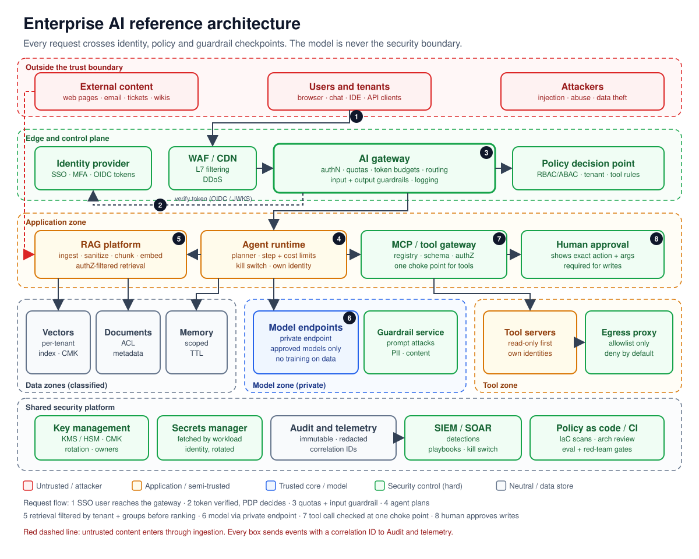
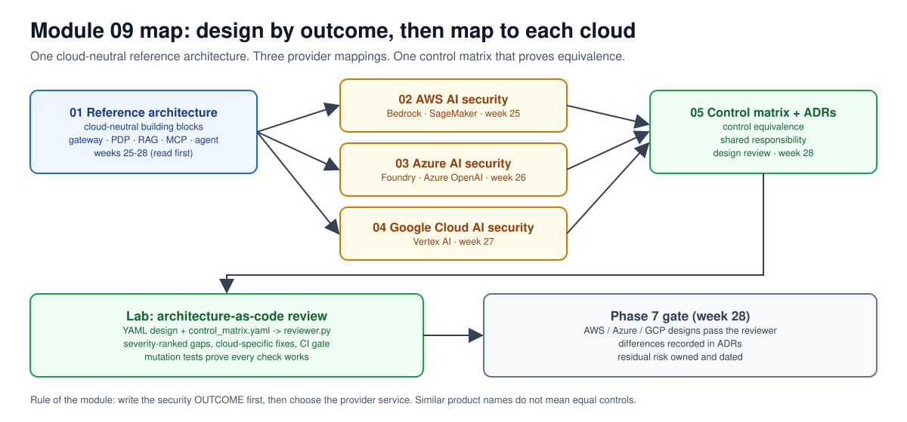
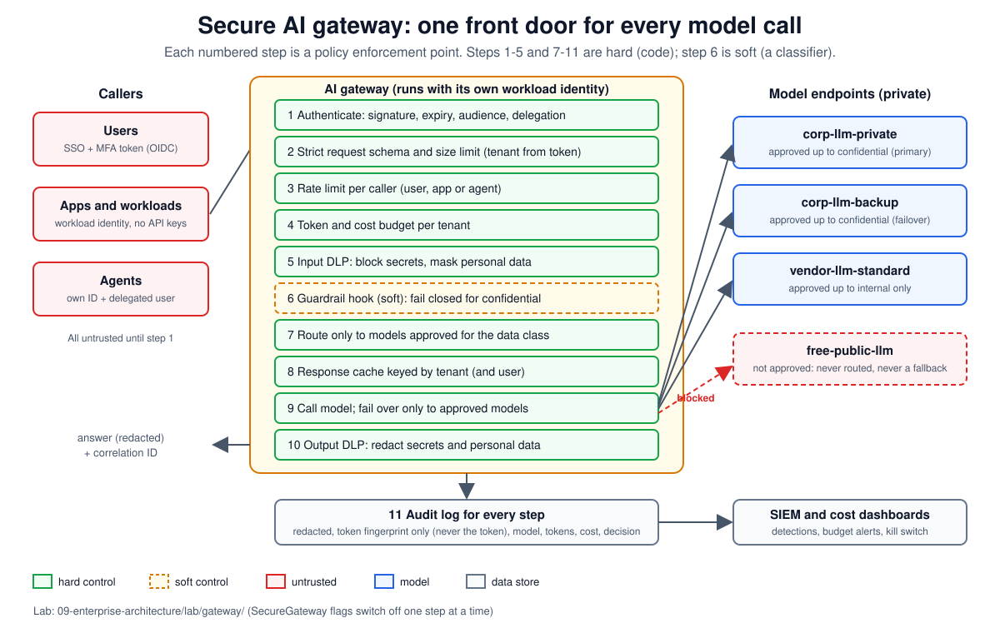
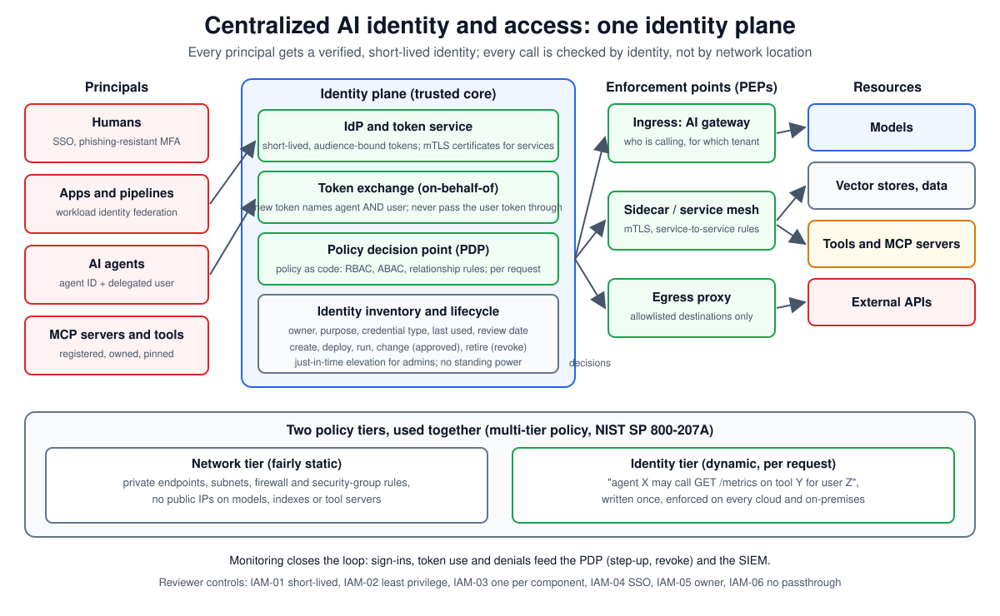
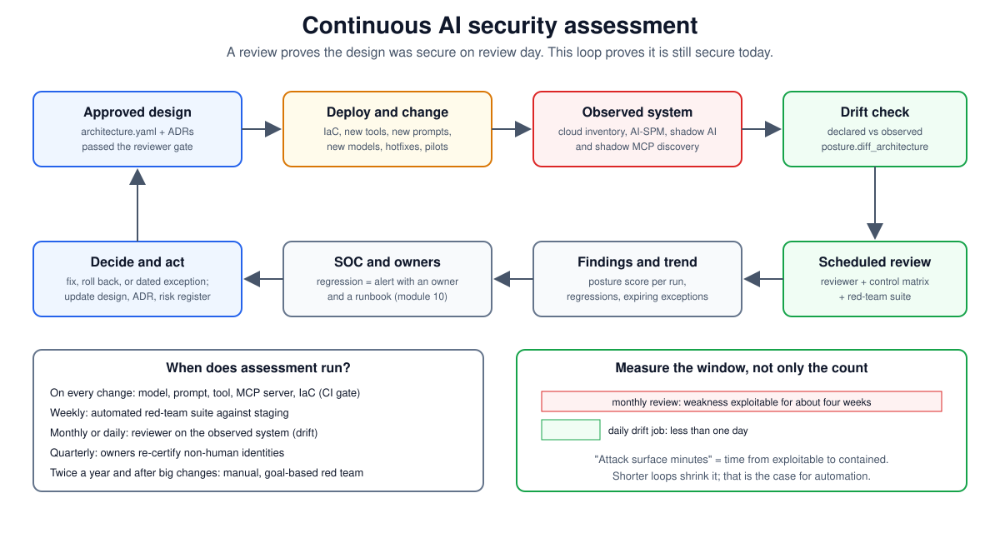
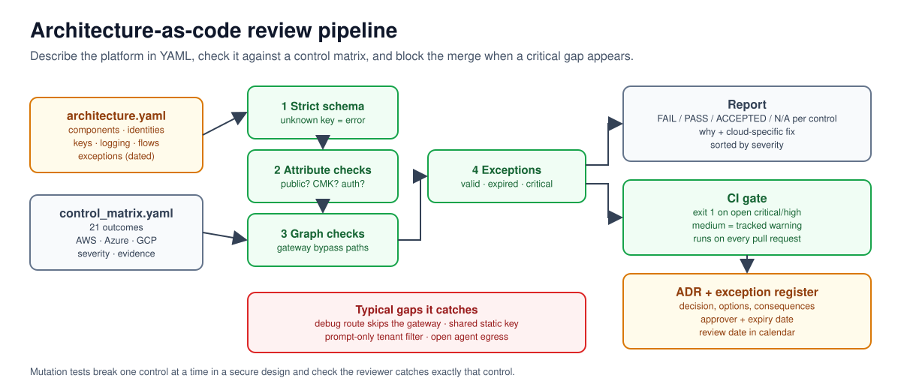

# Module 09: Enterprise AI Security Architecture

> **Weeks:** 25–28 (Month 7) · **Time:** ~40 hours · **Phase gate:** Phase 7 (multi-cloud control equivalence)

## What and why

Modules 02–06 taught you to secure one LLM app, one RAG pipeline, one MCP server, one agent and one pipeline. An enterprise runs **dozens** of these, on **more than one cloud**, for **many tenants**. This module teaches you to design the **platform** they all share, and to prove it is secure on AWS, Azure and Google Cloud.

You will learn to think like an architect:

1. Start from **security outcomes** ("no path to a model skips the gateway"), not from product names.
2. Map each outcome to **each cloud's services**, and write down where they differ.
3. Describe the platform **as code**, review it **automatically**, and record decisions as **ADRs** (architecture decision records).

Most real AI incidents so far (leaked keys, public databases, broken tenant isolation, unauthenticated AI compute) were platform mistakes. This is where an AI security architect earns their title.

## Learning path

| # | Lesson | Weeks | You will be able to… |
|---|---|---|---|
| 01 | [Enterprise AI reference architecture](01-enterprise-ai-reference-architecture.md) | 25–28 (read first) | Draw the platform, name the control in each block, state eight security invariants |
| 02 | [AWS AI security: Bedrock and SageMaker](02-aws-ai-security.md) | 25 | Secure Bedrock with IAM, PrivateLink, KMS, CloudTrail, Bedrock Guardrails |
| 03 | [Azure AI security: AI Foundry and Azure OpenAI](03-azure-ai-security.md) | 26 | Secure Azure OpenAI with Entra ID, Private Endpoints, Key Vault, Azure Monitor, Prompt Shields |
| 04 | [Google Cloud AI security: Vertex AI](04-gcp-ai-security.md) | 27 | Secure Vertex AI with service accounts, VPC-SC, PSC, CMEK, audit logs, Model Armor |
| 05 | [Multi-cloud control matrix, shared responsibility and ADRs](05-multi-cloud-control-matrix-and-shared-responsibility.md) | 28 | Prove control equivalence, explain shared responsibility, write ADRs, run a design review with the architect's questions |
| 06 | [Secure LLM / AI gateway](06-secure-llm-ai-gateway.md) | 25–26 | Build and attack a gateway: authN, routing by data class, rate limits, budgets, DLP, guardrail hooks, cache isolation, safe failover, redacted logs |
| 07 | [Centralized AI IAM and zero trust](07-centralized-ai-iam-and-zero-trust.md) | 26–27 | Design one identity plane for users, apps, agents and MCP servers; apply NIST SP 800-207A multi-tier policies; delegation without token passthrough |
| 08 | [Continuous assessment and AI SecOps](08-continuous-assessment-and-ai-secops.md) | 28 | Run drift detection, posture trends, exception alerts and assessment cadence; measure attack surface minutes; hand off to the SOC |
| Lab | [`lab/`](lab/): reviewer, gateway and posture labs | 25–28 | Review YAML designs against a 26-control matrix; attack a gateway; detect drift |

## Module architecture





## Key concepts (glossary)

| Term | Meaning |
|---|---|
| **AI gateway** | The single front door for model, RAG and agent traffic: authentication, quotas, routing, guardrails, logging |
| **PDP / PEP** | Policy decision point (answers "allowed?") / policy enforcement points (gateway, RAG, broker) that ask and enforce |
| **Control plane / data plane** | Changing the platform (deploy, configure) vs using it (prompts, retrieval, tool calls) |
| **Data zone** | A group of stores with the same classification, keys and access rules |
| **CMK / CMEK** | Customer-managed (encryption) key: a key you control in KMS / Key Vault / Cloud KMS |
| **Private endpoint** | A private IP in your network for a cloud service (PrivateLink, Private Link, Private Service Connect) |
| **VPC Service Controls** | Google Cloud's API-level perimeter that blocks data use from outside, even with valid credentials |
| **Workload identity** | Temporary credentials for code (IAM roles, managed identities, service accounts) instead of stored keys |
| **Landing zone** | A pre-built multi-account / subscription / project structure with central guardrails and logging |
| **SCP / Azure Policy / Org Policy** | Organization-wide preventive rules on AWS / Azure / Google Cloud |
| **Control equivalence** | Proof that different services on different clouds deliver the same security outcome, with gaps recorded |
| **Shared responsibility** | The split of security duties between provider and customer; for AI, data, identity, config and usage stay yours |
| **ADR** | Architecture decision record: context, options, decision, consequences, residual risk, owner, review date |
| **Architecture-as-code** | A machine-readable description of components, identities and data flows that tools can check |
| **Time-bound exception** | A risk acceptance with approver and expiry date; never for critical controls |
| **Drift** | When the running system no longer matches the approved design |
| **Data class** | The sensitivity label of a request (public, internal, confidential) that decides which models may receive it |
| **Token exchange (on-behalf-of)** | Swapping a user's token for a new, short-lived, audience-bound token that names both the agent and the user (RFC 8693) |
| **Token passthrough** | Forwarding the user's own token to a downstream service; forbidden for agents and MCP servers |
| **Non-human identity (NHI)** | Any identity that is not a person: workloads, pipelines, agents, MCP servers, API keys |
| **Multi-tier policy** | Network-tier rules (subnets, ports) plus identity-tier rules (who may call what), as in NIST SP 800-207A |
| **AI-SPM** | AI security posture management: continuous discovery and configuration assessment of AI assets |
| **Attack surface minutes** | Time from a weakness becoming exploitable until controls contain it |

## How the lessons connect

- **Lesson 01** gives the cloud-neutral blueprint and the invariants. Every later lesson implements the same blueprint.
- **Lessons 02–04** implement it on each cloud. Use the **same** control IDs from the matrix in all three, so your notes line up.
- **Lesson 05** joins them: the matrix proves equivalence, the shared-responsibility map says who owns each control, ADRs record choices, and the checklist ends in a gate decision.
- **Lesson 06** zooms into the gateway block, **lesson 07** into the identity plane, and **lesson 08** turns the one-time review into a continuous loop that feeds the SOC.
- The **lab** runs through all eight lessons: one reviewer, one matrix, five fixtures (vulnerable, three secure clouds, one drifted design with exceptions), a secure AI gateway, and a posture job.
- **Next:** [Module 10 (capstone)](../10-capstone-project/) uses this platform as the base for the secure AI operations assistant.

## Lab at a glance

```text
lab/
├── control_matrix.yaml        # 26 controls x (AWS, Azure, GCP) with evidence and OWASP LLM 2026 / ASI / MCP / CIS mappings
├── reviewer.py                # strict schema, attribute checks, graph checks, exceptions, CLI + CSV
├── architectures/
│   ├── vulnerable_aws.yaml    # the hackathon build: 17 VULN comments
│   ├── secure_aws.yaml        # reference design per cloud
│   ├── secure_azure.yaml
│   ├── secure_gcp.yaml
│   └── drifted_gcp.yaml       # six months later: drift + valid / expired / rejected exceptions
├── demo.py                    # scorecard: every control x every design
├── test_control_matrix.py     # the matrix maps every control to all three clouds; OWASP ids are valid
├── test_reviewer.py           # attack-style tests + mutation tests (break one control, catch exactly it)
├── posture.py / assess.py     # continuous assessment: drift, posture trend, exceptions, cadence (lesson 08)
├── test_posture.py
└── gateway/                   # lesson 06: vulnerable_gateway.py, ai_gateway.py, attacks.py, demo.py, test_ai_gateway.py
```

```powershell
python 09-enterprise-architecture/lab/demo.py
python 09-enterprise-architecture/lab/gateway/demo.py
python 09-enterprise-architecture/lab/assess.py
python -m pytest 09-enterprise-architecture        # 271 tests
```









## Module mini-project: "One assistant, three clouds"

Build a portfolio-ready architecture pack for the ops assistant (it becomes the base of your capstone):

1. **Three architecture files** (`my_aws.yaml`, `my_azure.yaml`, `my_gcp.yaml`) that pass the reviewer, each with the real setting behind every value written as a YAML comment.
   Also record, per cloud: data region and retention, the deployment (CI) identity, which controls are provider-managed vs customer-managed, and the main cost and operational trade-offs.
2. **One diagram per cloud** (copy the style of the lesson diagrams) and the cloud-neutral reference diagram.
3. **Control matrix extension:** add two controls of your own (for example "ingestion sanitizes untrusted documents" and "approved model allowlist"), with checks, matrix rows for all clouds, and mutation tests.
4. **Five ADRs:** provider choice, tenant isolation model, logging of prompt content, key ownership, and one exception you would accept.
5. **A design-review record** for one design, using the checklist in lesson 05, ending in a gate decision.

**Done when:** `python -m pytest 09-enterprise-architecture` passes with your new controls, and a peer can follow your pack without asking you questions.

## Interview questions (cross-cutting, system design)

<details><summary><b>Q1. Design a secure multi-tenant AI platform that 30 internal teams will use on two clouds.</b></summary>

One logical platform with the same blocks on both clouds: an AI gateway per cloud (SSO, tenant from claims, quotas, routing to approved models, guardrails, redacted logging), a central PDP with policies as code, RAG with filter-then-rank retrieval and per-tenant indexes for sensitive tenants, a tool gateway with a registry and approvals, agent runtimes with limits and kill switches, private endpoints and deny-by-default egress, CMKs per data zone, and all logs to one SIEM with correlation IDs. Platform templates make these defaults; a control matrix and CI reviewer prove equivalence; ADRs record differences. Teams onboard through a request that adds them to the AI inventory and gives them a tenant, quotas and an identity.
</details>

<details><summary><b>Q2. How do you prove to an auditor that the same control holds on AWS, Azure and Google Cloud?</b></summary>

With an outcome-based control matrix: one row per outcome, the mechanism and evidence per cloud, and the equivalence level. Then automated evidence: policy exports, architecture-review reports from CI, test results (for example cross-tenant tests with canaries), and logs showing the control working. Differences are documented in ADRs with compensating controls.
</details>

<details><summary><b>Q3. Where do you enforce tenant isolation in an AI platform, end to end?</b></summary>

Identity (tenant claim from the IdP, never from the body), gateway (per-tenant quotas, routing), retrieval (server-side filters or per-tenant indexes), tools (resource ownership checks in the broker), memory and caches (keyed by tenant), logs (tenant field, access by tenant), and keys (per-tenant CMKs for high-sensitivity tenants). And tests: canary documents and resources per tenant in CI.
</details>

<details><summary><b>Q4. A stolen workload credential is used from outside your network. Compare what happens on each cloud.</b></summary>

On Google Cloud with VPC-SC, calls to protected services from outside the perimeter are denied and logged. On AWS, it depends on policies: SCPs or resource/endpoint policies using `aws:SourceVpce` or network conditions can deny it; otherwise the credential works until it expires. On Azure, `publicNetworkAccess: Disabled` stops network access to the resource; Entra Conditional Access for workload identities may also help (check features). In all cases short-lived credentials limit the window, and detections on unusual source IPs matter.
</details>

<details><summary><b>Q5. How would you roll out architecture-as-code review in a company that has none?</b></summary>

Start with the highest-value checks (gateway bypass, public endpoints, static keys, tenant isolation) in report-only mode on existing designs; fix or except findings; then make critical/high blocking in CI for new changes; add exceptions with expiry; generate the architecture file from IaC over time to avoid drift; and add mutation tests so the checks themselves are proven.
</details>

<details><summary><b>Q6. What are the hardest AI-specific parts of shared responsibility to explain to a business?</b></summary>

That the provider's safety features (content filters, guardrails) are tools we must configure and that are not security boundaries; that our prompts, RAG data, tools and agents are entirely our responsibility; that provider data-retention settings (abuse monitoring, caching) need a decision from us; and that legal accountability for what our AI says stays with us.
</details>

<details><summary><b>Q7. Your AI gateway is down. What should happen?</b></summary>

Fail closed for anything with data access or tools: no direct fallback to the model that skips authentication, quotas and logging. Offer degraded service (a status message, cached static answers) and fail over to a second gateway instance or region. The design must not include a "bypass for emergencies" path; if business needs require one, it is an ADR with an owner, logging and a kill switch.
</details>

<details><summary><b>Q8. How do you keep an approved architecture from drifting?</b></summary>

Preventive policy in each cloud (SCPs, Azure Policy deny, Org Policy), IaC as the only change path with review, the architecture reviewer in CI on every change, scheduled comparison between the declared architecture and the observed inventory, dated exceptions, and quarterly drift reviews like lesson 04.
</details>

<details><summary><b>Q9. Which logs would you require from every AI workload on the platform, and why?</b></summary>

Gateway logs (user, tenant, model, tokens, decision, correlation ID), guardrail verdicts, retrieval logs (document IDs, ACL-filtered counts), tool broker logs (proposed call, decision, approval, result), control-plane audit logs, and identity sign-in logs. Content (prompts/outputs) only redacted and restricted. They are what you need to answer: who did what, with which data, and was it allowed.
</details>

<details><summary><b>Q10. Explain to a CTO why the platform team should own AI security controls instead of each product team.</b></summary>

Because the hard parts (identity, tenant isolation, egress, tool approval, logging) are the same for every AI feature and are easy to get subtly wrong. Building them once in the platform makes them consistent, testable and auditable, lets product teams move faster, and gives us one place to react when a new attack appears. Product teams still own their prompts, data and use-case risks.
</details>

<details><summary><b>Q11. Design the identity model for an agent platform with thousands of agents.</b></summary>

Identities are issued only through a pipeline tied to the AI inventory (owner, purpose, environment, review date), with attested short-lived credentials and no ambient credentials by default. Agents act for users through token exchange; tools receive audience-bound tokens, never the user's token. mTLS with identity-tier rules between services, network-tier rules underneath. Measure coverage: share on short-lived identity, median credential lifetime, identities without owners (target zero). Reviewer controls IAM-01..IAM-06 check the design; lesson 07.
</details>

<details><summary><b>Q12. A stolen refresh token is used from a residential proxy to call your AI APIs. How do you detect and prevent this?</b></summary>

Detect on context mismatch at refresh (device, client, network and TLS fingerprint against the issuing session), not only on geography. Prevent with sender-constrained tokens (DPoP or mTLS-bound) so possession alone is not enough, short access-token lifetimes and managed devices for sensitive apps. Contain by revoking sessions and treating every token on the infected device as compromised. At the gateway, per-caller budgets limit the damage meanwhile.
</details>

<details><summary><b>Q13. What belongs in an AI gateway, and what does not?</b></summary>

In: authentication, schema and size checks, rate limits, token budgets, DLP, guardrail hooks, routing by data class, cache scoping, safe failover, redacted logging. Not in: business authorization for tools (the broker and PDP), retrieval ACLs (the RAG service), and agent approvals. The gateway is the front door, not the whole house (lesson 06).
</details>

<details><summary><b>Q14. How do you know the platform is still secure six months after the design review?</b></summary>

Continuous assessment: drift detection between the approved architecture file and the observed system, scheduled reviewer and red-team runs with a posture trend, change-triggered tests, alerts before exceptions expire, and metrics such as attack surface minutes. Regressions page an owner (lesson 08).
</details>

## References

- OWASP Top 10 for LLM Applications 2026 (verify the current list at the source), https://genai.owasp.org/llm-top-10/
- OWASP Top 10 for Agentic Applications 2026, https://genai.owasp.org/ · OWASP MCP Top 10 (beta), https://owasp.org/www-project-mcp-top-10/
- NIST SP 800-207A, *Zero Trust Architecture Model for Access Control in Cloud-Native Applications in Multi-Cloud Environments*, https://csrc.nist.gov/pubs/sp/800/207/a/final
- NIST AI 600-1, *Generative AI Profile*, https://doi.org/10.6028/NIST.AI.600-1
- Google Secure AI Framework (SAIF), https://saif.google/
- AWS Generative AI Security Scoping Matrix, https://aws.amazon.com/ai/generative-ai/security/scoping-matrix/
- Microsoft AI shared responsibility model, https://learn.microsoft.com/azure/security/fundamentals/shared-responsibility-ai
- Google Cloud shared responsibility and shared fate, https://cloud.google.com/architecture/framework/security/shared-responsibility-shared-fate
- MITRE ATLAS, https://atlas.mitre.org/
- Program files: [assessment rubric](../00-program/assessment-rubric.md) · [portfolio and interview guide](../00-program/portfolio-and-interview-guide.md) · [templates](../00-program/templates/)


## Roadmap coverage

| Roadmap topic (phase 9 and domain A) | Where it is covered |
|---|---|
| Enterprise AI security architecture | [Lesson 01](01-enterprise-ai-reference-architecture.md) (blocks, invariants, seven design principles) |
| Cloud AI security (Bedrock, Azure AI, Vertex) | Lessons [02](02-aws-ai-security.md), [03](03-azure-ai-security.md), [04](04-gcp-ai-security.md); matrix in [05](05-multi-cloud-control-matrix-and-shared-responsibility.md) |
| Secure LLM gateway | [Lesson 06](06-secure-llm-ai-gateway.md) + [`lab/gateway/`](lab/gateway/); controls GW-01, GW-02, OPS-01 |
| Centralized AI IAM | [Lesson 07](07-centralized-ai-iam-and-zero-trust.md); controls IAM-01..IAM-06 |
| RAG and MCP architecture; agent controls | Lesson 01 blocks; controls DATA-03, TOOL-01, AGT-01, AGT-02; Modules [03](../03-rag-security/)–[05](../05-agent-security/) |
| Continuous AI security assessment | [Lesson 08](08-continuous-assessment-and-ai-secops.md) + `lab/posture.py`, `lab/assess.py`; control OPS-02; `drifted_gcp.yaml` |
| SecOps and IR | Lesson 08 section 2.5; [Module 10 lessons 03 and 05](../10-capstone-project/) |
| Domain A build: IAM, secrets, network isolation, logging, encryption, runtime protection | Lesson 01 section 2.7 (one control family each) |
| API security (authN/Z, rate limits) | Lesson 06 sections 2.2 and 2.7 |
| Network (isolation, egress, service identity) | NET-01..NET-04; lesson 07 (multi-tier policies) |
| Capstone layers (user access through compliance) | Lesson 01 section 2.8 |
| OWASP LLM 2026, Agentic (ASI) and MCP Top 10 mappings | `owasp_llm` / `owasp_asi` / `owasp_mcp` in [`lab/control_matrix.yaml`](lab/control_matrix.yaml) |

## Further reading from your library

- **NIST SP 800-207A, Zero Trust Architecture Model for Access Control in Cloud-Native Applications in Multi-Cloud Environments:** read the identity-based segmentation requirements, the multi-tier policy section and the monitoring framework (lessons 07 and 08).
- **AI Security Architecture Study Guide (OWASP LLM, Agentic and MCP Top 10 with a cross-cutting model):** read Part 4: the seven design principles, the reference layers, the refund-agent walk-through and the architect's review checklist (lessons 01 and 05).
- **Securing the Agentic Cloud (2026 edition):** read the chapters on detection at machine speed (attack surface minutes, five readiness domains, layered response), zero trust for agents (agent lifecycle) and identity for agents ("three-body problem") (lessons 07 and 08).
- **End-to-End API Security:** read the API gateway pattern, access control options and rate limiting (lesson 06).
- **API Security Testing Handbook:** use the chapters on authentication, JWT, BOLA/IDOR, mass assignment and rate limiting as a test plan for your gateway (lesson 06).
- **AI Security pilot exam study guide (ISC2-style, community-written):** read Domain 4, Secure AI Architecture, Engineering and IAM, as a self-check of lessons 01, 06 and 07.
- **IAM & Zero Trust: 30 interview scenarios:** practice the workload identity, secretless, token theft, cloud entitlement and identity detection scenarios (lesson 07 interview questions).
- **AI Cybersecurity Roadmap 2026–2030:** skim the yearly themes, the staged autonomy levels and the "AI security control plane" (lesson 08 outlook).

---

**Courses for this module (KodeKloud / Udemy):** see [00-program/learning-resources.md](../00-program/learning-resources.md).
