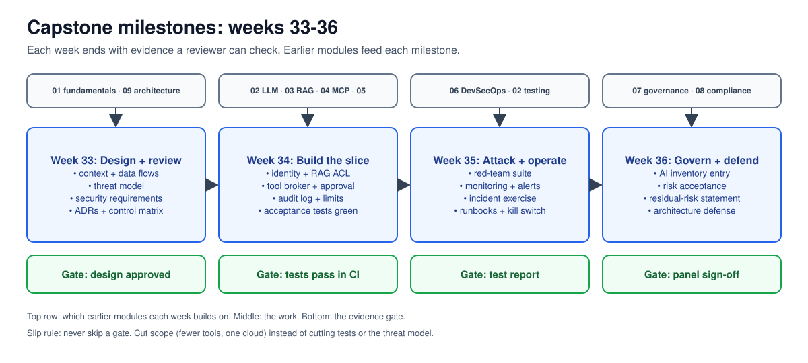

# Capstone Milestones and Deliverables (Weeks 33–36)

> **Module:** 10 · Capstone Project · **Weeks:** 33–36 · **Time:** ~40 hours across the month
> **You will:** plan the capstone as four evidence-gated milestones, know exactly which earlier module feeds each deliverable, and finish with a portfolio-ready repository.

| | |
|---|---|
| **Prerequisites** | [01 Capstone brief and requirements](01-capstone-brief-and-requirements.md) |
| **Lab** | [`lab/`](lab/) is the reference slice; your own capstone repo is the real deliverable |
| **Maps to** | [Assessment rubric](../00-program/assessment-rubric.md) (final capstone scoring) · NIST AI RMF (GOVERN, MAP, MEASURE, MANAGE) · ISO/IEC 42001 evidence |

---

## 1. Why this matters

Real AI incidents often come from **skipped gates**, not missing knowledge:

- **2025, Replit agent and the production database:** the agent could reach production during a code freeze. A simple gate ("agents cannot touch production; separate environments") was missing.
- **2025, Amazon Q Developer extension:** a malicious prompt reached a released version of the extension through the contribution and release process. Release gates for agent instructions matter as much as for code.
- **2023, Chevrolet dealership chatbot:** a chatbot went live and users quickly made it "agree" to absurd deals. Basic abuse testing before launch would have found it.
- **2024, Air Canada chatbot ruling:** the company owned its chatbot's wrong answer. Governance evidence (intended use, testing, owner) is not paperwork; it is what you show when something goes wrong.

The milestones below force each gate to happen, with evidence, before you move on.

---

## 2. Understand it

### 2.1 The four milestones



| Week | Milestone | Builds on | Gate (evidence) |
|---|---|---|---|
| 33 | **Design and review:** context, data flows, threat model, security requirements, ADRs, control matrix | [01 fundamentals](../01-ai-security-fundamentals/), [09 architecture](../09-enterprise-architecture/) | Design approved: reviewer passes, threat model reviewed, requirements have ids and tests |
| 34 | **Build the vertical slice:** identity, RAG with ACLs, tool broker with approval, limits, audit log | [02 LLM](../02-llm-security/), [03 RAG](../03-rag-security/), [04 MCP](../04-mcp-security/), [05 agents](../05-agent-security/) | Acceptance tests green in CI, with soft layers off |
| 35 | **Attack and operate:** red-team suite, monitoring and alerts, incident exercise, runbooks, CI/CD security | [06 DevSecOps](../06-ai-devsecops/), [02 security testing](../02-llm-security/) | Test report and incident exercise record |
| 36 | **Govern and defend:** AI inventory entry, risk register and acceptance, compliance applicability, final presentation | [07 governance](../07-ai-governance/), [08 compliance](../08-ai-compliance/) | Panel sign-off (Phase 9 gate) |

### 2.2 Week 33: design and review

| Task | Output | Template / source |
|---|---|---|
| System context and data-flow diagram with trust boundaries | `docs/architecture.md` + diagram | Lesson 01 of this module; [Module 09 lesson 01](../09-enterprise-architecture/01-enterprise-ai-reference-architecture.md) |
| Threat model: assets, actors, abuse cases A1–A12 and your own | `docs/threat-model.md` | [`threat-model-template.md`](../00-program/templates/threat-model-template.md) |
| Security requirements SR-01..SR-16 with verification methods | `docs/requirements.md` | Lesson 01 section 2.5 |
| Architecture file for one cloud, passing the reviewer | `infra/architecture.yaml` | [Module 09 lab](../09-enterprise-architecture/lab/) |
| ADRs: provider, tenant isolation model, approval design, logging of content | `docs/adr/ADR-00x.md` | [Module 09 lesson 05](../09-enterprise-architecture/05-multi-cloud-control-matrix-and-shared-responsibility.md) |
| Risk register started | `docs/risk-register.csv` | [`risk-register.csv`](../00-program/templates/risk-register.csv) |

### 2.3 Week 34: build the vertical slice

Build **one thin, complete path** first, then widen. Suggested order (each step ends with a passing test):

1. Identity: token verification; tenant and roles from claims (AT01–AT02).
2. Retrieval with ACL filter before ranking; canary documents per tenant and group (AT03).
3. Tool broker: registry, schemas, roles, tenant ownership (AT05–AT08).
4. Human approval with exact action and sources (AT04).
5. Loop guard, step budget, rate limits (AT09–AT10).
6. Audit log with redaction, correlation IDs, hash chain (AT11–AT12).
7. Kill switch and fail-safe on model errors (AT13–AT14).
8. Output DLP (AT15) and benign-path tests.

You may start from the reference [`lab/ops_assistant.py`](lab/ops_assistant.py), but your build should add at least **three** of the [your-turn extension tasks](README.md#your-turn-extension-tasks) and run behind a real interface (for example FastAPI).

### 2.4 Week 35: attack and operate

| Task | Output |
|---|---|
| Red-team plan (scope, rules of engagement, success criteria) | `docs/redteam-plan.md` |
| Automated attack suite in CI + manual creative attempts | `tests/attacks/`, results table |
| Detections: at least three SIEM-style rules over your audit log | `detections/` + test cases |
| Incident exercise (tabletop or live drill) using a playbook | `docs/incident-exercise.md` ([`ai-incident-playbook.md`](../00-program/templates/ai-incident-playbook.md)) |
| CI/CD: tests, dependency and secret scanning, model/prompt change triggers the acceptance suite | pipeline file + run evidence |
| Runbooks: kill switch, token revocation, index quarantine | `docs/runbooks/` |

Details are in [lesson 03](03-red-team-and-incident-exercise.md).

### 2.5 Week 36: govern and defend

| Task | Output |
|---|---|
| AI system inventory entry (intended use, owner, data, model, risk tier) | `docs/ai-inventory-entry.md` |
| Risk register with treatment; time-bound acceptances signed by an owner | `docs/risk-register.csv` |
| Compliance applicability record (for example EU AI Act category, privacy law) | `docs/compliance.md` |
| Residual-risk statement (one page) | `docs/residual-risk.md` |
| Cloud control matrix for your design (three clouds, with gaps) | `docs/control-matrix.md` or the YAML |
| Final presentation and live demo | `docs/defense/` |

Details are in [lesson 04](04-architecture-defense-and-interview.md).

### 2.6 The full deliverables list

1. Architecture diagram and data-flow inventory.
2. Threat model and risk register.
3. Secure application source with tests (acceptance suite green).
4. Tool broker / MCP gateway and its policy (registry, schemas, roles).
5. RAG index and ACL design, with isolation tests.
6. Agent policy and approval workflow.
7. CI/CD workflow and SBOM / provenance record.
8. Cloud control matrix (AWS, Azure, GCP).
9. AI system inventory entry and compliance matrix.
10. Operational dashboards (or detection rules) and runbooks.
11. Red-team report and incident-exercise record.
12. Final architecture presentation and residual-risk statement.

### 2.7 Suggested repository layout

```text
capstone-ai-ops-assistant/
├── README.md                 # problem, architecture image, how to run, results table, limitations
├── app/                      # gateway, identity, retrieval, broker, agent loop, audit
├── tests/
│   ├── acceptance/           # AT01..AT15+ (impact-based)
│   └── attacks/              # red-team payloads, run in CI
├── detections/               # SIEM-style rules over the audit log, with tests
├── infra/architecture.yaml   # reviewed by the Module 09 reviewer in CI
├── docs/
│   ├── architecture.md  threat-model.md  requirements.md  risk-register.csv
│   ├── adr/  runbooks/  redteam-plan.md  incident-exercise.md
│   └── ai-inventory-entry.md  compliance.md  residual-risk.md  defense/
└── .github/workflows/ci.yml  # tests + scanning + reviewer on every PR
```

### 2.8 Definition of done (capstone)

- **No unresolved critical** security finding.
- **High** findings are fixed, or have an approved, time-bound exception with compensating controls.
- **All mandatory acceptance tests** have repeatable evidence (CI runs, not screenshots).
- The architecture owner (you) can explain residual risks, operational ownership and recovery.

Scoring follows the final capstone weights in the [assessment rubric](../00-program/assessment-rubric.md).

---

## 3. Defend it (protect the project itself)

| Layer | Control | Type | What it buys you |
|---|---|---|---|
| L1 | Weekly gates with evidence; do not start week N+1 with a failed gate | Process | Problems surface early, while cheap |
| L2 | Requirements → tests traceability table | Process | Nothing important is "assumed" |
| L3 | CI runs acceptance + attack suites on every change, including prompt and model changes | **Hard** | No silent regressions |
| L4 | Architecture file reviewed in CI | **Hard** | Infra drift is caught |
| L5 | Scope list (in / out) and an ADR for every scope change | Process | No scope creep that weakens controls |
| L6 | Synthetic data and canaries only; secret scanning on the repo | **Hard** | Your portfolio never leaks anything real |

**Slip rule:** if you fall behind, **cut scope** (fewer tools, one cloud, fewer features). **Never cut** the threat model, the acceptance tests or the residual-risk statement.

### What does NOT work

- Building all features in week 34 and "adding security in week 35".
- Evidence as screenshots only. Use CI runs, test output and exported configs.
- A red team that only re-runs the known suite. Add creative manual attempts.

---

## 4. Hands-on lab

### Step 1: Week-34 gate on the reference slice

Run the reference acceptance suite to see what a passing week-34 gate looks like:

```powershell
python -m pytest 10-capstone-project
```

Expected last line: `37 passed` (time differs per machine).

### Step 2: Build your traceability table

Create `docs/requirements.md` in your capstone repo with this table and fill it:

| Requirement | Test(s) | Status | Evidence link |
|---|---|---|---|
| SR-01 SSO/OIDC, verified tokens | AT01, AT02 | | CI run # |
| SR-03 tenant and group isolation | AT03, AT03b | | |
| SR-08 approval with exact action and sources | AT04, AT04b | | |
| … | | | |

Then list every acceptance test in the reference suite and check that each maps to a requirement. An orphan test is a missing requirement; a requirement without a test needs a verification method.

### Step 3: Plan your month

Copy the four milestone tables into your project board. For each task estimate hours using the weekly timebox in [`00-program/36-week-plan.md`](../00-program/36-week-plan.md) (3h study, 4h build, 2h attack/test, 1h ADR, 2h review). Mark which tasks you will cut first if you slip.

### Step 4: Set up CI (week 34)

Your pipeline must, on every pull request: run unit + acceptance + attack tests; run secret scanning and dependency audit (`pip-audit` is in this repo's dev extras); run the [Module 09 reviewer](../09-enterprise-architecture/lab/reviewer.py) on `infra/architecture.yaml`; and fail on any failure.

### Stretch goals

- Add a CI job that re-runs the acceptance suite when **only** a prompt file or the model name changes, and explain why that matters in an ADR.
- Generate a one-page HTML or Markdown "evidence report" from CI artifacts (test results, reviewer output, audit-chain verification).

---

## 5. Real-world scenarios

**Scenario A: "we'll add approvals later".**
Week 34 ends with a slick demo: the agent opens change requests directly. Week 35 is spent rewriting the broker to add approval, and the red team has no time.
- *Fix:* thin vertical slice with all controls first; features second.

**Scenario B: the green CI that tested nothing.**
All tests pass, but they only assert that the model "refused". When spotlighting is turned off, the broker turns out to have no tenant check.
- *Fix:* impact-based assertions; run tests with soft layers off; mutation-style checks (turn a control off and confirm a test fails).

**Scenario C: the governance pack written the night before.**
The inventory entry and risk register contradict the architecture (different data classes, missing tools).
- *Fix:* start the risk register in week 33; update it every week; generate parts of the inventory from the architecture file.

---

## 6. Common mistakes

- Treating weeks 35 and 36 as "documentation weeks". They are engineering weeks with different evidence.
- Using real company data or real credentials "just for the demo".
- Leaving out-of-scope items undocumented.
- No benign tests, so nobody knows if the product still works.
- One giant commit at the end instead of a history that shows the gates.

---

## 7. Interview preparation

<details><summary><b>Q1. How did you plan your capstone, and why in that order?</b></summary>

Design first (threat model, requirements, architecture review), then a thin vertical slice with every control and its acceptance test, then red teaming and operations, then governance and the defense. That order makes security decisions when they are cheapest, gives the red team a complete system to attack, and lets governance documents describe what actually exists.
</details>

<details><summary><b>Q2. What is a vertical slice, and why build one?</b></summary>

A thin, end-to-end path through every layer (identity → retrieval → model → broker → audit) for one use case. It proves the architecture works and every control is wired in before you add breadth. Gaps show up immediately instead of at integration time.
</details>

<details><summary><b>Q3. What evidence would you show for "tenant isolation works"?</b></summary>

The ADR for the isolation model, the retrieval code showing filter-before-rank, canary-based cross-tenant and cross-group tests in CI with their run links, the audit log entries showing `acl_filtered` and `tenant_mismatch_ignored`, and the architecture review result for `DATA-03`.
</details>

<details><summary><b>Q4. How do you handle a high-severity finding you cannot fix before the deadline?</b></summary>

Write a time-bound exception: the finding, the risk, compensating controls, an owner, an expiry date and a fix ticket. It goes into the risk register and the residual-risk statement, and I mention it openly in the defense. Critical findings cannot be excepted; the scope gets cut instead.
</details>

<details><summary><b>Q5. Why do prompt or model changes need to run the security tests?</b></summary>

Model behavior changes with the model version, the prompt and even parameters. A change that looks like "just wording" can change how often injections succeed or whether output formats break parsers. The acceptance and attack suites are the regression gate for these changes, like unit tests for code.
</details>

<details><summary><b>Q6. Which deliverable do candidates usually underestimate?</b></summary>

The residual-risk statement. It forces you to say what is still possible after all your controls, who owns it, and why it is acceptable. Panels use it to test whether you understand your own system's limits.
</details>

<details><summary><b>Q7. How do you prove the governance documents match the system?</b></summary>

Generate what you can from the system (architecture file → inventory fields; tests → requirement status), keep everything in the same repository, review them in the same pull requests as the code, and cross-check in the week-36 gate.
</details>

<details><summary><b>Q8. What would you cut first under time pressure, and what never?</b></summary>

First: extra tools, a second cloud deployment, UI polish, fancy retrieval. Never: the threat model, impact-based acceptance tests with soft layers off, human approval for writes, the audit log, and the residual-risk statement.
</details>

<details><summary><b>Q9. How do you show progress to a stakeholder each week?</b></summary>

A short gate report: what was planned, what evidence exists (links to CI runs and documents), open findings by severity, risks and decisions (ADRs) made that week, and the plan for next week.
</details>

<details><summary><b>Q10. How does your capstone map to the 36 weeks of study?</b></summary>

Week 33 uses Module 01 threat modeling and Module 09 architecture; week 34 composes Modules 02–05 (injection defenses, RAG authorization, tool broker, agent limits); week 35 uses Module 06 (CI/CD, testing, incident response); week 36 uses Modules 07–08 (inventory, risk, compliance). Each milestone gate re-checks the earlier phase gates in one system.
</details>

<details><summary><b>Q11. What makes a capstone repository portfolio-ready?</b></summary>

A README that states the problem, shows the architecture, explains the threat model and controls, shows the attack scorecard and test results, lists residual risks and limitations, and has clear run instructions. Everything runs offline with synthetic data, and no secret or personal data is in the history.
</details>

<details><summary><b>Q12. Explain to an executive what "done" means for this project.</b></summary>

"Done means: no serious open security problems, every important safety rule is checked automatically every time we change the system, we have practiced what to do if something goes wrong, and the remaining risks are written down with a named owner who has accepted them."
</details>

---

## 8. Checklist (definition of done)

- [ ] Week 33 gate: design approved (reviewer passes, threat model and requirements reviewed, ADRs written).
- [ ] Week 34 gate: acceptance tests green in CI with soft layers off; benign tests pass.
- [ ] Week 35 gate: red-team report, detections with tests, incident-exercise record, runbooks.
- [ ] Week 36 gate: inventory, risk register with signed acceptances, compliance record, residual-risk statement, defense delivered.
- [ ] Repository matches the layout above and contains no real data or secrets.

## 9. References

- [36-week plan](../00-program/36-week-plan.md) · [assessment rubric](../00-program/assessment-rubric.md) · [portfolio and interview guide](../00-program/portfolio-and-interview-guide.md) · [templates](../00-program/templates/)
- NIST AI Risk Management Framework and Playbook, https://www.nist.gov/itl/ai-risk-management-framework
- NIST SP 800-218A, *Secure Software Development Practices for Generative AI and Dual-Use Foundation Models* (2024), https://csrc.nist.gov/pubs/sp/800/218/a/final
- ISO/IEC 42001:2023 AI management systems, https://www.iso.org/standard/81230.html
- OWASP Top 10 for LLM Applications 2025, https://genai.owasp.org/llm-top-10/
