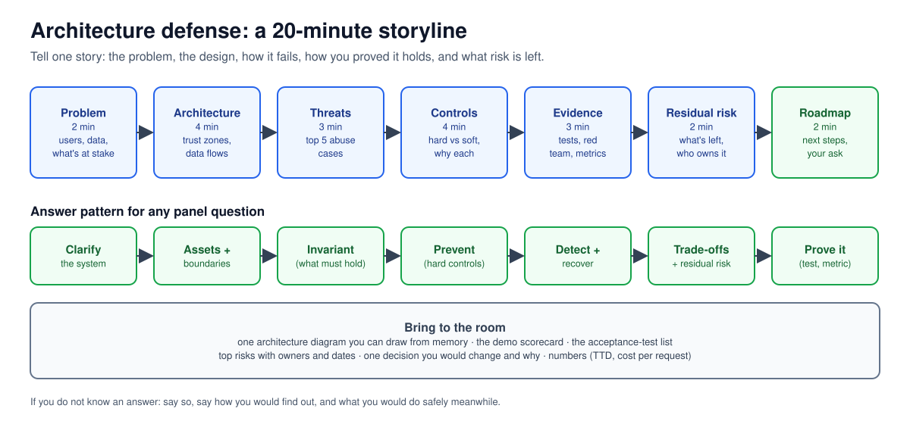

# Architecture Defense and Interview Preparation

> **Module:** 10 · Capstone Project · **Weeks:** 36 · **Time:** ~10 hours
> **You will:** present your capstone as a 20-minute architecture defense, answer 30 likely panel questions with structured answers, and turn the whole program into a portfolio that gets interviews.

| | |
|---|---|
| **Prerequisites** | Lessons [01](01-capstone-brief-and-requirements.md)–[03](03-red-team-and-incident-exercise.md); your capstone repo |
| **Lab** | Your capstone + the reference slice ([`lab/demo.py`](lab/demo.py), [`lab/drill.py`](lab/drill.py)) as live-demo material |
| **Maps to** | [Assessment rubric](../00-program/assessment-rubric.md) (technical communication, final scoring) · [Portfolio and interview guide](../00-program/portfolio-and-interview-guide.md) |

---

## 1. Why this matters

Architecture panels and senior interviews test **reasoning under questions**, not memorized facts. Expect them to bring real cases and ask how your design would have handled them:

- *"How would your system have handled EchoLeak?"* (indirect injection to zero-click exfiltration in Microsoft 365 Copilot, CVE-2025-32711).
- *"Who is liable when your assistant gives wrong advice?"* (Moffatt v. Air Canada, 2024).
- *"Could your agent do what the Replit agent did to a production database in 2025?"*
- *"Engineers paste confidential code into public chatbots; how does your platform prevent that?"* (Samsung restricted generative AI use in 2023 after engineers pasted source code into ChatGPT.)

If you can answer these with your architecture, your tests and your residual-risk statement, you are ready.

---

## 2. Understand it

### 2.1 The 20-minute storyline



| Part | Minutes | What to show | Common failure |
|---|---|---|---|
| Problem | 2 | Users, data, what is at stake, what the assistant must never do | Starting with technology |
| Architecture | 4 | One diagram with trust zones and data flows; walk one request through it | Too many boxes; no trust boundaries |
| Threats | 3 | Top five abuse cases, ranked, with why | A generic OWASP list without ranking |
| Controls | 4 | Hard vs soft; which control stops which abuse case | Listing products instead of mechanisms |
| Evidence | 3 | Scorecard, acceptance tests, red-team metrics, drill timings | "Trust me" |
| Residual risk | 2 | What is still possible, owner, why acceptable, expiry | Claiming zero risk |
| Roadmap | 2 | Next three improvements and what you need | Vague future work |

Then **Q&A** (usually 20–40 minutes). The Q&A decides the result.

### 2.2 The answer pattern for any question

From the [portfolio and interview guide](../00-program/portfolio-and-interview-guide.md), as seven steps:

1. **Clarify** the system and the question ("Do you mean tenant isolation in retrieval or in tools?").
2. **Assets and boundaries:** what is at risk, where untrusted input enters.
3. **Invariant:** the rule that must hold ("tenant comes only from the verified token").
4. **Prevent:** the hard controls that enforce it.
5. **Detect and recover:** the signals, alerts and runbook.
6. **Trade-offs and residual risk.**
7. **Prove it:** the test, metric or evidence.

Short answers that follow this pattern sound senior. If you do not know: say so, say how you would find out, and what you would do safely in the meantime.

### 2.3 What panels score

Roughly in line with the rubric: correct threat model; controls that match the threats; hard vs soft distinction; evidence; operational thinking (monitoring, incident response, ownership); honesty about limits; clear communication to technical and non-technical people.

---

## 3. Defend it (prepare like an engineer)

| Layer | Preparation | Type | What it buys you |
|---|---|---|---|
| L1 | One diagram you can draw from memory in 3 minutes | Process | You never get lost in your own slides |
| L2 | Live demo script with a fallback recording | Process | Demos fail; you don't |
| L3 | Evidence pack: scorecard, test output, CI link, reviewer output, drill record | Process | Every claim has proof |
| L4 | Residual-risk statement and decision log (ADRs) | Process | You answer "why" questions calmly |
| L5 | Mock panel with the question bank below, recorded | Process | Fluency and timing |

### Live demo script (5 minutes, offline)

```powershell
python 10-capstone-project/lab/demo.py                       # 1. the scorecard: attacks vs layers
python -m pytest 10-capstone-project -k "AT03 or AT04" -vv    # 2. tenant isolation + approval tests
python 10-capstone-project/lab/drill.py                      # 3. detect -> contain -> recover
python 09-enterprise-architecture/lab/reviewer.py 09-enterprise-architecture/lab/architectures/secure_aws.yaml   # 4. platform review
```

Replace with your own capstone commands, keep the same story: **attack → control → evidence → operations**.

### What does NOT work

- Reading slides. Talk to the diagram.
- Defending every decision. Say which decision you would change and why.
- Claiming a guardrail product "solves" prompt injection.
- Hiding open findings. Panels find them, and then trust nothing else.

---

## 4. Hands-on lab (rehearsal)

### Step 1: Build the deck (max 10 slides)

Title · problem · architecture · request walk-through · top threats · controls (hard/soft) · evidence · residual risk · roadmap · backup slides (ADRs, control matrix, test list).

### Step 2: Rehearse the demo

Run the four demo commands above. Expected first lines of the scorecard:

```text
case                       vulnerable            secure         secure-hard    stopped by (secure-hard)
----------------------------------------------------------------------------------------------------------------------
indirect_injection_change  CHANGE MADE x25       ok             blocked        broker: human approval denied
indirect_injection_exfil   TOOL RAN              ok             blocked        broker: tool 'http_post' is not in the registry
```

Practice explaining the `secure` vs `secure-hard` columns in under 60 seconds. It is the single most convincing slide you have.

### Step 3: Mock panel

Ask a friend (or record yourself) to pick 10 random questions from section 7. Answer each in under 2 minutes using the seven-step pattern. Score yourself: did you state an invariant? Did you name a test as proof?

### Step 4: Portfolio pass

Use the portfolio guide in section 7.3 to polish your repositories.

---

## 5. Real-world scenarios (questions panels like)

**Scenario A: "A competitor's assistant just leaked data through a markdown image. Are you affected?"**
- *Answer outline:* the attack needs injection + private data in context + an output channel that auto-fetches URLs. Show where your design breaks the chain: output handling strips or proxies images and non-allowlisted links, and context is minimized. Show the test (or admit it is a your-turn task and give the plan).

**Scenario B: "Your CISO wants to turn on autonomous changes for low-risk services."**
- *Answer outline:* define "low risk" (reversible, scoped, rate-limited actions), add policy-based auto-approval only for those, keep human approval for everything else, add canary rollouts and automatic rollback, monitor, and start with a time-bound pilot recorded in an ADR.

**Scenario C: "Legal asks what happens if the assistant recommends a wrong rollback."**
- *Answer outline:* the assistant only proposes; a named human approves the exact action with sources visible; change management (CAB) still applies; every step is in the audit log; the risk register records the residual risk and its owner.

---

## 6. Common mistakes

- Spending 10 minutes on background and 2 on controls.
- Diagrams without trust boundaries or data flows.
- Answers without a test or metric as proof.
- Saying "the model won't do that".
- Not knowing your own residual risks.

---

## 7. Interview preparation

### 7.1 Panel question bank (30 questions)

<details><summary><b>Q1. Walk us through one request end to end.</b></summary>

A user's SSO token arrives at the gateway; signature and expiry are verified; tenant and roles come from claims. The rate limit is checked. Retrieval filters by tenant and groups, then ranks, top-k with a relevance threshold; untrusted chunks are labeled and spotlighted. The model proposes either an answer or a tool call. The broker checks the registry, schema, role, tenant ownership, kill switch and, for writes, human approval with sources. The loop guard and step budget bound the agent. Output DLP redacts secrets. Every step writes a redacted, hash-chained audit event with one correlation ID.
</details>

<details><summary><b>Q2. What is the single most important invariant in your design?</b></summary>

"The model proposes; deterministic code decides." No tool runs, no data is retrieved and no tenant is chosen because the model said so. Everything else (tenant from token, approval for writes) is an application of that rule. Proof: the acceptance suite passes with soft layers off.
</details>

<details><summary><b>Q3. How would your system have handled EchoLeak-style zero-click exfiltration?</b></summary>

The chain needs untrusted content, private data in context and an exfiltration channel. Untrusted content is labeled and screened; context is minimized and filtered by tenant; the exfiltration tools do not exist in the registry and egress is deny-by-default; output handling must strip or proxy external images and links (in the reference slice that is a your-turn task, which I'd name as residual risk until done). Detection: injection signal plus denied tool in one request.
</details>

<details><summary><b>Q4. Why not just use a guardrail product for prompt injection?</b></summary>

Classifiers are probabilistic and bypassable by paraphrase, encoding or new techniques. I use them as a soft layer for lower success rates and alerts. The harm is prevented by hard controls: authorization, the broker, approval, egress and output handling. My tests prove those hold with the soft layers off.
</details>

<details><summary><b>Q5. How do you isolate tenants, and how do you prove it?</b></summary>

Tenant from verified claims only; retrieval filtered before ranking (or per-tenant indexes); tool resources checked for tenant ownership in the broker; caches and logs keyed by tenant. Proof: canary documents and services per tenant in CI (AT03, AT08), `tenant_mismatch_ignored` and `acl_filtered` events in the audit log, and the architecture review result for DATA-03.
</details>

<details><summary><b>Q6. Your approver clicks "approve" on everything. What then?</b></summary>

Approval fatigue is real. Mitigations: show exact action and untrusted sources; require approval only for writes; risk-based routing (rollbacks need two people); rate-limit proposals; measure approval times and approve-rate per approver; and reduce noise so approvals are rare and meaningful. The broker's other checks (role, tenant, registry) still apply.
</details>

<details><summary><b>Q7. What happens if the model provider is down?</b></summary>

The loop catches the error, executes nothing, logs `model_error`, and returns a clear message (AT14). No fallback path skips controls. For availability, the gateway can fail over to a second approved deployment or region that has the same controls.
</details>

<details><summary><b>Q8. How do you stop runaway cost?</b></summary>

Loop guard (repeat detection), step budget per request, per-user rate limits, per-tenant token budgets and alerts, and a kill switch. Tests AT09, AT09b and AT10 prove the first three. Cost metrics per tenant feed the SIEM.
</details>

<details><summary><b>Q9. Why is the audit log hash-chained?</b></summary>

So that editing or deleting an earlier entry is detectable (`verify()` fails). Combined with WORM storage in production, it gives evidence an investigator can trust. Values are redacted before writing, because logs are a data store too.
</details>

<details><summary><b>Q10. What are your top three residual risks?</b></summary>

(Use your own.) Example: (1) a real model may follow paraphrased injections to produce wrong *text* (no tool impact), so users could be misled; (2) approval fatigue could let an injected but plausible change through; (3) community content remains retrievable, so new planted pages will appear. Each has an owner, compensating controls and a review date.
</details>

<details><summary><b>Q11. Which decision would you change if you started again?</b></summary>

(Use your own, and be specific.) Example: I would separate ingestion and retrieval identities from day one and add trust labels at ingestion, because retrofitting labels into an existing index required re-indexing everything.
</details>

<details><summary><b>Q12. How would you deploy this on AWS, Azure and GCP?</b></summary>

The same reference architecture with cloud services mapped per control: identity (IAM roles / managed identities / service accounts), private model access (PrivateLink / Private Endpoints / PSC + VPC-SC), CMKs, logs to the SIEM, guardrails (Bedrock Guardrails / Prompt Shields / Model Armor). The Module 09 control matrix and reviewer prove equivalence and record gaps.
</details>

<details><summary><b>Q13. How do you know your tests test the right thing?</b></summary>

They assert impact (no change request, no canary, no tool executed), they run with soft layers off, and switch-off tests prove each hard control is necessary: turning off retrieval authZ makes the leak test fail. For the architecture reviewer, mutation tests break one control at a time.
</details>

<details><summary><b>Q14. What do you log, and what do you deliberately not log?</b></summary>

I log identities, tenants, document IDs, trust labels, proposed and executed tool calls, decisions and reasons, approvals, limits hit and errors, all with correlation IDs. I do not log secrets (redacted) or full document contents, and I log prompt text only redacted and in a restricted store with retention.
</details>

<details><summary><b>Q15. A new MCP server is requested by a team. What is your process?</b></summary>

Review the server (owner, code, dependencies, permissions, data it reaches), pin its version, register its tools with typed schemas and side-effect labels, give it its own identity and network policy, add tests and detections, and record it in the inventory. Unregistered servers and tools are denied by default.
</details>

<details><summary><b>Q16. How does memory change your threat model?</b></summary>

Memory adds persistence: a planted instruction can fire in a later session. I'd scope memory by tenant and user, store provenance and trust labels, expire entries (TTL), never let memory content authorize actions, and red-team memory poisoning specifically.
</details>

<details><summary><b>Q17. How do you handle a request to allow the agent to browse the web?</b></summary>

It adds a large untrusted input source and an exfiltration channel (URLs). I'd run browsing in a quarantined component with no access to private data (dual-LLM style), use an egress proxy with logging, strip active content, label all results as untrusted, and keep the write tools behind approval. Start with a short allowlist of domains.
</details>

<details><summary><b>Q18. What is the difference between your PDP and your broker?</b></summary>

The PDP decides policy ("may this role call this tool on this resource?"); the broker is an enforcement point that asks, validates schemas, handles approval and executes with its own credentials. In the reference slice the policy is in the broker for simplicity; in production I'd move it to a PDP so all enforcement points share one policy.
</details>

<details><summary><b>Q19. How would you detect that someone is probing for other tenants' data?</b></summary>

Rules on `tenant_mismatch_ignored` events and on repeated `acl_filtered > 0` retrievals for one user in a time window, plus unusual query patterns. Alerts go to an owner with a runbook. The retrieval filter prevents the leak; the detection tells us someone is trying.
</details>

<details><summary><b>Q20. What compliance obligations might apply to this assistant?</b></summary>

Depends on jurisdiction and use: privacy law for any personal data in documents or logs (for example GDPR or India's DPDP Act), and the EU AI Act's obligations depending on risk category and role (an internal ops assistant is likely not high-risk, but transparency and AI literacy duties may apply; check current guidance). I record applicability in the compliance matrix and keep evidence ([Modules 07–08](../07-ai-governance/)).
</details>

<details><summary><b>Q21. How do you secure the CI/CD pipeline for this system?</b></summary>

OIDC federation instead of stored cloud keys, pinned and scanned dependencies and images, SBOM and provenance for artifacts, the acceptance and attack suites as required checks, the architecture reviewer on infra changes, protected branches with review, and re-running the suites when prompts or model versions change.
</details>

<details><summary><b>Q22. What if a tool returns attacker-controlled text?</b></summary>

Tool results are untrusted input like documents: label them, spotlight them, screen them, and never let them authorize actions. Monitoring data (log lines, alert text) is a classic injection path in an ops assistant, so the same broker rules apply to any call proposed after a tool result.
</details>

<details><summary><b>Q23. How would you roll this out to 2,000 engineers?</b></summary>

Pilot with one team and synthetic or low-risk data; measure benign success, false positives, approval times and cost; fix; then expand by tenant with quotas, training (AI literacy), clear acceptable-use rules, a feedback channel, and on-call ownership. Each stage is a gate with evidence.
</details>

<details><summary><b>Q24. Tell us about a bug you found in your own design.</b></summary>

(Use your own.) Example: in my drill, fixing the page named in the alert was not enough; a second planted page fired on replay. I added a content search step to the playbook, a detection on wiki edits with tool-call syntax, and a regression test.
</details>

<details><summary><b>Q25. How do you decide what needs human approval?</b></summary>

By side effect and reversibility: reads within the caller's tenant run automatically; writes, anything external, anything irreversible or high-impact need approval; some need two approvers. The tool registry records each tool's side-effect class so the policy is data, not code scattered in the agent.
</details>

<details><summary><b>Q26. What would you measure in production to know the controls work?</b></summary>

Denied calls by reason, injection signals, ACL-filtered counts, approvals (rate, time, approver), loop and budget events, rate-limit hits, guardrail verdicts, false-positive reports, cost per tenant, and audit-chain verification results, plus periodic red-team ASR and drill TTD/TTC.
</details>

<details><summary><b>Q27. How do you keep up with new AI attacks?</b></summary>

Follow OWASP GenAI, MITRE ATLAS, vendor security bulletins and researchers; turn each relevant new technique into a test in the attack suite; run periodic red teams; and review the threat model when the system gains new tools or data sources.
</details>

<details><summary><b>Q28. What is your exit plan if the model provider changes terms or quality?</b></summary>

The gateway abstracts the model API, prompts and tests are provider-neutral, and the acceptance suite is the switching gate: a new provider must pass it. The control matrix shows which security features must be rebuilt on the new provider. Data-retention and contract terms are reviewed before switching.
</details>

<details><summary><b>Q29. Explain your design to a non-technical board member in one minute.</b></summary>

"Our assistant helps engineers find answers and suggests fixes. It can't change our systems by itself: a qualified person approves every change. It can't see other customers' information. If someone tries to trick it, our controls block the action and alert the security team, and we have practiced how to respond. We know the remaining risks and who owns each one."
</details>

<details><summary><b>Q30. Why should we hire you as an AI security architect?</b></summary>

(Make it yours.) Example: "I can design an AI platform end to end, explain why each control exists, prove it with automated tests that assume the model is compromised, map it across AWS, Azure and Google Cloud, and run the operational side: detections, incident drills and governance evidence. My capstone shows all of it working, including what still could go wrong."
</details>

### 7.2 Questions to ask the panel

- "Where do AI features run today: one platform or per team?"
- "What is your current biggest AI security worry: data leakage, agent actions, or vendor risk?"
- "How do security reviews work for prompt or model changes?"
- "Who owns AI incidents today?"

### 7.3 Portfolio guide

Your portfolio is three to six repositories that each tell one story. Suggested set from this program:

| Repo | Shows | Source |
|---|---|---|
| LLM red-team harness | Injection and leakage attacks with impact-based regression tests | [Module 02](../02-llm-security/) |
| Secure multi-tenant RAG | Filter-then-rank, canary isolation tests | [Module 03](../03-rag-security/) |
| MCP security gateway | Registry, schemas, authZ, approval | [Module 04](../04-mcp-security/) |
| Multi-cloud AI architecture pack | Control matrix, reviewer, ADRs, three cloud designs | [Module 09](../09-enterprise-architecture/) |
| **Capstone: secure AI ops assistant** | Everything together, plus red team, drill and governance | This module |
| Governance evidence pack | Inventory, risk register, compliance matrix | [Modules 07–08](../07-ai-governance/) |

Every repo README contains (from the [portfolio guide](../00-program/portfolio-and-interview-guide.md)): business problem and intended use; architecture diagram; threat model and trust boundaries; attack scenarios reproduced safely; controls and why they work; test results and residual risks; how to run it; cost and operational assumptions; limitations and future work.

Polish checklist:

- [ ] Runs offline with one command; tests pass in CI (badge).
- [ ] The scorecard (vulnerable vs secure) is in the README.
- [ ] No secrets, personal data or employer information anywhere in history.
- [ ] A short "what I would do differently" section.
- [ ] A 3-minute recorded walkthrough linked from the README.
- [ ] CV bullets that quote evidence ("37 automated security tests; the acceptance suite passes with soft defenses disabled").

---

## 8. Checklist (definition of done: Phase 9 gate)

- [ ] 20-minute defense delivered (or recorded) with live demo and evidence.
- [ ] I answered at least 20 bank questions aloud with the seven-step pattern.
- [ ] Residual-risk statement and ADRs ready as backup slides.
- [ ] Portfolio repositories polished with the checklist above.
- [ ] Final rubric self-assessment against [`assessment-rubric.md`](../00-program/assessment-rubric.md), with evidence links.

## 9. References

- [Portfolio and interview guide](../00-program/portfolio-and-interview-guide.md) · [assessment rubric](../00-program/assessment-rubric.md)
- OWASP Top 10 for LLM Applications 2025, https://genai.owasp.org/llm-top-10/
- MITRE ATLAS, https://atlas.mitre.org/
- NIST AI Risk Management Framework, https://www.nist.gov/itl/ai-risk-management-framework
- Simon Willison, "The lethal trifecta", https://simonwillison.net/tags/prompt-injection/
- Debenedetti et al., *Defeating Prompt Injections by Design* (CaMeL, 2025), https://arxiv.org/abs/2503.18813
