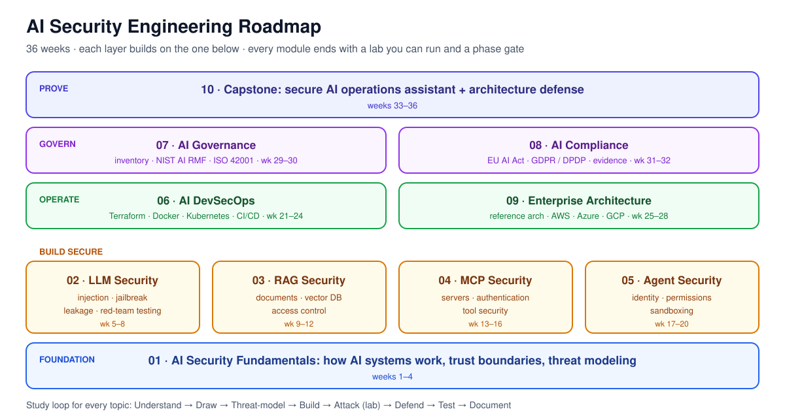

# AI Security Engineering Roadmap

**Advanced AI Security Engineer / Architect · 36 weeks · hands-on · multi-cloud**

A practical, lab-first curriculum for securing LLM applications, RAG, MCP integrations and AI agents. It also covers how to run them safely (DevSecOps, cloud architecture) and how to govern them (risk, compliance).
Every topic includes plain-English explanations, diagrams, a **runnable attack-and-defend lab**, real-world scenarios and **interview questions with model answers**.



## Repository map

```text
ai-security/
├── 00-program/                    plan, rubric, study log, templates, authoring guide
├── 01-ai-security-fundamentals/   how AI systems work · trust boundaries · threat modeling
├── 02-llm-security/
│   ├── prompt-injection/
│   ├── jailbreak/
│   ├── data-leakage/
│   └── security-testing/
├── 03-rag-security/
│   ├── document-security/
│   ├── vector-db-security/
│   └── access-control/
├── 04-mcp-security/
│   ├── mcp-server/
│   ├── authentication/
│   └── tool-security/
├── 05-agent-security/
│   ├── agent-identity/
│   ├── permissions/
│   └── sandboxing/
├── 06-ai-devsecops/
│   ├── terraform/
│   ├── docker/
│   ├── kubernetes/
│   └── cicd/
├── 07-ai-governance/
├── 08-ai-compliance/
├── 09-enterprise-architecture/
├── 10-capstone-project/
├── aisec_lab/                     shared lab helpers (offline mock LLM, canaries)
├── images/                        all diagrams
├── journal/                       my weekly learning notes
└── PROGRESS.md                    week-by-week tracker
```

| # | Module | Weeks | What you build |
|---|---|---|---|
| 01 | [AI Security Fundamentals](01-ai-security-fundamentals/) | 1–4 | Threat-model-as-code analyzer; system map and risk register |
| 02 | [LLM Security](02-llm-security/) | 5–8 | Injection/jailbreak/leakage defenses + a red-team eval harness with a CI gate |
| 03 | [RAG Security](03-rag-security/) | 9–12 | Multi-tenant RAG with authorization-aware retrieval and secure ingestion |
| 04 | [MCP Security](04-mcp-security/) | 13–16 | Server allowlist and rug-pull detection, token audience checks, hardened tools |
| 05 | [Agent Security](05-agent-security/) | 17–20 | Per-agent identity, policy engine with approvals, code sandbox and kill switch |
| 06 | [AI DevSecOps](06-ai-devsecops/) | 21–24 | Policy-as-code for Terraform, Docker, Kubernetes and CI/CD; model scanning |
| 07 | [AI Governance](07-ai-governance/) | 29–30 | AI system register with risk tiering; risk register scoring |
| 08 | [AI Compliance](08-ai-compliance/) | 31–32 | EU AI Act classifier; control-to-evidence gap checker |
| 09 | [Enterprise Architecture](09-enterprise-architecture/) | 25–28 | Architecture-as-code reviewer; AWS/Azure/GCP control matrix |
| 10 | [Capstone Project](10-capstone-project/) | 33–36 | End-to-end secure AI operations assistant and architecture defense |

> Module 09 (cloud architecture) is studied **before** 07–08 (weeks 25–28). Governance makes more sense once you know what you are governing.

## Get started (10 minutes)

```powershell
git clone https://github.com/tharyx/ai-security.git
cd ai-security
python -m venv .venv
.venv\Scripts\Activate.ps1
python -m pip install -e ".[dev]"
python -m pytest            # every lab's tests: should all pass
python 02-llm-security/prompt-injection/lab/demo.py
```

Labs run **offline with no API key**. They use a deterministic, deliberately gullible mock model (see [`aisec_lab/llm.py`](aisec_lab/llm.py)). To try any lab against a real local model, install [Ollama](https://ollama.com) and set `$env:AISEC_LLM_BACKEND = "ollama"`.

## How each topic is structured

Each topic follows the [authoring guide](00-program/AUTHORING-GUIDE.md):

1. **Why it matters**: real incidents.
2. **Understand it**: root cause, taxonomy, diagrams.
3. **Defend it**: layered controls, each marked *hard* (deterministic code) or *soft* (probabilistic).
4. **Hands-on lab**: a vulnerable app, a secure app, attacks, a scorecard and tests.
5. **Scenarios**: what went wrong, how to investigate, the fix.
6. **Common mistakes.**
7. **Interview preparation**: 12–15 questions with model answers.
8. **Checklist** and **references**.

## Study method

**Understand → Draw → Threat-model → Build → Attack → Defend → Test → Document.**

- Plan: [`00-program/36-week-plan.md`](00-program/36-week-plan.md) · Track: [`PROGRESS.md`](PROGRESS.md) · Log: [`journal/`](journal/)
- Phase gates: [`00-program/assessment-rubric.md`](00-program/assessment-rubric.md) · Interviews: [`00-program/portfolio-and-interview-guide.md`](00-program/portfolio-and-interview-guide.md)
- Templates: [`00-program/templates/`](00-program/templates/) (threat model, risk register, test case, incident playbook)

## Core principles (repeated everywhere, on purpose)

- Prompt instructions are **not** an authorization boundary.
- Model output is **untrusted input** until deterministic code validates it.
- Retrieved content, tool descriptions, tool results and memory are untrusted.
- Enforce authorization **outside the model**, as close to the data or action as possible.
- Assume the model will be fooled. Design so that a fooled model can do only a little damage.
- Human approval supports least privilege; it does not replace it.
- One red-team pass proves nothing. Test continuously, and on every model change.

## Safety

Use synthetic data, mock identities and isolated environments. Only test systems you own or are explicitly authorized to test. Never put production secrets or customer data in prompts or in this public repository. Lab code teaches patterns; it is not a drop-in production control. Check current specifications, cloud docs and laws before relying on them: AI moves fast.
