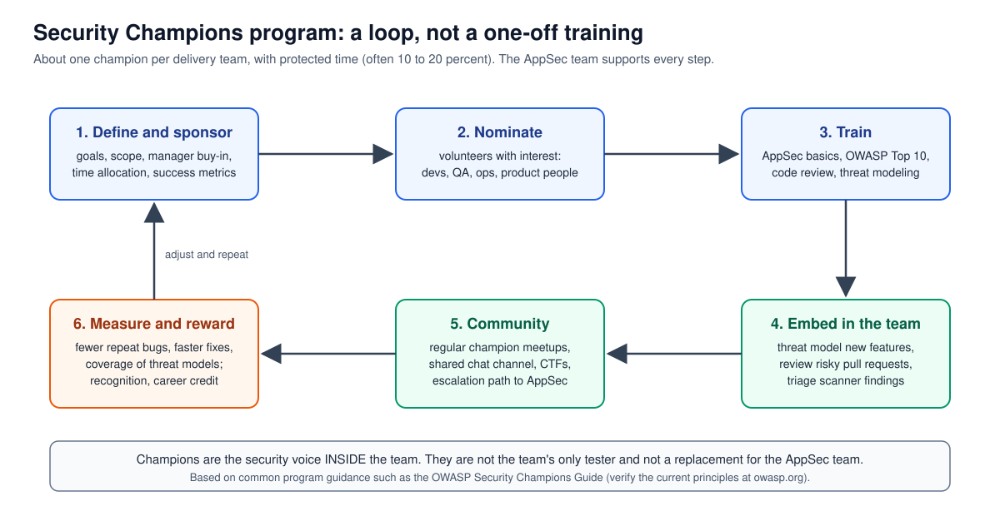

# Lesson 02: Security Champions: Who, Why and How a Program Works

**Syllabus items covered:** [CSC 0] Who is a Security Champion, and Why do we need them?; Who Can Become a Security Champion?; Security Champions' Benefits and Challenges; Security Champions Program Workflow.

**Time:** 60 minutes. **Safety:** concepts only.

> **DBA analogy.** In a big company not every application team has a DBA, but every team has "the person who knows the database": they review risky schema changes, spot a missing index before it hurts, and know when to call the central DBA team. A security champion is that person for security.

## 1. Who is a security champion and why we need them

A **security champion** is a member of a delivery team (usually a developer, sometimes a tester, an ops engineer or a product person) who takes on part-time responsibility for security **inside that team**. They are not a full-time security engineer and do not replace the AppSec team. They are the bridge between both.

**Why companies need them: the ratio problem.** A typical company has far more developers than application security engineers (ratios of one AppSec engineer per 100 or more developers are often quoted; treat any number as an industry estimate). The AppSec team cannot review every story, pull request and design. Champions scale security by being **already in the room** when decisions are made:

| Without champions | With champions |
|---|---|
| Security reviews at the end, as a gate | Security questions asked at sprint planning |
| Scanner findings thrown over the wall | Someone in the team triages and explains them |
| Same bug class repeats in every team | Lessons shared across the champion community |
| AppSec team is a bottleneck | AppSec team coaches and handles the hard cases |

Typical champion activities: raise security user stories and abuse cases, join or run a short threat modeling session for a new feature (chapters 03 to 07), review risky pull requests with a checklist (chapter 02), triage SAST/SCA/DAST results, keep dependencies patched, and pass knowledge back to the team.

## 2. Who can become a security champion

Interest matters more than job title. Good candidates:

- **Developers** who ask "what if the user sends something else?" in code reviews.
- **QA and test engineers**, who already think in abuse cases.
- **Ops, SRE and platform engineers**, who know configuration, secrets and the pipeline.
- **Product owners or business analysts**, who can champion security requirements in the backlog.
- **People from other security areas** (for example a SOC analyst or a DBA moving into security) who join a delivery team.

**Traits to look for:** curiosity, credibility with the team, communication skills, willingness to say "I don't know, let's find out". Prior security knowledge is optional; it is what the training gives them.

**Volunteers, not conscripts.** Nominating someone who does not want the role produces a name on a list and nothing else. Ask for volunteers and get their manager's agreement on time allocation.

## 3. Benefits and challenges

| Benefits | For whom |
|---|---|
| Security found earlier, when it is cheaper to fix | The company |
| Fewer repeat vulnerabilities, faster triage of findings | Delivery teams |
| Scale: AppSec effort multiplied across teams | AppSec team |
| Career growth, new skills, visibility | The champion |
| Better relationship between security and engineering | Everyone |

| Challenges | What helps |
|---|---|
| **No time:** security work is "extra" and loses to deadlines | Agreed time allocation (often 10 to 20 percent), visible in sprint planning |
| **No management support** | Executive sponsor; link the program to business goals and metrics |
| **Champions burn out or leave** | Rotation, recognition, a clear way to step down |
| **"Champion = the team's security person", others stop caring** | The whole team owns security; the champion coaches |
| **Knowledge gaps** | Structured training path, office hours with AppSec, a community |
| **Hard to measure** | A few simple metrics (see below), reviewed every quarter |
| **Program fades after launch** | Regular events, fresh content, leadership visibility |

## 4. The program workflow

1. **Define and sponsor.** Write down goals ("reduce repeat high-severity findings by half"), scope (which teams), time allocation and the executive sponsor. Agree it with engineering management.
2. **Nominate.** One champion per team is a common pattern. Volunteers, approved by their manager.
3. **Train.** A path, not a single session: AppSec basics and OWASP Top 10 (this chapter), secure code review (chapter 02), threat modeling (chapters 03 to 07), the company's own tools and policies.
4. **Embed.** The champion uses the skills in the team's normal ceremonies: security acceptance criteria in stories, a threat modeling slot for new features, a security look at risky pull requests.
5. **Community.** Regular meetups, a shared channel, internal CTFs, guest talks. The AppSec team answers questions and handles escalations.
6. **Measure and reward.** Track a small set of metrics and recognise champions (certificates, conference budget, performance-review credit). Use the results to adjust the program, then repeat.

**Useful metrics (pick a few):** number of teams with an active champion; share of new features with a threat model; mean time to fix high findings; number of repeat findings of the same class; training completion; champion retention.

**OWASP Security Champions Guide.** OWASP publishes a guide built on ten principles. Paraphrased, they cover: being passionate about security, a clear vision for the program, management support, nominating the right people, trusting champions, building a community, sharing knowledge, rewarding responsibility, investing in champions, and keeping engagement over time. Verify the exact wording at the OWASP project page before quoting it.

## 5. Scenario: the payments team

A bank's payments team keeps shipping the same IDOR bug class: an API returns another customer's transaction when the id in the URL changes. The AppSec team finds it in each quarterly pentest. Ravi, a backend developer, volunteers as champion with 15 percent of his time agreed by his manager.

- Week 1 to 4: Ravi completes the training path and runs the [vulnerable-shop lab](labs/vulnerable-shop/README.md) IDOR exercise with the team.
- He adds one line to the team's definition of done: "every endpoint that takes an object id has an ownership test".
- He writes a reusable test helper and shares it in the champion channel; two other teams adopt it.
- Next pentest: no new IDOR findings in payments. Ravi presents the change at the champion meetup and it goes into his performance review.

The pattern: one champion, one recurring problem, one small process change, measured and shared.

## 6. Common mistakes

- Naming champions without giving them time.
- Treating champions as unpaid security testers who must sign off every release.
- One big training day and nothing afterwards.
- No metrics, so the program cannot defend its budget.
- AppSec team stops answering because "the champions handle it".

## 7. Checklist

- [ ] I can explain in two sentences what a champion is and is not.
- [ ] I can list four kinds of people who make good champions.
- [ ] I can name three benefits, three challenges and a fix for each challenge.
- [ ] I can draw the six-step program loop from memory.
- [ ] I can name three metrics for a champion program.

## References

- OWASP Security Champions Guide (verify the current version at owasp.org).
- OWASP SAMM, "Education and Guidance" practice (champion programs appear as a maturity activity).
- Repo: [soft skills](../../cybersecurity-track/12-soft-skills/README.md) for influencing teams; chapter 17 of this course covers agile communication and conflict.
