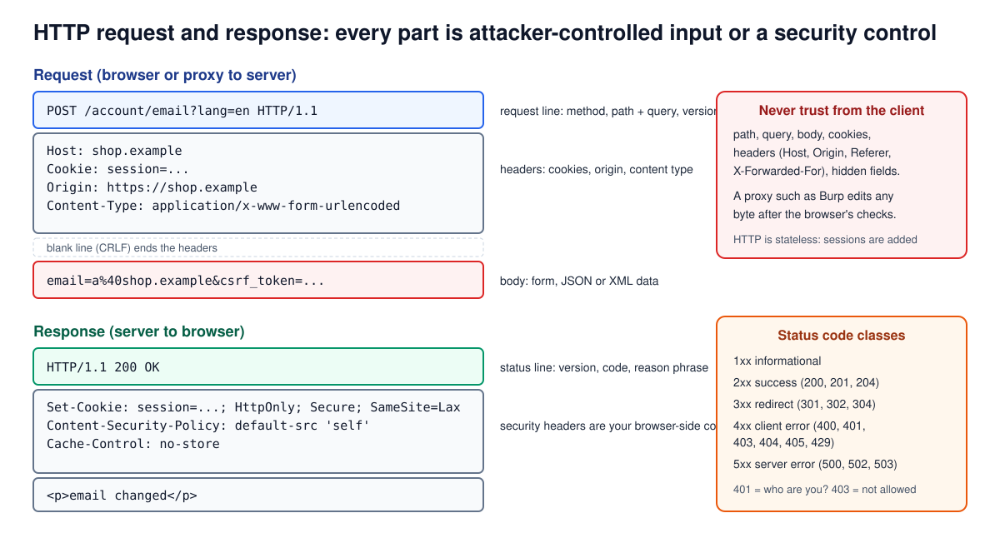

# Lesson 03: Application Security and HTTP Security Basics

**Syllabus items covered:** [CSC 1] Introduction to application security; The need for application security; What is application security; Using frameworks securely; HTTP Security Basics; HTTP Requests; HTTP Responses; HTTP Status Codes.

**Time:** 75 minutes. **Lab:** [intercepting-proxy](labs/intercepting-proxy/README.md). **Safety:** in-process toy apps only. Only test systems you own or have written permission to test.

> **DBA analogy.** You never let an application connect as `SYS`, and you never trust that the client "would not send that SQL". Application security applies the same distrust one layer up: the browser, mobile app or API client is outside your control, so every byte it sends is untrusted input.

## 1. Introduction to application security

Most attacks on companies today arrive through applications: web sites, APIs, mobile back ends. Firewalls and network segmentation still matter, but port 443 must be open for customers, and everything that comes through it reaches application code. Application security (AppSec) is the discipline that makes that code, its configuration and its dependencies safe.

## 2. The need for application security

- **Exposure:** apps are reachable from the internet by design. A database behind a firewall is still exposed if the app in front of it has SQL injection.
- **Value:** apps hold the data attackers want: customer records, payments, credentials, business logic (refunds, discounts).
- **Speed of change:** teams deploy many times a day; each change can add a bug.
- **Supply chain:** most code in an app is third-party libraries (chapter 04 of the [DevSecOps course](../../devsecops-course/04-software-component-analysis/README.md) covers SCA).
- **Cost curve:** a design flaw found in a threat model costs a conversation; found in production it costs an incident, fines and trust. Regulations (GDPR, India's DPDP Act, PCI DSS) expect secure development.

## 3. What is application security

AppSec is **all activities across the software life cycle that prevent, find and fix security weaknesses in applications**:

| SDLC phase | AppSec activity | Covered in |
|---|---|---|
| Requirements | Security requirements, abuse cases, ASVS level | Chapter 02 (ASVS), chapter 05 |
| Design | Threat modeling, secure design principles | Chapters 03 to 07 |
| Code | Secure coding, code review, SAST, secrets scanning | Chapter 02; [DevSecOps ch05](../../devsecops-course/05-static-analysis-and-secrets/README.md) |
| Build | SCA, SBOM, signed artifacts | [DevSecOps ch04](../../devsecops-course/04-software-component-analysis/README.md) |
| Test | DAST, API testing, pentest | [DevSecOps ch06](../../devsecops-course/06-dynamic-analysis/README.md), chapters 08 to 15 |
| Deploy and run | Hardening, WAF/gateway, logging, monitoring, incident response | Chapters 14 to 16 |

The core security properties are **confidentiality, integrity and availability** (CIA), plus **authentication** (who are you), **authorization** (what may you do) and **accountability** (audit logs).

## 4. Using frameworks securely

Modern frameworks (Django, Rails, Spring, ASP.NET Core, Express with good middleware, Laravel) give you many defenses for free: template auto-escaping, CSRF tokens, ORM parameterization, secure session cookies, password hashing helpers. Most real bugs come from **switching those defenses off or going around them**:

| Framework gives you | How developers break it | Safe habit |
|---|---|---|
| Auto-escaping templates | `\|safe`, `Markup()`, `mark_safe`, `dangerouslySetInnerHTML`, `v-html` | Keep auto-escape on; sanitize HTML with a vetted library if you must allow markup |
| ORM queries with parameters | `raw()`, `extra()`, string-built `WHERE` | Bind parameters; allowlist column names for sorting |
| CSRF middleware | `@csrf_exempt` on a form endpoint "to make it work" | Fix the client to send the token |
| Secure session cookies | `SESSION_COOKIE_SECURE = False` copied from a tutorial | Production settings reviewed like code |
| Debug pages | `DEBUG = True` in production | Environment-specific config; checked in CI |
| Mass binding (model from request) | Binding every request field to the model (`role=admin`) | Explicit allowlist of fields (DTOs) |

Also: keep the framework **patched**, read its **security documentation** once, and use its built-in features before writing your own crypto, session or auth code.

## 5. HTTP security basics

HTTP is a **text protocol of requests and responses**. It is **stateless**: each request stands alone, so the server remembers who you are through a **session** (usually a cookie with a random id, or a bearer token). HTTPS is HTTP inside TLS: it protects data in transit, but it does **not** make the request trustworthy. An attacker can send any HTTPS request they like.



For the network side (DNS, TLS handshake, ports) see the repo's [networking lesson on HTTP and TLS](../../cybersecurity-track/02-networking/04-dns-dhcp-http-tls.md).

## 6. HTTP requests

```text
POST /checkout HTTP/1.1
Host: shop.example
Cookie: session=...
Content-Type: application/x-www-form-urlencoded
Content-Length: 24

sku=7&price=499.00&qty=1
```

- **Request line:** method, target (path and query string), version.
- **Methods:** `GET` (read; should not change state), `POST` (create or action), `PUT`/`PATCH` (update), `DELETE`, `OPTIONS` (CORS preflight), `HEAD`. Changing state with `GET` makes CSRF and caching problems worse.
- **Headers** that matter for security: `Host` (virtual host; abused in password-reset poisoning), `Cookie`, `Authorization`, `Origin` and `Referer` (cross-site checks), `Content-Type`, `X-Forwarded-For` (spoofable unless your proxy sets it).
- **Body:** form data, JSON, XML, files. The `Content-Length` must match the body; a proxy recomputes it when you edit (see the lab).

**Everything above is attacker-controlled.** The hidden `price` field in the example is the classic mistake: the lab shows a proxy changing it to `0.01`.

## 7. HTTP responses

```text
HTTP/1.1 200 OK
Content-Type: text/html; charset=utf-8
Set-Cookie: session=...; Path=/; HttpOnly; Secure; SameSite=Lax
Content-Security-Policy: default-src 'self'; object-src 'none'; frame-ancestors 'none'
X-Content-Type-Options: nosniff
Strict-Transport-Security: max-age=31536000; includeSubDomains
Cache-Control: no-store

<p>Thank you</p>
```

- **Status line:** version, code, reason phrase.
- **Security headers** are instructions to the browser: `Set-Cookie` flags (`HttpOnly` hides the cookie from JavaScript, `Secure` sends it only over HTTPS, `SameSite` limits cross-site sending), `Content-Security-Policy` (limits script sources, framing), `Strict-Transport-Security` (HTTPS only), `X-Content-Type-Options: nosniff`, `Referrer-Policy`, `Cache-Control: no-store` for sensitive pages.
- **Outdated:** `X-XSS-Protection` is deprecated (set `0` or omit it); `X-Frame-Options` is superseded by CSP `frame-ancestors`. Chapter 14 covers headers in depth.
- **Leaky responses:** `Server: Apache/2.4.49` banners, stack traces, SQL errors and internal hostnames help attackers. The [vulnerable-shop lab](labs/vulnerable-shop/README.md) scans for these.

## 8. HTTP status codes

| Class | Meaning | Codes a tester meets daily |
|---|---|---|
| 1xx | Informational | 101 Switching Protocols (WebSockets) |
| 2xx | Success | 200 OK, 201 Created, 204 No Content |
| 3xx | Redirection | 301/308 permanent, 302/303/307 temporary, 304 Not Modified |
| 4xx | Client error | 400 Bad Request, **401 Unauthorized** (not authenticated), **403 Forbidden** (authenticated but not allowed), 404 Not Found, 405 Method Not Allowed, 409 Conflict, 413 Payload Too Large, 415 Unsupported Media Type, **429 Too Many Requests** |
| 5xx | Server error | 500 Internal Server Error, 502 Bad Gateway, 503 Service Unavailable, 504 Gateway Timeout |

**Security reading of status codes:**

- A **500** after you add a quote (`'`) suggests input reaches a SQL parser.
- **403 vs 404** on another user's object leaks whether it exists. Many APIs return 404 for both.
- Differences in status or **length** between "user exists" and "user does not exist" enable user enumeration (chapter 09).
- **429** with `Retry-After` shows rate limiting works (the lab's coupon Intruder run).
- **302** with a `Location` taken from a parameter is a candidate open redirect.

## 9. Scenario: the hidden price field

A retailer's checkout page puts the price in a hidden form field so the "confirm" page can show it without another database call. A tester routes the browser through Burp, changes `price=499.00` to `price=0.01` and gets a valid order. Root cause: the server trusted a value the client sent. Fix: the server looks up the price from the catalog by SKU and validates the quantity range; the hidden field is ignored. The [intercepting-proxy lab](labs/intercepting-proxy/README.md) reproduces this exactly and the test proves the fix.

## 10. Checklist

- [ ] I can explain why AppSec matters even behind a firewall.
- [ ] I can map AppSec activities to SDLC phases.
- [ ] I can name four framework defenses and how developers switch them off.
- [ ] I can label every part of a raw HTTP request and response.
- [ ] I know the difference between 401 and 403, and what 429 means.
- [ ] I can list five security response headers and two deprecated ones.
