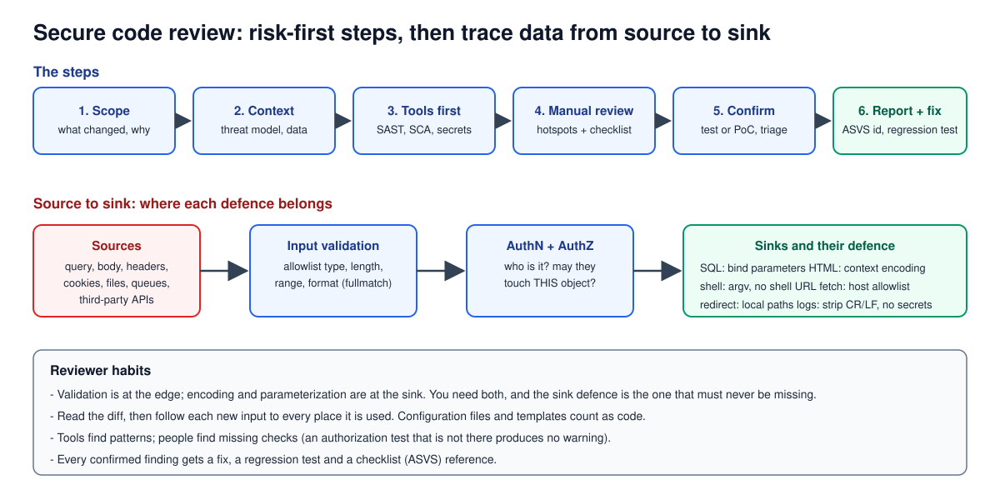

# Lesson 01: What Secure Code Review Is and How to Approach It

**Syllabus items covered:** [CSC 2] What is Secure Code Review?; How to approach Secure code review?; Introduction to tools of the trade.

**Time:** 60 minutes. **Lab:** [code-review-checklist](labs/code-review-checklist/README.md). **Safety:** the lab only parses fixture files. Only test systems you own or have written permission to test.

> **DBA analogy.** Before a DBA lets a schema change go to production, they read the DDL and the new SQL: missing indexes, full table scans, grants to `PUBLIC`, a `DELETE` without `WHERE`. Secure code review is the same discipline with security eyes: read the change and ask what an attacker could make it do.

## 1. What is secure code review?

Secure code review is a **systematic examination of source code to find security weaknesses** before they reach production, and to confirm that required security controls are present and correct. It is done by people, supported by tools.

| It is | It is not |
|---|---|
| Reading code with a threat model and a checklist in mind | A style or performance review with "security" in the title |
| Looking for **missing** controls as well as bad patterns | Running a scanner and forwarding its output |
| Focused on risk: auth, data access, input handling, crypto, config | Reading every line of a million-line codebase with equal care |
| Producing findings with evidence, fix and a test | Blocking a merge with "this looks insecure" and no reason |

**Why it matters:** a review finds whole classes of bugs that dynamic testing struggles with, such as a missing authorization check on one endpoint, a hard-coded key, a weak hash, or business logic that trusts the client. It is also the cheapest place to fix them: the developer is still in context.

**Two common forms:**

- **Pull request (diff) review:** small, continuous, part of the normal workflow. Champions do most of these.
- **Focused or full review:** a deeper look at a security-critical component (login, payments, file upload) or before a major release, often by the AppSec team.

## 2. How to approach secure code review

1. **Scope.** What changed and why? Read the ticket and the diff summary. Is this a high-risk area (authentication, authorization, payments, file handling, crypto, external calls)? Spend your time there.
2. **Context.** Look at the threat model (chapters 03 to 07) or sketch one: entry points, trust boundaries, sensitive data. Know which framework and which built-in defenses are in use.
3. **Tools first.** Let SAST, SCA and secrets scanners take the easy patterns so humans can think. Read their findings as **leads**, not verdicts.
4. **Manual review with a checklist.** Use two techniques:
   - **Source to sink:** start from each input (query string, body, header, file, message queue, third-party API response) and follow it to every place it is used. At each **sink** (SQL, HTML, shell, file path, URL fetch, redirect, log, deserializer) ask: is the right defense here?
   - **Control check:** for each endpoint ask: is it authenticated? Is the user allowed to perform this action on **this** object? Is input validated? Is output encoded? Are errors handled without leaking detail? Is it logged?
5. **Confirm.** Write a quick test or proof of concept (in a test environment) for anything you are not sure about. Unconfirmed findings waste developer trust.
6. **Report and fix.** For each finding: location, what is wrong, impact, how to fix, a reference (ASVS requirement, CWE), and a regression test. Then re-review the fix.

**Hotspots to read first** (where reviews pay off most):

| Area | What to look for |
|---|---|
| Data access | String-built SQL, ORM `raw()`, dynamic `ORDER BY`, missing owner filter |
| Rendering | `\|safe`, `Markup`, `innerHTML`, string-built HTML |
| Authentication | Password hashing, `==` on secrets, session handling, reset flows |
| Authorization | Routes without decorators, role checks in the client, ids taken from the request |
| External calls | URL fetch from input (SSRF), `verify=False`, missing timeouts |
| OS and files | `shell=True`, path joins with user input, file uploads |
| Configuration | `DEBUG`, CORS `*`, cookie flags, secrets in code |
| Error handling | Stack traces to users, failing open on exceptions |

## 3. Introduction to tools of the trade

| Tool type | Examples (verify current status) | Use in review |
|---|---|---|
| Pattern and dataflow SAST | **Semgrep** / **Opengrep** (2025 fork), **CodeQL**, SonarQube, Checkmarx, Snyk Code | Find string-built SQL, dangerous sinks; custom rules for your codebase |
| Language-specific SAST | Bandit (Python), Brakeman (Rails), SpotBugs + Find Security Bugs (Java), gosec (Go), eslint-plugin-security (JS) | Fast checks in CI and the IDE |
| SCA | pip-audit, npm audit, osv-scanner, OWASP Dependency-Check, Trivy, Grype | Vulnerable dependencies in the diff |
| Secrets | Gitleaks, TruffleHog, GitHub push protection | Keys and passwords in code and history |
| IDE plugins | SonarLint (now SonarQube for IDE), Semgrep extension, Snyk plugin | Feedback while coding |
| Plain tools | `git diff`, `grep`/`rg`, the debugger, unit tests | Following data flow; proving a finding |
| AI assistants | Code assistants that explain or summarise code | Helpful for orientation; never a substitute for verification; do not paste confidential code into unapproved services |

Deep dives: [DevSecOps SAST lesson](../../devsecops-course/05-static-analysis-and-secrets/01-sast-basics-and-tools.md), [custom rules](../../devsecops-course/05-static-analysis-and-secrets/03-custom-rules-regex-ast-graph.md), [Semgrep and CodeQL notes](../../devsecops-course/05-static-analysis-and-secrets/real-tools/semgrep-codeql.md). Hedged commands for this chapter: [real-tools/code-review-tools.md](real-tools/code-review-tools.md).

The [code-review-checklist lab](labs/code-review-checklist/README.md) shows how such tools work inside: line regexes (fast, noisy) plus Python AST checks (structure-aware: "an f-string reaches `execute()`"), mapped to a checklist and a CI gate.

## 4. Scenario: a Friday pull request

A developer opens a pull request adding "download invoice as PDF". Ali, the team's champion, has 20 minutes.

- **Scope:** new endpoint `GET /invoice/<id>/pdf`, new dependency for PDF generation. High risk: it returns customer data.
- **Tools:** Semgrep is clean. SCA flags the PDF library version with a known vulnerability; the fixed version is available.
- **Manual:** the query is `SELECT * FROM invoices WHERE id = ?`. Parameterized, so no SQL injection, but no owner filter: any logged-in user can download any invoice (IDOR). No tool flagged it, because nothing "dangerous" is in the code; the danger is what is **missing**.
- **Confirm:** a quick test logs in as user A and requests user B's invoice: 200.
- **Report:** two findings with fixes (owner filter, library upgrade), an ASVS authorization reference and the test. The fix is merged on Monday with the test.

## 5. Common mistakes

- Reviewing only what tools flag, so missing checks are never found.
- Trusting comments and names (`validated_input`) instead of reading the validation.
- Reviewing the diff without looking at callers and configuration.
- Reporting "possible XSS" without a location, impact or fix.
- Making review a final gate instead of a habit on every risky pull request.

## 6. Checklist

- [ ] I can define secure code review and its two forms.
- [ ] I can list the six steps and the two manual techniques (source to sink, control check).
- [ ] I can name review hotspots in a web app.
- [ ] I can name two tools per type and what each misses.
- [ ] I write findings with location, impact, fix, reference and a test.
