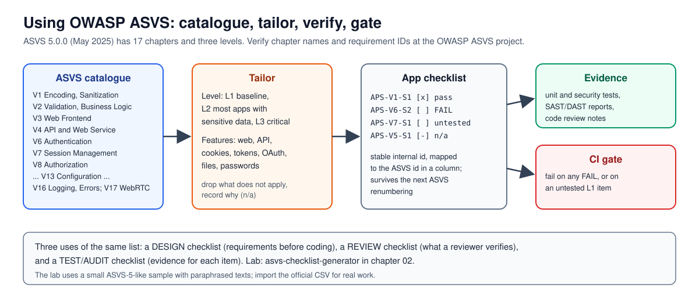

# Lesson 03: OWASP ASVS: Understanding It, Using It, Building Checklists

**Syllabus items covered:** [CSC 2] OWASP ASVS Framework; Understanding OWASP ASVS; Using ASVS to Secure Applications & APIs; Creating Checklists with OWASP ASVS.

**Time:** 90 minutes. **Lab:** [asvs-checklist-generator](labs/asvs-checklist-generator/README.md). **Safety:** documents and fixtures only.

> **DBA analogy.** The CIS Oracle Benchmark or Oracle's own security checklist tells you what a hardened database looks like, item by item, and you pick the items that apply to your environment. ASVS is that benchmark for application code and design.

## 1. OWASP ASVS framework

The **OWASP Application Security Verification Standard (ASVS)** is a list of **testable security requirements** for web applications and APIs. It answers: "what does a secure application of this kind need, and how do we verify it?"

- **Current version: 5.0.0, released May 2025** (verify at the OWASP ASVS project). It replaced 4.0.3 (2021). Chapters and requirement numbers were **reorganized**, so a 4.0.3 id such as "V5.3.4" does not mean the same thing in 5.0.
- About 350 requirements (approximate; verify), each with a level.
- Free, open, and available as documents plus machine-readable exports (CSV/JSON; check the project's GitHub repository for current files).
- Related OWASP projects: the **Top 10** (awareness), **Proactive Controls** (developer guidance), **WSTG** (Web Security Testing Guide, how to test), **MASVS** (mobile), **Cheat Sheet Series** (how to implement).

| Project | Question it answers |
|---|---|
| Top 10 | What are the biggest risks? |
| ASVS | What exactly must my app do, and how do I verify it? |
| WSTG | How do I test for it? |
| Cheat Sheets | How do I build it correctly? |

## 2. Understanding OWASP ASVS

**Levels** (the 5.0 wording changed; verify the exact definitions):

| Level | Meant for | Rough idea |
|---|---|---|
| **L1** | Every application | The first layer of defence; the most important, mostly testable from outside |
| **L2** | Most applications handling sensitive data or transactions | The usual target for business apps |
| **L3** | Critical systems (high value, high assurance, safety or large financial impact) | Deeper requirements, including design and architecture evidence |

Each level includes the levels below it.

**Chapters in ASVS 5.0** (verify names at source):

| | | |
|---|---|---|
| V1 Encoding and Sanitization | V7 Session Management | V13 Configuration |
| V2 Validation and Business Logic | V8 Authorization | V14 Data Protection |
| V3 Web Frontend Security | V9 Self-contained Tokens | V15 Secure Coding and Architecture |
| V4 API and Web Service | V10 OAuth and OIDC | V16 Security Logging and Error Handling |
| V5 File Handling | V11 Cryptography | V17 WebRTC |
| V6 Authentication | V12 Secure Communication | |

**Requirement identifiers** have the form `<chapter>.<section>.<requirement>`. ASVS recommends citing the version too, for example `v5.0.0-1.2.5` (verify the exact format), because ids change between versions.

**Requirement style:** each item is a verifiable statement, for example (paraphrased) "Verify that the application uses parameterized queries or equivalent protection for database access". "Verify" means a tester, reviewer or automated check can produce evidence for it.

## 3. Using ASVS to secure applications and APIs

ASVS is useful at every SDLC stage:

| Stage | How ASVS is used |
|---|---|
| Requirements | Pick a level; copy the applicable requirements into the backlog as security acceptance criteria |
| Design | Use V15 (architecture) and the relevant chapters (V9 tokens, V10 OAuth) during threat modeling |
| Code review | Use requirements as the review checklist ([lesson 02](02-reviewing-code-for-security-defences.md)); cite ids in findings |
| Testing | Map tests and scanner rules to ids; WSTG tells you how to test each |
| Procurement and pentest | "Assess against ASVS 5.0 L2" is a clear scope for a vendor or pentest |
| Metrics | Percentage of applicable L1/L2 requirements verified per app |

**For APIs:** V4 (API and Web Service), V8 (Authorization, for BOLA/BFLA), V9 (tokens such as JWT) and V10 (OAuth and OIDC) are the core. Combine with the **OWASP API Security Top 10** (chapter 13) to prioritise. Chapter 16 adds an API-focused ASVS checklist lab.

**Common mistakes:** trying to implement every L3 item in a small internal tool; treating ASVS as a document read once; no evidence (a spreadsheet of "yes" with no test or report behind it); mixing 4.0.3 and 5.0 ids in one checklist.

## 4. Creating checklists with OWASP ASVS

A practical checklist process:

1. **Get the machine-readable ASVS** (CSV/JSON export of the current version).
2. **Pick the level** with the product owner, based on data sensitivity and impact (often L2).
3. **Describe the app's features:** web UI? API? cookies or tokens? OAuth? file upload? passwords? Drop chapters and items that do not apply, and record **why** (`n/a` with a reason).
4. **Give each item a stable internal id** (for example `APS-...`) and keep the ASVS id in its own column. When ASVS is renumbered again, you update the mapping column, not every ticket, test and report.
5. **Attach evidence** to each item: a test name, a scanner rule, a review note, a pentest result.
6. **Track status:** pass, fail, n/a, untested. Report coverage (how much is tested) and compliance (how much passes).
7. **Gate in CI:** fail the build on any failed item, or on an untested L1 item. Review the n/a list regularly.
8. **Version it** in the repository next to the code, so changes are reviewed like code.

The [asvs-checklist-generator lab](labs/asvs-checklist-generator/README.md) implements steps 2 to 7 with a small ASVS-5-like sample (paraphrased texts, sample references), produces Markdown and CSV, and reads an official-style CSV export through a configurable column map.

Tools that help (hedged): the OWASP ASVS project's own exports; spreadsheets; security requirement platforms; threat modeling tools that map to ASVS (chapter 06); the [requirements-as-code lab](../../devsecops-course/03-security-requirements-and-threat-modeling/labs/security-requirements-as-code/README.md) in the DevSecOps course, which uses the same "stable id + ASVS mapping + test" idea; and the [BDD and ASVS notes](../../devsecops-course/03-security-requirements-and-threat-modeling/real-tools/bdd-and-asvs.md).

## 5. Scenario: one checklist, two apps

A fintech has a customer web app and a machine-to-machine partner API. The AppSec lead and two champions build checklists:

- **Customer app:** L2, features web, cookies, passwords, API. 23 items in the lab's sample (more with the full standard). Three fail (no breached-password check, weak toy hash, CORS not configured) and three are untested. The gate fails; the team plans the fixes for the next sprint, and the untested L1 session item gets a test first because it blocks the gate.
- **Partner API:** L1, features api, tokens, oauth. Cookie and password items drop out; JWT (V9) and OAuth (V10) items come in. The checklist is half the size.

Both checklists use the same internal ids, so the CISO's dashboard can compare "APS-V8-S1 (object-level authorization)" across apps.

## 6. Checklist

- [ ] I can explain what ASVS is and how it differs from the Top 10, WSTG and Cheat Sheets.
- [ ] I know ASVS 5.0.0 is current (May 2025) and ids changed from 4.0.3.
- [ ] I can describe L1, L2 and L3 and pick a level for an app.
- [ ] I can name the chapters most relevant to APIs.
- [ ] I can build a tailored checklist with stable ids, evidence and a CI gate.

## References

- OWASP ASVS project (current version and exports; verify location), OWASP WSTG, OWASP Proactive Controls, OWASP Cheat Sheet Series.
- Repo: [DevSecOps requirements as code](../../devsecops-course/03-security-requirements-and-threat-modeling/03-security-requirements-as-code.md).
