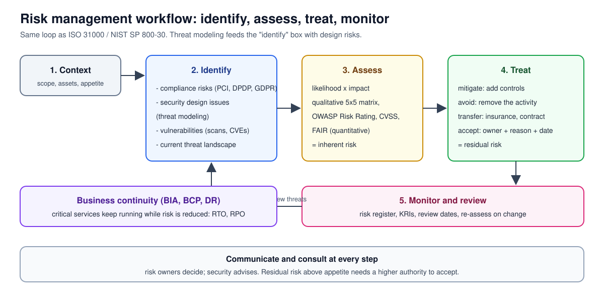

# Lesson 01: A Primer on Risk Management

**Syllabus items covered:** [CSC 3] all lines; [CTMP 1] "Risk Management Strategies with Examples", "Avoiding Risks", "Accepting Risks", "Mitigating Risks", "Transferring Risks".

**Time:** 90 minutes. **Safety:** concepts only; the lab uses a fictional company (ShopCo).

> **DBA analogy.** You already did risk management as a DBA. "What if the primary dies?" led to Data Guard (mitigate). "Do we really need that old reporting link to production?" led to dropping it (avoid). "The storage vendor's SLA covers hardware loss" (transfer, partly). "Dev databases have no standby, and the business agreed" (accept). This lesson gives those instincts names and a process.

The full risk vocabulary, NIST SP 800-30 and ISO/IEC 27001 are already taught in [cybersecurity-track module 04](../../cybersecurity-track/04-risk-management-and-iso27001/README.md) (start with [01 Risk concepts](../../cybersecurity-track/04-risk-management-and-iso27001/01-risk-concepts.md)). This lesson is the **application security** view: where app risks come from and how a security champion treats them.

## 1. Introduction to risk management

**Risk** is the chance that a **threat** uses a **vulnerability** to harm an **asset**, combined with how bad that harm is: risk is roughly **likelihood x impact**.

| Term | Meaning | ShopCo example |
|---|---|---|
| Asset | Something of value | Customer accounts, the orders database |
| Threat | Who or what could cause harm | Credential-stuffing crew |
| Vulnerability | The weakness they use | No rate limit on login |
| Likelihood | How probable, in a period | High: stuffing is constant on retail sites |
| Impact | How bad if it happens | Fraud, refunds, privacy breach |
| Inherent risk | Risk before your controls | 16 / 25 |
| Residual risk | Risk after your controls | 4 / 25 |
| Risk appetite | How much residual risk leadership will carry | "Nothing above MEDIUM (9) without CISO sign-off" |
| Risk owner | The person who decides and is accountable | Product owner of login, not the security team |

Security teams **advise**; risk **owners decide**. A champion's job is to make the risk visible, quantified and owned.

## 2. Risk management workflow

The loop in the diagram above follows ISO 31000 and NIST SP 800-30 (verify the current editions at source):

1. **Context:** scope, assets, regulations, appetite.
2. **Identify** risks (section 3).
3. **Assess** them: likelihood and impact, giving inherent risk (section 4).
4. **Treat** them: mitigate, avoid, transfer or accept (section 5), giving residual risk.
5. **Monitor and review:** the risk register, review dates, re-assessment when the system changes.
6. **Communicate and consult** throughout: owners, engineers, legal, the business.

The output is a **risk register**: one row per risk with source, scores, treatment, owner and evidence. The [risk-register lab](labs/risk-register/README.md) is exactly that, with rules that catch "spreadsheet" decisions.

## 3. Risk identification

Look in four places; a register with only one kind of risk means the team only looked one way (the lab reports this as a coverage gap).

### 3.1 Identifying compliance risks

Rules you must follow: PCI DSS v4.0.1 for card data, GDPR, India's **DPDP Act 2023** with its **DPDP Rules notified in November 2025** and phased in until about May 2027 (verify dates at source), sector rules (RBI, SEBI, HIPAA), contracts. Ask: what data do we hold, where does it go, what does the law or contract say? Example: card numbers in debug logs breaks PCI DSS even if nobody ever steals the logs.

### 3.2 Identifying security design issues

Flaws in **how the system is designed**, not bugs in code: trusting the client for prices, a queue anyone inside the network can write to, a password reset that sends predictable tokens. These are found by **threat modeling** ([lesson 02](02-threat-modeling-overview.md) and [chapter 04](../04-threat-modeling-methods-and-rating/README.md)) and design reviews. They are the most expensive to fix late.

### 3.3 Identifying vulnerabilities

Concrete weaknesses in what you shipped: SAST, SCA and DAST findings, pentests, bug bounty reports, CVEs in dependencies. Pipelines that find them are in [devsecops-course](../../devsecops-course/README.md) (chapters 04 to 06) and the vulnerability management process in [devsecops chapter 14](../../devsecops-course/14-vulnerability-management/README.md).

### 3.4 Understanding the current threat landscape

What attackers are doing **now**: credential stuffing waves, ransomware groups targeting your sector, exploited-in-the-wild lists (CISA KEV), supply-chain attacks, AI-assisted phishing. Sources: CERT-In advisories, vendor threat reports, ISAC sharing, your own SOC data. The landscape changes the **likelihood** of risks you already know.

## 4. Risk assessment methodologies

| Method | How it scores | When to use |
|---|---|---|
| Qualitative matrix (3x3 or 5x5) | Likelihood and impact on a word or 1-5 scale, read a matrix | Most teams; fast and good enough |
| OWASP Risk Rating | 16 factors 0-9 for likelihood and impact | App threats; taught in [chapter 04 lesson 05](../04-threat-modeling-methods-and-rating/05-threat-rating.md) |
| CVSS v4.0 | Severity of a single vulnerability | Vulnerability triage; it is **not** risk on its own (no business context) |
| NIST SP 800-30 | Structured threat-source and event tables | Organisational risk assessments |
| ISO/IEC 27005 | Risk process for an ISMS | ISO 27001 programmes |
| FAIR (quantitative) | Loss event frequency x loss magnitude, in money | When leadership wants rupees or dollars |

The lab uses a 5x5 matrix with the same bands as the cybersecurity track: LOW 1-4, MEDIUM 5-9, HIGH 10-16, CRITICAL 17-25.

## 5. Risk treatment: strategies with examples

Every risk gets exactly one primary treatment. Each has its own **evidence rule**, which is what auditors (and the lab's `validate()`) check.

| Strategy | What it means | Evidence a reviewer should ask for |
|---|---|---|
| Mitigate | Add controls that lower likelihood or impact | Named controls that actually change a score, and a test |
| Avoid | Stop the risky activity or redesign it away | A described change (feature removed, data no longer stored) |
| Transfer | Shift the financial part to someone else | A named party: insurer, contract clause, managed provider |
| Accept | Knowingly live with it | Owner with enough authority, a reason, a review date |

### 5.1 Mitigating risks (how to mitigate risks)

Add controls. **Example:** card numbers in logs (inherent 20, CRITICAL). Controls: a log redaction filter with a CI test (likelihood -3) and tokenising card numbers at the edge so the app never sees them (impact -2). Residual: 1 x 3 = 3, LOW. A "control" that changes nothing ("we will upgrade later") is not mitigation; the lab flags it `CONTROL_WITH_NO_EFFECT`.

### 5.2 Avoiding risks (how to avoid risks)

Remove the activity. **Example:** a legacy CSV export of all customers is rarely used but would be a disaster if abused. Delete the feature and move reporting to aggregated dashboards. Residual becomes zero **for that risk**. Avoidance is the most underused option: "do we need to store this at all?" is a powerful question (data minimisation, also a DPDP and GDPR principle).

### 5.3 Transferring risks (how to transfer risks)

Shift the **financial** impact: cyber insurance, a contract that makes a payment provider liable, a managed service. **Example:** ransomware on the orders database: insurance covers recovery costs. But you **cannot transfer accountability**: customers, regulators and the press still blame ShopCo, and the outage still happens. That is why the lab caps the effect of transfer at one impact level (`TRANSFER_OVERCLAIMED` if you claim more) and why transfer usually comes **with** controls (immutable backups) and a continuity plan.

### 5.4 Accepting risks (how to accept risks)

Decide consciously to carry it. **Example:** credential stuffing is at MEDIUM (9) after rate limits and breached-password checks; MFA arrives next quarter. The product owner accepts it with a reason and a review date of 31 March. Rules:

- The person accepting must have **authority for that level** (a team lead cannot accept a CRITICAL risk).
- Acceptance **expires**; a review date is mandatory.
- "Accepted" without a reason is just "ignored".

**Accept vs ignore** is the classic interview question: acceptance is documented, owned, time-boxed and within appetite; ignoring is none of these.

## 6. Ensuring business continuity while reducing risk

Security changes must not break the business, and some risks are about **availability** itself.

- **Business impact analysis (BIA)** names critical services (checkout, payments) and their **RTO** (how long can it be down?) and **RPO** (how much data can we lose?).
- **BCP / DR plans** describe how those services keep running: restore drills, a secondary region, a fallback email provider.
- Risk treatments for critical services should reference the plan (the lab flags `NO_CONTINUITY_PLAN`).
- Roll out controls safely: report-only modes, canaries, feature flags, so a new WAF rule or rate limit does not become your own denial of service.

Full BIA and BC/DR material: [cybersecurity-track 04, lesson 04](../../cybersecurity-track/04-risk-management-and-iso27001/04-third-party-risk-bia-bcdr.md). As a DBA you know this already: an untested backup is not a backup.

## 7. Scenario: the "accepted" risk nobody accepted

ShopCo's register says "R-01 card numbers in debug logs: **accepted**, owner dev-team". The QSA asks who accepted it. Answer: a team lead, two years ago, with no reason and no review date. The residual risk is CRITICAL and a PCI violation. The champion re-opens it: treatment becomes **mitigate** (redaction filter, tokenisation), the payments lead becomes owner, and a CI test proves no card number reaches the logs. Run `demo.py` in the [risk-register lab](labs/risk-register/README.md) to see the before and after registers.

## 8. Common mistakes

- Treating CVSS as risk. CVSS has no business context.
- Security owning every risk. Owners decide; security advises.
- Transfer as "problem solved". Accountability stays with you.
- Acceptance with no expiry. It silently becomes permanent.
- A register with only scanner findings. Design and compliance risks are missing.

## 9. Quick check

1. Name the four sources of risk identification. 2. What evidence does each treatment need? 3. Why can transfer not reduce impact to LOW? 4. What makes acceptance different from ignoring? 5. What do RTO and RPO mean?
