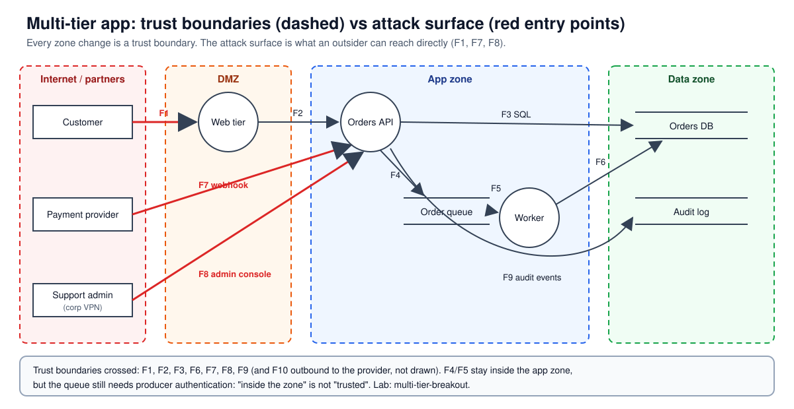

# Lesson 02: Threat Modeling Overview

**Syllabus items covered:** [CTMP 1] "What is Threat Modeling?" through "Modern Threat Modeling Approaches for Agile and DevOps". Also [CSC 4] "What is Threat Modeling?", "Why Threat Model?", "Threat modeling vs. Other Security Practices" and "Modern threat modeling approaches for Agile and DevOps" (chapter 04 links here so they are taught once).

**Time:** 2 hours. **Safety:** concepts only.

> **DBA analogy.** Before a big schema change you draw the data flows (which apps write, which read, which batch jobs touch it), then ask "what breaks if…?". Threat modeling is that design review, with attackers instead of outages.

Related lessons already in the repo (do not repeat them, but they are good second reads): [devsecops ch03 lesson 01](../../devsecops-course/03-security-requirements-and-threat-modeling/01-threat-modeling-stride-dread-and-challenges.md) (STRIDE vs DREAD, challenges), [CAISP ch5 foundations](../../caisp-course/ch5-threat-modeling-ai-systems/01-threat-modeling-foundations.md) (vocabulary for AI systems), [AI threat modeling](../../01-ai-security-fundamentals/03-ai-threat-modeling.md).

## 1. What is threat modeling?

Threat modeling is a **structured way to find, rate and decide on threats to a system, using a model of that system**, usually a data flow diagram (DFD) with trust boundaries. It answers four questions (Shostack; also the Threat Modeling Manifesto):

1. **What are we working on?** (the model)
2. **What can go wrong?** (threats)
3. **What are we going to do about it?** (mitigate, avoid, transfer, accept: [lesson 01, section 5](01-risk-management-primer.md#5-risk-treatment-strategies-with-examples))
4. **Did we do a good enough job?** (validation)

The output is not a pretty diagram. It is a **list of threats, each with a decision and an owner**, plus security requirements and tests.

## 2. The threat model parlance

| Word | Meaning | Example |
|---|---|---|
| Asset | What has value | Customer accounts, order data, the brand |
| Threat actor (agent) | Who might attack | Fraud crew, insider, opportunist |
| Threat | What could go wrong | "Attacker resets a victim's password" |
| Attack vector | The path used | The `/forgot` endpoint |
| Weakness | A flaw type (CWE) | Predictable random values (CWE-330) |
| Vulnerability | A weakness that is exploitable here | Reset token = md5(email + time) |
| Control / countermeasure / mitigation | What reduces the risk | CSPRNG tokens, expiry, rate limits |
| Trust boundary | Where the trust level changes | Internet to DMZ |
| Attack surface | All points an attacker can reach | Public endpoints, webhooks, admin console |
| Risk | Likelihood x impact of a threat | HIGH |
| Residual risk | What is left after controls | MEDIUM |

## 3. Security is a balancing act

Perfect security does not exist and would make the product unusable. Threat modeling balances:

- **Security vs usability:** MFA on every click annoys users; step-up MFA for refunds does not.
- **Security vs cost and time:** a fix that costs more than the loss it prevents is a bad deal (risk appetite).
- **Security vs performance:** encryption and logging cost CPU and latency.
- **Confidentiality vs availability:** locking accounts after failures stops guessing but lets an attacker lock out real users (an availability threat you created).

Good threat models make these trade-offs **explicit and owned** instead of accidental.

## 4. Design flaws and risk rating

A **bug** is an implementation mistake (a missing bind variable). A **design flaw** is a mistake in the plan (the API trusts the client to send the price; the queue has no producer authentication). Design flaws:

- cannot be fixed by a one-line patch; they need redesign,
- are invisible to most scanners,
- are cheapest to fix at design time and most expensive in production,
- correspond to **OWASP Top 10:2021 A04 Insecure Design** (A06 in the 2025 list; verify the final 2025 naming).

Because a model can produce dozens of threats, each needs a **risk rating** to decide what to fix first. Rating methods (OWASP Risk Rating, bug bars, RRA, DREAD and why it fell out of favour) are in [chapter 04 lesson 05](../04-threat-modeling-methods-and-rating/05-threat-rating.md).

## 5. Why threat model?

- **Find design flaws early**, when a change costs a whiteboard edit, not a re-architecture.
- **Focus effort:** test, review and monitor the risky parts, not everything equally.
- **Create security requirements** that developers can build and test (see [chapter 04 lesson 01](../04-threat-modeling-methods-and-rating/01-security-requirements-and-diagramming.md)).
- **Shared understanding:** developers, ops and security agree on how the system really works (the DFD alone often finds surprises).
- **Evidence for audits** (PCI DSS, ISO 27001, SOC 2 ask for secure design activities).
- **Better pentests:** testers get a map of trust boundaries and assumptions to attack.

## 6. Threat modeling vs. other security practices

| Practice | Question it answers | When | Finds design flaws? |
|---|---|---|---|
| Threat modeling | What can go wrong with this design? | Design, every significant change | Yes, that is its job |
| Secure code review | Is this code written safely? | Implementation | Rarely |
| SAST | Do code patterns look dangerous? | Every commit | No |
| SCA | Are dependencies vulnerable? | Every build | No |
| DAST / pentest | Can a running system be broken? | Test, pre-release | Sometimes, late and expensive |
| Risk assessment | How big is the business risk? | Periodic, organisational | Only if fed by threat models |

Threat modeling **directs** the others: the threats become SAST rules, DAST test cases, code review focus areas and monitoring use cases. It is a **proactive** practice; scans and pentests are **detective**.

## 7. Threat modeling frameworks and methodologies

Methods differ in their **starting point** (diagram: [chapter 04 methods map](../04-threat-modeling-methods-and-rating/04-other-methodologies-and-games.md)). Chapter 04 teaches each one in depth; here is the overview.

### 7.1 List/library centric threat modeling

Start from a **list of known threat types** and walk it over the system: STRIDE, LINDDUN for privacy, OWASP Top 10, CAPEC, threat card decks. Easy to teach and repeatable; the risk is "checkbox" thinking. Details: [chapter 04 lesson 02](../04-threat-modeling-methods-and-rating/02-stride.md).

### 7.2 Asset/goal centric threat modeling

Start from **what you must protect** (crown jewels) or the **attacker's goal**, and work down: attack trees, OCTAVE. Good for prioritising; can miss threats to "boring" components. Details: [chapter 04 lesson 03](../04-threat-modeling-methods-and-rating/03-goal-attacker-and-software-centric.md).

### 7.3 Threat actor/attacker centric threat modeling

Start from **who attacks you**: personas with motivation, skill and resources, mapped to MITRE ATT&CK techniques. Realistic and great for detection engineering (your SOC side); needs good threat intelligence. Details: [chapter 04 lesson 03, section 4](../04-threat-modeling-methods-and-rating/03-goal-attacker-and-software-centric.md#4-attackerthreat-actor-centric-modeling-approach).

### 7.4 Software centric threat modeling

Start from **the design itself**: draw the DFD and analyse each element and flow (STRIDE per element). This is what most development teams do because they know their software best. Details: [chapter 04 lesson 03, section 7](../04-threat-modeling-methods-and-rating/03-goal-attacker-and-software-centric.md#7-software-centric-threat-modeling).

In practice teams **combine** them: software-centric DFD + STRIDE to find, attacker personas to judge likelihood, attack trees for the crown jewels.

## 8. Trust boundaries vs. attack surfaces

They are related but not the same, and interviewers like the difference.

| | Trust boundary | Attack surface |
|---|---|---|
| What it is | A line in the design where the level of trust changes | The set of all points where an attacker can try to enter or extract data |
| Where | Between zones: Internet/DMZ, DMZ/app, app/data, you/third party | Endpoints, webhooks, admin consoles, file uploads, queues exposed to partners |
| Question | "What must be checked when data crosses here?" | "What can an outsider touch?" |
| Typical control | Authenticate, authorise, validate, encrypt at the crossing | Reduce it: remove endpoints, restrict network access, disable unused features |

Every attack surface entry point crosses a trust boundary, but not every boundary is on the external attack surface (app-to-database is a boundary an outsider cannot reach directly, until they compromise the app). The [multi-tier breakout lab](labs/multi-tier-breakout/README.md) computes both for a sample system: 8 boundary crossings, only 3 external entry points.

**DBA analogy:** the listener port is attack surface; the line between the application schema and the `SYS` schema is a trust boundary.

## 9. Modern threat modeling approaches for Agile and DevOps

Big up-front threat models (a two-week workshop, a 60-page document) do not fit two-week sprints. Modern practice:

- **Model the delta:** each user story or epic that adds a new data flow, data store, trust boundary or sensitive data gets a short threat review. Triggers live in the definition of ready.
- **Small and frequent:** 30 to 60 minutes per feature; Rapid Threat Model Prototyping (RTMP) is designed for this ([chapter 04 lesson 04](../04-threat-modeling-methods-and-rating/04-other-methodologies-and-games.md#4-rtmp)).
- **Threat modeling as code:** the model lives in the repo (pytm, Threagile, Threat Dragon JSON, annotations) and is checked in CI. Labs: [devsecops ch03 threat-modeling-as-code](../../devsecops-course/03-security-requirements-and-threat-modeling/labs/threat-modeling-as-code/README.md); appsec chapter 05 goes further.
- **Security requirements and abuse cases** in the backlog, with tests, so threats become work items, not documents.
- **Security champions** in each team run the sessions; the central team trains and reviews.
- **Living model:** update it when the design changes, review it in retrospectives, link it to incidents ("which threat was this?").

## 10. Scenario: the queue nobody modeled

A team adds a message queue between the orders API and a new fulfilment worker. No threat review because "it is internal". Months later a compromised build agent inside the network publishes fake `OrderPlaced` messages and ships goods that were never paid for. A 30-minute delta review would have asked: who can write to the queue (spoofing/tampering)? does the worker validate messages? That is threat K7 in the breakout lab, and the one teams most often miss.

## 11. Common mistakes

- Starting with tools instead of the four questions.
- Treating "internal" as "trusted".
- Producing a list of threats with no owners or decisions.
- Modeling once and never again.
- Confusing trust boundary with attack surface (or with a firewall).

## 12. Quick check

1. State the four questions. 2. Give one example each of a bug and a design flaw. 3. Name the four families of methods and their starting point. 4. Explain trust boundary vs attack surface with an example. 5. How does threat modeling fit a two-week sprint?
