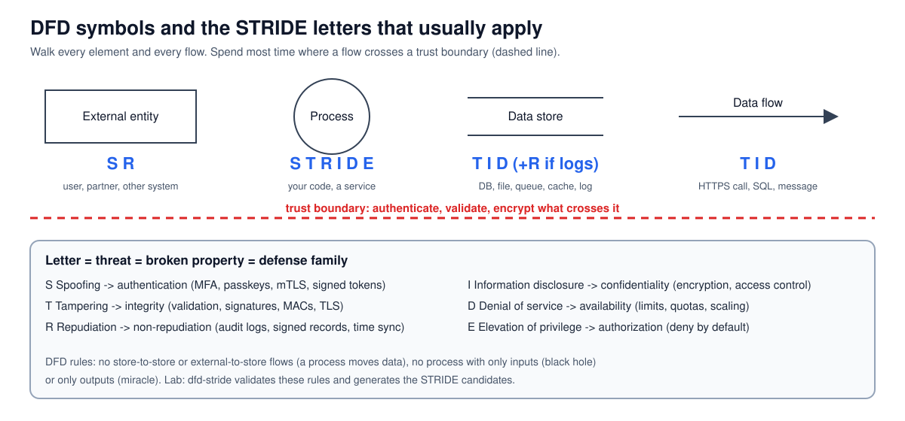

# Lesson 01: Threat Modeling, Security Requirements and Diagramming

**Syllabus items covered:** [CTMP 2] "Threat Modeling and Security Requirements", "Threat Modeling vs. Threat Rating", "Diagramming for Threat Modeling", "Creating a Data Flow Diagram for Threat Modeling"; [CSC 4] "Threat modeling and security requirements", "Diagramming for Threat Modeling", "Creating Data Flow Diagrams", "Writing Security Requirements for Threat Modeling".

**Time:** 90 minutes. **Labs:** [dfd-stride](labs/dfd-stride/README.md), [password-reset-threat-model](labs/password-reset-threat-model/README.md).

> **DBA analogy.** A DFD is the threat modeler's ER diagram. You would never tune a schema without one; do not threat model without a DFD.

New to threat modeling? Read [chapter 03 lesson 02](../03-risk-management-and-threat-modeling-overview/02-threat-modeling-overview.md) first.

## 1. Threat modeling and security requirements

Threats and requirements are two sides of the same coin:

- A **threat** says what can go wrong: "an attacker predicts a reset token".
- A **security requirement** says what the system must do so it does not: "reset tokens come from a CSPRNG with at least 128 bits of entropy".
- A **test** proves the requirement holds: "two tokens generated in the same second differ; a token computed from email + time is rejected".

Requirements come from two directions: **top-down** catalogs (OWASP ASVS 5.0, PCI DSS, company standards) and **bottom-up** from the threat model of *this* system. The catalog tells you the baseline; the threat model tells you what is special here (the forged payment webhook is not in any generic list). The chain **threat → requirement → test → evidence** is what auditors and good teams want. Requirements as code and BDD are taught in [devsecops ch03 lesson 03](../../devsecops-course/03-security-requirements-and-threat-modeling/03-security-requirements-as-code.md); ASVS in this course's [chapter 02](../02-secure-code-review-and-asvs/README.md).

## 2. Threat modeling vs. threat rating

| | Threat modeling (finding) | Threat rating (ranking) |
|---|---|---|
| Question | What can go wrong? | Which threat first? |
| Methods | STRIDE, attack trees, personas, PASTA | OWASP Risk Rating, CVSS, bug bar, RRA, DREAD |
| Output | A list of threats with targets | A severity per threat and a fix order |
| Common mistake | Stopping at a list of 200 threats | Rating threats nobody found systematically |

Finding first, then rating. "Is STRIDE better than DREAD?" is a trick question: one finds, the other ranks ([lesson 05](05-threat-rating.md)).

## 3. Diagramming for threat modeling

Threat models use **data flow diagrams** because threats follow data.

| Element | Symbol | Examples |
|---|---|---|
| External entity | Rectangle | User, partner API, payment provider |
| Process | Circle | Web app, API, worker, Lambda |
| Data store | Two parallel lines | Database, bucket, queue, cache, log |
| Data flow | Arrow with a label | HTTPS request, SQL query, message |
| Trust boundary | Dashed line or box | Internet/DMZ, app/data, your account/vendor |

**DFD rules** (the [dfd-stride lab](labs/dfd-stride/README.md) checks them):

- Data moves only through processes: no store-to-store or external-to-store arrows.
- No **black holes** (a process with inputs and no outputs) or **miracles** (outputs from nothing).
- Every flow has a label saying what moves and how.
- External-to-external flows are out of scope; leave them out.

**Levels.** Level 0 (context diagram): the system as one process with its externals. Level 1: the main processes and stores. Level 2: zoom into a risky process. Most sessions use level 1.

Other diagrams help too: sequence diagrams for protocols (OAuth, reset flows), architecture diagrams for cloud deployments. For AI systems see [CAISP ch5 lesson 02](../../caisp-course/ch5-threat-modeling-ai-systems/02-dfd-and-llm-architecture.md).

## 4. Creating a data flow diagram (step by step)

Example: the password reset feature.

1. **List the actors:** user (or attacker) and the email provider. They are external entities.
2. **List your processes:** the reset service.
3. **List the stores:** users DB, reset token cache, audit log.
4. **Draw the flows** with labels: `POST /forgot (email)`, `save token hash + expiry`, `send reset link`, `POST /reset (token, new password)`, `update password hash`, `reset events`, `generic response`.
5. **Draw trust boundaries:** internet, third party, app, data.
6. **Validate** with the rules above, and with the people who built it ("is that really the only way in?").
7. **Mark sensitive data** on flows (tokens, passwords, emails).

The lab stores this DFD as JSON ([password_reset_dfd.json](labs/dfd-stride/fixtures/password_reset_dfd.json)), validates it and renders Mermaid, so the diagram lives in git and diffs in reviews. Tools that draw DFDs: OWASP Threat Dragon, Microsoft Threat Modeling Tool, draw.io, pytm (from code); see [real-tools](real-tools/diagramming-attack-and-games.md).

## 5. Writing security requirements for threat modeling

Good security requirements are **specific, testable, linked and owned**.

| Weak | Strong |
|---|---|
| "The reset must be secure." | "SR-05: reset tokens expire after at most 15 minutes." |
| "Use good passwords." | "SR-09: new passwords are at least 15 characters (single-factor) and not on the common-password blocklist." |
| "Log things." | "SR-11: write an audit event (no secrets) for every completed reset." |

A template: **ID, STRIDE category, threat answered, requirement ("The system shall…"), verification (test name), owner, source (threat model / ASVS id)**. Also write the **abuse case**: "As an attacker, I want to reuse an old reset link so that I can take over the account."

The [password-reset lab](labs/password-reset-threat-model/README.md) has 11 requirements in code. Each runs an attack that must **fail**: all 11 are violated by the vulnerable service and met by the secure one.

## 6. Scenario: the requirement that said "secure"

A story said "implement a secure password reset". The developer used `md5(email + time)` and a 24-hour expiry; tests checked that the email arrived. A threat model would have turned "secure" into eleven testable lines. After an account-takeover report, the team wrote SR-01 to SR-11 and the tests in the lab; the next pentest found nothing in the reset flow.

## 7. Common mistakes

- Drawing the network instead of the data flows.
- Forgetting the admin path, batch jobs and third-party callbacks.
- Requirements that cannot be tested.
- Requirements with no link to a threat (nobody knows why they exist, so they get removed).
