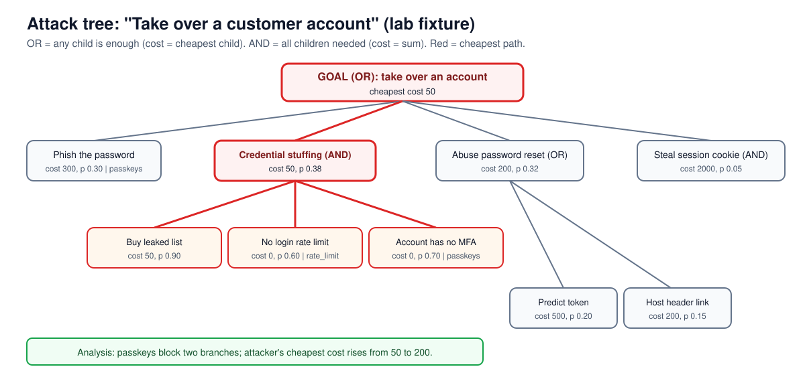

# Lesson 03: Goal, Attacker and Software Centric Threat Modeling

**Syllabus items covered:** [CTMP 2] "Goal/Asset Based Modeling Approach", "Attack Trees", "Attack Tree Analysis", "Attacker/Threat Actor Centric Modeling Approach", "Using MITRE ATT&CK for Attacker Centric Threat Modeling", "Software Centric Threat Modeling", "Creating Threat Actor Personas".

**Time:** 2.5 hours. **Labs:** [attack-trees](labs/attack-trees/README.md), [threat-actor-personas](labs/threat-actor-personas/README.md), [dfd-stride](labs/dfd-stride/README.md).

## 1. Goal/asset based modeling approach

Start from **what you must protect** (assets, crown jewels) or **what an attacker wants** (goals), then work out how each could be reached.

1. List assets and rank them by value: customer accounts, card data, the orders DB, the signing key, the brand.
2. For each top asset, write attacker goals: "take over an account", "get a copy of the orders DB", "ship goods without paying".
3. Decompose each goal into ways to reach it: an **attack tree**.

Strength: effort goes to what matters. Weakness: threats to "unimportant" components that are stepping stones can be missed. OCTAVE ([lesson 04](04-other-methodologies-and-games.md#5-octave)) is an organisation-level asset-centric method.

## 2. Attack trees

An attack tree (Bruce Schneier, 1999) puts the **attacker's goal at the root** and the ways to reach it below.

- **OR node:** any child achieves the parent (phish the password OR stuff credentials OR abuse reset).
- **AND node:** all children are needed (leaked list AND no rate limit AND no MFA).
- **Leaves:** concrete attacker steps; give them attributes: cost, skill, probability, detectability, and the controls that block them.

Trees can be drawn (draw.io, Graphviz), written as text or code (ADTool, attack-tree libraries; [AI threat modeling lesson, step 7](../../01-ai-security-fundamentals/03-ai-threat-modeling.md#step-7-attack-trees-as-code) has a code version), or kept as JSON as in the lab.

## 3. Attack tree analysis

With attributes on the leaves you can compute things for the root:

| Question | OR node | AND node |
|---|---|---|
| Cheapest attack cost | min of children | sum of children |
| Probability of success | 1 - product of (1 - p) | product of p |
| Possible? (boolean) | any child possible | all children possible |

Useful analyses (all in the [attack-trees lab](labs/attack-trees/README.md)):

- **Cheapest path:** what a rational attacker does first. In the fixture: credential stuffing, cost 50.
- **Attack scenarios (cut sets):** minimal sets of leaves that reach the goal; 5 in the fixture.
- **Budget filter:** what an attacker with budget X can afford; useful with personas (a skill-1 opportunist vs a funded crew).
- **Control what-if:** apply a control, recompute. Rate limiting moves the attacker to the Host-header reset attack (cost 200); passkeys block two branches at once and are the best single control.

Caveats: probabilities are estimates and branches are not truly independent; use the numbers to **compare options**, not as forecasts.

## 4. Attacker/threat actor centric modeling approach

Start from **who** would attack you: their motivation, skill, resources and access. This makes likelihood realistic (an opportunist will not build a supply-chain implant; a ransomware affiliate will buy initial access) and links the threat model to detection, which is useful in your SOC role.

Typical actors for a web shop: opportunists with tools, organised fraud crews, malicious or careless insiders, ransomware affiliates, hacktivists, competitors, and in some sectors state actors.

## 5. Creating threat actor personas

A persona is a one-screen profile based on evidence (incidents, threat intel, sector reports), not on movie hackers.

| Field | Example: "Organised fraud crew" |
|---|---|
| Motivation | Money: refunds, gift cards, resold accounts |
| Skill (1-5) | 3 |
| Resources | Leaked credential lists, phishing kits, mule accounts |
| Access | External only |
| Goals | Take over customer accounts; abuse refunds through support staff |
| Techniques | T1110.004 Credential Stuffing, T1566 Phishing, T1078 Valid Accounts, T1565 Data Manipulation, T1190 Exploit Public-Facing Application (verify IDs) |

Related ideas: **Persona non Grata** (personas of people who should *not* use the system, from Cleland-Huang's work), and the attacker personas used in hybrid methods ([lesson 04](04-other-methodologies-and-games.md#3-hybrid-threat-modeling)). Keep 3 to 6 personas; more becomes noise. The [threat-actor-personas lab](labs/threat-actor-personas/README.md) validates persona cards and works out which threats each persona would attempt.

## 6. Using MITRE ATT&CK for attacker centric threat modeling

**MITRE ATT&CK** is a public knowledge base of adversary **tactics** (the why: Initial Access, Credential Access, Impact…) and **techniques** (the how: T1566 Phishing, T1190 Exploit Public-Facing Application…), built from real incidents. The Enterprise matrix is versioned (v18 was released in October 2025; verify the current version at attack.mitre.org).

How to use it in threat modeling:

1. Give each persona the techniques real groups like them use (ATT&CK has group pages and software pages).
2. Tag threats in your model with technique IDs.
3. Ask: which persona would realistically attempt each threat? Which threats need a persona we have not written (the lab finds the supply-chain threat T1195 has none)?
4. Turn techniques into **detections and tests**: the SOC builds rules per technique; red teams emulate them.

Limits: ATT&CK describes intrusion behaviour; **business-logic abuse** (a forged payment webhook, coupon abuse) often has no clean technique. Model those anyway (the lab lists them as "unmapped"). Related catalogs: **CAPEC** (attack patterns against software, closer to app design) and **MITRE ATLAS** for AI systems ([CAISP ch5 lesson 04](../../caisp-course/ch5-threat-modeling-ai-systems/04-ai-threat-libraries.md)).

## 7. Software centric threat modeling

Start from **the system design**: draw the DFD, then analyse every element and flow, typically with STRIDE per element ([lesson 02](02-stride.md#4-stride-per-element)). This is the default for development teams because they know their software and the output maps directly to code changes and tests.

Steps: DFD with trust boundaries → STRIDE per element → concrete threats → requirements and tests → rating. Microsoft's SDL threat modeling and tools like Microsoft TMT, Threat Dragon and pytm are software centric. The [dfd-stride lab](labs/dfd-stride/README.md) automates the candidate step.

## 8. Choosing and combining approaches

| Approach | Start from | Best for | Watch out for |
|---|---|---|---|
| Goal/asset | Crown jewels, attacker goals | Prioritising, executive conversations | Missing stepping-stone components |
| Attacker | Personas, ATT&CK | Realistic likelihood, SOC detections | Needs intel; misses logic flaws |
| Software | DFD | Dev teams, design reviews | Long lists with no priority |

A practical combination: software-centric DFD + STRIDE to find; personas to judge likelihood; attack trees for the top two or three goals; a rating method to order the backlog.

## 9. Scenario: the persona that changed the priority

ShopCo's STRIDE session rated "SQL injection in the orders API" and "refund fraud via a phished support account" both MEDIUM. Adding personas changed that: the organised fraud crew (skill 3, phishing kits, history of refund fraud in the sector) targets exactly the second one, and the attack tree showed it needed no technical vulnerability at all. Step-up MFA and a second approver for refunds moved to the top of the backlog.

## 10. Common mistakes

- Attack trees with no attributes: pretty but useless for decisions.
- Personas without evidence ("elite hackers").
- Treating ATT&CK as a checklist of everything; pick techniques relevant to your personas.
- Using only one approach and calling the model complete.
