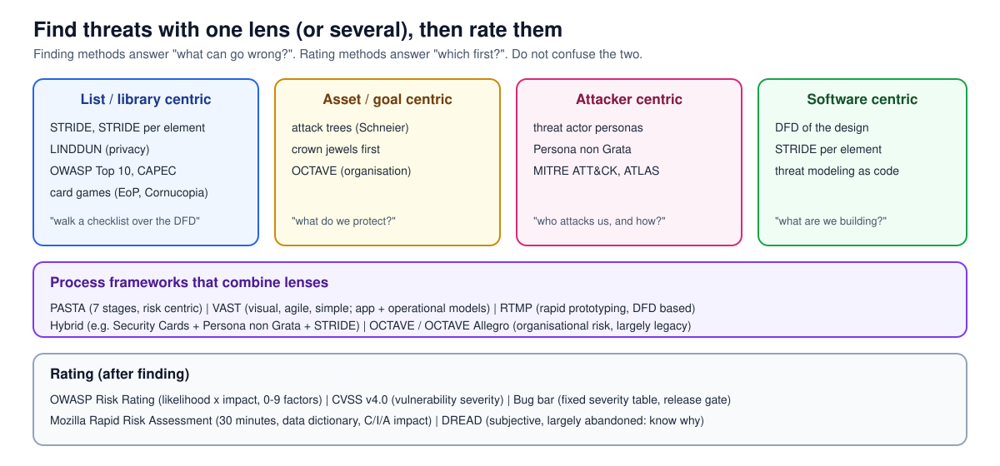

# Lesson 04: Other Methodologies (PASTA, VAST, Hybrid, RTMP, OCTAVE) and Gamified Threat Modeling

**Syllabus items covered:** [CTMP 2] "Other Threat Modeling Methodologies", "PASTA", "VAST", "Hybrid Threat modeling", "RTMP", "OCTAVE", "Gamified approaches for Threat Modeling", "Virtual Card Games", "Adversary Card Games".

**Time:** 2 hours. **Lab:** [threat-card-game](labs/threat-card-game/README.md).

STRIDE and attack trees are **techniques**. The methods below are mostly **processes** that tell you when and how to apply techniques, and who takes part. Exam questions usually ask you to name the stages or the distinguishing idea of each.

## 1. PASTA

**Process for Attack Simulation and Threat Analysis** (Tony UcedaVélez and Marco Morana, 2015). **Risk centric**: it starts from business objectives and ends with risk-ranked countermeasures. Seven stages:

1. **Define objectives** (business and security objectives, compliance, impact).
2. **Define the technical scope** (components, dependencies, infrastructure).
3. **Application decomposition** (DFDs, trust boundaries, use cases, actors, assets).
4. **Threat analysis** (threat intelligence, likely threat scenarios).
5. **Vulnerability and weakness analysis** (scans, CWE/CVE, design weaknesses, mapped to threats).
6. **Attack modeling** (attack trees, simulation of attacks against the weaknesses).
7. **Risk and impact analysis** (residual risk, countermeasures, business impact).

Strengths: ties security to business impact; uses threat intel and evidence. Weaknesses: heavy; needs mature teams and time; awkward for every sprint.

## 2. VAST

**Visual, Agile and Simple Threat** modeling (Anurag Agarwal; associated with the ThreatModeler tool). Built to **scale** across an enterprise and fit Agile. Its key idea: two kinds of models for two audiences:

- **Application threat models**: process flow diagrams of the app for developers.
- **Operational threat models**: infrastructure and data-flow views for ops and security.

Strengths: scalable, automation-friendly, fits DevOps. Weaknesses: much of the public material comes from one vendor; less detail on how to find threats beyond its tooling.

## 3. Hybrid threat modeling

Combines techniques to get coverage and realism. The best-known version (from Carnegie Mellon SEI work, verify the paper) is the **hybrid Threat Modeling Method (hTMM)**, which combines:

- **Security Cards** (brainstorming cards about human impact, adversary motivations, resources and methods),
- **Persona non Grata** (personas of attackers and misusers),
- **STRIDE** to systematise the result.

Steps in short: identify the system; brainstorm with Security Cards; prune unlikely Persona non Grata; summarise threats; apply STRIDE-style checks to fill gaps. In practice "hybrid" also just means combining software-centric STRIDE with personas and attack trees, as recommended in [lesson 03](03-goal-attacker-and-software-centric.md#8-choosing-and-combining-approaches).

## 4. RTMP

**Rapid Threat Model Prototyping** (Geoffrey Hill). A lightweight, Agile-friendly method: short sessions per feature or story, a simple DFD-based model that grows sprint by sprint, threats captured as backlog items. The idea is to prototype a threat model as quickly as you prototype software and refine it later, instead of one big up-front model. Fits the "model the delta" approach in [chapter 03 lesson 02](../03-risk-management-and-threat-modeling-overview/02-threat-modeling-overview.md#9-modern-threat-modeling-approaches-for-agile-and-devops). Hedge: public documentation is limited; follow your course's description for exact steps.

## 5. OCTAVE

**Operationally Critical Threat, Asset, and Vulnerability Evaluation** (CERT/SEI, Carnegie Mellon, around 1999-2001). **Organisational** and asset-centric risk assessment run by an internal team. Variants: OCTAVE, OCTAVE-S (small organisations) and **OCTAVE Allegro** (streamlined, information-asset focused, 2007). Phases (original): build asset-based threat profiles; identify infrastructure vulnerabilities; develop a security strategy and plans.

Strengths: business-driven, self-directed. Weaknesses: heavy, documentation-centric and **largely legacy**; not designed for individual applications or Agile delivery.

## 6. Comparison

| Method | Focus | Effort | Fits Agile? | Use it when |
|---|---|---|---|---|
| STRIDE | Threat categories per element | Low | Yes | Every design review |
| Attack trees | Attacker goals | Medium | Yes, for top goals | Prioritising crown-jewel threats |
| PASTA | Business risk, 7 stages | High | Partly | High-value systems, regulated sectors |
| VAST | Scale, app + operational models | Medium (tool-driven) | Yes | Many teams, tool-supported programmes |
| Hybrid (hTMM) | Coverage + realism | Medium | Yes | Brainstorm-friendly teams |
| RTMP | Speed, per feature | Low | Yes | Sprint-level threat modeling |
| OCTAVE | Organisational risk | High | No | Enterprise risk programmes (legacy) |
| LINDDUN | Privacy threats | Medium | Yes | Personal data (taught in chapter 05) |

## 7. Gamified approaches for threat modeling

Card games make threat modeling social and less intimidating for developers. Players draw cards that describe threats and must say where the threat applies to the DFD on the table; good findings score points and land in the backlog.

| Game | Focus | Notes (verify current editions) |
|---|---|---|
| **Elevation of Privilege (EoP)** | STRIDE suits, Microsoft | Adam Shostack's original deck; also maintained as an OWASP project |
| **OWASP Cornucopia** | Web app threats (suits by security area) | Version 2 adds a mobile app edition |
| **OWASP Cumulus** | Cloud and DevOps threats | Based on the EoP format |
| **LINDDUN GO** | Privacy threats | Card version of LINDDUN |
| **Security Cards** | Brainstorming (human impact, adversary) | University of Washington; used in hTMM |
| **Backdoors & Breaches** | Incident response tabletop | Black Hills Information Security; IR rather than design |

### 7.1 Virtual card games

Most decks have free printable PDFs and online or virtual versions for remote teams: online EoP and Cornucopia implementations, LINDDUN GO online, and Backdoors & Breaches has an online play mode (verify current sites). Tips for remote sessions: share the DFD on a whiteboard tool, one facilitator records threats live, timebox to 60 minutes.

### 7.2 Adversary card games

Some games make players **think as the attacker**: EoP's cards are phrased as attacker capabilities ("an attacker can…"); Backdoors & Breaches has attacker procedure cards (initial compromise, pivot, persistence, C2) that defenders must detect; Security Cards include adversary motivation and method suits. They train attacker-centric thinking ([lesson 03](03-goal-attacker-and-software-centric.md#4-attackerthreat-actor-centric-modeling-approach)).

The [threat-card-game lab](labs/threat-card-game/README.md) is a tiny STRIDE-suited deck written for this course (original wording, not copied from any published deck) with scoring rules and a backlog output.

## 8. Scenario: the game that found the admin route

A team that "had no time for threat modeling" agreed to one hour of a card game at the sprint retro. A junior tester drew an elevation-of-privilege card ("a normal user can reach an admin function by calling its URL directly") and tried it on staging: `GET /admin/refunds` worked for any logged-in user. The game paid for itself in the first round.

## 9. Common mistakes

- Choosing a heavy method (PASTA, OCTAVE) for a sprint-sized change.
- Playing card games without a DFD on the table: discussion drifts.
- Scoring points but not recording the threats.
- Treating any method as complete on its own.
