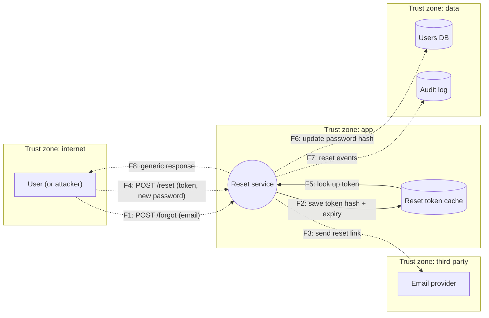

# Lab: DFD as data, trust boundaries and a STRIDE-per-element generator

**Course exercises:** [CTMP 2] Creating a Data Flow Diagram for Threat Modeling; [CSC 4] Creating Data Flow Diagrams. Lessons: [01 Diagramming](../../01-security-requirements-and-diagramming.md#3-diagramming-for-threat-modeling), [02 STRIDE per element](../../02-stride.md#4-stride-per-element).

**Time:** 45 minutes. **Tests:** 7, all offline. **Safety:** a fictional DFD in JSON. Only test systems you own or have written permission to test.

## Goal

Keep a DFD as reviewable data, check it follows the DFD rules, and generate the STRIDE questions for every element and flow.

## Concept

[dfd.py](dfd.py) reads a JSON DFD (zones, elements of type external/process/datastore, flows) and provides:

- `validate()`: DFD rules: `STORE_TO_STORE`, `EXTERNAL_TO_STORE`, `EXTERNAL_TO_EXTERNAL`, `DANGLING_FLOW`, `MIRACLE` (output with no input), `BLACK_HOLE` (input with no output), unknown zones.
- `crossings()`: flows that cross a trust boundary (zone change).
- `stride_per_element()`: one question per applicable letter (externals S R; processes S T R I D E; stores T I D, plus R for log stores; flows T I D). Boundary-crossing flows get priority `boundary`.
- `mermaid()`: a diagram with one subgraph per trust zone, boundary flows dashed.

## Steps

1. Run the demo. Read the six errors for `broken_dfd.json` and fix the fixture so it validates (add a process between `user` and `db`, and so on).
2. In `password_reset_dfd.json`, move `token_store` to the `data` zone. Predict which flows become boundary crossings, then run.
3. Add an `admin` external entity with a flow to `reset_app` (support-initiated resets). How many new candidates appear?
4. Paste the Mermaid block into a Mermaid renderer (GitHub renders it in Markdown).
5. Pick five candidates and turn each into a concrete threat sentence and mitigation; compare with [lesson 06](../../06-password-reset-workflow.md#2-what-can-go-wrong-stride).

## Run

```text
.venv/Scripts/python appsec-course/04-threat-modeling-methods-and-rating/labs/dfd-stride/demo.py
.venv/Scripts/python -m pytest appsec-course/04-threat-modeling-methods-and-rating/labs/dfd-stride -q -p no:cacheprovider
```

## Real output (from demo.py)

````text
=== Validating broken_dfd.json ===
  B1: EXTERNAL_TO_STORE (a process must sit between them)
  B2: STORE_TO_STORE (data must move through a process)
  B4: EXTERNAL_TO_EXTERNAL (out of scope for this model)
  B6: DANGLING_FLOW
  report_job: MIRACLE (output with no input)
  sink: BLACK_HOLE (input with no output)

=== password_reset_dfd.json ===
validation errors: none
boundary-crossing flows: F1, F3, F4, F6, F7, F8
STRIDE-per-element candidates: 44
  Spoofing                 3
  Tampering                12
  Repudiation              4
  Information disclosure   12
  Denial of service        12
  Elevation of privilege   1

First 8 candidates (target, letter, priority, question):
  user        S normal   Can someone pretend to be User (or attacker)?
  user        R normal   Can User (or attacker) deny an action, or can an action through it go unrecorded?
  mail        S normal   Can someone pretend to be Email provider?
  mail        R normal   Can Email provider deny an action, or can an action through it go unrecorded?
  reset_app   S normal   Can someone pretend to be Reset service?
  reset_app   T normal   Can someone change Reset service or the data it handles?
  reset_app   R normal   Can Reset service deny an action, or can an action through it go unrecorded?
  reset_app   I normal   Can Reset service leak data to someone who should not see it?


````

## Run the real tool (hedged)

Draw the same DFD in **OWASP Threat Dragon** or the **Microsoft Threat Modeling Tool** (which generates STRIDE threats automatically), or describe it in **OWASP pytm** (chapter 05). See [real-tools](../../real-tools/diagramming-attack-and-games.md).

## What you learned

- A DFD is data; keep it in git and validate it like code.
- STRIDE per element turns a diagram into a finite list of questions; humans turn questions into threats.
- Boundary-crossing flows deserve most of the session time.
