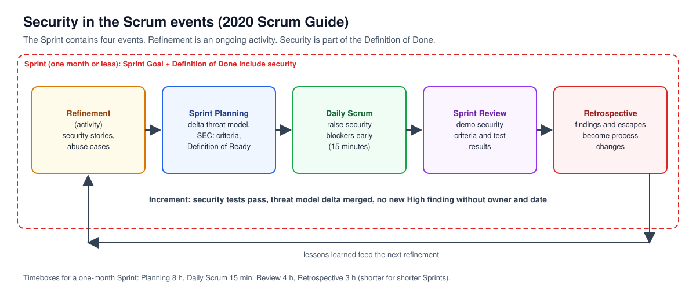

# Lesson 01: Agile Threat Modeling, Rapid Prototyping and Scrum

**Syllabus items covered:** [CTMP 3] "Agile Threat Modeling Approaches", "Rapid Threat Model Prototyping", "Events of Agile Software Development Through Scrum".

**Time:** 1.5 hours. **Safety:** all systems and names are fictional.

> **DBA analogy.** A big up-front threat model is like a yearly full database export: correct on the day, stale the next week. Agile threat modeling is like archive logs plus incremental backups: a small, regular delta on top of a baseline, so you can always get back to "now".

## 1. Why classic threat modeling struggles in agile teams

Classic threat modeling assumes a design phase: architects draw a full DFD, run STRIDE on every element, write a long report and hand it to developers. In a team that ships every two weeks this breaks:

- the design changes every sprint, so the report is stale before it is approved;
- a two-day workshop does not fit in a sprint;
- the security team becomes a bottleneck and a "gate" people try to avoid;
- findings live in a PDF, not in the backlog, so nobody plans the fixes.

The questions do not change. The Threat Modeling Manifesto's four questions still apply: **What are we working on? What can go wrong? What are we going to do about it? Did we do a good enough job?** What changes is **how often**, **how much** and **where the result lives**.

## 2. Agile threat modeling approaches

| Approach | What it means | When it fits |
|---|---|---|
| **Baseline + delta** | One baseline model of the system (often in "sprint 0"), then a short **delta** model for each story that changes a data flow, trust boundary or sensitive data | Most product teams |
| **Story-level threat modeling** | At Sprint Planning or refinement, ask the four questions for each security-relevant story; output = abuse cases and `SEC:` acceptance criteria | Every sprint |
| **Just enough, timeboxed** | 15 to 45 minutes, whiteboard or tool, the people who build it; stop when new threats stop appearing | Small changes |
| **Continuous threat modeling** | Developers answer a short checklist or questionnaire on every design change, with security champions as reviewers (for example the Autodesk Continuous Threat Modeling handbook; verify) | Large organisations |
| **Threat modeling as code** | The model is a file in the repository (annotations, pytm, Threagile, Threat Dragon JSON) and CI checks it ([Lesson 02](02-threat-modeling-as-code-pytm-and-diagrams.md)) | Teams that live in git |
| **Rapid Threat Model Prototyping (RTMP)** | Section 3 | Fast first model of a new feature |
| **Security champions** | One developer per team with security interest runs the session and keeps the model current | Scaling beyond the security team |

Rules of thumb:

- **Trigger on change, not on the calendar.** New external interface, new data store, new trust boundary, new sensitive data type, new third party, or authentication change: model it.
- **Put the output in the backlog,** not in a document: abuse cases, security stories, acceptance criteria and tests ([Lesson 03](03-security-requirements-user-stories-and-abuse-cases.md)).
- **Keep a living model,** one per system, updated by deltas. A new team member should be able to read it in 20 minutes.

## 3. Rapid Threat Model Prototyping (RTMP)

**RTMP** is a lightweight, agile-friendly method described by Geoffrey Hill (verify the current material at its source). The idea:

1. **Prototype first.** Sketch a simple DFD of the feature (not the whole system) in minutes, with the actors, processes, stores and flows the story adds.
2. **Mark the trust boundaries** the feature crosses.
3. **Apply STRIDE per element** (or a short threat list) quickly, as a team.
4. **Map each threat to a control** and write it as a story or acceptance criterion.
5. **Iterate:** the prototype is refined in later sprints as the feature grows, like a software prototype.

It fits agile because it is timeboxed, feature-scoped and produces backlog items, not a report. Chapter 04 compares RTMP with PASTA, VAST, OCTAVE and hybrid methods.

## 4. Scrum events and where security fits

The **2020 Scrum Guide** defines the **Sprint** as the container event, with four events inside it: **Sprint Planning**, **Daily Scrum**, **Sprint Review** and **Sprint Retrospective**. Product Backlog **refinement** is an ongoing activity, not an event. The three accountabilities are Product Owner, Scrum Master and Developers; the artifacts are the Product Backlog, Sprint Backlog and Increment, with commitments Product Goal, Sprint Goal and **Definition of Done**.

| Event (2020 Scrum Guide) | Timebox (one-month Sprint; shorter for shorter Sprints) | Security activity |
|---|---|---|
| **Sprint** | one month or less | Security work is part of the Sprint Goal and the Definition of Done |
| **Backlog refinement** (activity) | ongoing | Write security stories and abuse cases; size them; mark security-relevant stories |
| **Sprint Planning** | up to 8 hours | Threat model each security-relevant story (delta model); add abuse cases and `SEC:` criteria **before** the story is pulled in |
| **Daily Scrum** | 15 minutes | Raise security blockers early: a new data flow, a secret needed, a failing security test |
| **Sprint Review** | up to 4 hours | Demo the security acceptance criteria and the security test results; update the threat model with what was built |
| **Sprint Retrospective** | up to 3 hours | Review findings and escaped defects; turn them into process changes (a checklist item, a new rule, a training) |

**Definition of Ready (team practice, not in the Scrum Guide) and Definition of Done with security:**

- *Ready:* a security-relevant story has at least one abuse case and one `SEC:` acceptance criterion.
- *Done:* security acceptance criteria pass as automated tests; SAST/SCA/secret scan clean or triaged; the threat model delta is merged; no new High finding without an owner and a date.

The [agile-security-stories lab](labs/agile-security-stories/README.md) checks these rules on a backlog file.

## 5. Scenario: the password reset story

Sprint 14 of an online shop. The Product Owner brings "As a customer, I want to reset my password by email so that I can get back into my account."

- **Refinement (Tuesday):** the champion tags it `auth`. It is security-relevant.
- **Sprint Planning:** 20-minute delta model on the whiteboard: Customer → Web App → Users DB, Web App → Mailer. STRIDE finds token guessing (Spoofing), account enumeration (Information Disclosure) and reset-form flooding (Denial of Service). The team adds two `SEC:` criteria and a security story for rate limiting.
- **Daily Scrum (Thursday):** a developer says the mail provider needs an API key. The champion points to the secrets vault; nobody puts it in the config file.
- **Sprint Review:** the team shows that the 6th reset request gets HTTP 429 and that the response is the same for unknown emails.
- **Retrospective:** "We almost logged the reset token." Action: add "never log tokens" to the code review checklist.

No PDF was written; the threat model delta is a file in the repository and the controls are tests.

## 6. Common mistakes

- Calling the yearly architecture review "agile threat modeling".
- Threat modeling every story, including button colours. Use triggers.
- Findings in a document, not in the backlog.
- "Security sprint" at the end of the release. Security is in every Sprint's Definition of Done.
- The security team does all modeling. Developers model; security coaches and reviews.

## 7. Checklist

- [ ] I can state the four questions and the triggers for a delta threat model.
- [ ] I can describe RTMP in five steps.
- [ ] I can name the five Scrum events (2020 Scrum Guide) and one security activity for each.
- [ ] I can write a Definition of Ready and a Definition of Done with security items.

## References

- Threat Modeling Manifesto (threatmodelingmanifesto.org); OWASP Threat Modeling Cheat Sheet.
- The 2020 Scrum Guide (scrumguides.org).
- Autodesk Continuous Threat Modeling handbook (GitHub; verify).
- Geoffrey Hill's Rapid Threat Model Prototyping material (verify at source).
- Repo: [devsecops-course chapter 03](../../devsecops-course/03-security-requirements-and-threat-modeling/README.md) (STRIDE, DREAD, tools in CI/CD), [CAISP ch5](../../caisp-course/ch5-threat-modeling-ai-systems/README.md) (threat modeling AI systems).
