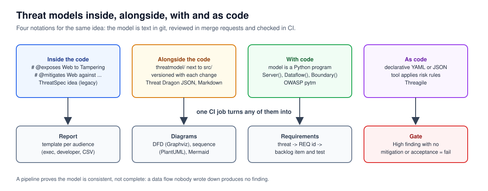

# Lesson 02: Threat Modeling Inside, Alongside, With and As Code (pytm, Diagrams, Attack Trees)

**Syllabus items covered:** [CTMP 3] "Threat Modeling Diagrams as Code", "Threat Modeling Inside The Code", "Threat Modeling as Code", "Creating Threat Models With Pytm", "Customizing Reporting Capabilities Of Pytm", "Exploring UML as Code", "Creating Attack Trees Using Code", "Writing Threat Models Alongside Code", "Writing Threat Models With Code", "Writing Threat Models As Code".

**Time:** 2 hours plus labs. **Safety:** all systems are fictional.

> **DBA analogy.** A threat model drawn in Visio is like a schema built by clicking in a GUI. A threat model **as code** is like a DDL script in git: you can diff it, review it, re-run it on a clean environment and see exactly what changed between releases.

## 1. Four ways to keep the model next to the code

The course uses four phrases that sound alike. They are points on one spectrum:



| Phrase | What it means | Example tools | Lab |
|---|---|---|---|
| **Inside the code** | Threat annotations in **source comments**, at the line that has the risk or the control | ThreatSpec (legacy), custom annotation parsers | [devsecops-course ThreatSpec-style lab](../../devsecops-course/03-security-requirements-and-threat-modeling/labs/threat-modeling-as-code/README.md) |
| **Alongside the code** | A model file in the **same repository**, versioned and reviewed with the code it describes (for example `threatmodel/` next to `src/`) | Threat Dragon JSON, Threagile YAML, pytm script, Markdown + Mermaid | All labs in this chapter keep models next to code |
| **With code** | The model **is a program**: elements are objects in a general-purpose language | **OWASP pytm** (Python) | [pytm-lite](labs/pytm-lite/README.md) `model_shop.py` |
| **As code** | The model is **declarative data** that a tool processes (rules, reports, diagrams) | **Threagile** (YAML), Threat Dragon JSON | [pytm-lite](labs/pytm-lite/README.md) `shop_model.json` |

In practice people use "threat modeling as code" for all four. What they share: the model is **text in git**, changes go through **merge requests**, and **CI** generates the report and diagram and can fail the build.

**Inside the code, briefly.** Comments such as `@exposes DMZ:WebServer to Tampering with unvalidated form fields` and `@mitigates DMZ:WebServer against Tampering with schema validation` sit next to the code. A parser builds a report, a DFD and a gate. The DevSecOps course already teaches this in depth, so this course **links** to it rather than repeating it: read [lesson 02 section 3 there](../../devsecops-course/03-security-requirements-and-threat-modeling/02-threat-modeling-tools-and-ci-cd.md#3-threat-modeling-as-code-with-annotations-the-threatspec-idea) and do its lab. ThreatSpec itself has had little development since about 2020 (verify).

**With code versus as code.** "With code" gives you loops, functions and reuse (a helper that creates the same five elements for every microservice). "As code" is easier for non-programmers to read and harder to abuse (no arbitrary code in the model). Both work; pick one per organisation.

## 2. Creating threat models with pytm and customizing its reports

**OWASP pytm** is a Pythonic framework for threat modeling (verify the current API in its README). You describe the system in Python:

```python
# tm.py (sketch, check the pytm README for the current API)
from pytm import TM, Actor, Boundary, Server, Datastore, Dataflow, Data

tm = TM("Shop")
tm.description = "Customers browse and order"
internet = Boundary("Internet")
user = Actor("Customer"); user.inBoundary = internet
web = Server("Web App"); web.sanitizesInput = False
db = Datastore("Orders DB"); db.isEncrypted = False
login = Dataflow(user, web, "Login"); login.protocol = "HTTP"
tm.process()
```

and run it with options:

| Option (verify) | Output |
|---|---|
| `--dfd` | Graphviz DOT for the data flow diagram (pipe to `dot -Tpng`) |
| `--seq` | PlantUML sequence diagram |
| `--report template.md` | Report filled from a template |
| `--list` | Threats in the library |
| `--json out.json` | Machine-readable model and findings |

**How the findings appear.** pytm's threat library is JSON. Each threat has an id (`SID`), the element types it targets, a **condition** on element attributes (for example "the flow is not encrypted"), a severity and mitigations. `process()` checks every element against every threat. Conditions are Python expressions evaluated by pytm, so treat a third-party threat library like code and review it. The [pytm-lite lab](labs/pytm-lite/README.md) uses a safe mini-language instead and has a test showing why.

**Customizing reports.** pytm fills a Markdown template. A special format repeats text for each item:

```text
{findings:repeat:
| {{item.threat_id}} | {{item.target}} | {{item.severity}} | {{item.description}} |
}
```

Typical customisations: an **executive summary** (counts, High items only), a **developer view** (one line per finding with the requirement id), a **CSV** for a ticket import, a **compliance view** (findings with their ASVS or PCI mapping). The model and rules stay the same; only the template changes. Never hand-edit a generated report: change the model or the template.

## 3. Diagrams as code and UML as code

Diagrams drawn by hand drift. Diagrams **generated from text** are diffed and reviewed like code.

| Notation | Good for | Rendered by |
|---|---|---|
| **Graphviz DOT** | DFDs with clusters for trust boundaries (pytm `--dfd`) | `dot`, many viewers |
| **PlantUML** | UML: sequence, class, use case, component, deployment, activity | PlantUML (Java), server, IDE plugins |
| **Mermaid** | Flowcharts, sequence diagrams, simple C4 | GitHub, GitLab, many wikis natively |
| **Structurizr DSL / C4** | Architecture views (context, container, component) | Structurizr tools |

**UML as code for threat modeling:**

- **Sequence diagrams** show the order of calls and where tokens and data travel. They find threats DFDs hide: "the token is sent before the TLS check", "the callback is not authenticated".
- **Class diagrams** show which objects carry sensitive fields and which methods check ownership.
- **Use case and misuse case diagrams** show what users do and what attackers want next to it. Misuse cases "threaten" use cases; security use cases "mitigate" misuse cases (Sindre and Opdahl notation).

```text
@startuml
actor "Customer" as Customer
actor "Attacker" as Attacker #black
usecase "View orders" as View_orders
usecase "Read other orders (BOLA)" as BOLA <<misuse>>
Customer --> View_orders
Attacker --> BOLA
BOLA ..> View_orders : <<threatens>>
@enduml
```

Lint diagrams in CI: a missing `@enduml` or an undeclared participant should fail the build, not produce a silently broken picture. The [diagrams lab](labs/diagrams-and-attack-trees-as-code/README.md) generates all three UML types and lints them.

## 4. Attack trees as code

An **attack tree** (Schneier, 1999) puts the attacker's goal at the root and the ways to reach it below: **OR** nodes (any child works) and **AND** nodes (all children are needed). Chapter 04 teaches attack tree analysis; here the point is to write the tree **as code** so it can be computed and versioned:

```text
OR: Read another customer's order history
  AND: Take over a customer account
    LEAF: Get the password from a breach list [id=L1, cost=50, p=0.30]
    LEAF: Log in without a second factor     [id=L2, cost=0,  p=0.90]
  LEAF: Change order_id in the API call (BOLA) [id=L3, cost=10, p=0.60]
```

Once it is code you can answer questions a picture cannot:

- **Cheapest attack:** OR takes the minimum child cost; AND adds the children. Here: BOLA for 10.
- **Effect of a control:** block L3 (owner check) and the cheapest attack moves to L1 + L2 for 50; add MFA (block L2) and it moves to 300. Fix the cheapest path first.
- **Probability** (assuming independent steps): OR = 1 − ∏(1 − p), AND = ∏ p. Treat the numbers as rough guesses; the ranking is more useful than the value.
- **Render** to Mermaid or DOT for the wiki.

Tools: ADTool (attack-defence trees), Threagile and some platforms draw attack trees, and STRIDE GPT can draft them in Mermaid (verify). A draft from any tool still needs a human review.

## 5. Threat modeling as code in a pipeline

```text
merge request ──> CI job: parse model (pytm / Threagile / annotations)
                    ├─ report.md and dfd.png as build artifacts
                    ├─ new High finding with no mitigation or accepted risk ─> fail
                    ├─ diagram lint errors ─> fail
                    └─ requirement ids exported to the backlog
```

A pipeline proves the model is **consistent** (every declared risk has a decision). It cannot prove it is **complete**: a data flow nobody wrote down produces no finding. Humans in the design session cover completeness. See also [devsecops-course lesson 02](../../devsecops-course/03-security-requirements-and-threat-modeling/02-threat-modeling-tools-and-ci-cd.md#2-how-threat-modeling-fits-into-cicd).

## 6. Scenario: the forgotten export bucket

A team keeps a pytm model in `threatmodel/tm.py`. A developer adds a nightly export of customer data to a storage bucket and, as the merge request template asks, adds two lines to the model: a `Datastore("Export bucket", storesPII=True)` in an untrusted boundary and a flow from the API. CI re-runs the model: two new High findings (PII not encrypted at rest; flow crossing a boundary unencrypted). The reviewer sees them in the merge request, the developer turns on bucket encryption and TLS, sets the attributes, and the gate goes green. Without the model in the repository, this change would have been found (if at all) in next year's audit.

## 7. Common mistakes

- Generating a 60-page report nobody reads. Make an audience-specific template.
- Modeling everything in one giant file. Model per system or service, with shared helpers.
- Trusting the tool's threat list as complete. Rules only know the attributes you set.
- Setting control attributes to `True` to make the gate green without the control existing. Link each control to a test ([Lesson 03](03-security-requirements-user-stories-and-abuse-cases.md)).
- Diagrams in a slide deck that disagree with the code.

## 8. Checklist

- [ ] I can explain inside, alongside, with and as code, with one tool for each.
- [ ] I can write a five-element pytm model and name its output options.
- [ ] I can customise a pytm report template with a `repeat` block.
- [ ] I can write a sequence diagram and a misuse case diagram in PlantUML.
- [ ] I can write an attack tree in a DSL and compute its cheapest path.

## References

- OWASP pytm (GitHub, owasp.org); Threagile (threagile.io); OWASP Threat Dragon.
- PlantUML, Graphviz, Mermaid documentation; Structurizr and the C4 model.
- Bruce Schneier, "Attack Trees" (Dr. Dobb's Journal, 1999); Sindre and Opdahl, "Eliciting security requirements with misuse cases" (2005).
- Real-tools guide: [pytm, Threagile and diagram tools](real-tools/pytm-threagile-and-diagram-tools.md).
