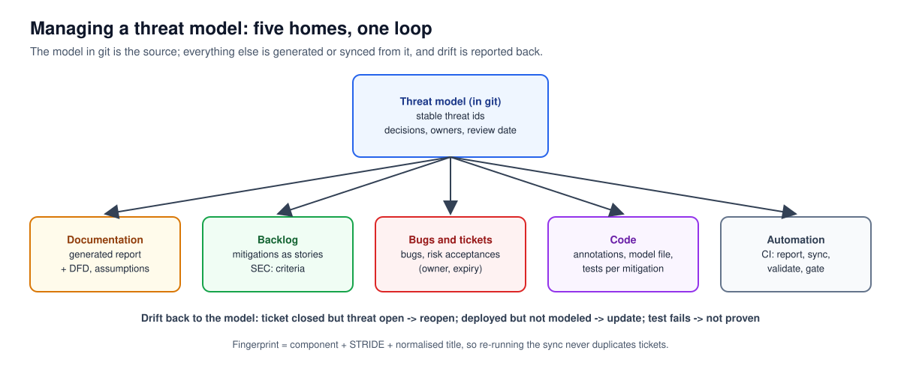

# Lesson 01: How to Manage Threat Models (Documentation, Backlog, Bugs and Tickets, Code, Automation)

**Syllabus items covered:** [CTMP 4] "How To Manage Threat Models", "Documentation", "Backlog", "Bugs, and Tickets", "Code", "Automation".

**Time:** 1 hour plus lab. **Safety:** fictional systems.

> **DBA analogy.** A threat model nobody maintains is like a data dictionary nobody updates after go-live: the first audit finds tables nobody documented. Managing a threat model is change management: every schema change (new component, flow, data type) updates the dictionary, and a nightly job compares the dictionary with `DBA_OBJECTS`.

## 1. How to manage threat models

A workshop produces a model; **management** keeps it true and makes it change the product. Five places the model must live, each with an owner:

| Where | What goes there | Owner |
|---|---|---|
| **Documentation** | The readable model: scope, DFD, assumptions, threats, decisions, version and review date | Tech lead or security champion |
| **Backlog** | Mitigations as stories and `SEC:` acceptance criteria, prioritised with features | Product Owner |
| **Bugs and tickets** | Vulnerabilities found in existing code (bugs), risk acceptances (tickets with owner and expiry) | Team plus risk owner |
| **Code** | Annotations, model files, and the tests that prove mitigations | Developers |
| **Automation** | CI jobs that regenerate reports, sync tickets, validate the model, and gate releases | Platform/DevSecOps team |

Rules: one model per system (not per project); version it in git; give every threat a **stable id**; record a decision for every threat (mitigate, accept, transfer, avoid); review on change and at least yearly.

## 2. Documentation

A good threat model document (see the [template](templates/threat-model-template.md)) contains:

1. **Scope and context:** system, version, owners, what is out of scope and why.
2. **Diagram(s):** DFD with trust boundaries, generated from the model where possible.
3. **Assets and data classification.**
4. **Assumptions** ("the CDN terminates TLS", "the IdP enforces MFA"). Wrong assumptions are a top source of missed threats.
5. **Threats** with id, STRIDE category, rating, decision, mitigation, ticket and test link.
6. **Accepted risks** with owner, approver, expiry.
7. **Change log and next review date.**

Generate the document from the model (pytm report, Threagile output, Threat Dragon export, or the lab's `to_markdown`). Hand-edited reports drift.

## 3. Backlog

- A **design gap** (no rate limit, no MFA for admins) becomes a **story** or a `SEC:` criterion on an existing story, sized and prioritised by the Product Owner with risk input.
- Prioritise by **risk** (rating from chapter 04), not by who shouts loudest. High risks go into the next sprint or need an explicit acceptance.
- Link each backlog item to the threat id so closing it can update the model.

## 4. Bugs, and tickets

| Ticket type | When | Must contain |
|---|---|---|
| **Bug** (security defect) | The threat is already exploitable in code (BOLA found in review or pen test) | Severity, affected version, fix SLA (for example critical 7 days; your policy decides) |
| **Story / task** | Design gap to build | Acceptance criteria, test |
| **Risk acceptance** | The team decides not to mitigate now | Owner, approver at the right level, reason, expiry date, compensating controls |
| **Risk transfer** | Contract, insurance, provider responsibility | Where it is transferred and evidence |

Sync **idempotently**: a stable fingerprint per threat (component + category + normalised title) prevents duplicate tickets on every pipeline run. Detect **drift**: a ticket closed while the model still shows the threat open must be reopened and verified.

## 5. Code

- **Inside the code:** annotations at the control (chapter 05, ThreatSpec idea).
- **Alongside the code:** the model file in `threatmodel/` reviewed in merge requests.
- **Tests:** each mitigation names its test (`tests/test_bola.py::test_other_user_gets_403`). If the file is renamed or deleted, the link breaks and CI should notice.
- **Merge request template:** "Does this change add a component, data flow, trust boundary or sensitive data? If yes, update the model."

## 6. Automation

| Job | Trigger | Fails when |
|---|---|---|
| Generate report and DFD | every merge request | model does not parse |
| Ticket sync | merge to main | (never fails; posts drift notes) |
| Validate model | nightly and pre-release | open High threat, expired acceptance, broken code link, model versus reality drift |
| Review reminder | schedule | next review date passed |

The [threat-model-management lab](labs/threat-model-management/README.md) implements the sync, drift, code links, document and gate; the [validation lab](labs/threat-model-validation/README.md) adds model versus reality.

## 7. Scenario: 400 duplicate tickets

A team connected its threat modeling tool to Jira with "create a ticket for every open threat" and ran it on every build. After two weeks Jira had 400 security tickets, developers set a filter to hide them, and a real BOLA bug was missed. The fix: one fingerprint per threat stored in a ticket label, upsert instead of create, severity updates instead of new tickets, and a weekly drift report to the champion. Ticket count dropped to 23, all real, all with owners.

## 8. Common mistakes

- The model lives only in a tool account of someone who left.
- Accepted risks with no expiry: "temporary" becomes forever.
- Closing tickets without updating the model (or the reverse).
- No test for a mitigation, so a refactor removes it silently.
- Automation that creates noise instead of decisions.

## 9. Checklist

- [ ] I can list the five places a threat model lives and who owns each.
- [ ] I can choose between bug, story, risk acceptance and transfer tickets.
- [ ] I can explain fingerprint-based ticket sync and drift detection.
- [ ] I can name four automation jobs and what fails each.

## References

- Adam Shostack, *Threat Modeling* (chapter on processes and tracking); Threat Modeling Manifesto.
- OWASP Threat Modeling Cheat Sheet; OWASP SAMM "Threat Assessment" practice.
- Repo: [devsecops-course chapter 14 vulnerability management](../../devsecops-course/14-vulnerability-management/README.md), [chapter 05 of this course](../05-agile-threat-modeling-as-code/README.md).
