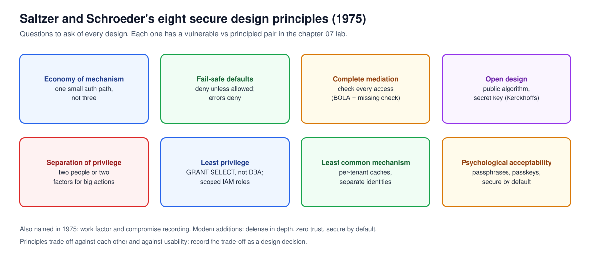

# Lesson 01: Principles of Secure Design (Saltzer and Schroeder) with Examples

**Syllabus items covered:** [CTMP 5] "Exploring Principles of Secure Design with Examples" and the eight principles: Economy of Mechanism, Fail Safe Defaults, Complete Mediation, Open Design, Separation of Privilege, Least Privilege, Least Common Mechanism, Psychological Acceptability.

**Time:** 2 hours plus lab. **Safety:** all code is fictional and runs offline.

> **DBA analogy.** You already know most of these principles from Oracle: grant `SELECT` on one view instead of `DBA` (least privilege); profiles that lock an account after failed logins (fail-safe); VPD policies that are checked on every query, not once per session (complete mediation); a change that needs both the DBA and the change manager (separation of privilege).

## 1. Exploring principles of secure design with examples

In 1975 Jerome Saltzer and Michael Schroeder published "The Protection of Information in Computer Systems". Its eight design principles are still the vocabulary of secure design reviews. They are not rules that guarantee security; they are **questions** to ask of a design. Threat modeling finds what can go wrong; the principles tell you what a good answer usually looks like.



| Principle | One-line meaning | Typical violation | Lab pair (`principles.py`) |
|---|---|---|---|
| Economy of mechanism | Keep security mechanisms small and simple | Three authentication paths, one forgotten | `ManyPathAuth` vs `OnePathAuth` |
| Fail-safe defaults | Deny unless explicitly allowed | `except: return True` | `allowed_fail_open` vs `allowed_fail_safe` |
| Complete mediation | Check every access, every time | Permissions cached at login | `CachedAuthz` vs `MediatedAuthz` |
| Open design | Security must not depend on a secret design; only keys are secret | Home-made token format | `obscure_token` vs `open_token` (HMAC) |
| Separation of privilege | Require two conditions or two people for sensitive actions | Requester approves own refund | `refund_single_key` vs `refund_two_person` |
| Least privilege | Every program and user gets only the rights it needs | Report tool connects as schema owner | `report_db(False)` vs `report_db(True)` |
| Least common mechanism | Share as little mechanism as possible between users | One cache for all tenants | `SharedReportCache` vs `TenantReportCache` |
| Psychological acceptability | Security must be easy to use correctly | Complexity + rotation rules → `Summer2026!` | `complexity_policy` vs `usable_policy` |

Saltzer and Schroeder also named two principles that "apply imperfectly to computer systems": **work factor** (cost to defeat the mechanism) and **compromise recording** (logging that a breach happened). Modern lists add **defense in depth**, **secure by default**, **zero trust** and **minimise attack surface**; they are elaborations of the eight.

## 2. Principle of economy of mechanism

*Keep the design as simple and small as possible.* Simple mechanisms can be reviewed line by line and tested exhaustively; complex ones hide bypasses.

```python
# Violation: three ways in. The third was "only for internal tools".
if "Cookie" in h: ...
elif "X-Api-Key" in h: ...
elif "X-Internal-User" in h: return h["X-Internal-User"]   # anyone can send this header
```

Principled: one authentication mechanism (one library, one middleware) used by every route. **Scenario:** a bank's API had a legacy header used by a decommissioned call-centre app; a researcher found it and became any customer. One code path would have made the header impossible to forget.

## 3. Principle of fail-safe defaults

*Base access decisions on permission, not exclusion.* The default is "no access"; errors deny.

```python
try:
    return action in acl[user["role"]]
except Exception:
    return True        # fail open: unknown role -> allowed
```

Principled: `return action in acl.get(role, set())`. Also: firewall default deny, new S3 buckets with Block Public Access on, Kubernetes default-deny NetworkPolicy, a WAF that blocks when its rules fail to load (and an alert). **Scenario:** an authorization service timed out during a deploy and the gateway was configured to "allow on timeout"; for 12 minutes every request was authorised.

## 4. Principle of complete mediation

*Every access to every object must be checked for authority.* Do not cache a decision beyond its validity; re-check when the permission can change.

Violation: permissions copied into the session at login; HR revokes a user's access but the session keeps working for 8 hours. Principled: check the current permission store on each request (or keep cached decisions very short and invalidate on change). **BOLA** (OWASP API1) is a complete mediation failure: the API checks "is the user logged in?" but not "may this user access **this** object?". DBA view: Oracle VPD adds the predicate on **every** query; a missing `WHERE owner_id = :me` is a missing mediation.

## 5. Principle of open design

*The design should not be secret.* Security rests on keys and passwords, which are small and easy to change, not on attackers not knowing the algorithm (Kerckhoffs's principle).

Violation: a session token that is base64 of `uid:42`. Once someone reads the JavaScript or decompiles the app, every account is forgeable. Principled: a public algorithm (HMAC-SHA256, signed JWT with a pinned algorithm, or an opaque random token stored server side) with a secret key. Open design does not mean publishing your configuration; it means the design survives being known.

## 6. Principle of separation of privilege

*Where feasible, a protection mechanism that requires two keys is more robust than one that requires one.* Two people, two factors or two independent conditions.

Examples: two-person approval for large refunds or production deploys; MFA (something you know + something you have); a release needs a passing pipeline **and** a reviewer who is not the author; Oracle Database Vault separating the security admin from the DBA. The lab's refund rule: above a threshold, two distinct approvers, neither the requester.

## 7. Principle of least privilege

*Every program and every user should operate using the least set of privileges necessary to complete the job.* It limits the **blast radius** of bugs and compromises.

The lab's ad-hoc reporting feature lets users type SQL. Connected as the schema owner, `DELETE FROM orders` empties the table; connected with a read-only authorizer (like `GRANT SELECT ON orders TO report_user` and nothing else), it fails with "not authorized". Other examples: an IAM role per Lambda function, Kubernetes pods without the service account token, containers without root and capabilities, just-in-time admin access.

## 8. Principle of least common mechanism

*Minimise the amount of mechanism common to more than one user and depended on by all users.* Shared mechanisms are channels for leaks and single points of failure.

Violations: a cache keyed only by report name serves tenant A's revenue to tenant B; a shared `/tmp`; a shared service account for all microservices; noisy neighbours on a shared database without resource limits. Principled: per-tenant cache keys, separate service identities, separate namespaces and quotas. Containers and VMs apply this principle with isolation; side channels (Spectre, cache timing) show its limits.

## 9. Principle of psychological acceptability

*The human interface must be easy to use, so users routinely and automatically apply the protection mechanisms correctly.* If security is painful, people route around it.

Complexity-plus-rotation password rules produce `Summer2026!`; NIST SP 800-63B-4 (verify) favours length, blocklists and no forced rotation, so users can pick passphrases. Other examples: passkeys instead of SMS codes; secure defaults in libraries so the easy call is the safe one; clear error messages; security warnings that are rare enough to be read.

## 10. Scenario: one incident, five principles

A retailer's internal "support console" was reachable from the internet (fail-safe defaults: no default deny), used one shared admin account for 40 agents (least privilege, separation of privilege, compromise recording), cached each agent's permissions for a day (complete mediation), and identified customers by sequential ids in the URL (complete mediation again: no object-level check). A phished agent password exposed every customer. The fix list reads like the principles table above.

## 11. Common mistakes

- Treating the principles as a checklist to tick instead of questions to ask in a design review.
- "Security through obscurity" defended as defence in depth; obscurity can add cost but never replace keys.
- Least privilege applied to humans but not to services and CI pipelines.
- Fail-open "for availability" without an explicit risk decision.

## 12. Checklist

- [ ] I can state the eight principles and give a violation and a fix for each.
- [ ] I can map BOLA, default-allow firewalls and shared caches to principles.
- [ ] I can explain Kerckhoffs's principle in one sentence.

## References

- J. H. Saltzer and M. D. Schroeder, "The Protection of Information in Computer Systems", Proceedings of the IEEE, 1975.
- NIST SP 800-160 Vol. 1 (systems security engineering principles); OWASP Secure by Design / Developer Guide (verify current names).
- Repo: [cybersecurity-track security foundations](../../cybersecurity-track/03-security-foundations/README.md), [chapter 11 authorization](../11-api-authorization-and-oauth/README.md).
