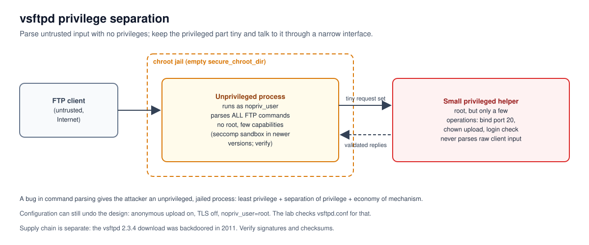

# Lesson 04: Case Study: Very Secure FTP Daemon (vsftpd)

**Syllabus item covered:** [CTMP 5] "Case Study of Very Secure FTP daemon".

**Time:** 1 hour plus lab. **Safety:** the lab parses a config file fixture; no FTP server is run.

> **DBA analogy.** Oracle's listener and server processes run as an unprivileged OS user, not root, and `root.sh` is run once for the few things that truly need root. vsftpd applies the same idea inside one program: only a tiny part keeps privileges.

## 1. Why vsftpd is a classic

FTP servers in the 1990s (wu-ftpd and others) ran as root, parsed complex untrusted input in that root process, and had a long history of remote root exploits. Chris Evans wrote **vsftpd** ("very secure FTP daemon") with security as the first design goal. Its design document and source are widely studied as an example of secure design principles applied to a real network daemon (see the vsftpd site and its `SECURITY/DESIGN` notes; verify).

## 2. The design

| Design choice | Principle |
|---|---|
| **Privilege separation:** an unprivileged process talks to the network and parses all FTP commands; a small privileged helper does only the few things that need root (bind to port 20, `chown` uploads, login with `crypt`) and accepts a tiny, well-defined set of requests from it | Separation of privilege, least privilege, economy of mechanism |
| The network-facing process runs as a dedicated **`nopriv_user`** in a **chroot** (`secure_chroot_dir`, empty and not writable) | Least privilege, least common mechanism |
| **Minimal parsing in privileged code:** the privileged side never parses raw client input | Economy of mechanism, complete mediation of the small interface |
| Drops Linux **capabilities** it does not need; uses `seccomp` sandboxing in newer versions (verify) | Least privilege |
| Own **safe string and buffer** handling instead of risky C library calls | Economy of mechanism (one audited mechanism) |
| **Secure defaults** and few features; features that are risky must be enabled explicitly | Fail-safe defaults, psychological acceptability for admins |
| `chroot_local_user` jails users to their home directory | Least privilege |

The result: even if a parsing bug exists in the network-facing code, the attacker gets an unprivileged, chrooted process with almost nothing to reach.

## 3. Threat table (ids match the lab where checked)

| Id | STRIDE | Threat | Design or config mitigation |
|---|---|---|---|
| FTP-T1 | Spoofing / Information Disclosure | Anonymous login exposes files | `anonymous_enable=NO` unless intended |
| FTP-T2 | Tampering | Anonymous upload turns the server into a malware drop | `anon_upload_enable=NO`, `anon_mkdir_write_enable=NO` |
| FTP-T3 | Elevation of Privilege / Info Disclosure | Logged-in user browses the whole filesystem | `chroot_local_user=YES` |
| FTP-T4 | Information Disclosure / Spoofing | FTP sends passwords and data in clear text | `ssl_enable=YES`, force TLS for logins and data, or replace FTP with SFTP |
| FTP-T5 | Elevation of Privilege | Network-facing process runs with privileges | Privilege separation by design; `nopriv_user` a dedicated account, never root |
| FTP-T6 | Repudiation | No record of uploads and downloads | `xferlog_enable=YES`, central logging |
| FTP-T7 | Tampering | Write access without a jail | `write_enable` only with chroot |
| FTP-T8 | Elevation of Privilege | Memory-corruption bug in command parsing | Parsing only in the unprivileged, chrooted process; safe string library; sandboxing |
| FTP-T9 | Tampering (supply chain) | Backdoored source package (the vsftpd 2.3.4 download was trojaned in 2011) | Verify signatures and checksums; reproducible builds; trusted repositories |

Note FTP-T9: the 2011 incident was a compromised **download**, not a design flaw. Good design does not protect you from installing a tampered package; supply chain controls do.

## 4. Lessons for modern systems

- **Privilege separation** is now everywhere: OpenSSH's privsep, Chrome's sandboxed renderers, Postfix's multi-process design, containers with one small privileged sidecar.
- Put **parsing of untrusted input** in the least privileged place.
- Keep the **privileged interface tiny** and validate every message on it.
- Even a secure design can be **configured insecurely** (anonymous uploads, TLS off), which is why the lab checks the config.
- FTP itself is old: prefer SFTP or HTTPS-based transfer for new systems.

## 5. Scenario

A logistics company ran vsftpd for partner file drops. The software was not the problem: an admin had enabled `anonymous_enable` and `anon_upload_enable` "for a quick test", and TLS was off. The server became a public file share and partner passwords crossed the internet in clear text. The design kept the attacker from getting root, but configuration undid the confidentiality. A config check in CI (the lab) and a decision to move partners to SFTP closed it.

## 6. Lab

The [cloud-native-threat-model-checks lab](labs/cloud-native-threat-model-checks/README.md) parses `vsftpd.conf` fixtures and checks FTP-T1 to FTP-T7. The [secure-design-principles lab](labs/secure-design-principles/README.md) shows separation and least privilege in code.

## References

- vsftpd home page and design notes (security.appspot.com/vsftpd.html and the `SECURITY` directory in the source; verify).
- `man vsftpd.conf` for option names and defaults of your version.
- N. Provos, M. Friedl, P. Honeyman, "Preventing Privilege Escalation" (USENIX Security 2003), on OpenSSH privilege separation.
