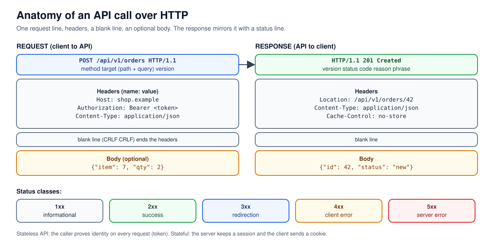

# Lesson 02: HTTP for API Security People

**Syllabus items covered:** "Understanding API Architecture", "Overview of the HTTP protocol", "Anatomy of a HTTP Request", "Anatomy of a HTTP Response", "HTTP Response Codes and Its Significance", "Stateless and Stateful Requests" ([CASP 1]).

**Time:** 75 minutes. **Lab:** [http-anatomy](labs/http-anatomy/README.md). **Background:** the repo's networking lesson on [DNS, HTTP and TLS](../../cybersecurity-track/02-networking/04-dns-dhcp-http-tls.md#23-http-and-https) covers ports, TLS and DNS; this lesson focuses on what an API tester reads in every request.

> **DBA analogy.** An HTTP request is like a SQL*Net round trip: the client sends a statement with bind values, the server returns rows or an ORA- error. HTTP status codes are the ORA- codes of the web, and headers are the session settings (`NLS_*`, client identifier) that travel with each call.

## 1. Understanding API architecture

An API call is a **client-server** exchange: the client sends a request, a server (often behind a load balancer and gateway) processes it and returns a response. Three ideas sit under almost every web API:

1. **Resources** named by URLs (`/orders/42`).
2. **A uniform set of verbs** (HTTP methods) applied to them.
3. **Representations** of resources in a data format (JSON most often).

The rest of the architecture (gateways, services, queues) is in [lesson 03](03-api-architecture-protocols-and-deployment.md).

## 2. Overview of the HTTP protocol

- **Text-based request/response** protocol on top of TCP (HTTP/1.1), multiplexed binary frames (HTTP/2), or QUIC over UDP (HTTP/3). The *meaning* (methods, headers, status codes) is the same in all versions.
- **HTTPS** is HTTP inside TLS. For APIs, TLS 1.2+ is the floor and TLS 1.3 is preferred; see [devsecops ch06 TLS testing](../../devsecops-course/06-dynamic-analysis/03-tls-and-server-misconfiguration-testing.md).
- **Methods** and their properties:

| Method | Typical use | Safe (no change)? | Idempotent (repeat = same result)? |
|---|---|---|---|
| GET | read | yes | yes |
| HEAD | headers only | yes | yes |
| OPTIONS | which methods / CORS preflight | yes | yes |
| POST | create, or run an action | no | no |
| PUT | replace a resource | no | yes |
| PATCH | partial update | no | not guaranteed |
| DELETE | remove | no | yes |

Security consequence: a `GET` that changes data (for example `GET /api/delete?id=5`) can be triggered by a link, an image tag or a crawler. Keep state changes on non-safe methods.

## 3. Anatomy of a HTTP request



```text
POST /api/v1/orders?dryrun=false HTTP/1.1      <- request line: method, target, version
Host: shop.example                             <- headers start
Authorization: Bearer <token>
Content-Type: application/json
Content-Length: 22
                                                <- empty line (CRLF CRLF)
{"item": 7, "qty": 2}                          <- body
```

What a tester looks at:

| Part | Questions to ask |
|---|---|
| Method | Does the server accept other methods than documented (`PUT` where only `GET` was expected)? |
| Path and query | IDs you can change? Version prefixes? Parameters the docs do not mention? |
| `Host` | Is it used to build links (password reset poisoning, see [chapter 10](../10-api-authentication/README.md))? |
| `Authorization` / `Cookie` | Which scheme? What happens without it, or with another user's? |
| `Content-Type` | Does the server accept XML when it expects JSON (XXE risk)? |
| Custom headers | `X-Forwarded-For`, `X-User-Id`, `X-Api-Version`: trusted when they should not be? |
| Body | Extra fields (`"role": "admin"`, mass assignment), types, sizes |

## 4. Anatomy of a HTTP response

```text
HTTP/1.1 201 Created                           <- status line: version, code, reason
Content-Type: application/json
Location: /api/v1/orders/42
Cache-Control: no-store
                                                <- empty line
{"id": 42, "status": "new"}                    <- body
```

What a tester looks at: the status code, security headers (`Cache-Control`, `Strict-Transport-Security`, `Content-Type` with `X-Content-Type-Options: nosniff`), CORS headers, `Set-Cookie` attributes (`HttpOnly`, `Secure`, `SameSite`), server banners (`Server: Apache/2.4.29`), and whether the body contains more fields than the client needs (excessive data exposure). Headers are covered in depth in [chapter 14](../14-api-defenses-data-security-and-headers/README.md).

## 5. HTTP response codes and their significance

| Class | Meaning | Codes an API tester must know |
|---|---|---|
| 1xx | informational | 101 Switching Protocols (WebSocket upgrade) |
| 2xx | success | 200 OK, 201 Created, 202 Accepted, 204 No Content |
| 3xx | redirection | 301/308 permanent, 302/307 temporary, 304 Not Modified |
| 4xx | client error | 400 Bad Request, **401 Unauthorized (not authenticated)**, **403 Forbidden (authenticated, not allowed)**, 404 Not Found, 405 Method Not Allowed, 409 Conflict, 415 Unsupported Media Type, 422 Unprocessable, **429 Too Many Requests** |
| 5xx | server error | 500 Internal Server Error, 502 Bad Gateway, 503 Service Unavailable, 504 Gateway Timeout |

Why they matter for security:

- **401 vs 403 vs 404 leak information.** If `/api/v1/admin` returns 401 while `/api/v1/nothing` returns 404, the admin endpoint exists (the [ffuf lab](../09-api-tooling-and-reconnaissance/labs/path-discovery-ffuf/README.md) exploits this). Some APIs deliberately return 404 for objects you may not see, so object IDs cannot be probed.
- **A 200 where you expected 401/403** is the most important finding in API testing: missing authentication or authorization.
- **5xx responses** often mean unhandled input: a lead for injection, and frequently a stack trace or SQL error that leaks internals.
- **429 with `Retry-After`** shows that rate limiting exists; its absence on login or OTP endpoints is a finding.

## 6. Stateless and stateful requests

| | Stateless (typical REST API) | Stateful (classic web session) |
|---|---|---|
| Server memory | none per client between calls | a session store (memory, Redis, DB) |
| Client sends | credentials every time: `Authorization: Bearer <token>` | a session id cookie |
| Scaling | any server can answer any call | needs sticky sessions or a shared store |
| Logout / revoke | hard for self-contained tokens (JWT) until expiry: keep lifetimes short or check a deny list | easy: delete the session |
| Main risks | token theft, long-lived tokens, weak signature checks | session fixation, CSRF (cookies are sent automatically), session not invalidated |

HTTP itself is stateless; "stateful" means the application **adds** state on top. Many real systems mix the two: a browser holds a session cookie with a backend-for-frontend, which calls internal APIs with tokens.

The [http-anatomy lab](labs/http-anatomy/README.md) implements both: the stateless API keeps `server_state_entries == 0`, while the stateful one stores a session and returns a `Set-Cookie` with `HttpOnly; Secure; SameSite=Lax`.

## 7. Scenario: the 500 that told the attacker everything

A tester sends `GET /api/v1/products?sort=price'` to a shop API. The response is `500 Internal Server Error` with a body containing `ORA-00907: missing right parenthesis` and the query text. In one response the tester learns the database vendor, that the `sort` value is concatenated into SQL, and the table name.

**Fix:** allowlist sort columns (`price`, `name`), use bind variables for values, and return a generic error body with a correlation id while logging the detail server-side ([lesson 04, error handling](04-securing-apis-strategies-threat-modeling-and-defenses.md#3-api-defenses)).

## 8. Self-check

1. What is the difference between 401 and 403?
2. Why is `PUT` idempotent but `POST` is not?
3. Why are cookie-based sessions exposed to CSRF while bearer tokens in a header are not?

Next: [Lesson 03, architecture, protocols and deployment](03-api-architecture-protocols-and-deployment.md).
