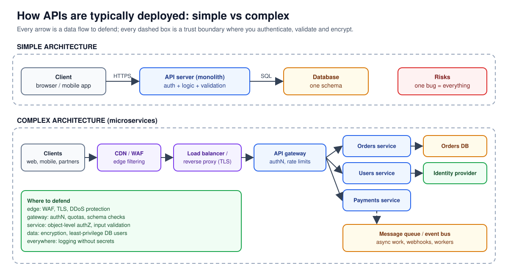

# Lesson 03: API Architecture, Protocols, Data Formats and Deployment

**Syllabus items covered:** "Overview of API architecture", "API Protocols", "API Data formats", "Different Types of API", "Simple Architecture", "How Are APIs Typically Deployed?", "Complex Architecture" ([CASP 1]).

**Time:** 75 minutes. **Lab:** [api-threat-model](labs/api-threat-model/README.md) models a simple and a complex deployment.

> **DevOps analogy.** You already know the pieces: an NGINX or HAProxy in front, app servers behind, a database, a queue (RabbitMQ, Kafka), all in containers deployed by a pipeline. An "API architecture" is that same stack, viewed by asking where each request is authenticated, validated and logged.

## 1. Overview of API architecture

Every API architecture has the same layers, even if some are merged:

| Layer | Job | Example products |
|---|---|---|
| Client | builds and sends requests | browser SPA, mobile app, partner server, CLI, AI agent |
| Edge | absorbs attacks, terminates TLS | CDN, WAF (OWASP CRS on ModSecurity/Coraza), DDoS protection |
| Load balancer / reverse proxy | spreads load, health checks | NGINX, HAProxy, Envoy, cloud ALB |
| API gateway | authentication, quotas, routing, transformation | Kong, Apache APISIX, Tyk, Envoy Gateway, AWS API Gateway, Azure API Management |
| Services | business logic and object-level authorization | your code |
| Data and async | storage and background work | databases, caches, message queues, event buses |
| Identity | issues and validates tokens | an OAuth 2.0 / OIDC provider (Keycloak, Entra ID, Okta, Auth0, Cognito) |

The gateway is covered as a "moving part" in [chapter 09](../09-api-tooling-and-reconnaissance/01-api-moving-parts-and-toolchain.md) and configured in chapters 14 and 15.

## 2. API protocols

"Protocol" here means the **style of conversation** on top of HTTP or TCP.

| Protocol / style | Transport | Shape | Security notes |
|---|---|---|---|
| **REST** | HTTP/1.1 or 2 | resources + verbs, usually JSON | most common; BOLA, mass assignment, verb tampering |
| **GraphQL** | HTTP, usually one `POST /graphql` | client chooses fields in a query language | introspection left on, deep or batched queries (DoS, brute force), per-resolver authorization ([chapter 12](../12-input-validation-and-injection/README.md)) |
| **gRPC** | HTTP/2, binary **protobuf** | strongly typed RPC from `.proto` files | harder to inspect with a proxy; reflection service can expose the schema; needs mTLS or tokens per call |
| **SOAP** | HTTP POST, XML envelopes, WSDL | operation-based | XXE, XML bombs, signature wrapping, exposed WSDL ([chapter 13](../13-owasp-api-top-10-and-other-threats/README.md)) |
| **WebSockets** | upgrade from HTTP (101) | long-lived two-way messages | auth only at handshake, check `Origin`, no per-message authorization by default |
| **Webhooks** | HTTP POST from provider to you | event callbacks | verify the HMAC signature and timestamp; SSRF if users can register URLs |
| **Async / event APIs** | Kafka, AMQP, MQTT | messages on topics; described by **AsyncAPI** | topic-level ACLs, message validation, poison messages |

Specifications: **OpenAPI** describes REST (3.1 widely used; **3.2.0 published Sept 2025, verify**; "Swagger 2.0" is the old name for OpenAPI 2), **AsyncAPI** describes event APIs, `.proto` files describe gRPC, **WSDL** describes SOAP, and a GraphQL **schema (SDL)** describes GraphQL.

## 3. API data formats

| Format | Looks like | Watch out for |
|---|---|---|
| **JSON** | `{"id": 42, "tags": ["a"]}` | duplicate keys, big numbers losing precision, type confusion (`"1"` vs `1`), prototype pollution in JavaScript back ends |
| **XML** | `<order id="42"/>` | external entities (XXE), entity expansion bombs; disable DTDs |
| **Protocol Buffers** | binary, needs the `.proto` | unknown fields silently kept; validation still required |
| **YAML** | `id: 42` | unsafe loaders that build objects (use safe loaders) |
| **Form / multipart** | `a=1&b=2`, file uploads | file type and size checks, path traversal in file names |
| **CSV / plain text** | exports | CSV formula injection when opened in Excel |

Security rule: **the server decides the format.** Check `Content-Type`, reject what you do not support (415), and validate against a schema (JSON Schema, the OpenAPI spec) before business logic runs.

## 4. Different types of API

By **audience** (who may call it):

| Type | Callers | Typical risk |
|---|---|---|
| **Public / open** | anyone, often with a free API key | abuse, scraping, resource consumption |
| **Partner** | known companies under contract | over-broad keys shared by email, weak rotation |
| **Private / internal** | your own apps and services | "it is internal so no auth" (lateral movement after one breach) |
| **Composite** | one call fans out to many services | one weak downstream service, unsafe consumption of third-party APIs |

By **style**: REST, GraphQL, gRPC, SOAP, event-driven (section 2). The syllabus wording "different types" covers both views; know both.

## 5. Simple architecture

Client, one API server (a monolith), one database. Fine for a small product, and easy to reason about. Security weaknesses:

- **One process does everything**, so one bug (an injection, a deserialization flaw) reaches all data.
- **The database user is often powerful** (owner of the schema). Use a least-privilege application user, as you would never let an app connect as `SYSTEM`.
- **No gateway**, so rate limiting and authentication must be in the code, and they are easy to forget on one route.

## 6. How are APIs typically deployed?

A typical modern path from code to production (this is where the DevSecOps chapters plug in):

1. Code in Git, reviewed in a merge request ([chapter 02 code review](../02-secure-code-review-and-asvs/README.md)).
2. CI builds a **container image**, runs tests, SAST, SCA and secrets scanning.
3. The image goes to an **artifact registry**, signed, with an SBOM.
4. CD deploys it to **Kubernetes**, a PaaS (App Service, Cloud Run), serverless functions (Lambda, Azure Functions) or VMs.
5. Traffic arrives through **DNS, CDN/WAF, load balancer and gateway**.
6. **Logs, metrics and traces** go to a monitoring stack.

The toolchain behind steps 1 to 6 is [chapter 09 lesson 01](../09-api-tooling-and-reconnaissance/01-api-moving-parts-and-toolchain.md). The pipeline view is [chapter 16](../16-api-security-the-devsecops-way/README.md).

## 7. Complex architecture

Many microservices behind a gateway, with an identity provider, caches and message queues. It adds **east-west traffic** (service to service) and many more trust boundaries.

| New problem | Why | Defense |
|---|---|---|
| Internal services trust each other blindly | "only the gateway can reach us" | authenticate every hop (mTLS, workload identity such as SPIFFE), authorize per service |
| Identity is lost after the gateway | the gateway checks the token, then forwards `X-User-Id` | pass a signed token downstream; never trust an identity header a client could set |
| Inconsistent rules | each team implements auth differently | shared libraries, policy as code ([chapter 11](../11-api-authorization-and-oauth/README.md)) |
| Inventory drift | hundreds of endpoints, old versions | API inventory, spec-first CI checks |
| Async paths skip checks | a queue consumer acts on any message | validate messages, authorize the producer, sign events |
| Observability gaps | a request crosses ten services | correlation ids, distributed tracing (OpenTelemetry) |

## 8. Scenario: the internal header

A bank splits its monolith into services. The gateway validates the customer's JWT and forwards `X-Customer-Id: 5521` to the accounts service, which trusts it. Months later a developer exposes the accounts service on a second, "temporary" load balancer for a partner test. A tester sends `X-Customer-Id: 1` directly and reads any customer's balance.

**Lessons:** every service must authenticate its caller; identity must travel as a verifiable token, not a plain header; inventory must include every route to a service, not only the official one.

## 9. Self-check

1. Name four API styles and one security issue specific to each.
2. Why does a gateway not remove the need for authorization inside services?
3. What does "east-west traffic" mean, and how do you protect it?

Next: [Lesson 04, strategies, threat modeling and defenses](04-securing-apis-strategies-threat-modeling-and-defenses.md).
