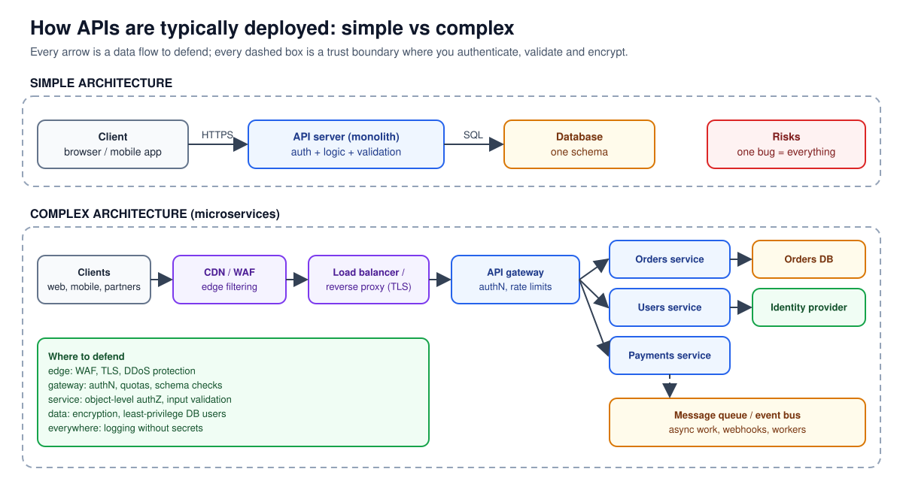

# Lesson 04: Securing APIs: Strategies, Threat Modeling, API VAPT and Core Defenses

**Syllabus items covered:** "Strategies To Secure APIs", "Threat Modeling of APIs", "Traditional VAPT vs API VAPT", "API Defenses", "Input Validation", "Identification", "Authentication", "Authorization", "Data Encryption", "Transport Security", "Error Handling and Logging", "Supply Chain Security" ([CASP 1]).

**Time:** 90 minutes. **Lab:** [api-threat-model](labs/api-threat-model/README.md). This lesson is the **map** of the API half of the course; each defense has its own deep-dive chapter, linked below.

## 1. Strategies to secure APIs

1. **Know what you have.** An up-to-date API inventory (every host, version and endpoint, with an owner). You cannot protect a zombie `/v1` nobody remembers ([chapter 09](../09-api-tooling-and-reconnaissance/README.md)).
2. **Design first, with a spec.** Write the OpenAPI/AsyncAPI contract, threat model it, and generate validation from it.
3. **Deny by default.** Every endpoint requires authentication unless it is consciously marked public; every object access is checked against the caller.
4. **Defense in depth.** Edge (WAF, DDoS), gateway (authentication, quotas, schema), service (object-level authorization, validation), data (encryption, least privilege).
5. **Minimise data.** Return only the fields the client needs; do not rely on the client to hide them.
6. **Automate checks in CI/CD.** SAST, SCA, secrets scanning, spec linting, DAST against the spec ([chapter 16](../16-api-security-the-devsecops-way/README.md)).
7. **Monitor and respond.** Log security events, alert on abuse patterns, have a key/token revocation plan.

Reference catalogs: **OWASP API Security Top 10 (2023, current; verify)**, **OWASP ASVS 5.0** (May 2025; its API and web service chapter), and the **OWASP REST Security Cheat Sheet**.

## 2. Threat modeling of APIs

Use the general method from the threat modeling chapters ([chapter 04](../04-threat-modeling-methods-and-rating/README.md), [chapter 05](../05-agile-threat-modeling-as-code/README.md)) and add API-specific questions.

**Step 1: draw it.** Clients, gateway, services, data stores, queues, third-party APIs, and the **trust boundaries** between them (Internet to edge, edge to app tier, app tier to data tier, you to a third party).

**Step 2: STRIDE per element**, with API examples:

| STRIDE | API example | Usual control |
|---|---|---|
| Spoofing | stolen or forged token; `alg:none` JWT | strong authentication, strict token validation |
| Tampering | changing `price` or `role` in the body; editing another user's object | server-side validation, object-level authorization, signed messages |
| Repudiation | "I never cancelled that order" | audit logs with identity, time and request id |
| Information disclosure | excessive fields in responses; stack traces | response schemas, generic errors |
| Denial of service | huge pages (`?limit=1000000`), deep GraphQL queries | quotas, pagination limits, timeouts |
| Elevation of privilege | user calls `DELETE /admin/users/7` | function-level authorization, deny by default |

**Step 3: API-specific prompts.** For each endpoint ask: Who may call it? Which object does it touch, and does the code check the caller owns it? Which fields can the caller set? What is the maximum cost of one call? What third-party APIs does it trust?

**Step 4: decide and track** each threat (mitigate, accept with an owner, transfer), and link mitigations to tests.

The lab turns a deployment description into STRIDE-per-element threats and **fails a gate** when an element is missing a required defense from section 4.

## 3. API defenses

The syllabus lists eight defenses. Here is what each means in practice, the DBA way to remember it, and where it is taught in depth.

### Input validation

Validate **every** input (path, query, headers, body) on the server against an allowlist: type, length, range, format, and allowed fields. Reject unknown fields to prevent mass assignment. Validation is not a substitute for parameterized queries and output encoding; it is the first layer.
*DBA view:* `CHECK` constraints and bind variables. *Deep dive:* [chapter 12](../12-input-validation-and-injection/README.md).

### Identification

Know **who or what** is calling before anything else: a user id, a client id (OAuth client), an API key id, a service identity. Identification is the *claim* ("I am app 17"); authentication is the *proof*. Unique identities per client make rate limiting, auditing and revocation possible. Shared keys between partners make all three impossible.
*DBA view:* one named database account per application, never a shared `APPUSER` for everything.

### Authentication

Prove the identity: passwords plus MFA for humans; OAuth 2.0 / OIDC tokens; API keys for simple server-to-server cases; mTLS or workload identity for services. Validate tokens strictly (signature, `iss`, `aud`, `exp`).
*Deep dive:* [chapter 10](../10-api-authentication/README.md).

### Authorization

Decide what the authenticated caller may do: **function level** (may this role call `DELETE /users`?) and **object level** (may this user read order 42?), plus **property level** (may they set `isAdmin`?). Deny by default, check on every request, and centralise the policy.
*DBA view:* role grants (RBAC) plus a Virtual Private Database policy that adds `WHERE owner_id = :me` to every query. *Deep dive:* [chapter 11](../11-api-authorization-and-oauth/README.md).

### Data encryption

Encrypt sensitive data **at rest** (database or disk encryption, plus field-level encryption for the most sensitive values) with keys in a KMS or vault, not in code. Hash passwords with a slow, salted algorithm (Argon2id, scrypt, bcrypt, PBKDF2), which is not encryption.
*DBA view:* TDE for tablespaces, but remember TDE does not stop a SQL injection from reading decrypted rows. *Deep dive:* [chapter 14](../14-api-defenses-data-security-and-headers/README.md).

### Transport security

TLS 1.2+ (prefer 1.3) on every hop, including internal ones; HSTS for browser-facing APIs; certificate validation never disabled in clients (`verify=False` is a finding); mTLS for service-to-service where possible.
*Deep dive:* [chapter 15](../15-implementing-api-security-mechanisms/README.md) and [devsecops ch06 TLS testing](../../devsecops-course/06-dynamic-analysis/03-tls-and-server-misconfiguration-testing.md).

### Error handling and logging

Return **generic** error bodies with a correlation id (no stack traces, SQL errors or internal hostnames). Log security events server-side (logins, failures, authorization denials, admin actions) with who, what, when and from where, **without** secrets, tokens or unnecessary personal data. Protect logs against injection (CR/LF). Alert on abuse patterns.
*Deep dive:* [chapter 15](../15-implementing-api-security-mechanisms/README.md); SOC view in [cybersecurity-track SIEM](../../cybersecurity-track/06-siem-sentinel-splunk/README.md).

### Supply chain security

Your API includes third-party libraries, base images, CI actions and other people's APIs. Pin and scan dependencies (SCA), sign and verify images, generate SBOMs, review CI/CD permissions, and treat data from third-party APIs as untrusted input (OWASP API10:2023 "Unsafe Consumption of APIs").
*Deep dive:* [devsecops ch04 SCA](../../devsecops-course/04-software-component-analysis/README.md) and [CSSE ch2 supply chain](../../csse-course/ch2-attacking-code-and-application-supply-chain/README.md).

## 4. Traditional VAPT vs API VAPT

VAPT = vulnerability assessment (find and list weaknesses, often with tools) plus penetration testing (exploit them to prove impact). For APIs the approach changes.

| | Traditional (web/network) VAPT | API VAPT |
|---|---|---|
| Discovery | crawl pages, port scans | read OpenAPI/GraphQL schemas, mobile app and JS bundles, guess paths; find shadow and zombie versions |
| Input | forms a crawler finds | every parameter in the spec, plus undocumented ones |
| Authentication | log in once, crawl | multiple users and roles, token handling, refresh flows |
| Key tests | XSS, CSRF, SQLi, misconfig | **BOLA/BFLA with two or more test users**, mass assignment, rate limits, business-flow abuse, token validation |
| Automation | generic scanners do well | generic scanners miss authorization bugs; you need test data that says who owns what |
| Tools | Burp, ZAP, Nessus | Burp/ZAP with OpenAPI import, Postman/Bruno collections, ffuf, custom scripts, GraphQL tools |
| Scope | hosts and URLs | API versions, environments, third-party integrations |

**Exam point:** an automated scanner cannot know that order 42 belongs to Bob. Authorization testing needs **at least two test accounts per role** and a list of objects each owns. The [devsecops OpenAPI scan lab](../../devsecops-course/06-dynamic-analysis/labs/openapi-zap-api-scan/README.md) shows this: the scanner is *told* which object belongs to another user.

Always test under a written scope and rules of engagement ([cybersecurity-track pentesting ethics](../../cybersecurity-track/09-pentesting-fundamentals/01-ethics-scope-and-methodology.md)). Only test systems you own or have written permission to test.

## 5. Scenario: threat modeling a "simple" export endpoint

A team adds `GET /api/v1/reports/export?from=2020-01-01&format=csv` for finance users. A 20-minute API threat model asks the section 2 questions:

- *Who may call it?* Finance role only: add a function-level check (EoP).
- *Which objects?* Only the caller's company: add the tenant filter (information disclosure).
- *Maximum cost?* Five years of data in one call: add a date-range limit and a quota (DoS).
- *Output risk?* Customer names starting with `=` become Excel formulas: escape CSV cells (tampering of the analyst's machine).
- *Logging?* Record who exported what range (repudiation).

Five controls, each with a test, before a single line was shipped.

## 6. Self-check

1. Separate identification, authentication and authorization with one sentence each.
2. Why can a generic DAST scanner not find BOLA on its own?
3. Give one STRIDE threat per element type for a gateway, a service, a database and a flow.

Next: [Lesson 05, lab setup and command-line basics](05-lab-setup-and-command-line-basics.md).
