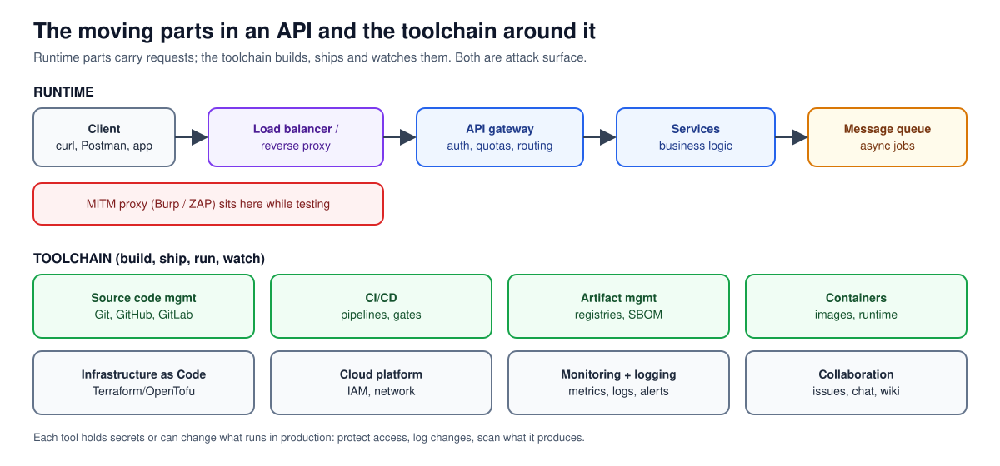

# Lesson 01: The Moving Parts in an API and the Toolchain Behind It

**Syllabus items covered:** "The Moving Parts in an API", "API Gateway", "Load Balancer/Reverse Proxy", "Message Queues", "Critical Toolchain for API Development", "Source Code Management", "CI/CD Tools", "Artifact Management", "Cloud Platform", "Infrastructure as Code", "Monitoring and Logging Tools", "Collaboration Tools", "Containerization" ([CASP 2]).

**Time:** 60 minutes. **Safety:** concepts only. Only test systems you own or have written permission to test.

> **DevOps analogy.** You already run this stack. The only new habit is to ask, for each part, "who can change it, what secrets does it hold, and what does it log?"

## 1. The moving parts in an API

A request rarely goes straight from the client to your code. Each hop can add a control or a weakness.

### API gateway

A gateway is a reverse proxy that understands APIs. Typical jobs:

| Job | Example | Security value |
|---|---|---|
| Authentication | validate JWTs, API keys, mTLS | stop anonymous traffic early |
| Coarse authorization | scopes per route | block calls a client was never granted |
| Rate limiting / quotas | 100 req/min per key | slows brute force, scraping, resource abuse |
| Request validation | against the OpenAPI schema, body size limits | rejects malformed input before your code |
| Routing and versioning | `/v1` to old service, `/v2` to new | keeps old versions visible and retirable |
| Transformation | strip internal headers, add a request id | stops header spoofing, enables tracing |
| Logging and analytics | per-consumer usage | detection and billing |

Products: Kong Gateway (check current OSS vs Enterprise packaging), Apache APISIX, Tyk, Envoy Gateway, NGINX, AWS API Gateway, Azure API Management, Google Apigee. **Limits:** a gateway cannot know object ownership (BOLA) or business rules; a misconfigured gateway route can expose an internal service; and services reachable around the gateway bypass it entirely. Gateways are configured in [chapter 14](../14-api-defenses-data-security-and-headers/README.md) and [chapter 15](../15-implementing-api-security-mechanisms/README.md); the AI version is the repo's [secure LLM gateway](../../09-enterprise-architecture/06-secure-llm-ai-gateway.md).

### Load balancer / reverse proxy

Spreads traffic over healthy instances, terminates TLS, and hides the back-end topology. Layer 4 (TCP) or layer 7 (HTTP). Products: NGINX, HAProxy, Envoy, Traefik, cloud ALB/NLB, Azure Application Gateway.

Security notes:

- **Trusted headers.** The proxy sets `X-Forwarded-For`, `X-Forwarded-Proto` and `X-Real-IP`. The app must trust them **only** from the proxy, otherwise clients spoof their IP (bypassing IP rate limits or allowlists).
- **TLS termination** means traffic behind the proxy may be plain HTTP: re-encrypt if the network is not trusted.
- **Request smuggling** happens when the proxy and the back end disagree on where a request ends (`Content-Length` vs `Transfer-Encoding`). Keep both up to date and normalise.
- **Path normalisation differences** (`/admin/..;/`, `%2e%2e`) can bypass proxy-level path rules.

### Message queues

Asynchronous parts: RabbitMQ, Apache Kafka, AWS SQS/SNS, Azure Service Bus, Redis streams. An API often accepts a request (202 Accepted) and puts a job on a queue for a worker.

Security notes: authenticate producers and consumers (SASL, mTLS, IAM), set topic/queue ACLs, **validate messages in the consumer** (it is input like any request), keep secrets and personal data out of messages or encrypt them, handle poison messages with dead-letter queues, and consider replay (idempotency keys). An attacker who can write to a queue can often act as any user.

## 2. Critical toolchain for API development

Everything that builds, ships and watches the API is part of its attack surface: whoever controls the toolchain controls production. The DevSecOps half of the repo teaches these tools in depth; here is what an API security person must know about each.

### Source code management

Git hosting (GitHub, GitLab, Bitbucket, Azure Repos). Risks: secrets committed to history, weak branch protection, too many admins, unreviewed merges. Controls: protected branches and required reviews, signed commits, secret scanning with push protection, CODEOWNERS for security-sensitive files. See [devsecops ch02](../../devsecops-course/02-tools-pipelines-and-secure-sdlc/01-tools-of-the-trade.md#2-source-hosting-gitlab-and-github) and [ch05 secrets](../../devsecops-course/05-static-analysis-and-secrets/README.md).

### CI/CD tools

GitHub Actions, GitLab CI, Jenkins, Azure Pipelines, CircleCI, Argo CD. Risks: pipeline secrets readable by any job, third-party actions not pinned, pull requests from forks running with secrets, self-hosted runners reused between jobs. Controls: least-privilege tokens, OIDC federation to clouds instead of long-lived keys, pinned actions (by commit SHA), separate deploy approvals. Security gates (SAST, SCA, DAST against the OpenAPI spec) live here: [chapter 16](../16-api-security-the-devsecops-way/README.md).

### Artifact management

Container registries and package repositories (GHCR, ECR, ACR, Artifactory, Nexus, PyPI/npm mirrors). Risks: unsigned or mutable tags (`:latest`), dependency confusion between internal and public package names, public registries leaking internal images. Controls: immutable tags or digests, image signing (Sigstore/cosign), SBOMs, scanned before promotion. See [CSSE ch2 supply chain](../../csse-course/ch2-attacking-code-and-application-supply-chain/README.md).

### Cloud platform

AWS, Azure, GCP and their managed API services. Risks: over-privileged IAM roles for the API's workload, public storage buckets behind an API, metadata service reachable through SSRF (`169.254.169.254`). Controls: least-privilege roles, IMDSv2 on AWS, private endpoints, cloud security posture tools. See the cybersecurity track's [cloud security](../../cybersecurity-track/10-cloud-security/README.md).

### Infrastructure as code

Terraform (BSL licence) / OpenTofu (open-source fork), Pulumi, CloudFormation, Bicep, Ansible. Risks: secrets in state files, open security groups, public endpoints declared by mistake. Controls: scanners (Checkov, Trivy, KICS) in CI, remote encrypted state, review of plans. See [devsecops ch08](../../devsecops-course/08-iac-configuration-and-compliance-as-code/README.md).

### Monitoring and logging tools

Prometheus/Grafana, ELK/OpenSearch, Loki, Datadog, cloud monitors, a SIEM (Sentinel, Splunk), OpenTelemetry for traces. For APIs, log authentication events, authorization denials, rate-limit hits and 4xx/5xx spikes, with a request id across hops, and **never log tokens or passwords**. Logging is implemented in [chapter 15](../15-implementing-api-security-mechanisms/README.md); the SOC view is [cybersecurity-track SIEM](../../cybersecurity-track/06-siem-sentinel-splunk/README.md).

### Collaboration tools

Jira, Confluence, Slack/Teams, Mattermost, shared Postman workspaces. Risks: tokens pasted into tickets and chat, public Postman workspaces exposing collections with real API keys (a known real-world leak pattern), bots with broad scopes. Controls: secret scanning on chat and wikis where available, private workspaces, short-lived test credentials.

### Containerization

Docker/Podman images run the API; Kubernetes or a PaaS runs the containers. Risks: running as root, secrets baked into image layers, large base images full of CVEs, exposed Docker socket. Controls: minimal or distroless base images, non-root user, read-only filesystem, image scanning, secrets injected at runtime. See [devsecops ch09](../../devsecops-course/09-container-fundamentals/README.md) and [ch11](../../devsecops-course/11-defending-containers-at-scale/README.md).

## 3. Scenario: the public workspace

A payments start-up's developer shares a Postman collection to a **public** workspace so a partner can try the sandbox. The collection's environment holds a production API key copied "temporarily". Months later the key is used to pull transaction data. No code was vulnerable; the leak was in a collaboration tool.

**Controls that would have helped:** keys scoped to sandbox only, short expiry, secret scanning of workspaces, an inventory of who holds which key, and alerting on key usage from new IP ranges.

## 4. Self-check

1. List four things a gateway can do and two things it cannot.
2. Why must an app trust `X-Forwarded-For` only from its own proxy?
3. For each toolchain category, name one way it can leak secrets.

Next: [Lesson 02, talking to an API](02-talking-to-an-api.md).
