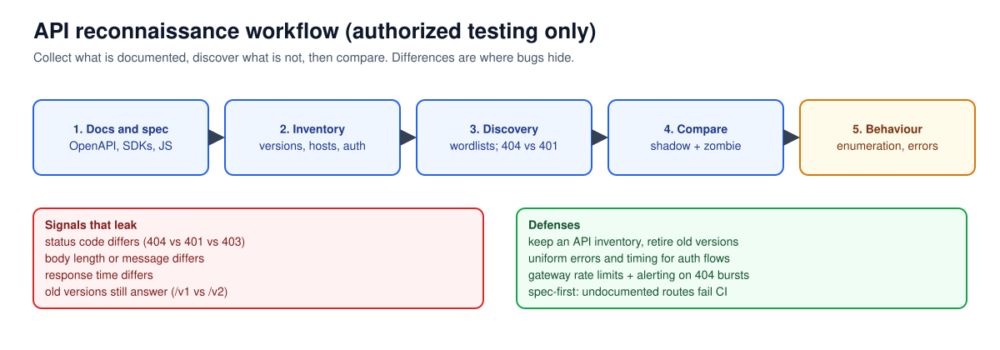

# Lesson 03: OpenAPI Specs, Burp Setup and API Reconnaissance

**Syllabus items covered:** "Setup the Burp Suite for API Security Testing", "Understanding APIs Using OpenAPI Specifications", "Performing Reconnaissance on an API", "Path And Directory Discovery Using FFUF", "Enumerating User Accounts From an AP[I]" ([CASP 2]).

**Time:** 2 hours. **Labs:** [openapi-recon](labs/openapi-recon/README.md), [path-discovery-ffuf](labs/path-discovery-ffuf/README.md), [user-enumeration](labs/user-enumeration/README.md). **Real tools:** [Burp Suite for APIs](real-tools/burp-suite-for-apis.md), [ffuf](real-tools/ffuf.md).

> **Rules of engagement.** Reconnaissance and discovery send many requests. Do them only inside a written scope, against systems you own or have written permission to test, at an agreed rate. See [pentesting ethics and scope](../../cybersecurity-track/09-pentesting-fundamentals/01-ethics-scope-and-methodology.md).



## 1. Setting up Burp Suite for API security testing

Summary (step-by-step, hedged, in [real-tools/burp-suite-for-apis.md](real-tools/burp-suite-for-apis.md)):

1. Start Burp, keep the proxy listener on `127.0.0.1:8080`.
2. Use Burp's built-in Chromium browser, or set your client's proxy to `127.0.0.1:8080` (`curl -x`, Postman proxy settings, Python `proxies=`).
3. For HTTPS from an external client, export Burp's CA certificate and trust it **only** in a test profile or the client's own trust store.
4. Set **target scope** to the in-scope hosts so history and tools ignore everything else.
5. Import the OpenAPI spec (Burp Professional can scan from an API definition; Community users can use an extension or replay a Postman collection through the proxy; verify current features).
6. Work with **Proxy history**, **Repeater** (edit and resend), **Intruder** (variations; throttled in Community), **Comparer** (diff two responses), and the **Logger**.
7. Configure session handling so tokens refresh automatically for long tests.

Free alternative with the same workflow: **ZAP by Checkmarx** (OpenAPI add-on, Fuzzer, Automation Framework).

## 2. Understanding APIs using OpenAPI specifications

What to read in a spec, in order:

| Section | What it tells a tester |
|---|---|
| `openapi` | version (2.0 = Swagger; 3.x; tool support differs) |
| `servers` | base URLs: production, staging, **old versions** |
| `components.securitySchemes` | how auth works: `http` bearer/basic, `apiKey` (header/query/cookie), `oauth2` flows and scopes, `openIdConnect`, `mutualTLS` (3.1) |
| `security` (top level) | the default requirement for every operation |
| `paths.*.*.security` | per-operation override; **`security: []` means public**: list these first |
| parameters | IDs in paths (`{orderId}`: BOLA candidates), filters, `limit` (resource consumption) |
| request schemas | which fields are writable, `readOnly` fields that the server must ignore (mass assignment) |
| response schemas | which fields come back (excessive data exposure) |
| `deprecated: true` | old operations that may still be live and less protected |

The [openapi-recon lab](labs/openapi-recon/README.md) loads a JSON spec, lists endpoints with their effective security, reads the auth schemes, refuses Swagger 2.0, and flags public operations.

## 3. Performing reconnaissance on an API

**Passive** (no or few requests to the target):

- Documentation portals, SDKs, Postman public workspaces, GitHub code search for the API host name.
- **JavaScript bundles** of the web front end and **mobile app** packages: they contain endpoint paths, versions, sometimes keys.
- Certificate transparency logs and DNS for hosts such as `api-staging.`, `api-v1.`, `partner-api.`.
- Archived copies of old docs (they reveal retired versions).

**Active** (inside scope):

- Fetch the spec at common paths (`/openapi.json`, `/swagger.json`, `/v3/api-docs`, `/swagger-ui/`, `/graphql` with introspection).
- Walk versions: if `/api/v3/users` exists, try `/api/v2/users` and `/api/v1/users`. Old versions often lack newer controls.
- Try other verbs (`OPTIONS`, `PUT`, `DELETE`) and content types on known endpoints.
- Path discovery with wordlists (section 4).

**Compare** what is documented with what is live:

| Category | Meaning | Why it matters (OWASP API9:2023 Improper Inventory Management) |
|---|---|---|
| documented | in the spec and live | your normal test surface |
| **shadow** | live but **not** documented | debug, internal or forgotten endpoints, often without auth |
| **zombie** | documented (or once was) but should be retired | old versions still answering with old, weaker controls |

The lab's `recon()` does this comparison from a spec and a "live inventory" (what crawling and discovery found).

## 4. Path and directory discovery using ffuf

**ffuf** ("Fuzz Faster U Fool", actively maintained) replaces the keyword `FUZZ` in a URL, header or body with each word from a wordlist and reports responses, filtered by status, size, words or lines.

```bash
ffuf -u https://api.lab/api/v1/FUZZ -w api-words.txt -mc 200,201,204,301,302,401,403,405 -rate 20
ffuf -u https://api.lab/api/FUZZ/users -w versions.txt            # v1, v2, internal, beta...
ffuf -u https://api.lab/api/v1/users/FUZZ -w ids.txt -fs 0         # -fs filters a response size
```

Useful flags: `-mc` match codes, `-fc` filter codes, `-fs` filter size, `-H` add a header (auth), `-X` method, `-rate` requests per second, `-o`/`-of` output file and format, `-recursion`. Good API wordlists: SecLists `Discovery/Web-Content/api/` (verify path), Assetnote wordlists. Full guide: [real-tools/ffuf.md](real-tools/ffuf.md). Older alternatives: gobuster, dirsearch, wfuzz (little maintenance; hedge).

**How the API's own responses help the attacker:** an unknown path returns 404, a protected one 401 or 403, a wrong verb 405. Each different answer says "something is here". The [path-discovery-ffuf lab](labs/path-discovery-ffuf/README.md) runs an ffuf-style fuzzer against an in-process router and shows how much less it learns when protected paths also answer 404.

**Defenses:** an API inventory, removing debug and old endpoints, consistent error responses, gateway rate limits, and alerting on bursts of 404s from one client.

## 5. Enumerating user accounts from an API

Account enumeration means learning which usernames, emails or phone numbers exist. It makes password spraying, credential stuffing and phishing far more efficient. APIs leak it through:

| Endpoint | Leak |
|---|---|
| login | "No such user" vs "Wrong password"; 404 vs 401 |
| registration | "Email already registered" (409) |
| password reset | "Reset link sent" vs "Unknown email" |
| OTP / MFA | different behaviour for real numbers |
| user lookup | `GET /users/{email}` 200 vs 404, or GraphQL field suggestions |
| **timing** | a password hash is computed only when the user exists, so real users answer slower |
| response size | a longer body for real accounts |

**Defense:** the **same status, the same message, the same size and similar timing** for both cases ("If the credentials are valid you will be signed in"; "If that account exists, we sent an email"). Always run the password hash check, against a dummy hash if the user is missing. Add rate limits and alerting. For registration, send an email instead of saying "already taken". The [user-enumeration lab](labs/user-enumeration/README.md) shows a vulnerable API leaking existence three ways (status, message, timing) and a uniform version where the same attack finds nobody.

## 6. Scenario: the forgotten v1

A tester's scope is `api.shop.example`. The v3 spec documents `/api/v3/customers/{id}` with OAuth scopes and object checks. The web app's old JavaScript bundle, still on the CDN, mentions `/api/v1/customers/`. A request to `/api/v1/customers/1` returns a full customer record with only an API key check; the key is in the same bundle. **Findings:** improper inventory (zombie v1), hard-coded key, and broken object level authorization on v1. **Fixes:** retire v1 at the gateway, rotate the key, add the inventory check to CI ("every routed path must exist in a current spec").

## 7. Self-check

1. What does `security: []` mean on an OpenAPI operation?
2. Define shadow and zombie APIs and give one source for discovering each.
3. Name four ways an API can leak whether an account exists, and the single design rule that fixes them.

Back to the [chapter README](README.md).
