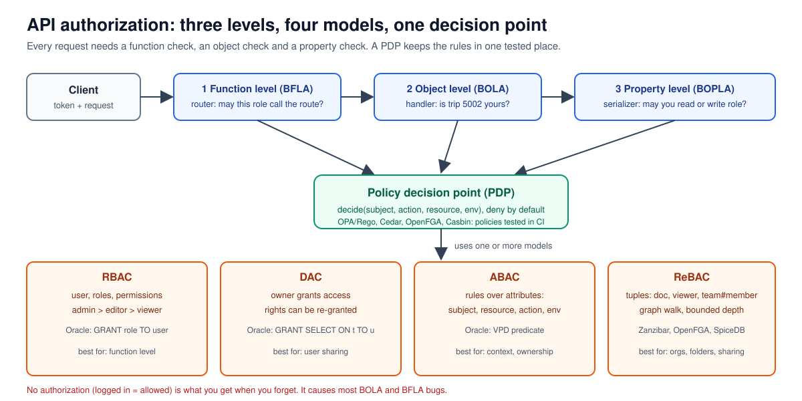

# Lesson 01: Authorization Models and Policy as Code

**Syllabus items covered:** [CASP 4] "Overview of API Authorization", "Types of Authorization", "No Authorization", "Role-Based Access Control (RBAC)", "Discretionary Access Control (DAC)", "Attribute-Based Access Control (ABAC)", "Relationship-Based Access Control (ReBAC)", "Attribute-Based Access Control (ABAC) with Roles, and Relations", "Decoupling Authorization Decisions With Policy As Code".

**Time:** 75 minutes. **Labs:** [authz-models](labs/authz-models/README.md), [policy-as-code-pdp](labs/policy-as-code-pdp/README.md).

> **DBA analogy.** You already know authorization very well. Oracle system privileges, object privileges, roles, `WITH GRANT OPTION`, and Virtual Private Database (VPD) policies are all authorization models. An API needs the same thing, but it is usually written by hand in every endpoint, which is why it is so often wrong.

## 1. Overview of API authorization

**Authentication** answers "who are you?" ([chapter 10](../10-api-authentication/README.md)). **Authorization** answers "may *you* do *this action* on *this object* right now?". An API must answer it on **every request**, on the **server**, for **two levels**:

| Level | Question | If you forget it |
|---|---|---|
| **Function level** | May this user call `DELETE /admin/users/{id}` at all? | BFLA (OWASP API5) |
| **Object level** | May this user read *trip 5002*? | BOLA (OWASP API1) |
| **Property level** | May this user read or write the `role` field of this object? | BOPLA (OWASP API3, [chapter 13](../13-owasp-api-top-10-and-other-threats/README.md)) |

Where the decision is made:

- **In the handler** (`if user.id != trip.owner_id: return 403`). Simple, but easy to forget in the next handler.
- **In middleware or a gateway** (function level: route + role). Good for coarse checks; the gateway usually does not know who owns trip 5002.
- **In the data layer** (a query filter, Postgres row-level security, Oracle VPD). Hard to forget, but only for data access.
- **In a policy decision point** (OPA, Cedar, OpenFGA). One place to write, test and log decisions (section 4).



**Scenario.** A food-delivery startup ships `GET /api/orders/{id}`. The mobile app only ever asks for the user's own orders, so nobody notices that the handler never compares `order.customer_id` with the caller. A curious user changes the number in the URL with a proxy and sees other people's names, addresses and phone numbers. Authentication worked perfectly; authorization was never written.

## 2. Types of authorization

### 2.1 No Authorization

"If you have a valid token, you may do anything." This is the default when developers rely on the UI to hide buttons. It is not a model you choose; it is what you get when you forget. Public, read-only APIs (exchange rates) can legitimately have no authorization, but then they must also have **no private data and no write functions**.

### 2.2 Role-Based Access Control (RBAC)

Permissions are attached to **roles**; users get roles. Roles can inherit from other roles (`admin` includes `editor` includes `viewer`), exactly like `GRANT editor TO admin` in Oracle.

- **Good for:** function-level checks ("only `support` may call `/refunds`").
- **Weak at:** object-level checks. "Editor" does not say *which* documents. Teams then create role explosion (`editor_project_42`).
- **Watch:** every edit of a role changes everyone above it in the hierarchy (blast radius).

### 2.3 Discretionary Access Control (DAC)

The **owner** of an object decides who else may access it (file permissions, Google Docs sharing, `GRANT SELECT ON t TO u`). With a "grant option", a grantee can re-share.

- **Good for:** user-controlled sharing.
- **Weak at:** central control. Once alice re-grants to bob, the owner may not know (the lab shows this). This is why Oracle auditors look for `WITH GRANT OPTION`.

(Its opposite is **MAC**, mandatory access control, where a central policy and labels decide, as in SELinux or Oracle Label Security.)

### 2.4 Attribute-Based Access Control (ABAC)

The decision is a rule over **attributes**: of the subject (department, clearance, MFA used), the resource (owner, classification, region), the action, and the environment (time, IP, device posture). Example: "a support agent may read a ticket if `ticket.region == agent.region` and the agent used MFA in the last 12 hours".

- **Good for:** fine-grained, context-aware decisions; it can express ownership (`resource.owner_id == subject.id`).
- **Weak at:** auditability. "Who can read this ticket?" is hard to answer without evaluating every rule. Needs tests.
- **DBA view:** a VPD policy function that builds a `WHERE` clause from `SYS_CONTEXT('USERENV', ...)` is ABAC.

### 2.5 Relationship-Based Access Control (ReBAC)

Access follows **relationships** in a graph: alice is a *member* of group eng; group eng is a *viewer* of folder roadmaps; doc q3-plan has *parent* folder roadmaps; so alice may view q3-plan. Google's **Zanzibar** paper (2019) made this popular; open-source implementations include **OpenFGA**, **SpiceDB** and **Permify**.

- **Good for:** sharing, organisations, nested folders, multi-tenant SaaS.
- **Weak at:** needs a separate, consistent tuple store; checks must bound recursion depth (the lab stops at depth 10 to survive cycles).

### 2.6 ABAC with roles and relations (combining models)

Real systems mix models. A typical API rule is: **role** says which functions you may call (RBAC), **relation** says which objects you are connected to (ReBAC), and **attributes** add context (ABAC):

```text
allow trip:refund if
    "support" in subject.roles                    # RBAC
    and subject.region == resource.region         # ABAC
    and not resource.owner_id == subject.id       # ABAC: no refunding yourself
    and subject.mfa_age_minutes < 720             # ABAC: environment
```

NIST SP 800-162 describes ABAC; many products call the role-plus-attribute mix "RBAC with conditions" or "PBAC" (policy-based access control).

## 3. Choosing a model

| Need | Start with |
|---|---|
| Few user types, admin vs user functions | RBAC |
| Users share their own objects | DAC or ReBAC |
| Rules depend on data or context (region, time, risk) | ABAC |
| Organisations, teams, folders, nested sharing | ReBAC |
| Any API with per-user data | Object-level check on **every** read and write, whatever the model |

## 4. Decoupling authorization decisions with policy as code

Hand-written `if` statements spread across 60 handlers are hard to review and easy to forget. **Policy as code** moves the decision into a **policy decision point (PDP)**; the API becomes a **policy enforcement point (PEP)** that asks and obeys:

```text
handler -> decide(subject, action, resource, env) -> PDP -> allow/deny (+ reasons)
```

The PDP reads **policies stored as code**: version-controlled, reviewed, unit-tested and deployed like code. These terms come from XACML (PEP, PDP, PIP for attribute lookup, PAP for administration).

| Tool | Language | Notes (verify at source) |
|---|---|---|
| **OPA** (CNCF graduated) | Rego | General purpose; used for Kubernetes admission, API authz, CI policies. `opa test` runs policy unit tests. |
| **Cedar** (AWS, open source) | Cedar | Designed for application authz; analysable; used by Amazon Verified Permissions. |
| **OpenFGA / SpiceDB** | Zanzibar-style models | ReBAC as a service. |
| **Casbin** | model + policy files | Library for many languages; ACL/RBAC/ABAC. |
| **AuthZEN** (OpenID Foundation) | API standard | Standardises the PEP-to-PDP request/response; check its current status. |

**Rules for a good PDP setup:**

1. **Deny by default**; explicit deny overrides allow.
2. **Policy tests in CI** with allow *and* deny cases (the lab's `policy_tests.json`).
3. **Lint policies** so a typo cannot silently disable a rule.
4. **Log decisions** with the matched rule id (useful for audits and incident response).
5. **Fail closed** if the PDP is unreachable, and keep it close (sidecar or library) for latency.
6. The PEP must still be **called on every route**. A PDP does not help an endpoint that never asks.

**Scenario.** A bank's API team keeps authorization in an OPA sidecar. Compliance asks "can call-centre agents see card numbers?". Instead of reading 200 handlers, the team runs a query against the policy and its tests in 10 minutes, and adds a deny rule plus a test in the same pull request.

Repo links: Rego policies for CI gates are used in [cmcpse-course ch5 (policy as code)](../../cmcpse-course/ch5-devsecops-for-mcp-security/05-cicd-integration-and-policy-as-code.md) and compliance as code in [devsecops-course ch08](../../devsecops-course/08-iac-configuration-and-compliance-as-code/README.md).

## Check yourself

1. Which model would you use for "users can share a folder with a team"? Why?
2. Why is RBAC alone not enough to stop BOLA?
3. What does "deny overrides allow" protect you from?
