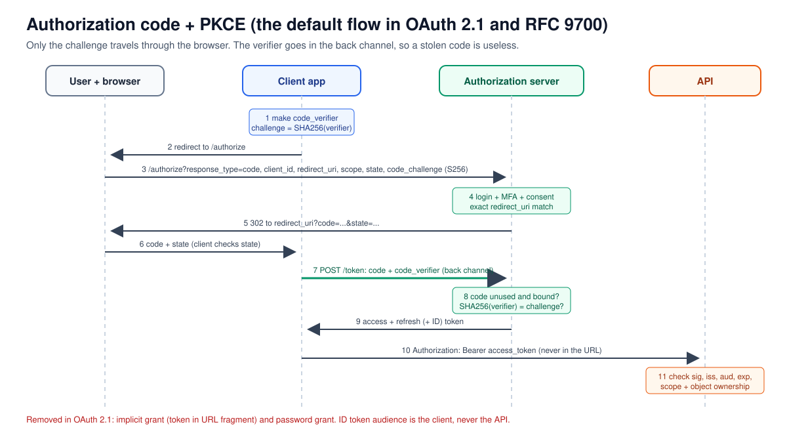

# Lesson 03: Authorizing with OAuth, and the Different Types of Tokens

**Syllabus items covered:** [CASP 4] "Authorizing with OAuth Framework", "OAuth Specification", "Different Authorization Workflows", "Insecure OAuth Configurations", "OAuth 2.0 vs OAuth 2.1", "Different Types of Tokens", "Access Token", "Refresh Token", "ID Token".

**Time:** 90 minutes. **Lab:** [oauth-flows](labs/oauth-flows/README.md). **Related:** the repo's [MCP authentication lesson](../../04-mcp-security/authentication/README.md) teaches OAuth 2.1 for MCP servers (protected resource metadata, resource indicators, token passthrough). This lesson is the general API view and does not repeat the MCP parts.

## 1. Authorizing with the OAuth framework

**OAuth 2.0 is a delegated authorization framework.** It lets a user allow an application (the **client**) to call an API (the **resource server**) on their behalf, with limited rights (**scopes**), without giving the client their password. Tokens are issued by an **authorization server** (AS), often called the identity provider (Entra ID, Okta, Auth0, Keycloak, Google).

| Role | Example |
|---|---|
| Resource owner | Alice |
| Client | The mobile app, a SPA, a backend job |
| Authorization server | Keycloak, Entra ID |
| Resource server | `api.example.com` |

**Analogy.** A hotel key card. Reception (AS) checks your passport once (authentication) and gives you a card that opens room 412 and the gym until Friday (scopes, audience, expiry). The door (API) only checks the card; it never sees your passport.

OAuth itself is **not authentication**. **OpenID Connect (OIDC)** is a layer on top that adds an **ID token** saying who logged in. Using a plain OAuth access token as "proof of login" for the client is a classic mistake.

## 2. The OAuth specification (what to read)

| Document | What it is (verify status at the IETF/OpenID sites) |
|---|---|
| RFC 6749 | OAuth 2.0 core (2012) |
| RFC 6750 | Bearer token usage (header, not query string) |
| RFC 7636 | PKCE |
| RFC 7009 / RFC 7662 | Token revocation / introspection |
| RFC 8414 | Authorization server metadata (discovery) |
| RFC 8628 | Device authorization grant (TVs, CLIs) |
| RFC 8693 | Token exchange (service acting for a user) |
| RFC 8705 / RFC 9449 | Sender-constrained tokens: mTLS / DPoP |
| RFC 8707 | Resource indicators (`resource=` parameter, sets `aud`) |
| RFC 9068 | JWT profile for access tokens (`typ: at+jwt`) |
| RFC 9126 / RFC 9396 | Pushed authorization requests (PAR) / Rich authorization requests (RAR) |
| **RFC 9700** (Jan 2025) | **OAuth 2.0 Security Best Current Practice**: the current rulebook |
| OAuth 2.1 | An IETF **draft** that consolidates 2.0 plus the BCP (section 5) |
| OpenID Connect Core 1.0 | ID tokens, UserInfo, discovery |

## 3. Different authorization workflows (grant types)

| Flow | Use it for | Status |
|---|---|---|
| **Authorization code + PKCE** | Any app with a user: web, SPA, mobile, desktop, CLI with a browser | **The default.** PKCE required for all clients in OAuth 2.1 |
| **Client credentials** | Service-to-service, no user | Current. Prefer private-key JWT or mTLS client auth over shared secrets |
| **Device authorization** | TVs, CLIs without a browser | Current. Watch for device-code phishing |
| **Refresh token** | Getting a new access token without the user | Current. Rotate or sender-constrain for public clients |
| **Token exchange** | An API calling another API for the user | Current (RFC 8693). Avoid token passthrough |
| Implicit (`response_type=token`) | Old SPAs | **Removed** in OAuth 2.1; BCP says do not use |
| Resource owner password credentials | Legacy first-party apps | **Removed** in OAuth 2.1; BCP says must not use |

**Authorization code + PKCE, step by step:**

1. The client makes a random `code_verifier` and computes `code_challenge = BASE64URL(SHA256(code_verifier))`.
2. The browser goes to `/authorize?response_type=code&client_id=…&redirect_uri=…&scope=…&state=…&code_challenge=…&code_challenge_method=S256`.
3. The user logs in and consents. The AS redirects to `redirect_uri?code=…&state=…`.
4. The client checks `state`, then calls `/token` (back channel) with `code`, `redirect_uri` and `code_verifier`.
5. The AS checks the code is unused, bound to this client and redirect, and that `SHA256(verifier)` matches the challenge. It returns an access token (+ refresh token, + ID token if `openid` scope).
6. The client calls the API with `Authorization: Bearer <access token>`.

PKCE means a stolen code (from logs, a malicious app on the phone, a referrer header) is useless without the verifier, which never went through the browser.

**For SPAs,** the current advice (IETF "OAuth 2.0 for Browser-Based Applications" draft) favours a **backend-for-frontend (BFF)**: the backend does the OAuth flow and keeps tokens; the browser gets only an HttpOnly session cookie. Token storage is covered in [chapter 10](../10-api-authentication/README.md).

## 4. Insecure OAuth configurations

| Misconfiguration | Attack | Fix |
|---|---|---|
| `redirect_uri` prefix, substring, regex or wildcard match | Code or token sent to `app.example.com.evil.net` or via an open redirect on the real domain | **Exact string match** of pre-registered URIs (localhost port may vary for native apps) |
| No PKCE | Authorization code interception | PKCE `S256` for every client |
| No or unchecked `state` | Login CSRF: victim is logged into the attacker's account | Check `state` (PKCE also helps); OIDC `nonce` for ID tokens |
| Implicit grant | Tokens in URL fragment, history, referrer, extensions | Code + PKCE, or BFF |
| Password grant | App sees the password; no MFA | Code + PKCE |
| Codes reusable, long-lived, not bound to client | Replay of a leaked code | Single use, ~1 minute, bound to `client_id` and `redirect_uri` |
| Access tokens valid for days | Long window for stolen tokens | Minutes, plus refresh tokens |
| Refresh tokens never rotate (public client) | Stolen refresh token works forever | Rotation with reuse detection, or DPoP/mTLS binding |
| Bearer token in query string | Leaks into logs, proxies, history | `Authorization` header only |
| API does not check `aud` | Token for API A replayed to API B; ID token used at the API | Validate `iss`, `aud`, `exp`, `typ` |
| Broad scopes (`*`, `admin`) by default | Over-privileged clients | Least-privilege scopes; consent screens |
| Client secret in a mobile app or SPA | Secret extracted and reused | Public client + PKCE; no secret |
| Trusting unverified email from social login | Account takeover by registering the victim's email at another IdP | Use `sub` + `iss` as the identity key; check `email_verified` |
| Open dynamic client registration | Attacker registers a look-alike client | Restrict or review registrations |

**Scenario.** A travel site registered `https://travel.example.com` as its redirect URI and the AS used prefix matching. An attacker sent victims a login link with `redirect_uri=https://travel.example.com.attacker.net/cb`. Users logged in at the real IdP, and their codes went to the attacker, who redeemed them because PKCE was not required. Both rules from RFC 9700 would have stopped it.

## 5. OAuth 2.0 vs OAuth 2.1

OAuth 2.1 is an **IETF draft** (not yet an RFC at the time of writing; verify) that folds RFC 6749, RFC 6750, PKCE, the browser and native app guidance and the security BCP into one document. Most of its rules are already required by **RFC 9700**, so treat them as current practice now.

| Topic | OAuth 2.0 (RFC 6749, 2012) | OAuth 2.1 (draft) / RFC 9700 |
|---|---|---|
| PKCE | Optional extension for native apps | **Required** for all clients using the code flow (confidential clients may use another CSRF-safe method per the BCP; verify) |
| Implicit grant | Allowed | **Removed** |
| Password grant | Allowed | **Removed** |
| Redirect URI matching | Flexible matching allowed | **Exact** string matching |
| Bearer token in query | Allowed by RFC 6750 (discouraged) | **Not allowed** |
| Refresh tokens for public clients | No rules | **Sender-constrained or rotated** |
| Authorization code | Recommended short-lived | Single-use, short-lived, bound to client |
| Specs | Many separate RFCs | One consolidated document |

## 6. Different types of tokens

| | **Access token** | **Refresh token** | **ID token** |
|---|---|---|---|
| Purpose | Call an API | Get new access tokens | Tell the **client** who logged in (OIDC) |
| Audience (`aud`) | The API (resource server) | The authorization server | The **client** (`client_id`) |
| Format | Opaque or JWT (`typ: at+jwt`, RFC 9068) | Usually opaque | Always a JWT |
| Lifetime | Short (minutes) | Longer (hours to days), with rotation/idle timeout | Short; used once at login |
| Sent to | The API in `Authorization: Bearer` | Only the AS `/token` endpoint | Nobody else: the client validates and consumes it |
| Validate | Signature or introspection, `iss`, `aud`, `exp`, scopes | AS checks binding, rotation, revocation | Signature, `iss`, `aud == client_id`, `exp`, `nonce` |
| Never | Put in URLs or logs | Send to an API; store in localStorage | Send to an API as an access token |

### 6.1 Access token

The API's view: the token says who (`sub`), for which API (`aud`), what is allowed (`scope`), and until when (`exp`). The API must still do **object-level checks** ([lesson 02](02-authorization-attacks-and-defenses.md)): `scope=trips:read` does not mean "all trips". Opaque tokens are checked by **introspection** (RFC 7662), which allows instant revocation at the cost of a call; JWTs are checked locally, so keep them short-lived.

### 6.2 Refresh token

A long-lived credential, so protect it like a password: store it server-side (BFF) or in secure OS storage on mobile; **rotate** it on every use and treat reuse of an old one as theft (the lab revokes the whole token family); or bind it to a key with **DPoP** (RFC 9449) or **mTLS** (RFC 8705). Revoke on logout and password change.

### 6.3 ID token

An OIDC JWT about the **authentication event**: `iss`, `sub`, `aud` (the client), `exp`, `iat`, `nonce`, `auth_time`, `acr`/`amr`. The client must validate it and should use `iss` + `sub` as the stable user key. **It is not an access token**: an API that accepts ID tokens lets any client that receives one (including a malicious app the user logged into) call the API as the user. The lab's naive API makes exactly this mistake.

**Scenario.** A company's internal API checked only that a JWT was signed by its IdP. A developer's side-project app, registered with the same IdP, received ID tokens for every colleague who tried it, and those tokens worked against the internal API. Checking `aud` and `typ` closed it.

## Check yourself

1. Why does PKCE protect a public client that has no secret?
2. Which three grants or practices did OAuth 2.1 remove or forbid?
3. Name the audience of each token type.
