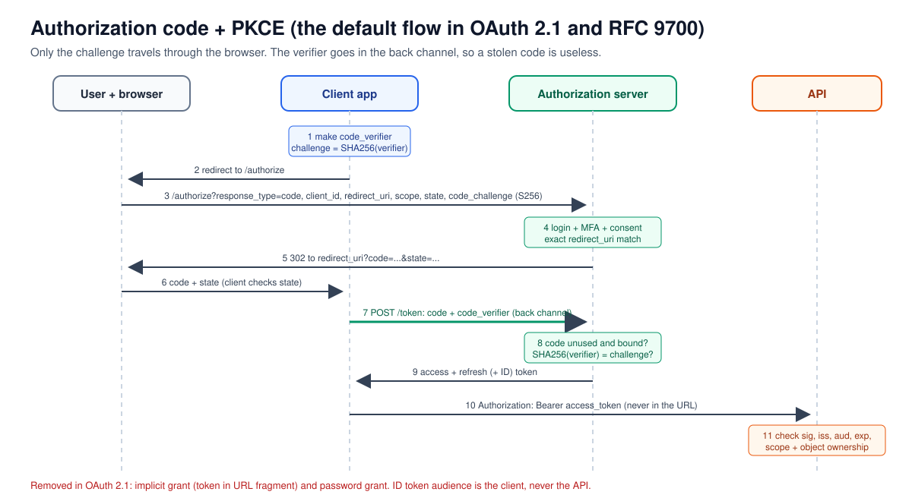

# Lab: OAuth flows, insecure configurations and token types

**Course topics:** "Authorizing with OAuth Framework", "OAuth Specification", "Different Authorization Workflows", "Insecure OAuth Configurations", "OAuth 2.0 vs OAuth 2.1", "Different Types of Tokens", "Access Token", "Refresh Token", "ID Token". Lesson: [03 OAuth and token types](../../03-oauth-and-token-types.md).

**Time:** 75 minutes. **Tests:** 10, all offline. **Safety:** the authorization server, client and API are Python objects; redirects are URL strings; keys are random bytes made at runtime. Only test systems you own or have written permission to test.

## Goal

Walk the **authorization code + PKCE** flow step by step, then attack a badly configured authorization server (open redirect_uri, stolen code, implicit grant, missing state, ID token used as an access token, refresh token replay) and see which OAuth 2.1 / RFC 9700 rule stops each one.

## Concept



| Attack | Vulnerable setting | Rule that stops it |
|---|---|---|
| Code sent to attacker host | prefix match of `redirect_uri` | exact string match |
| Stolen code redeemed | PKCE optional | PKCE `S256` required, verifier checked |
| Code replay | codes reusable | single-use codes bound to client and redirect |
| Token in URL fragment | implicit grant on | implicit removed (OAuth 2.1) |
| Login CSRF | client skips `state` | client checks `state` (and PKCE) |
| ID token sent to the API | API checks only the signature | API checks `typ: at+jwt` and `aud` (RFC 9068) |
| Stolen refresh token | refresh token never rotates | rotation + reuse detection revokes the family |

[oauth_sim.py](oauth_sim.py) also has `audit_client_config()`, which reviews a client/AS config JSON. Compare [fixtures/client_insecure.json](fixtures/client_insecure.json) and [fixtures/client_secure.json](fixtures/client_secure.json).

## Steps

1. Run the demo. Read block 1 slowly: the client sends only the `code_challenge`; the `code_verifier` travels later, in the back-channel token request.
2. In block 2, explain why `https://app.lab.example.evil.example/steal` passed the prefix check.
3. In `client_callback`, pass `None` as the expected state and explain the login-CSRF test (`test_missing_state_check_allows_login_csrf_and_check_blocks_it`).
4. In block 3, the legitimate client also loses its session after the thief replays the old token. Why is that the right trade-off?
5. Add a check to `audit_client_config` for `"token_endpoint_auth_method": "none"` on a **confidential** client, with a test.

## Run

```text
.venv/Scripts/python appsec-course/11-api-authorization-and-oauth/labs/oauth-flows/demo.py
.venv/Scripts/python -m pytest appsec-course/11-api-authorization-and-oauth/labs/oauth-flows -q -p no:cacheprovider
```

## Expected output (real run)

```text
== 1. Happy path: authorization code + PKCE (secure AS) ==
token response keys: ['access_token', 'expires_in', 'id_token', 'refresh_token', 'token_type']
  access_token: typ=at+jwt aud=https://api.lab.example
  id_token: typ=JWT aud=spa
API accepts access token: True
API accepts ID token    : False

== 2. Attacks: vulnerable AS vs secure AS ==
[VULN  ] open redirect_uri : code sent to attacker host app.lab.example.evil.example
[VULN  ] stolen code      : attacker redeemed stolen code
[VULN  ] implicit grant   : access token returned in URL fragment
[SECURE] open redirect_uri : blocked: invalid_request: unknown client or redirect_uri
[SECURE] stolen code      : blocked: invalid_grant: PKCE verification failed
[SECURE] implicit grant   : blocked: unsupported_response_type: implicit grant removed in OAuth 2.1

== 3. Refresh token rotation with reuse detection (secure AS) ==
legit client refreshed, got a NEW refresh token: True
thief replays the OLD refresh token -> invalid_grant: refresh token reuse detected, family revoked
legit client's new token is now dead too -> invalid_grant

== 4. Config review ==
client_insecure.json: 10 finding(s)
  - implicit grant enabled (removed in OAuth 2.1; tokens leak via URL fragment/history)
  - resource owner password grant enabled (removed in OAuth 2.1)
  - PKCE not required for the code flow
  - wildcard redirect_uri https://app.lab.example/*
  - plain-http redirect_uri http://app.lab.example/callback
  - redirect_uri matching is not exact
  - access tokens live longer than 1 hour
  - public client refresh tokens are neither rotated nor sender-constrained
  - bearer token accepted in URL query string
  - state parameter not required
client_secure.json: 0 finding(s)
```

## Run the real tool (hedged)

- Run a local identity provider such as **Keycloak** (container) in the course lab, register a public client with PKCE required, and watch the requests in **Burp Suite** or browser dev tools. Try changing `redirect_uri` and replaying a code: both should fail.
- **oauth2c** (CLI) and **Postman**'s OAuth 2.0 helper can drive the code + PKCE flow against a test IdP.
- The repo's MCP lesson shows the same flow for MCP servers, with protected resource metadata and resource indicators: [04-mcp-security/authentication](../../../../04-mcp-security/authentication/README.md).

## What you learned

- OAuth is **delegated authorization**; OIDC adds an **ID token** for authentication. Never send an ID token to an API.
- PKCE, exact redirect URIs, `state`, single-use codes and refresh rotation each close one specific attack.
- Most OAuth bugs are **configuration** bugs, so review configs as code.
