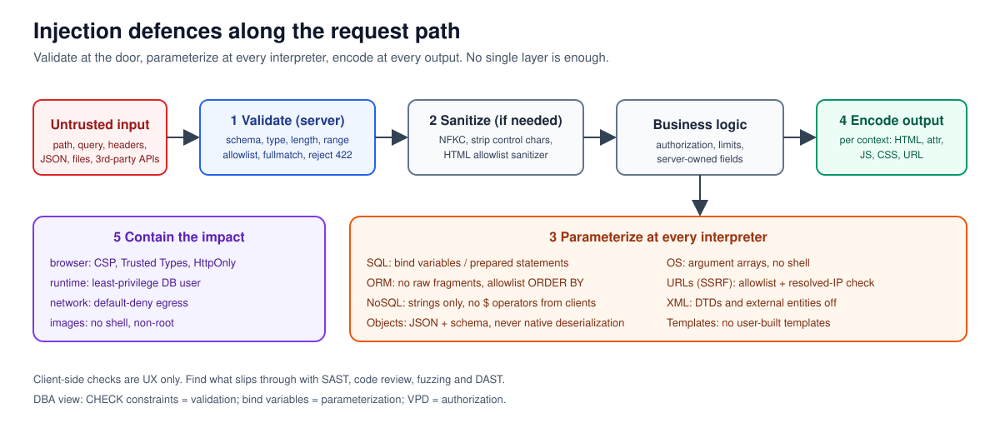

# Lesson 01: Input Validation and Input Sanitization

**Syllabus items covered:** [CASP 5] "Introduction to Input Validation", "Input Validation", "Input Sanitization", "Injection Defenses", "Implementing Input Validation", "Client-Side vs. Server-Side Validation", "Whitelisting & Blacklisting", "Implementing Input Sanitization", "Validating With Regular Expressions", "Learning To Validate Input With Regular Expressions".

**Time:** 75 minutes. **Lab:** [regex-validation](labs/regex-validation/README.md). Secure-code-review view of the same topic: [chapter 02](../02-secure-code-review-and-asvs/README.md).

> **DBA analogy.** A `CHECK` constraint, a `NOT NULL`, a `VARCHAR2(20)` and a foreign key are input validation inside the database. They reject bad rows no matter which application sends them. An API needs the same discipline at its front door.

## 1. Introduction to input validation

Every API input is attacker-controlled: path, query string, headers, cookies, JSON/XML bodies, file uploads, webhook payloads, even data your API reads back from another API or your own database (second-order injection). **Input validation** checks that input matches what the business expects **before** it is used.

Input validation is a strong **first** line of defence, but not the fix for injection. A valid surname can be `O'Brien`, and a valid comment can contain `<`. The real fixes are **parameterization** (data never becomes code) and **output encoding** (data is shown as text). Validation reduces attack surface; it does not replace those.

## 2. Input validation vs input sanitization

| | Validation | Sanitization |
|---|---|---|
| Action | **Accept or reject** | **Change** the input to make it acceptable |
| Example | `qty` must be an integer 1-100, else 422 | strip control characters, normalize Unicode, remove disallowed HTML tags |
| Risk | Too strict breaks legit users | Can be bypassed or change meaning (`<scr<script>ipt>` after naive removal) |
| Prefer | Yes, always | Only when you must accept rich input (HTML from an editor) |

## 3. Implementing input validation

1. **Validate on the server**, at the trust boundary, for every input source.
2. **Syntactic validation:** type, length, format, range, enum (`"status" in {"open","closed"}`).
3. **Semantic validation:** business meaning (end date after start date; the account belongs to the user, see [chapter 11](../11-api-authorization-and-oauth/README.md)).
4. **Schema-first:** describe the body in **OpenAPI/JSON Schema** with `type`, `maxLength`, `pattern`, `enum`, `minimum/maximum` and `additionalProperties: false`, and let the framework or gateway enforce it (pydantic, Joi/zod, Bean Validation, ASP.NET model validation).
5. **Canonicalize first** (decode, normalize Unicode NFKC), then validate, so `%2e%2e%2f` and full-width characters cannot sneak past.
6. **Reject, don't fix,** and return a generic 400/422 without echoing the raw input.
7. **Limit sizes** everywhere: body size, array length, string length, nesting depth, upload size.

**Scenario.** An insurance API accepted `"age": -5` and `"sum_insured": 1e20` because the JSON parser happily produced numbers. A premium calculation divided by age, returned a negative premium, and the payment step "refunded" the customer. A schema with `minimum`/`maximum` would have stopped it at the door.

## 4. Client-side vs server-side validation

Client-side validation (HTML5 `required`, `pattern`, JavaScript checks, mobile app checks) improves **user experience**: fast feedback, fewer bad requests. It is **not a security control**: the attacker talks to the API directly with curl, a proxy (Burp) or a script, skipping the client entirely. The lab shows a value the browser rejects being accepted by a server that does not validate.

Rule: **validate on the server always; on the client optionally.** Share the schema (for example the OpenAPI spec) so both sides agree.

## 5. Whitelisting and blacklisting (allowlists and denylists)

Current terminology is **allowlist** and **denylist**; the syllabus uses the older words.

- **Allowlist:** define what is allowed (`[a-z0-9_]{3,20}`, an enum, a set of hostnames). Anything else is rejected. Robust, because unknown attacks are not in the list.
- **Denylist:** define what is forbidden (`<script>`, `' OR`, `../`). Always incomplete: case changes, encodings, other tags (``), Unicode look-alikes and new techniques bypass it. Useful only as an extra signal (a WAF rule, logging).

## 6. Validating with regular expressions

Regex is the usual tool for format checks. The mistakes are classic:

| Mistake | Example | Fix |
|---|---|---|
| Unanchored | `re.match(r"[a-z]+", s)` accepts `"abc; DROP..."` | `re.fullmatch`, or `\A...\Z` |
| `$` and newlines | `^[a-z]+$` accepts `"abc\n"` in Python/PCRE | `\Z` or fullmatch |
| Too permissive classes | `.*` or `[\w\W]` | precise classes and lengths |
| ReDoS | `^(a+)+$`, `(\w*)*`, `(a|aa)+` with backtracking engines | no nested quantifiers, length cap first, linear-time engines (RE2) |
| Validating then using a different value | validating the decoded value but using the raw one | validate the exact value you use |

**ReDoS (regular-expression denial of service):** backtracking engines (Python `re`, Java, JavaScript, .NET default, PCRE) try every way to match a nested quantifier before failing. `^(a+)+$` against 30 `a`s plus `!` can take minutes. One request can pin a CPU core. Cloudflare's July 2019 global outage was caused by a backtracking regex in a WAF rule.

**Learning to validate input with regular expressions** is the lab: build validators with `fullmatch` and length caps, compare allowlists and denylists, and use a small heuristic to flag nested quantifiers.

## 7. Implementing input sanitization

When you must accept "messy" input:

- **Normalize** Unicode (NFKC) and decode once.
- **Strip** control characters and bidirectional overrides (`U+202E` can make `exe.txt` look like `txt.exe`).
- **Rich HTML:** use a maintained **allowlist sanitizer** (DOMPurify in the browser; OWASP Java HTML Sanitizer, Python `nh3`/`bleach`-style libraries on the server; check maintenance). Never write your own tag-stripping regex for HTML.
- **File names:** generate your own server-side names; never use the client's path.
- **Sanitize for the destination, at the destination:** that is output encoding ([lesson 04](04-output-encoding-csp-and-trusted-types.md)) and parameterization ([lesson 02](02-injection-vulnerabilities.md)).

## 8. Injection defenses (summary)

| Layer | Control | Stops |
|---|---|---|
| Input | Schema validation, allowlists, size limits | Many malformed and unexpected inputs |
| Interpreter boundary | Prepared statements / bind variables, safe ORM APIs, no shell (`subprocess` with argument lists), safe parsers (no XXE) | SQL/ORM/NoSQL/OS command/LDAP/XML injection |
| Output | Context-aware encoding, auto-escaping templates | XSS, header injection |
| Browser | CSP, Trusted Types, HttpOnly cookies | Limits impact of XSS |
| Runtime | Least-privilege DB accounts, egress filtering, WAF as a signal | Limits blast radius |
| Process | SAST rules, code review, fuzzing, DAST | Finds what slipped through |

## Check yourself

1. Why is a denylist of SQL keywords not a fix for SQL injection?
2. Give one reason `^[a-z]+$` can accept an unexpected value in Python.
3. When would you sanitize instead of reject?
