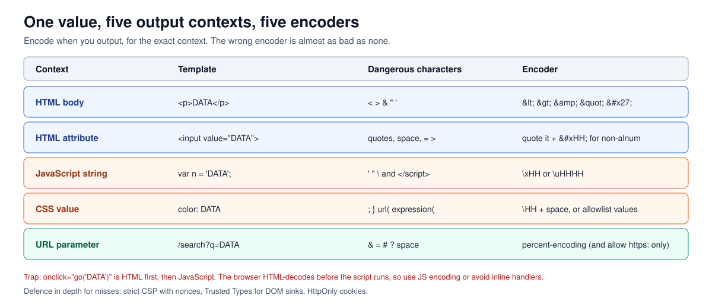

# Lab: Output encoding per context, CSP and Trusted Types

**Course exercise:** "Preventing DOM XSS With Trusted Types". Also covers "Output Encoding", "HTML Encoding", "HTML Attribute Encoding", "Javascript Encoding", "CSS Encoding", "Content Security Policy" and "Cross-Site Scripting (XSS)". Lesson: [04 Output encoding, CSP and Trusted Types](../../04-output-encoding-csp-and-trusted-types.md). CSP at scale and security headers are covered again in [chapter 14](../../../14-api-defenses-data-security-and-headers/README.md).

**Time:** 60 minutes. **Tests:** 10, all offline. **Safety:** no browser; a simplified parser view and a fake DOM element. Only test systems you own or have written permission to test.

## Goal

1. Break out of four output contexts with raw output, then contain each with the **right** encoder.
2. Evaluate a weak and a strict CSP, and see which inline scripts a CSP-aware browser would run.
3. Enforce **Trusted Types** on a fake `innerHTML` sink: plain strings are rejected; a policy sanitizes.

## Concept



| Context | Example | Encoder |
|---|---|---|
| HTML body | `<p>{}</p>` | HTML entity encode `& < > " '` |
| HTML attribute | `<input value="{}">` | encode all non-alphanumerics as `&#xHH;`, always quote |
| JavaScript string | `var x = '{}'` | `\xHH` / `\uHHHH` |
| CSS value | `color: {}` | `\HH ` |
| URL parameter | `?q={}` | percent-encode |
| Nested (JS in an attribute) | `onclick="go('{}')"` | the browser HTML-decodes first, so JS-encode (avoid this pattern) |

**CSP** (strict, nonce-based): `script-src 'nonce-R4nd0m' 'strict-dynamic'; object-src 'none'; base-uri 'none'`. Injected inline scripts have no nonce and do not run. When a nonce is present, browsers ignore `'unsafe-inline'` (kept only as a fallback for very old browsers).

**Trusted Types:** with `require-trusted-types-for 'script'`, DOM sinks such as `innerHTML` throw on plain strings. Only values created by a reviewed **policy** are accepted, so DOM XSS reviews shrink to the policies.

## Steps

1. Run the demo and compare raw vs encoded lines.
2. Replace `attr_encode` with `html_encode` and use an **unquoted** attribute template `<input value={}>`. Which payload breaks out now?
3. Add `'unsafe-eval'` to the strict CSP and rerun the evaluator.
4. Create a default policy that only allows `<b>` and `<i>`, attach it to `FakeElement`, and assign legacy strings.

## Run

```text
.venv/Scripts/python appsec-course/12-input-validation-and-injection/labs/output-encoding-csp-trusted-types/demo.py
.venv/Scripts/python -m pytest appsec-course/12-input-validation-and-injection/labs/output-encoding-csp-trusted-types -q -p no:cacheprovider
```

## Expected output (real run)

The nonce changes on every run.

```text
== Output encoding per context ==
[html] payload ''
   raw     breaks out=True  <p>Hello </p>
   encoded breaks out=False <p>Hello &lt;img src=x onerror=alert(1)&gt;</p>
[attribute] payload '" autofocus onfocus="alert(1)'
   raw     breaks out=True  <input value="" autofocus onfocus="alert(1)">
   encoded breaks out=False <input value="&#x22;&#x20;autofocus&#x20;onfocus&#x3d;&#x22;alert&#x28;1&#x29;">
[javascript] payload "';alert(1);//"
   raw     breaks out=True  <script>var name = '';alert(1);//';</script>
   encoded breaks out=False <script>var name = '\x27\x3balert\x281\x29\x3b\x2f\x2f';</script>
[css] payload 'red; background:url(//evil.example/x)'
   raw     breaks out=True  <div style="color: red; background:url(//evil.example/x)">x</div>
   encoded breaks out=False <div style="color: red\3b \20 background\3a url\28 \2f \2f evil\2e example\2f x\29 ">x</div>
[onclick handler] HTML-encoded value breaks out: True | JS-encoded: False

== CSP evaluator ==
weak: default-src 'self'; script-src 'self' 'unsafe-inline' https://ajax.googleapis.com
   - HIGH 'unsafe-inline' allows injected inline scripts
   - MEDIUM CDN host allowlist may host JSONP or old AngularJS gadgets
   - MEDIUM missing object-src 'none' (plugins)
   - MEDIUM missing base-uri (base tag hijacking of relative scripts)
strict: script-src 'nonce-ZFJ8MtrAogD6VbfXUxE0eQ' 'strict-dynamic'; object-src 'none'; base-uri 'none'; frame-ancestors 'none'; require-trusted-types-for 'script'; report-uri /csp-report
   - no findings
injected inline script runs under weak CSP?   True
injected inline script runs under strict CSP? False
our own nonce'd script runs under strict CSP? True

== Trusted Types (simulated DOM sink) ==
no TT: innerHTML = Hi <b>there</b> | script present: True
TT enforced, plain string -> This document requires 'TrustedHTML' assignment.
TT enforced, via policy -> Hi <b>there</b> | script present: False
```

## Run the real tool (hedged)

- **Google CSP Evaluator** (web) and browser dev tools (Console shows CSP violations). Roll out with `Content-Security-Policy-Report-Only` first, collecting reports with `report-to` / `report-uri`.
- Trusted Types: test in a current browser with `Content-Security-Policy-Report-Only: require-trusted-types-for 'script'`, then fix the reported sinks. Browser support has widened (check caniuse).
- Use maintained libraries: framework auto-escaping (React, Angular, Jinja2 autoescape), OWASP Java Encoder, DOMPurify for HTML sanitization.

## What you learned

- Encode on output, for the exact context, with a library encoder.
- CSP and Trusted Types are second and third lines of defence, not a replacement for encoding.
