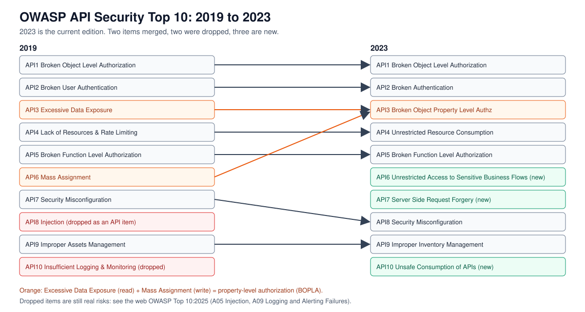

# Lesson 01: The OWASP API Security Top 10 (2019 and 2023)

**Syllabus items covered:** [CASP 6] "Introduction to OWASP API Top 10", the ten 2019 items ("Broken Object Level Authorization" … "Insufficient Logging and Monitoring") and the 2023 items ("Broken Object Property Level Authorization", "Unrestricted Resource Consumption", "Unrestricted Access to Sensitive Business Flows", "Server Side Request Forgery", "Improper Inventory Management", "Unsafe Consumption of APIs").

**Time:** 2 hours. **Lab:** [api-top10-2023-demos](labs/api-top10-2023-demos/README.md).

> The syllabus mixes both editions. **The 2023 edition is current** (no newer edition is known at the time of writing; check owasp.org/API-Security). Learn both, and the mapping in section 4: exam questions often use the 2019 names.

## 1. Introduction to OWASP API Top 10

The **OWASP API Security Project** publishes a ranked list of the most critical API risks, built from public breach data, bug bounty reports and expert input. The first edition was **2019**; the second, **2023**. It complements the web **OWASP Top 10** (2021 and 2025 editions) because APIs fail differently: less about rendering HTML, more about **authorization on every object and property**, **resource limits**, **business flows** and **inventory**.

How to use it: as a **threat checklist** in design reviews (with STRIDE, [chapter 04](../04-threat-modeling-methods-and-rating/README.md)), as **test cases** for pentests, and as **training** vocabulary. It is not a compliance standard; for verifiable requirements use **OWASP ASVS** ([chapter 16](../16-api-security-the-devsecops-way/README.md)).

## 2. The 2019 list

### 2.1 Broken Object Level Authorization

API1 in both editions. The API uses a client-supplied ID to access an object and does not check that the caller may access **that** object. Example: `GET /api/v1/users/102/location` as user 101. Fix: object-level checks on every access path, centralised. Deep dive and lab: [chapter 11](../11-api-authorization-and-oauth/02-authorization-attacks-and-defenses.md#3-broken-object-level-authorization-bola).

### 2.2 Broken Authentication

2019 name: "Broken User Authentication". Weak login and token handling: credential stuffing with no rate limit, weak passwords, tokens not validated (`alg:none`, no `exp`), API keys in URLs, password reset flaws. Fix: standard auth flows, MFA, rate limits and lockouts, strict token validation. Deep dive: [chapter 10](../10-api-authentication/README.md).

### 2.3 Excessive Data Exposure

The API returns full objects and relies on the client to hide fields (`password_hash`, `ssn`, internal flags). Anyone with a proxy sees everything. Fix: explicit **response schemas** per endpoint and role; never `return user.__dict__`. Merged into **API3:2023 BOPLA**.

### 2.4 Lack of Resources and Rate Limiting

No limits on request rate, payload size, page size, query complexity or expensive operations, leading to DoS, brute force and cost explosions. Fix: rate limits per user/key/IP, maximum page sizes, timeouts, body limits, cost limits. Renamed **API4:2023 Unrestricted Resource Consumption**.

### 2.5 Broken Function Level Authorization

API5 in both editions. Users call functions they should not (admin endpoints, other HTTP methods). Fix: deny-by-default function-level authorization. Lab: [chapter 11](../11-api-authorization-and-oauth/labs/bola-user-location/README.md).

### 2.6 Mass Assignment

The API binds client JSON to internal models, so attackers set `is_admin`, `balance` or `owner_id`. Fix: input allowlists (DTOs). Merged into **API3:2023 BOPLA**. Lab: [chapter 12 mass-assignment](../12-input-validation-and-injection/labs/mass-assignment/README.md).

### 2.7 Security Misconfigurations

Verbose errors and stack traces, debug endpoints on, default credentials, missing TLS or security headers, permissive CORS, unnecessary HTTP methods, unpatched components, cloud storage open. **API8:2023**. Fix: hardened, repeatable configuration (IaC), config scanning, generic errors, CORS allowlists ([CORS lab](labs/cors-misconfiguration/README.md)).

### 2.8 Injection

SQL, NoSQL, OS command, LDAP, XML and other injection through API parameters. Dropped as a separate API item in 2023 (it is well covered by the web Top 10, **A05:2025 Injection**), but still common. Deep dive: [chapter 12](../12-input-validation-and-injection/README.md).

### 2.9 Improper Asset Management

Old API versions (`/v1`), beta, staging and debug hosts and undocumented endpoints stay exposed and unpatched. Renamed **API9:2023 Improper Inventory Management**.

### 2.10 Insufficient Logging and Monitoring

No logs of authentication, authorization failures or high-value actions; no alerting; logs nobody reads, so breaches go unnoticed for months. Dropped as an API item in 2023 (still **A09** in the web Top 10). Deep dive: [chapter 15](../15-implementing-api-security-mechanisms/README.md).

## 3. The 2023 list

| # | 2023 item | One-line test |
|---|---|---|
| API1 | Broken Object Level Authorization | Swap object IDs between two users |
| API2 | Broken Authentication | Brute force, token tampering, reset abuse |
| API3 | Broken Object Property Level Authorization | Read hidden fields; write read-only fields |
| API4 | Unrestricted Resource Consumption | Huge page size, body, query cost, SMS/email cost |
| API5 | Broken Function Level Authorization | Call admin functions as a user |
| API6 | Unrestricted Access to Sensitive Business Flows | Automate a flow (buy, book, sign up, refer) at scale |
| API7 | Server Side Request Forgery | Make the API fetch an internal URL |
| API8 | Security Misconfiguration | Errors, headers, CORS, defaults, TLS |
| API9 | Improper Inventory Management | Find old versions and undocumented hosts |
| API10 | Unsafe Consumption of APIs | Abuse data or redirects from a third-party API the target trusts |

### 3.1 Broken Object Property Level Authorization

**BOPLA** = Excessive Data Exposure (read side) + Mass Assignment (write side): authorization is missing at the **property** level. Example: `GET /users/7` returns `password_hash`; `PATCH /users/7 {"is_admin": true}` succeeds. Fix: per-role response and request schemas; reject unknown fields.

### 3.2 Unrestricted Resource Consumption

Broadens 2019 API4: not only rate limits but **any** resource that costs money or capacity: CPU, memory, storage, bandwidth, and **paid third-party calls** (SMS OTPs, emails, AI model calls, maps). Example: an attacker triggers 100,000 "send verification SMS" calls and the company pays the SMS bill. Fix: limits per user/key/IP/tenant, maximum sizes, timeouts, spending caps and alerts. Rate limiting labs are in [chapter 14](../14-api-defenses-data-security-and-headers/README.md) and [chapter 15](../15-implementing-api-security-mechanisms/README.md).

### 3.3 Unrestricted Access to Sensitive Business Flows

New in 2023. The API exposes a business flow (buying limited stock, booking seats, posting reviews, creating accounts, referral bonuses) without protecting it from **automated abuse**, even though each single request is legitimate. Example: scalper bots buy a whole sneaker drop. Fix: identify sensitive flows in threat modeling; device fingerprinting, behaviour analysis, per-account limits, human-detection friction (CAPTCHA as one signal), delays and queues. Labs: [free-coupons](../12-input-validation-and-injection/labs/free-coupons/README.md) and the API6 demo.

**Scenario.** A cinema chain launched a blockbuster pre-sale API. Bots reserved (without paying) every seat for opening night within minutes and released them to resellers. Each "hold seat" call was valid. A per-account hold limit, a short hold timeout and bot detection on the flow would have helped.

### 3.4 Server Side Request Forgery

New as its own API item in 2023 (it was already **A10:2021** in the web list; folded into A01 Broken Access Control in 2025). APIs fetch URLs for webhooks, imports, previews and integrations, so SSRF is common. Fix: allowlists, resolved-IP checks, no redirects, egress controls, IMDSv2. Lab: [chapter 12 injection-playground](../12-input-validation-and-injection/labs/injection-playground/README.md).

### 3.5 Improper Inventory Management

You cannot protect APIs you do not know about: old versions, partner/beta hosts, shadow APIs deployed outside the gateway, zombie endpoints, and **data flows to third parties** that are not documented. Fix: an API inventory generated from gateways, code and traffic; OpenAPI specs as the source of truth; retire old versions; scan for drift (the lab diffs deployed vs documented routes).

### 3.6 Unsafe Consumption of APIs

New in 2023. Developers trust data from **third-party APIs** more than user input, so attackers go after the weaker partner. Examples: an address API returns a payload that is used in SQL; the API follows a redirect from a partner to an internal URL; a partner returns a huge response that exhausts memory. Fix: validate and sanitize third-party responses like user input, use TLS, do not follow redirects blindly, set timeouts and size limits, keep an allowlist of integrations.

## 4. Mapping 2019 to 2023

| 2019 | 2023 |
|---|---|
| API1 Broken Object Level Authorization | API1 Broken Object Level Authorization |
| API2 Broken User Authentication | API2 Broken Authentication |
| API3 Excessive Data Exposure | API3 Broken Object Property Level Authorization |
| API4 Lack of Resources & Rate Limiting | API4 Unrestricted Resource Consumption |
| API5 Broken Function Level Authorization | API5 Broken Function Level Authorization |
| API6 Mass Assignment | API3 Broken Object Property Level Authorization |
| (new) | API6 Unrestricted Access to Sensitive Business Flows |
| (new) | API7 Server Side Request Forgery |
| API7 Security Misconfiguration | API8 Security Misconfiguration |
| API8 Injection | dropped as its own item (web Top 10 A05:2025) |
| API9 Improper Assets Management | API9 Improper Inventory Management |
| API10 Insufficient Logging & Monitoring | dropped (web Top 10 A09) |
| (new) | API10 Unsafe Consumption of APIs |

The web **OWASP Top 10:2025** (A01 Broken Access Control … A10 Mishandling of Exceptional Conditions) is mapped in [chapter 01](../01-security-champions-and-appsec-basics/README.md).

## Check yourself

1. Which two 2019 items became BOPLA, and why does merging them make sense?
2. Give one example each of API4:2023 and API6:2023 and explain the difference.
3. Why did OWASP add "Unsafe Consumption of APIs"?
