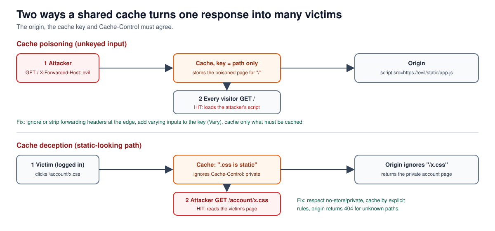

# Lesson 02: Caching Layers, GraphQL, SOAP and Microservices

**Syllabus items covered:** [CASP 6] "Attacking Caching Layers (Memcache, Proxies, etc.)", "Attacking GraphQL APIs", "Attacking SOAP APIs", "Abusing Microservices and REST APIs".

**Time:** 2 hours. **Labs:** [cache-poisoning-deception](labs/cache-poisoning-deception/README.md), [graphql-suggestions-and-persisted-queries](labs/graphql-suggestions-and-persisted-queries/README.md), [soap-xxe-and-safe-parsing](labs/soap-xxe-and-safe-parsing/README.md), [microservices-header-trust](labs/microservices-header-trust/README.md).

> Only test systems you own or have written permission to test.

## 1. Attacking caching layers (Memcache, proxies, etc.)

Caches sit everywhere in an API path: browser, CDN, reverse proxy (NGINX, Varnish), API gateway response cache, application caches (**Memcached**, **Redis**). They make one response serve many users, which also multiplies mistakes.

### 1.1 Web cache poisoning

The cache builds a **key** from some parts of the request (usually method, host, path, query). If the response also depends on an **unkeyed** input (a header such as `X-Forwarded-Host`, `X-Original-URL`, a cookie, a parameter the cache strips), an attacker sends one request with a malicious value; the poisoned response is cached and served to everyone with the same key. Impact: stored XSS at scale, redirects, DoS (poisoned error pages).

Defences: do not reflect unkeyed headers; strip forwarding headers at the edge; include varying inputs in the key (`Vary`); cache only what must be cached; short TTLs for HTML.

### 1.2 Web cache deception

The attacker makes a **victim** request a URL like `/account/settings/x.css`. The origin ignores the extra segment and returns the private page; the cache sees `.css` and stores it as static, ignoring `Cache-Control: private`. The attacker then requests the same URL and gets the victim's page from the cache.

Defences: the cache must respect `Cache-Control: no-store/private`; cache by content type and explicit route rules, not extensions; the origin returns 404 for unknown paths; mark authenticated responses `no-store`.

### 1.3 Memcached, Redis and application caches

- **Memcached** has no authentication by default. Exposed instances leak cached sessions, tokens and PII, and allow cache poisoning by writing keys. Its UDP protocol enabled record DDoS amplification in 2018 (about 1.35 Tbps against GitHub). Bind to private interfaces, firewall, disable UDP (`-U 0`), use SASL and TLS where supported.
- **Redis** without a password or ACLs on a public interface has been mass-exploited (writing SSH keys or cron jobs through `CONFIG SET`). Use ACLs, `protected-mode`, private networks, TLS, and rename or disable dangerous commands.
- **Application-level** cache keys must include the **tenant and user** when data is user-specific; a cache keyed only by `order_id` becomes a BOLA bug.

**Scenario.** A travel site cached `/api/me/bookings` at the CDN for 60 seconds to absorb a traffic spike, keyed by path only. For a minute at a time, every user saw the bookings of whoever had loaded the page first. Nobody attacked it; the cache configuration was the breach.

## 2. Attacking GraphQL APIs (part 2)

Part 1 is in [chapter 12 lesson 05](../12-input-validation-and-injection/05-post-exploitation-and-graphql.md#2-attacking-graphql-apis): introspection, resolver BOLA, alias brute force and depth DoS. Additional attack surface:

- **Field suggestions** leak schema when introspection is off ("Did you mean ..."). **Clairvoyance** rebuilds schemas this way.
- **Array batching** sends many operations in one HTTP request.
- **GET-based queries and form-encoded POSTs** allow CSRF against cookie-authenticated GraphQL.
- **Mutations without authorization** (BFLA in GraphQL form).
- **Debug and tracing extensions** (Apollo tracing, stack traces in `errors`) leak internals.
- **Subscriptions over WebSockets** often skip the authorization applied to HTTP queries.

Defences: suggestions off, introspection off in production, **persisted queries** for first-party clients, batching limits, depth/cost limits, per-resolver authorization, JSON-only POST, generic errors, the same auth checks on WebSocket connections. Lab: [graphql-suggestions-and-persisted-queries](labs/graphql-suggestions-and-persisted-queries/README.md).

## 3. Attacking SOAP APIs

SOAP (XML envelopes, WSDL contracts, WS-Security) still runs banking, insurance, telecom and government integrations.

| Attack | Description | Defence |
|---|---|---|
| **XXE** | External entities read local files or make requests (SSRF) | Disable DTDs/external entities in the parser |
| **XML bombs** (billion laughs, quadratic blowup) | Small input expands to gigabytes | Disable DTDs; parser limits; size limits |
| **WSDL exposure and enumeration** | `?wsdl` reveals every operation, including admin ones | Do not publish in production; authorize every operation anyway |
| **SOAPAction spoofing** | Header says a harmless operation, Body runs another; gateways or WAFs that check the header are bypassed | Route and authorize on the Body; reject mismatches |
| **XML Signature Wrapping (XSW)** | Signed element relocated; logic processes an unsigned one | "Verify what you use"; strict schema; hardened libraries |
| **Injection in parameters** | SQL/command/XPath injection via SOAP fields | Parameterize, validate against XSD |
| **WS-Security misuse** | Missing timestamps/nonces allow replay; weak algorithms | Timestamps, nonces, current algorithms, TLS |

**Python parsing note:** `xml.etree.ElementTree` does not resolve external entities and current expat versions limit entity amplification (see Python's "XML vulnerabilities" documentation); `defusedxml` rejects DTDs outright. **Java:** enable `FEATURE_SECURE_PROCESSING` and set `http://apache.org/xml/features/disallow-doctype-decl` to true. **.NET:** `DtdProcessing.Prohibit` (default in modern versions; verify).

Lab: [soap-xxe-and-safe-parsing](labs/soap-xxe-and-safe-parsing/README.md).

## 4. Abusing microservices and REST APIs

Microservices replace in-process calls with network calls between dozens of services. Common abuses:

- **Implicit internal trust:** services accept `X-User-Id`/`X-Role` headers or skip authentication "because only the gateway calls us". An attacker who adds the header through the gateway, or reaches the service directly (SSRF, compromised pod, flat network), becomes any user.
- **Header spoofing:** `X-Forwarded-For` used for IP allowlists or rate limits (the left-most value is client-controlled); `X-Original-URL`/`X-Rewrite-URL` bypass path-based gateway rules; `X-Forwarded-Host` poisons links and password-reset emails.
- **Path and method confusion between gateway and service:** `/admin` blocked at the gateway but `/ADMIN`, `/admin/`, `/%61dmin` or `/api/../admin` reaches it; the gateway allows `GET` while the service also implements `DELETE` on the same path.
- **REST verb tampering and parameter pollution:** `?role=user&role=admin` parsed differently by the gateway and the service.
- **Token passthrough and confused deputies:** a service forwards the user's token to another service it was not issued for, or calls with its own powerful credentials on behalf of any caller (see [MCP authentication](../../04-mcp-security/authentication/README.md)).
- **Excessive service permissions:** one compromised service can read every database.

Defences (zero trust between services): mutual TLS with workload identities (SPIFFE/SPIRE, service mesh), **signed, audience-bound, short-lived internal tokens** (or token exchange, RFC 8693), the gateway strips client-supplied identity headers, NetworkPolicies, consistent path normalisation, per-service least privilege, and authorization in each service, not only at the edge.

**Scenario.** A fintech's KYC service trusted `X-Customer-Id` set by the gateway. The gateway used `setdefault`, so a client-supplied header won. A researcher changed the header and downloaded other customers' identity documents through a perfectly authenticated session. The fix: strip the header at the edge and pass a signed token the KYC service verifies.

Lab: [microservices-header-trust](labs/microservices-header-trust/README.md).

## Check yourself

1. What is an unkeyed input and why does it enable cache poisoning?
2. What does "verify what you use" mean for XML signatures?
3. Name three ways an attacker can bypass a gateway path rule to reach an internal endpoint.
