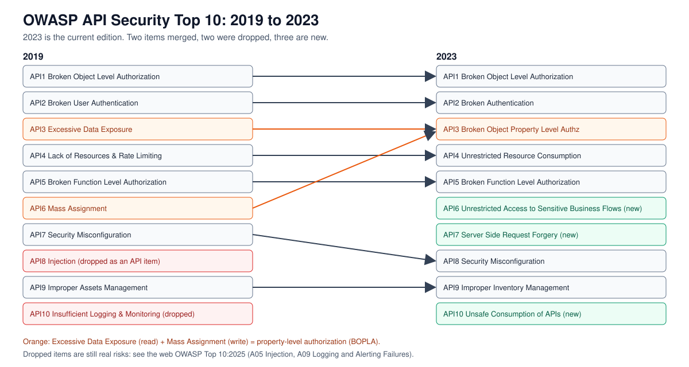

# Lab: OWASP API Security Top 10, one mini-demo per 2023 item

**Course topics:** "Introduction to OWASP API Top 10" and all 16 OWASP items in [CASP 6] (the 2019 and 2023 names). Lesson: [01 OWASP API Top 10 2019 and 2023](../../01-owasp-api-top-10-2019-and-2023.md).

**Time:** 60 minutes. **Tests:** 15, all offline. **Safety:** ten tiny vulnerable/secure function pairs; FAKE secrets built at runtime. Only test systems you own or have written permission to test.

## Goal

Run the same attack against a vulnerable and a secure version of each 2023 item, and learn the 2019 → 2023 mapping as data you can test.

## Concept



| 2023 item | Mini-demo in [top10.py](top10.py) | Deeper lab |
|---|---|---|
| API1 BOLA | read another user's invoice | [ch11 bola-user-location](../../../11-api-authorization-and-oauth/labs/bola-user-location/README.md) |
| API2 Broken Authentication | 3-digit PIN, no lockout | [ch10](../../../10-api-authentication/README.md) |
| API3 BOPLA | response leaks `password_hash`; `is_admin` writable | [ch12 mass-assignment](../../../12-input-validation-and-injection/labs/mass-assignment/README.md) |
| API4 Unrestricted Resource Consumption | `?limit=1000000` | [ch12 graphql-attacks](../../../12-input-validation-and-injection/labs/graphql-attacks/README.md) (cost limits) |
| API5 BFLA | user calls admin delete | [ch11 bola-user-location](../../../11-api-authorization-and-oauth/labs/bola-user-location/README.md) |
| API6 Sensitive Business Flows | bot buys the whole sneaker drop | [ch12 free-coupons](../../../12-input-validation-and-injection/labs/free-coupons/README.md) |
| API7 SSRF | webhook test URL hits FAKE metadata | [ch12 injection-playground](../../../12-input-validation-and-injection/labs/injection-playground/README.md) |
| API8 Security Misconfiguration | stack trace and framework version in errors | [cors-misconfiguration](../cors-misconfiguration/README.md), [cache-poisoning-deception](../cache-poisoning-deception/README.md) |
| API9 Improper Inventory Management | v1 and debug endpoints deployed but undocumented | [ch09](../../../09-api-tooling-and-reconnaissance/README.md) (recon) |
| API10 Unsafe Consumption of APIs | partner API data used in SQL and redirects | this lab |

## Steps

1. Run the demo and read the mapping and the results table.
2. Pick any secure function in [top10.py](top10.py), remove its check, and watch the parametrized test for that item fail.
3. For API9, add an endpoint to `DOCUMENTED` that is not deployed. Should the diff report "documented but missing" too? (Yes: drift both ways is an inventory problem.)
4. For API6, list three signals other than "headless" a real bot-defence system uses (device fingerprint, behaviour, IP reputation, purchase velocity).

## Run

```text
.venv/Scripts/python appsec-course/13-owasp-api-top-10-and-other-threats/labs/api-top10-2023-demos/demo.py
.venv/Scripts/python -m pytest appsec-course/13-owasp-api-top-10-and-other-threats/labs/api-top10-2023-demos -q -p no:cacheprovider
```

## Expected output (real run)

```text
== OWASP API Security Top 10: 2019 -> 2023 ==
  API1:2019 Broken Object Level Authorization    -> API1:2023 Broken Object Level Authorization
  API2:2019 Broken User Authentication           -> API2:2023 Broken Authentication
  API3:2019 Excessive Data Exposure              -> API3:2023 Broken Object Property Level Authorization
  API4:2019 Lack of Resources & Rate Limiting    -> API4:2023 Unrestricted Resource Consumption
  API5:2019 Broken Function Level Authorization  -> API5:2023 Broken Function Level Authorization
  API6:2019 Mass Assignment                      -> API3:2023 Broken Object Property Level Authorization
  API7:2019 Security Misconfiguration            -> API8:2023 Security Misconfiguration
  API8:2019 Injection                            -> (dropped as its own item)
  API9:2019 Improper Assets Management           -> API9:2023 Improper Inventory Management
  API10:2019 Insufficient Logging & Monitoring   -> (dropped as its own item)
  (new)                                          -> API6:2023 Unrestricted Access to Sensitive Business Flows
  (new)                                          -> API7:2023 Server Side Request Forgery
  (new)                                          -> API10:2023 Unsafe Consumption of APIs

== Same attack against vulnerable and secure mini-APIs ==
  item                                     vulnerable   secure
  API1 BOLA                                EXPLOITED    blocked
  API2 Broken Authentication               EXPLOITED    blocked
  API3 BOPLA                               EXPLOITED    blocked
  API4 Unrestricted Resource Consumption   EXPLOITED    blocked
  API5 BFLA                                EXPLOITED    blocked
  API6 Sensitive Business Flows            EXPLOITED    blocked
  API7 SSRF                                EXPLOITED    blocked
  API8 Security Misconfiguration           EXPLOITED    blocked
  API9 Improper Inventory Management       EXPLOITED    blocked
  API10 Unsafe Consumption of APIs         EXPLOITED    blocked

API9 undocumented endpoints still deployed: ['GET /api/v1/users/{id}', 'GET /api/v2/debug/env', 'POST /api/v1/login']
API10 vulnerable query built from partner data: UPDATE orders SET city = 'Bengaluru'; DROP TABLE orders; --'
```

## Run the real tool (hedged)

- Against the course lab or **OWASP crAPI** / **vAPI** (intentionally vulnerable APIs, run locally in containers), use Burp, Postman/Bruno and ffuf to find one instance of each item.
- ZAP's API scan with an OpenAPI file finds misconfigurations and some injection; BOLA/BFLA/BOPLA/business flows need manual two-user testing ([ch11 real-tools](../../../11-api-authorization-and-oauth/real-tools/authorization-testing-tools.md)).

## What you learned

- The 2023 list is about **authorization at three levels**, **resource and business-flow abuse**, **SSRF**, **inventory** and **trusting other APIs**.
- Injection and logging are no longer separate API items, but they still matter (web Top 10).
