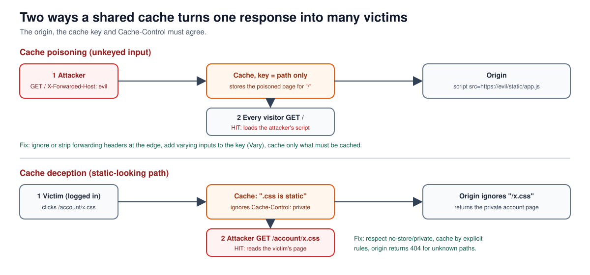

# Lab: Attacking caching layers (cache poisoning, cache deception, Memcached exposure)

**Course topic:** "Attacking Caching Layers (Memcache, Proxies, etc.)". Lesson: [02 section 1](../../02-caching-graphql-soap-and-microservices.md#1-attacking-caching-layers-memcache-proxies-etc).

**Time:** 45 minutes. **Tests:** 7, all offline. **Safety:** an in-process origin and a dict-based cache; the "card number" is FAKE. Only test systems you own or have written permission to test.

## Goal

Poison a shared cache with one request so every visitor loads the attacker's script, then trick the cache into storing a victim's private page for the attacker to read. Then fix the cache key, the origin and the caching rules.

## Concept



| Attack | Root cause | Fix |
|---|---|---|
| **Web cache poisoning** | The response depends on an **unkeyed** input (`X-Forwarded-Host`), so one poisoned response is served to everyone | Do not use unkeyed headers in responses; or add them to the cache key / `Vary`; strip them at the edge |
| **Web cache deception** | Cache decides "static" by file extension; origin ignores the extra path (`/account/x.css` → account page) | Respect `Cache-Control: private/no-store`; cache by content type and explicit rules; origin returns 404 for unknown paths |
| **Exposed Memcached / Redis** | No auth, listening on all interfaces, UDP on | Bind privately, firewall, SASL/ACLs, TLS, UDP off |

## Steps

1. Run the demo and follow the four lines per block.
2. Make the secure cache use `key = (path,)` again but keep the fixed origin. Is the page still safe? (Yes: the origin ignores the header. Defence in depth means fixing both.)
3. Add `Vary: X-Forwarded-Host` handling to the vulnerable cache instead of a custom key.
4. Why did the 2018 Memcached DDoS reach 1.3 Tbps? (UDP reflection with amplification factors in the tens of thousands.)

## Run

```text
.venv/Scripts/python appsec-course/13-owasp-api-top-10-and-other-threats/labs/cache-poisoning-deception/demo.py
.venv/Scripts/python -m pytest appsec-course/13-owasp-api-top-10-and-other-threats/labs/cache-poisoning-deception -q -p no:cacheprovider
```

## Expected output (real run)

```text
===== VULNERABLE cache + origin =====
1 attacker GET / with X-Forwarded-Host: evil.example -> ('<script src="https://evil.example/static/app.js"></script>', 'MISS')
  victim   GET / (no special headers)             -> ('<script src="https://evil.example/static/app.js"></script>', 'HIT')
2 victim clicks /account/nothing.css               -> 200 MISS
  attacker GET /account/nothing.css (no cookie)   -> 200 user=victim card=FAKE-CARD-4111 HIT

===== SECURE cache + origin =====
1 attacker GET / with X-Forwarded-Host: evil.example -> ('<script src="https://shop.lab.example/static/app.js"></script>', 'MISS')
  victim   GET / (no special headers)             -> ('<script src="https://shop.lab.example/static/app.js"></script>', 'MISS')
2 victim clicks /account/nothing.css               -> 404 MISS
  attacker GET /account/nothing.css (no cookie)   -> 404 not found MISS

== Memcached exposure audit ==
{'listen': '0.0.0.0', 'udp_port': 11211, 'internet_facing': True} -> ['listens on all interfaces: bind to localhost or a private interface', 'UDP enabled: disable (-U 0) to prevent amplification attacks', 'no SASL authentication', 'no TLS: cached values travel in clear text', 'reachable from the internet: restrict with security groups/firewall']
{'listen': '10.0.4.12', 'udp_port': 0, 'sasl': True, 'tls': True} -> clean
```

## Run the real tool (hedged)

- **Param Miner** (Burp extension) guesses unkeyed headers and parameters; PortSwigger Web Security Academy has free cache poisoning and deception labs.
- Check CDN rules (Cloudflare, Akamai, CloudFront, Fastly) for "cache everything" or extension-based rules, and test with a cache-buster query parameter so you never poison real users.
- For Memcached/Redis: `nmap -sU -p 11211 --script memcached-info <lab-host>` and `redis-cli -h <lab-host> PING` in the lab only.

## What you learned

- Caches multiply mistakes: one poisoned or private response is served to many users.
- The origin, the cache key and the `Cache-Control` headers must agree.
