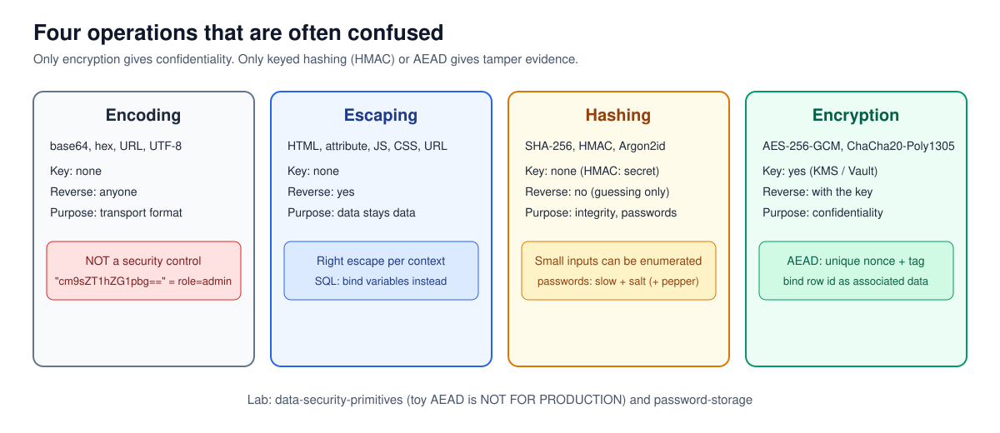

# Lesson 02: Data Security: Encoding, Escaping, Hashing, Encryption, Passwords, Service Credentials and TLS

**Syllabus items covered:** "Data Security", "Encoding and Decoding", "Escaping", "Hashing", "Encryption and Decryption", "Securing Data at Rest Using Encryption", "Storing Credentials for Service-to-Service Communication", "Password Storage and Its Considerations", "Picking a Secure Algorithm", "Securing Data in Transit Using TLS" ([CASP 7]).

**Time:** 2 hours. **Labs:** [data-security-primitives](labs/data-security-primitives/README.md), [password-storage](labs/password-storage/README.md). Implementation in a real service (Vault, TLS, logging) is in [chapter 15](../15-implementing-api-security-mechanisms/README.md).

## 1. Data security in one table

Developers often mix up four operations. Interviewers ask about this often.

| | Purpose | Key? | Reverse? | Example | Not a protection against |
|---|---|---|---|---|---|
| **Encoding** | Represent data safely for transport or storage | No | Anyone can | base64, hex, URL encoding, UTF-8 | Anything. It is not secret. |
| **Escaping** | Make data inert for one interpreter | No | Yes | HTML entity encoding, JS string escaping | Injection into a **different** context |
| **Hashing** | Fixed-size fingerprint; one-way | No (HMAC: yes) | No | SHA-256 for integrity; Argon2id for passwords | Guessing when inputs are few |
| **Encryption** | Confidentiality (AEAD also gives integrity) | Yes | With the key | AES-256-GCM, ChaCha20-Poly1305 | A thief who also has the key |

## 2. The four operations in detail

### 2.1 Encoding and decoding

Base64 turns bytes into text so they survive JSON, headers and URLs. JWTs, Basic auth headers and Kubernetes Secrets are base64. **"Encoded" is not "encrypted":** `kubectl get secret -o yaml` plus `base64 -d` reveals the value. Watch for **double decoding** bugs: a WAF decodes once, the app decodes twice, and `%253Cscript%253E` gets through.

### 2.2 Escaping

Escaping changes characters that mean something to one interpreter: `<` becomes `&lt;` in HTML; `"` becomes `\"` in a JS string. The right escape **depends on the context** (HTML body, attribute, JS, CSS, URL). Chapter 12 has the per-context encoding lab. For SQL, do not escape: use **bind variables** (prepared statements). For an Oracle DBA this is familiar: binds stop injection and also help the shared pool.

### 2.3 Hashing

A cryptographic hash (SHA-256, SHA-3) maps any input to a fixed digest. It is one-way, and a tiny change in input changes the whole digest. Uses:

- **Integrity** of files and artifacts (checksums, SBOM digests, container image digests).
- **HMAC** (hash plus secret key) for **authenticity**: webhook signatures, JWT HS256, signed cookies. Compare tags in constant time.
- **Pseudonymization**: HMAC an identifier so analysts can join on it without seeing it.
- **Passwords**: only with a **slow, salted** password hash (section 4).

The trap: a plain hash of a **small input space** (4-digit PIN, phone number, card last-4 plus BIN) can be reversed by trying every value. The lab reverses a PIN in under 10,000 tries.

### 2.4 Encryption and decryption

- **Symmetric** (one key): AES, ChaCha20. Fast; used for data.
- **Asymmetric** (key pair): RSA, ECDH/ECDSA, Ed25519. Used for key exchange and signatures.
- Use an **AEAD** mode: **AES-GCM** or **ChaCha20-Poly1305**. AEAD gives confidentiality **and** integrity, and can bind **associated data** (for example the row id) so a ciphertext cannot be moved to another record.
- AES-GCM essentials: 256-bit key, 96-bit **nonce that must never repeat** with the same key (nonce reuse breaks both confidentiality and authenticity), 128-bit tag. Use a library (`cryptography`, Tink, libsodium, the JCA with `AES/GCM/NoPadding`), never your own.
- Never use ECB mode, or CBC without a MAC (padding-oracle attacks).

> The lab's `ToyAEAD` is **NOT FOR PRODUCTION**. It copies the *interface* of an AEAD so you can see nonces, tags and associated data without installing a package.

## 3. Securing data at rest using encryption

Layers, from coarse to fine:

| Layer | Protects against | Does not protect against |
|---|---|---|
| Disk / volume encryption (BitLocker, LUKS, EBS encryption) | Stolen disks, decommissioned hardware | Anyone who can log in to the running host |
| Database TDE (Oracle TDE, SQL Server TDE) | Stolen data files and backups | SQL users who can `SELECT`, SQL injection |
| **Field-level / application encryption** | DBAs, SQL injection dumps, backups, analytics copies | An attacker inside the app process with the key |
| Tokenization (a vault maps tokens to values) | Removes the data from most systems (PCI scope reduction) | The tokenization service itself |

**Envelope encryption:** each record (or table) gets a **data encryption key (DEK)**. The DEK is encrypted ("wrapped") by a **key encryption key (KEK)** in a KMS or HSM. Rotating the KEK only needs **re-wrapping** DEKs, not re-encrypting all data. AWS KMS `GenerateDataKey`, Azure Key Vault and Vault Transit all work this way.

**Key management rules:** keys never in the same place as the data; key versions in the ciphertext (`k2:...`); scheduled rotation; access to decrypt logged; separation of duties (the DBA cannot decrypt, the app cannot export keys).

## 4. Password storage and picking a secure algorithm

**Considerations:**

1. Never store passwords reversibly (no encryption, no base64).
2. Use a **slow, salted, memory-hard** password hash. Fast hashes (MD5, SHA-1, SHA-256) allow billions of GPU guesses per second.
3. A unique random **salt** per user (16 bytes) stops rainbow tables and hides users who share a password.
4. An optional **pepper**: a secret key in a secret manager or HSM, applied with HMAC before hashing. A stolen database alone is then useless.
5. Store the algorithm and parameters with the hash (`$argon2id$v=19$m=19456,t=2,p=1$...`) so you can **raise the cost later**, and **upgrade on login**.
6. Constant-time comparison; the same work for unknown users (no user enumeration by timing).
7. Limit input length sensibly (for example 64–128 characters) to avoid hashing DoS, but allow long passphrases.

**Picking a secure algorithm** (OWASP Password Storage Cheat Sheet, verify current parameters):

| Choice | When | Parameters (verify) |
|---|---|---|
| **Argon2id** | Default for new systems | m=19 MiB, t=2, p=1 (minimum example) or stronger |
| **scrypt** | Argon2id unavailable | N=2^17, r=8, p=1 |
| **bcrypt** | Legacy systems | cost 10 or more; inputs over **72 bytes** are truncated, so pre-hash carefully or choose another algorithm |
| **PBKDF2-HMAC-SHA256** | FIPS-140 compliance required | about **600,000** iterations |

**Password rules (NIST SP 800-63B-4, final 2025; verify):** at least **15 characters** when a password is the only factor, **8** with MFA; allow at least 64; no composition rules ("one symbol, one digit"); **no periodic forced rotation** (only change on evidence of compromise); check new passwords against **breached and common** lists; allow paste and password managers.

## 5. Storing credentials for service-to-service communication

Your API calls a database, a payment provider and other microservices. Each call needs a credential. In order of preference:

1. **No static secret at all: workload identity.** Cloud IAM roles (AWS IAM roles for service accounts, Azure Managed Identity, GCP Workload Identity), **SPIFFE/SPIRE** identities with **mTLS**, or OAuth 2.0 **client credentials** with short-lived tokens. Credentials are minted automatically and expire in minutes.
2. **Dynamic secrets:** a secret manager creates a database user per service instance with a lease (Vault/OpenBao database engine) and revokes it on expiry. Chapter 15 has the lab.
3. **Static secrets in a secret manager** (Vault/OpenBao KV, AWS Secrets Manager, Azure Key Vault, GCP Secret Manager), fetched at startup with the service's own identity, cached in memory, rotated on a schedule.
4. **Never:** in source code, in container images, in `docker-compose.yml`, in CI logs, in plain environment variables visible to every process and crash dump, or in a shared "service account" password used by ten teams.

Rules: one credential per service (blast radius, audit); least-privilege grants (the orders service gets `SELECT, INSERT` on its own schema, not `DBA`); rotation without downtime (two valid versions during the switch); alert on use from unexpected places. Deep dives: [devsecops ch13 secrets management](../../devsecops-course/13-secrets-management/README.md), [cmcpse ch4](../../cmcpse-course/README.md) (secrets for MCP servers), and [chapter 15 lesson 03](../15-implementing-api-security-mechanisms/03-secrets-data-security-and-tls.md).

## 6. Securing data in transit using TLS

- **TLS 1.3** preferred, **TLS 1.2** minimum; disable SSLv3, TLS 1.0 and 1.1.
- TLS 1.2 cipher suites with **ECDHE** (forward secrecy) and **AEAD** (GCM, ChaCha20-Poly1305) only; no RC4, 3DES, CBC-SHA1 export suites.
- Valid certificates from a trusted CA, automated renewal (ACME), full chain, short lifetimes. Clients must **verify** certificates and hostnames: `verify=False` in Python `requests` is a finding.
- **HSTS** for browser-facing APIs (lesson 03).
- **mTLS** between services and for B2B partners; it doubles as service authentication.
- TLS ends at a load balancer? Then the hop from the LB to the app also needs TLS, or a documented and isolated network.

The TLS test lab is already in the repo: [devsecops ch06 TLS and server misconfiguration](../../devsecops-course/06-dynamic-analysis/03-tls-and-server-misconfiguration-testing.md) and its [tls-misconfiguration-checks lab](../../devsecops-course/06-dynamic-analysis/labs/tls-misconfiguration-checks/README.md). Implementation details (certificates, mTLS, configs) are in [chapter 15 lesson 03](../15-implementing-api-security-mechanisms/03-secrets-data-security-and-tls.md).

## 7. Scenario: the base64 "encryption"

A loan-processing API stores PAN (India's tax ID) numbers in a `customers` table "encrypted", according to the design document. A code review finds `base64.b64encode(pan)`. A support analyst with read-only SQL access exports 40,000 rows for a "report". Under India's **DPDP Act** this is a personal data breach the company must report.

**Fix:** field-level AEAD encryption with keys in a KMS, the customer id as associated data, a keyed HMAC column for exact-match search, and a masked view (`XXXXX1234F`) for support staff. The DBA analogy: a VPD policy plus encryption, so even `SELECT *` returns ciphertext.

## 8. Checklist

- [ ] I can explain encoding vs escaping vs hashing vs encryption with an example each.
- [ ] I can explain AEAD, nonce reuse and associated data.
- [ ] I know the four password algorithms in order of preference and their main parameter.
- [ ] I can list four ways to give a service a credential, from best to worst.
- [ ] I know the TLS baseline and where to test it.

## References

- OWASP Cryptographic Storage, Password Storage, Secrets Management and Transport Layer Security cheat sheets.
- NIST SP 800-63B-4 (Digital Identity Guidelines, Authentication); NIST SP 800-38D (GCM); NIST SP 800-57 (key management).
- RFC 8446 (TLS 1.3); Mozilla Server Side TLS guidelines (ssl-config.mozilla.org).
- SPIFFE/SPIRE documentation; cloud KMS docs for envelope encryption.
