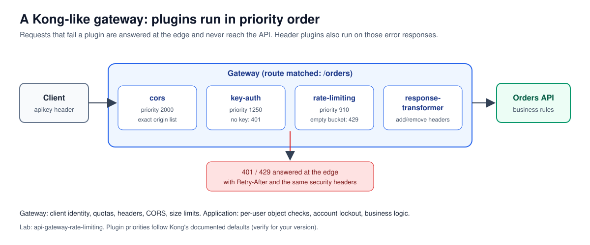

# Lesson 04: Rate Limiting Best Practices and API Gateways (Kong)

**Syllabus items covered:** "Rate Limiting Best Practices", "Implementing Rate Limiting With API Gateway", "Securing HTTP Headers using Kong Gateway", "Implementing Rate Limiting using API Key" ([CASP 7]).

**Time:** 90 minutes. **Lab:** [api-gateway-rate-limiting](labs/api-gateway-rate-limiting/README.md). **Real tool:** [real-tools/kong-gateway.md](real-tools/kong-gateway.md). Rate limiting at every layer (reverse proxy, load balancer, WAF) and the algorithms compared side by side are in [chapter 15 lesson 02](../15-implementing-api-security-mechanisms/02-rate-limiting-at-every-stage.md).



## 1. Rate limiting best practices

Rate limiting answers OWASP API4:2023 **Unrestricted Resource Consumption** and slows brute force (API2) and business-flow abuse (API6).

1. **Limit by the right identity.** Per API key (client app), per user (token `sub`), per IP (anonymous endpoints), per tenant. Usually several at once.
2. **Different limits per endpoint.** Login, OTP, password reset and search need much tighter limits than `GET /products`. Expensive operations (exports, reports) get their own quota.
3. **Return `429 Too Many Requests` with `Retry-After`** and the `RateLimit-*` headers (IETF draft, verify) so good clients back off.
4. **Fail closed for security limits** (login), and decide deliberately for availability limits.
5. **Shared state** for clusters: a limit kept in one node's memory is multiplied by the number of nodes. Use Redis or the gateway's cluster policy.
6. **Complement, do not replace,** account-level controls: lockout or progressive delays per account, MFA, CAPTCHA as a friction signal (chapter 10). A per-IP limit does not stop a botnet spraying one password across many accounts.
7. **Limit the size and cost of each request** too: body size, page size, GraphQL cost (lesson 01), upload size, timeouts.
8. **Monitor:** alert on many 429s from one key (abuse, or a broken client) and on spikes in 401s (credential stuffing).
9. **Bypass carefully:** allowlists for health checks and partners must be narrow and reviewed.

## 2. Implementing rate limiting with an API gateway

An **API gateway** (Kong, Apache APISIX, Envoy Gateway, Tyk, AWS API Gateway, Azure API Management) is the single front door. Doing rate limiting there means:

- every service gets it without code changes;
- blocked requests **never reach** the backend (the lab's upstream saw 5 login calls out of 30);
- one place to see and tune limits.

In Kong, the bundled `rate-limiting` plugin counts requests per `second/minute/hour/day` window, identified by `consumer`, `credential`, `ip`, `header`, `path` or `service`, with a `local`, `cluster` or `redis` policy (verify the current options). The lab uses a token bucket to show refill and bursts.

Limits on login endpoints are **per IP** (there is no consumer yet). Limits on authenticated endpoints are **per consumer or key**.

## 3. Implementing rate limiting using API key

API keys identify the **calling application**, not the end user. Typical design:

- Each partner or app is a **consumer** with one or more keys (`key-auth` in Kong).
- Plans (free, gold, internal) set different quotas per consumer.
- The gateway sets `X-Consumer-Username` (and **overwrites** anything the client sent; the lab tests this).
- Keys are secrets: generated randomly, shown once, stored hashed if possible, rotated, revocable, sent in a header (never in the URL, where they end up in logs).
- API keys alone are **not** user authentication. For user data, combine them with OAuth tokens (chapter 11).

## 4. Securing HTTP headers using Kong gateway

Kong does not have a dedicated "security headers" plugin in its open-source set. The usual approach is the **`response-transformer`** plugin (or a small custom plugin) applied globally (verify against current Kong docs):

```yaml
# decK file fragment (sketch, verify field names for your Kong version)
plugins:
  - name: response-transformer
    config:
      remove:
        headers: ["Server", "X-Powered-By"]
      add:
        headers:
          - "Strict-Transport-Security:max-age=31536000; includeSubDomains"
          - "Content-Security-Policy:default-src 'none'; frame-ancestors 'none'"
          - "X-Content-Type-Options:nosniff"
          - "Cache-Control:no-store"
          - "X-XSS-Protection:0"
  - name: cors
    config:
      origins: ["https://shop.example"]
      credentials: true
```

Points to remember:

- Headers set at the gateway apply to **error responses** generated by the gateway too (401, 429). The lab checks this.
- Kong itself adds `Server: kong/x.y` and `Via` headers. Turn them off with the `headers` setting in `kong.conf` (verify).
- For HTML responses, the CSP nonce must come from the application. The gateway can only add a static policy.

## 5. Scenario: the OTP endpoint

A food-delivery app sends a 6-digit OTP for login. The gateway limit is "100 requests per minute per IP", applied to every route. An attacker uses 300 residential proxy IPs at 50 requests per minute each and tries 15,000 OTPs per minute. The OTP is valid for 10 minutes, so 150,000 guesses cover 15% of the code space per OTP.

**Fixes:** a per-**phone-number** limit in the app (5 attempts, then the OTP is burned); an OTP endpoint limit of 5 per minute per IP at the gateway; alerting on a 401 spike across many IPs; longer OTPs or app-based push with number matching.

## 6. Checklist

- [ ] I can list seven rate-limiting best practices.
- [ ] I can explain why the gateway is a good place for limits and headers, and what must stay in the application.
- [ ] I can configure per-IP and per-key limits in the lab config and predict the 429s.
- [ ] I can add and remove headers with a response transformer.

## References

- OWASP API Security Top 10 2023: API4 and API6.
- Kong Gateway docs: rate-limiting, key-auth, response-transformer, cors plugins; decK (verify current versions and licensing).
- IETF draft "RateLimit header fields for HTTP" (verify status); RFC 6585 (429).
- Repo: [secure LLM/AI gateway](../../09-enterprise-architecture/06-secure-llm-ai-gateway.md) for the same gateway ideas applied to AI traffic.
