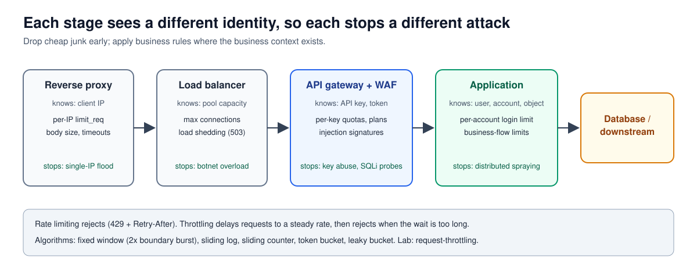

# Lesson 02: Rate Limiting at Different Stages and Request Throttling

**Syllabus items covered:** "Rate-Limiting Implementation and Best Practices at Different Stages", "Reverse Proxy", "Load Balancer", "API Gateways and WAFs", "Request Throttling" ([CASP 8]).

**Time:** 75 minutes. **Lab:** [request-throttling](labs/request-throttling/README.md). Best practices and the Kong gateway lab: [chapter 14 lesson 04](../14-api-defenses-data-security-and-headers/04-rate-limiting-and-api-gateways.md).

## 1. Why more than one stage?

Each component in front of your API sees a different **identity** and costs a different amount to run. Drop junk as early (cheaply) as possible, and apply business rules where the business context exists.

| Stage | Knows | Good at | Blind to |
|---|---|---|---|
| CDN / DDoS service | IP, geography, volumetric patterns | Layer 3/4 and huge layer 7 floods | Users, accounts |
| Reverse proxy | Client IP, path, connection | Per-IP request and connection limits, body size | Who the user is |
| Load balancer | Whole pool, backend health | Total capacity, connection limits, shedding | Individual abusers |
| API gateway + WAF | API key, consumer, token claims, signatures | Per-client quotas, plans, injection signatures | Business logic |
| Application | User, account, object, business action | Per-account login attempts, per-user expensive actions, business-flow limits (API6) | Floods (too late and too expensive) |

## 2. Reverse proxy

NGINX, HAProxy, Envoy or Traefik in front of the app:

- `limit_req` (NGINX) per `$binary_remote_addr` with `burst` and `nodelay` (reject) or `delay=` (throttle).
- `limit_conn` for concurrent connections; `client_max_body_size`; timeouts (`client_body_timeout`) against slow-loris.
- **Real client IP:** behind a CDN/LB the socket IP is the LB. Use `real_ip_header X-Forwarded-For` with `set_real_ip_from` restricted to your own proxies; otherwise attackers spoof `X-Forwarded-For` and bypass per-IP limits.

## 3. Load balancer

AWS ALB/NLB, Azure Front Door/Application Gateway, F5, HAProxy:

- Protects **total capacity**: max connections per backend, queue limits, health checks that eject failing nodes.
- **Load shedding** returns 503 when the pool is full. That is an availability control: it protects the service, not a specific victim account.
- Many cloud LBs integrate a WAF (AWS WAF rate-based rules, Azure WAF custom rate limits).

## 4. API gateways and WAFs

- **Gateway:** per consumer / API key / token `sub` / plan quotas; per-route limits (login tighter than catalog); cluster-wide counters (Redis); `429` with `Retry-After`. Kong, APISIX, Envoy Gateway, Tyk, AWS API Gateway usage plans, Azure APIM `rate-limit-by-key`.
- **WAF:** signature and anomaly rules (OWASP CRS on ModSecurity, now an OWASP project, or Coraza; cloud WAFs), bot management, rate-based rules. Tune in detection mode first; false positives on APIs (JSON bodies) are common.
- A WAF is a **compensating** control: it buys time, it does not fix injection.

## 5. Request throttling

**Rate limiting** rejects requests over a limit. **Throttling** slows them: requests are queued or delayed so the downstream sees a smooth rate, and only rejected when the wait becomes too long.

| Use throttling when | Use rejection when |
|---|---|
| Good clients send bursts (batch jobs, mobile reconnects) | The request is security-sensitive (login, OTP, coupon) |
| A downstream (database, partner API) has a fixed capacity | Holding connections would itself be a DoS risk |
| You want graceful degradation | You need a clear signal to the client (429) |

Algorithms (implemented in the lab):

- **Fixed window:** simple, but allows 2x the limit at the boundary.
- **Sliding window log:** exact, memory per request.
- **Sliding window counter:** approximation used by many gateways.
- **Token bucket:** average rate with bounded bursts; the most common choice.
- **Leaky bucket:** constant output rate; this is throttling.

## 6. Best practices across stages

1. Tightest limits on authentication, OTP, password reset, coupon/gift-card, search and export endpoints.
2. Limit by **several keys at once**: IP and account for login; key and user for APIs.
3. Share counters across instances; decide fail-open vs fail-closed if the counter store is down.
4. Return `429` + `Retry-After` (+ `RateLimit-*`); never `200` with an error body.
5. Monitor and alert on limit hits; tune limits from real traffic percentiles.
6. Document limits for API consumers (developer portal), so legitimate clients can back off.
7. Exempt nothing silently: health-check and partner allowlists are reviewed and narrow.

## 7. Scenario: the gift-card balance check

A retailer exposes `POST /giftcards/balance` with a 16-digit card number and a 4-digit PIN. The gateway limit is 100 requests per minute per API key, and the mobile app's key is public (it ships in the app). Attackers use the mobile key from 2,000 residential IPs. The WAF sees valid JSON. The gateway sees one key over its limit and starts returning 429 to **all real customers**.

**Fixes:** limits per IP **and** per card number in the application (5 failed PINs → card locked, owner notified); device attestation or a risk score for the mobile app; a CAPTCHA/friction step after failures; alerting on the failure ratio; never rely on a public API key for security.

## 8. Checklist

- [ ] I can say which identity each stage sees and which attack each stops.
- [ ] I can configure per-IP limits on a reverse proxy and explain the real-IP problem.
- [ ] I can explain throttling vs rate limiting and the boundary burst of fixed windows.
- [ ] I can design layered limits for a login endpoint.

## References

- OWASP API Security Top 10 2023 (API4, API6); OWASP Denial of Service Cheat Sheet.
- NGINX `ngx_http_limit_req_module`; HAProxy stick tables; Envoy local/global rate limiting; Kong, APISIX and Azure APIM rate-limit docs.
- IETF draft "RateLimit header fields for HTTP" (verify status); RFC 6585 (429).
