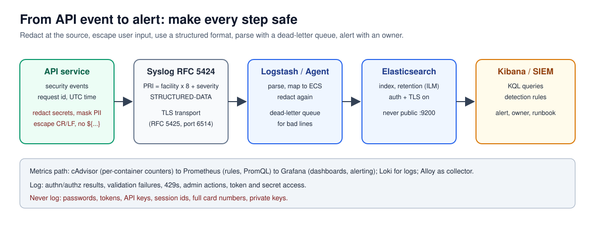

# Lesson 04: Sufficient Logging and Monitoring, Secure Logging, Syslog, ELK and Grafana

**Syllabus items covered:** "Implementing Sufficient Logging & Monitoring", "Secure Logging Implementation", "Logging Using Syslog Format", "Using ELK To Capture the Log Data", "Monitoring Docker Containers Using Grafana" ([CASP 8]).

**Time:** 2 hours. **Labs:** [secure-logging-syslog-elk](labs/secure-logging-syslog-elk/README.md), [container-metrics-alerting](labs/container-metrics-alerting/README.md). **Real tools:** [ELK and syslog](real-tools/elk-and-syslog.md), [Grafana for Docker](real-tools/grafana-docker-monitoring.md). SIEM use (Sentinel/Splunk): [cybersecurity-track 06](../../cybersecurity-track/06-siem-sentinel-splunk/README.md).



## 1. Implementing sufficient logging and monitoring

"Insufficient Logging & Monitoring" was API10 in the 2019 OWASP API Top 10 (dropped as its own item in 2023; now "Security Logging and Alerting Failures" in the OWASP Top 10:2025, verify). The point stands: without evidence you cannot detect or investigate.

**What to log (security events):**

| Event | Fields |
|---|---|
| Authentication success and failure, MFA events, lockouts | user, client id, source IP, user agent, outcome, reason |
| Authorization failures (403), especially object-level | user, action, resource id, policy that denied |
| Input validation failures and WAF blocks | endpoint, rule id (not the full payload if it contains PII) |
| Rate-limit hits (429) | key/consumer, IP, endpoint |
| Admin and high-value actions (refunds, role changes, exports, key rotation) | actor, target, before/after |
| Token issuance and revocation, secret access | client, scopes, lease ids |
| Application errors and exceptions | correlation id, error class (no stack trace to the client) |

**Every event:** UTC timestamp, service, environment, **request/correlation id**, outcome. Use a schema (Elastic Common Schema, OpenTelemetry semantic conventions) so queries work across services.

**Monitoring:** turn logs and metrics into **alerts** with owners and runbooks: brute force, credential stuffing (many users, few passwords), BOLA probing (many 403/404 on sequential ids), spikes in 5xx, unusual export volume, access from new countries for admin accounts.

## 2. Secure logging implementation

- **Never log** passwords, tokens, API keys, session ids, full card numbers, secrets, private keys, or full request bodies with PII. Redact by **field name** and by **pattern** at the source (the lab's `redact()`); mask PII (`a***@example.in`, `****1111`).
- **Prevent log injection:** structured (JSON) logging; escape CR/LF and control characters in any user input; never interpret user data as logging syntax (Log4Shell, CVE-2021-44228, came from `${jndi:...}` lookups in log messages).
- **Protect integrity and availability:** ship logs off the host quickly; append-only or WORM storage for audit logs; restrict who can delete; time sync (NTP).
- **Access control:** logs contain personal data; restrict and audit access; set retention per policy and law (DPDP, GDPR, PCI DSS requires one year with three months immediately available; verify).
- **Do not log at DEBUG in production** without redaction; debug logs are where secrets leak.
- **Reliability:** buffer and retry; a dead-letter queue for unparseable lines; alert when a source goes silent.

## 3. Logging using syslog format

**RFC 5424** is the current syslog format; RFC 3164 ("BSD syslog") is legacy.

```text
<PRI>VERSION TIMESTAMP HOSTNAME APP-NAME PROCID MSGID [STRUCTURED-DATA] MSG
<84>1 2026-11-19T10:00:00.000Z api-1 orders-api 4242 AUTHFAIL [audit@32473 action="login" outcome="failure" src="203.0.113.50"] login failed
```

- **PRI** = facility × 8 + severity. `authpriv` (10) and `warning` (4) give 84.
- **Severities:** 0 emerg, 1 alert, 2 crit, 3 err, 4 warning, 5 notice, 6 info, 7 debug.
- **STRUCTURED-DATA** carries key/value pairs; escape `"`, `\` and `]` in values. SD-IDs without `@` are IANA-registered; private ones use `name@<enterprise-number>` (32473 is the documentation example number).
- Transport: UDP 514 (lossy, spoofable), TCP, and **TLS** (RFC 5425, port 6514). Use TLS across networks.
- Tools: rsyslog, syslog-ng, `logger --rfc5424` for testing; most network devices and Linux hosts speak syslog, which is why SIEMs ingest it.

## 4. Using ELK to capture the log data

**ELK** = **E**lasticsearch (store and search) + **L**ogstash (ingest and transform) + **K**ibana (search UI, dashboards, alerting). Beats (Filebeat) or the newer **Elastic Agent** collect logs.

```text
app/syslog --> Filebeat / Elastic Agent / Logstash (parse, map to ECS, redact, enrich)
           --> Elasticsearch (index, retention via ILM)
           --> Kibana (KQL queries, dashboards, detection rules, cases)
```

- **Parse** into fields (grok/dissect for text, `json` for structured logs, `syslog` input for RFC 5424) and map to **ECS** names (`source.ip`, `user.name`, `event.outcome`).
- **Redact in the pipeline too** (defense in depth): Logstash `mutate`/`gsub`, ingest pipeline processors.
- **Query** with KQL: `event.action:login and event.outcome:failure and not source.ip:10.*`.
- **Secure the stack:** authentication and TLS on Elasticsearch (enabled by default in recent versions; verify), never expose port 9200 to the internet (many breaches are open Elasticsearch clusters), role-based access to indices, ILM retention.
- **Licensing (verify):** Elastic re-added an open-source **AGPL** option in 2024; **OpenSearch** (AWS-led fork, Linux Foundation) is the main alternative. Grafana Loki and OpenTelemetry Collector are common alternatives for log shipping and storage.

## 5. Scenario: the forged audit trail

During an investigation of a fraudulent refund, the audit log shows `user=admin approved refund 8841`. The admin denies it. Investigators later find the preceding line: a support ticket subject containing a newline and a fake log line was logged verbatim by the ticketing API. The "approval" never happened; the real refund was created by a compromised integration client, whose events were not logged at all.

**Lessons:** structured logs with escaped values (lab step 2); log the **actor's client id** for every privileged action; alert on refunds by integration clients; logs are evidence, so their integrity matters.

## 6. Monitoring Docker containers with cAdvisor, Prometheus and Grafana

- **cAdvisor** exposes per-container CPU, memory, network and filesystem metrics at `/metrics`.
- **Prometheus** scrapes and stores them; **alerting rules** (PromQL) fire to Alertmanager.
- **Grafana** builds dashboards (import a community "Docker/cAdvisor" dashboard, verify the id) and can alert too. **Loki** adds container logs to the same views. **Grafana Alloy** replaced Grafana Agent (Agent EOL Nov 2025).
- Security-relevant signals: CPU anomalies (miners), unexpected egress (exfiltration), restarts (crash loops, exploitation), new or missing containers, no memory limits. The [container-metrics-alerting lab](labs/container-metrics-alerting/README.md) computes these from fixtures.
- Protect the monitoring stack itself: cAdvisor mounts the Docker socket and host paths read-only and should not be exposed; Grafana with SSO and no anonymous admin; Prometheus behind auth.
- Runtime detection (Falco, Tetragon) and container security monitoring in depth: [devsecops ch12](../../devsecops-course/12-container-security-monitoring/README.md).

## 7. Checklist

- [ ] I can list what an API must log for security and what it must never log.
- [ ] I can explain log injection and two defenses.
- [ ] I can compute a syslog PRI and write an RFC 5424 line with structured data.
- [ ] I can draw the ELK pipeline and write a KQL query.
- [ ] I can name four container metrics that matter for security and the PromQL idea for each.

## References

- OWASP Logging Cheat Sheet and Logging Vocabulary Cheat Sheet; OWASP Top 10:2025 A09 (verify name).
- RFC 5424 (syslog), RFC 5425 (syslog over TLS), RFC 5612 (documentation enterprise number).
- Elastic Common Schema; Elastic/Kibana and OpenSearch docs; Prometheus, cAdvisor and Grafana docs.
- NIST SP 800-92 (log management; a revision was in draft, verify).
