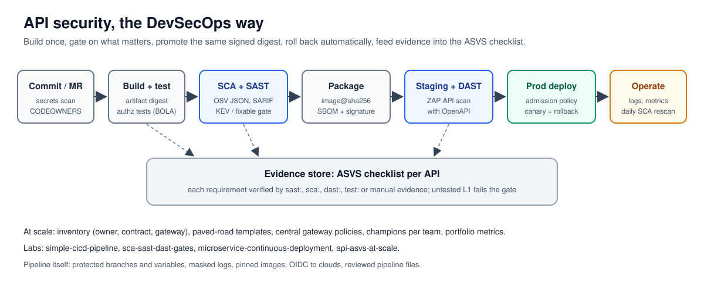

# Lesson 03: Addressing API Security at Scale, and API Security in CI/CD

**Syllabus items covered:** "Addressing API Security Issues at Scale", "Creating a Simple CI/CD Pipeline", "Deploying a Microservice(s) Using Continuous Deployment", "Embedding Software Composition Analysis Into CI/CD Pipeline", "Embedding Static Application Security Testing Into CI/CD Pipeline", "Embedding Dynamic Application Security Testing Into CI/CD Pipeline" ([CASP 9]); the same integration items from [CSC 5].

**Time:** 90 minutes. **Labs:** [api-asvs-at-scale](labs/api-asvs-at-scale/README.md), [simple-cicd-pipeline](labs/simple-cicd-pipeline/README.md), [microservice-continuous-deployment](labs/microservice-continuous-deployment/README.md), [sca-sast-dast-gates](labs/sca-sast-dast-gates/README.md).

## 1. Addressing API security issues at scale

One API can be secured by a careful team. Two hundred APIs across thirty teams need a **system**:

| Lever | What it means | Lab or chapter |
|---|---|---|
| **Inventory** | Every API, version, owner, contract, exposure (internet/partner/internal), data class. Discover from gateways, cloud accounts, DNS, traffic and code. | [api-asvs-at-scale](labs/api-asvs-at-scale/README.md) hygiene findings |
| **Contracts** | OpenAPI/GraphQL/AsyncAPI in the repo; linted (Spectral); diffed for breaking and risky changes | [chapter 09](../09-api-tooling-and-reconnaissance/README.md) |
| **Paved road** | Shared auth middleware, authorization library, logging with redaction, service template with secure defaults | [chapter 15](../15-implementing-api-security-mechanisms/README.md) |
| **Central gateway policies** | Authentication, rate limits, headers, CORS, schema validation for every API | [chapter 14](../14-api-defenses-data-security-and-headers/README.md) |
| **Policy as code** | Authorization (OPA/Cedar), pipeline policies, admission policies | [chapter 11](../11-api-authorization-and-oauth/README.md), [CD lab](labs/microservice-continuous-deployment/README.md) |
| **Automated discovery in every pipeline** | SCA, SAST, DAST, secrets, IaC, with consistent gates | [sca-sast-dast-gates](labs/sca-sast-dast-gates/README.md) |
| **Checklists with evidence** | ASVS per API, evidence from pipelines, portfolio dashboard | [api-asvs-at-scale](labs/api-asvs-at-scale/README.md) |
| **Runtime** | Gateway and app logs to a SIEM, API anomaly detection, alerting | [chapter 15 lesson 04](../15-implementing-api-security-mechanisms/04-logging-and-monitoring.md) |
| **People** | Security champions per team, training, threat modeling of new APIs | [chapter 01](../01-security-champions-and-appsec-basics/README.md), [17](../17-agile-communication-and-soft-skills/README.md) |
| **Metrics** | Coverage, mean time to remediate, findings per API, zombie APIs retired | Portfolio view |

## 2. Creating a simple CI/CD pipeline

Minimum stages for an API service: **build → test → security scans → package (image, SBOM, signature) → deploy to staging → DAST → deploy to production**. Security properties of the pipeline itself:

- Pipeline definition reviewed like code (CODEOWNERS on `.gitlab-ci.yml`), validated (CI Lint).
- **Protected branches** and **protected, masked variables**; no secrets for merge requests from forks.
- Explicit **artifacts** with digests; build once, promote the same artifact.
- Short-lived cloud credentials through **OIDC**, not stored keys.
- Pinned CI images and actions (by digest), minimal runner permissions, isolated runners for production deploys.

The [simple-cicd-pipeline lab](labs/simple-cicd-pipeline/README.md) shows each of these. GitLab specifics: [devsecops ch02 GitLab guide](../../devsecops-course/02-tools-pipelines-and-secure-sdlc/real-tools/gitlab-ci.md), [csse ch1 GitLab stages](../../csse-course/ch1-introduction-to-supply-chain-security/05-cicd-stages-and-deployment.md#23-working-with-gitlab-cicd).

## 3. Continuous integration vs continuous delivery vs continuous deployment

- **Continuous integration:** every change is merged often and built and tested automatically.
- **Continuous delivery:** every passing build is **ready** to release; a human presses the button.
- **Continuous deployment:** every passing build **goes to production** automatically.

Continuous deployment is only safe with strong automated gates, progressive delivery and automatic rollback. Full background: [devsecops ch01 lesson 02](../../devsecops-course/01-devops-devsecops-and-maturity/02-cicd-and-deployment-strategies.md).

## 4. Deploying microservices using continuous deployment

- **Immutable, digest-pinned images**, signed (cosign/Sigstore), with an SBOM attestation.
- **Admission control** in the cluster (Kyverno, OPA Gatekeeper, Sigstore policy-controller) rejects unsigned, unscanned or tag-only images.
- **Promotion:** the same digest goes dev → staging → prod; prod only accepts what passed staging.
- **Dependency order** and backward-compatible API changes (expand, migrate, contract), so a new `orders` does not break the old `gateway`.
- **Progressive delivery:** rolling updates with readiness probes; canaries with metric analysis (Argo Rollouts, Flagger); feature flags.
- **Automatic rollback** on failed health checks or bad metrics (error rate, latency, 401/403 spikes).
- **GitOps** (Argo CD, Flux): the cluster state is in git, so every change is reviewed and auditable.

The [microservice-continuous-deployment lab](labs/microservice-continuous-deployment/README.md) simulates admission, rolling, canary and rollback.

## 5. Embedding SCA, SAST and DAST into the pipeline

| Gate | Where | Blocking policy (example) | Output |
|---|---|---|---|
| Secrets | pre-commit and every MR | any verified secret | block + rotate the secret |
| SCA | every build + daily on main | KEV-listed, or HIGH/CRITICAL with a fix | SBOM, OSV/JSON |
| SAST | every MR | high-confidence HIGH/CRITICAL rules | SARIF in the MR |
| IaC / container scan | every MR / image build | critical misconfig, critical CVEs with fix | SARIF/JSON |
| DAST | after deploy to staging; full scan nightly | High risk alerts | ZAP JSON/HTML, tickets |

Rules that make gates work: **fail on what matters**, warn on the rest; suppressions with owner, reason and **expiry**; findings go to a tracker (DefectDojo, GitLab vulnerability report); measure time to fix. The [sca-sast-dast-gates lab](labs/sca-sast-dast-gates/README.md) implements these over SARIF, OSV JSON and ZAP JSON and runs them inside the pipeline.

## 6. Scenario: two hundred APIs and one spreadsheet

A retail group's security team tracks APIs in a spreadsheet updated quarterly. A gateway log analysis finds 37 APIs not in the sheet, 9 of them reachable from the internet, 4 without authentication. The fix programme: gateway-only exposure (no direct ingress), automatic inventory from the gateway and cloud accounts, a service template with the security pipeline built in, one champion per team, and an ASVS portfolio dashboard reviewed monthly. Within two quarters, unknown APIs drop to zero and median fix time for high findings falls from 60 to 12 days.

## 7. Checklist

- [ ] I can list ten levers for API security at scale.
- [ ] I can describe a secure pipeline for an API service, stage by stage.
- [ ] I can explain CI vs continuous delivery vs continuous deployment.
- [ ] I can list five controls for safe continuous deployment of microservices.
- [ ] I can design SCA/SAST/DAST gates with a blocking policy and a suppression process.

## References

- OWASP API Security Top 10 2023 (API9 Improper Inventory Management); OWASP DevSecOps Guideline; OWASP SAMM.
- NIST SP 800-218 (SSDF); NIST SP 800-204 series (microservices security); SLSA; Sigstore.
- Argo Rollouts, Flagger, Kyverno, OPA Gatekeeper docs; GitLab CI security templates.
