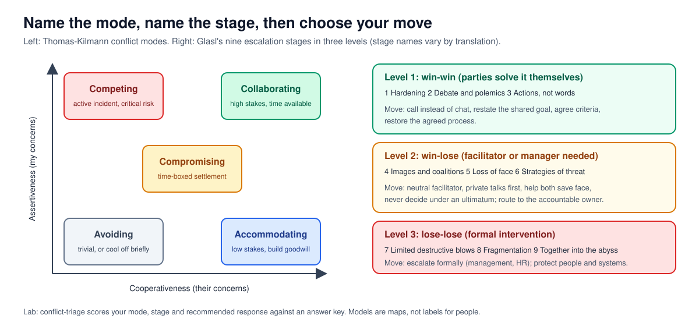

# Lesson 02: Conflict Management: Framework, Types and Patterns, De-escalation

**Syllabus items covered:** "Exploring conflict management framework", "Exploring types and patterns of conflicts", "Deescalating levels of conflict" ([CSC 7]).

**Time:** 75 minutes. **Labs:** [conflict-triage](labs/conflict-triage/README.md), [role-play-workbook](labs/role-play-workbook/README.md) scenarios 3 and 4. A short treatment of conflict for SOC work is in [cybersecurity-track 12 lesson 04 section 2.6](../../cybersecurity-track/12-soft-skills/04-working-with-it-devops-and-influence.md#26-handling-conflict); this lesson goes deeper.

> **Models are maps, not laws.** The frameworks below are widely taught simplifications. Use them to name what is happening and choose a response; do not use them to label people.

## 1. Exploring the conflict management framework (Thomas-Kilmann)

The **Thomas-Kilmann model** (Kenneth Thomas and Ralph Kilmann, 1970s) places responses to conflict on two axes: **assertiveness** (how much you pursue your own concerns) and **cooperativeness** (how much you pursue the other person's concerns). That gives five modes:

| Mode | Assertive | Cooperative | Looks like | Use it when | Risk when overused |
|---|---|---|---|---|---|
| **Competing** | high | low | "This must be fixed now." | Emergencies (active incident, critical exposure), unpopular but necessary decisions | Resentment; people stop telling you things |
| **Collaborating** | high | high | "Let's find a solution that works for both." | High stakes and an ongoing relationship, with time available | Slow; overkill for small issues |
| **Compromising** | medium | medium | "Patch half now, half next month." | Moderate stakes, time pressure, temporary settlements | Both sides half-satisfied; security can be traded away |
| **Avoiding** | low | low | "Let's talk about it later." | Trivial issues, cooling-off time, someone else is better placed | Problems grow; risk is silently accepted |
| **Accommodating** | low | high | "Fine, do it your way." | Low stakes for you, building goodwill, you were wrong | Being walked over on things that matter |

For a security champion: **collaborating** is the default for important issues, **competing** is reserved for real urgency (and followed by repair), **accommodating** is fine for low-stakes items (it builds credit), **avoiding** is a temporary tactic, never a way to accept risk. The [conflict-triage lab](labs/conflict-triage/README.md) encodes this as `recommend_mode()`.

Other useful frameworks:

- **Interest-Based Relational (IBR) approach** (Fisher and Ury, *Getting to Yes*): separate people from the problem; focus on interests, not positions; invent options for mutual gain; use objective criteria. "We need the release this week" (position) hides "marketing promised a date" (interest).
- **Escalation ladder** (next sections) to judge how far a conflict has gone.

## 2. Exploring types and patterns of conflicts

### 2.1 Types

| Type | About | Security example | What helps |
|---|---|---|---|
| **Task / content** | What to do | Fix in the gateway or in the app? | Facts, data, design decision records |
| **Process** | How to do it | Who triages WAF alerts? What blocks a build? | Clear rules, RACI, agreed SLAs |
| **Relationship** | People, trust, style | "Security always blames devs." | Private one-to-ones, empathy, blameless language |
| **Status / role** | Power, territory | Platform team vs app team ownership | Clear mandates from management |
| **Values** | What matters most | Speed vs safety | Shared goals, business-language risk |
| **Resource** | Time, people, budget | Sprint capacity | Prioritisation frameworks (lesson 01) |

Task conflict handled well improves decisions; relationship conflict almost always hurts. Task conflicts **turn into** relationship conflicts when people feel attacked, so address them early.

### 2.2 Patterns

- **Recurring conflict:** the same argument every sprint means a **process** is missing (lab scenario S04, workbook scenario 3).
- **Escalation spiral:** each reply is a little sharper; chat replaces calls; more people are copied in.
- **Triangulation:** A complains about B to C instead of to B; the champion gets pulled in as a messenger. Redirect: "Have you told them? Shall we talk together?"
- **Proxy conflict:** an argument about a scanner rule is really about workload or respect.
- **Silent conflict / passive resistance:** agreement in meetings, no action afterwards. Watch for avoiding.
- **Us vs them:** security vs developers, SOC vs dev, central team vs product teams. Counter with shared goals and shared metrics.

## 3. De-escalating levels of conflict (Glasl's nine stages)

Friedrich Glasl's model describes nine stages in three levels (stage names are translated differently in different sources; verify against Glasl's own work):

| Level | Stage | What it looks like | Champion's de-escalation move |
|---|---|---|---|
| **1. Win-win** (the parties can still solve it themselves) | 1. Hardening | Tension, positions harden, but people still talk | Name it early; a quick call; restate the shared goal |
| | 2. Debate and polemics | Polarised arguments, point-scoring, talking past each other | Separate facts from opinions; listen and summarise the other side first; agree criteria |
| | 3. Actions, not words | Fait accompli: someone acts without agreement | Stop and talk in person; restore the agreed process; focus on the next step, not blame |
| **2. Win-lose** (a facilitator or manager is usually needed) | 4. Images and coalitions | Recruiting allies, stereotypes, taking sides | Bring in a neutral facilitator; get both sides in one room; refuse to take sides yourself |
| | 5. Loss of face | Public humiliation or blame | Private conversations first; blameless review; help both sides save face |
| | 6. Strategies of threat | Ultimatums, "or else" | Do not act under threat; route decisions to the accountable owner; managers or a mediator step in |
| **3. Lose-lose** (power intervention: senior management, HR, formal process) | 7. Limited destructive blows | Small acts of harm, retaliation | Escalate formally; protect systems and people |
| | 8. Fragmentation | Attempts to break the other side's support or systems | Formal intervention |
| | 9. Together into the abyss | Destroying the other side even at own cost | Formal intervention |

Practical de-escalation techniques at any stage:

- **Change the channel:** from chat to a call or a meeting.
- **Slow down:** "Let me check the facts and come back in an hour" (a deliberate, time-boxed avoid).
- **Acknowledge before arguing:** "I see why that looks like nonsense from your side."
- **Use "I" statements and facts**, not "you always…" (see DESC and NVC in lesson 03).
- **Find the shared goal:** both want the release safe and on time.
- **Offer choices**, so the other side keeps some control.
- **Know your limit:** from stage 4 on, ask for a facilitator; from stage 6, involve managers.

## 4. Scenario: the gateway war

The platform team builds a new API gateway and announces that all authorization will happen there. The orders team, which has object-level checks in its code, refuses to remove them. Within two weeks the platform lead has lobbied three managers (stage 4), and a slide at the all-hands mocks "teams that do security twice" (stage 5). The champion asks the engineering manager for a facilitated session, prepares a one-page design comparison (gateway: authentication, scopes, rate limits; application: object and property checks, which the gateway cannot see), and proposes a design decision record that both leads co-author. The session starts with the shared goal ("no BOLA in production") and ends with both checks kept at their right layers. The champion later thanks both leads publicly, which helps both save face.

## 5. Checklist

- [ ] I can draw the Thomas-Kilmann grid and give a security example for each mode.
- [ ] I can say when each mode is right and when it is risky.
- [ ] I can name six types of conflict and four patterns.
- [ ] I can describe Glasl's three levels and a de-escalation move for stages 1 to 6.
- [ ] I have done the conflict-triage lab and scored my own answers.

## References

- Thomas, K. W. and Kilmann, R. H., *Thomas-Kilmann Conflict Mode Instrument* (verify current publisher).
- Glasl, F., *Confronting Conflict* (English edition) and his books on conflict management.
- Fisher, R., Ury, W. and Patton, B., *Getting to Yes*.
- Repo: [cybersecurity-track 12 lesson 04](../../cybersecurity-track/12-soft-skills/04-working-with-it-devops-and-influence.md).
