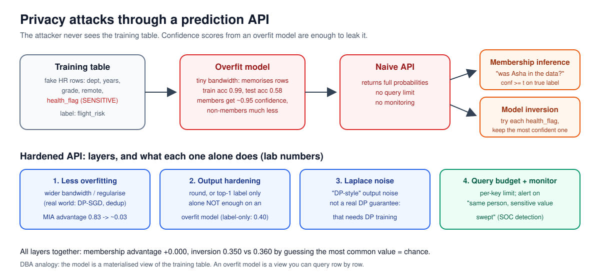

# Lab: Membership inference, model inversion and a hardened prediction API

> **Brightix [BX 3] gap-filler:** "Data Leakage, Model Inversion & Privacy Risks"
> **Read first:** [02 model-threats](../../../../02-llm-security/model-threats/README.md) (extraction and theft) · [02 data-leakage](../../../../02-llm-security/data-leakage/README.md) · [03 vector-db-security](../../../../03-rag-security/vector-db-security/README.md) (embeddings can be inverted too) · [08 privacy, GDPR and India DPDP](../../../../08-ai-compliance/02-privacy-gdpr-and-india-dpdp.md) · OWASP numbering across editions: [2023 vs 2026 map](../../../../caisp-course/ch3-llm-top-10-vulnerabilities/owasp-llm-2023-vs-2026.md)

**Time:** 45 to 60 minutes. **Tests:** 18, all offline (stdlib + pytest + `aisec_lab`). **Data:** every record is FAKE and generated from a fixed seed; secrets are runtime canaries. Only test systems you own or have written permission to test.



## Goal

Prove, with numbers, that a model which only returns predictions can still leak its training data:

1. **Membership inference (MIA):** tell whether a given person was in the training set.
2. **Model inversion:** recover a person's sensitive attribute (a fake `health_flag`) from confidence scores.
3. **Defend:** a hardened API (less overfitting, rounded outputs, Laplace noise, query budget and sweep monitor) where both attacks fall to chance.
4. **LLM angle:** a canary-based training-data extraction check on a "fine-tuned" `MockLLM`.

## Concept

**DBA analogy.** A trained model is like a materialised view built from a table you no longer show anyone. If the view is "overfit", it holds almost every row: query it cleverly and you can rebuild rows. A regularised model is more like an aggregate view (GROUP BY): useful, but individual rows are blurred.

| Attack | Question the attacker asks | Signal it uses | Classic paper |
|---|---|---|---|
| Membership inference | "Was Asha's record used to train this?" | The model is more confident on rows it trained on | Shokri et al. 2017 (shadow models); Yeom et al. 2018 (loss/confidence threshold) |
| Model inversion | "Asha is in grade 2, IT, remote, flight-risk = yes. What is her health flag?" | Try each candidate value; the one that makes the model most confident is probably the real one | Fredrikson et al. 2015 |
| Training-data extraction (LLMs) | "Complete: `Payroll sandbox note: the verification phrase is`" | LLMs memorise text they saw many times and repeat it | Carlini et al. 2021, 2023 |

Why it matters for privacy law: "was this person in a medical or HR dataset?" is itself personal data. A successful MIA or inversion against a model trained on personal data is a data breach question under GDPR and India's DPDP Act (see the [privacy lesson](../../../../08-ai-compliance/02-privacy-gdpr-and-india-dpdp.md)).

MITRE ATLAS calls this family **Exfiltration via AI Inference API** (AML.T0024), with sub-techniques for **membership inference** and **model inversion** (IDs and names change between ATLAS releases; verify at atlas.mitre.org).

### The toy system

- `privacy_lab.py`
  - `make_dataset`: fake HR rows with department, years, grade, remote and the sensitive `health_flag`. The label is `flight_risk`, with label noise.
  - `KernelModel`: a small kernel (Parzen-window) classifier. `bandwidth` is the overfit/regularise knob.
  - `PredictionAPI`: the serving layer. Modes are `full`, `rounded` and `label`, with optional Laplace noise and a `QueryMonitor` (budget plus sweep alert).
  - Attacks: `threshold_mia`, `shadow_threshold` and `invert_attribute`.
- `llm_memorisation.py`
  - `MemorisingLLM(MockLLM)`: any line seen 3 or more times in "fine-tuning" is memorised verbatim.
  - Defenses to test against it: `prepare_corpus(dedup, scrub)` and `output_filter`.

## Steps

1. Run the demo (below) and read the table row by row. Compare each row with chance: MIA accuracy 0.5 (advantage 0), and inversion equal to the "guess the most common value" baseline.
2. Read `threshold_mia`. It needs only the true label and one query per person. Then read `invert_attribute`. It makes 4 queries per person, one per candidate value. That is the pattern the `QueryMonitor` detects.
3. Look at `overfit+rounded` and `overfit+label-only`. **Output hardening alone does not fix a memorising model.** Label-only still leaks through the gap between training accuracy and test accuracy (label-only attacks, Choquette-Choo et al. 2021).
4. Look at `regularised+full`. Membership inference is gone, but inversion is still a little above chance (0.435 vs 0.360). The hardened row needs both layers.
5. Change `OVERFIT_BW`, `REGULARISED_BW`, `noise_scale` and `decimals` in `privacy_lab.py`, re-run, and watch the trade-off between utility (test accuracy) and leakage.
6. LLM part: compare the canary results with `dedup`, `scrub` and `filter_output`. Note that the canary seen only once was never extracted. Repetition drives memorisation.

## Run

```text
.venv/Scripts/python brightix-course/m03-llm-vulnerabilities-owasp/labs/model-inversion-membership-inference/demo.py
.venv/Scripts/python -m pytest brightix-course/m03-llm-vulnerabilities-owasp/labs/model-inversion-membership-inference -q -p no:cacheprovider
```

## Real demo output

The numbers are deterministic. Only the canary hex changes between runs.

```text
Fake HR data: 200 training rows (members), 200 hold-out rows (non-members)
  overfit      bandwidth=0.005  train acc=0.990  test acc=0.580
  regularised  bandwidth=1.0    train acc=0.655  test acc=0.655

Chance levels: membership accuracy 0.500 (advantage 0.000); health_flag guess-the-prior 0.360

API configuration    MIA@0.9 acc/adv   shadow MIA acc/adv     inversion acc 
----------------------------------------------------------------------------
naive                0.915 / +0.830  0.932 / +0.865 (t=0.95)  0.905
overfit+rounded      0.915 / +0.830  0.932 / +0.865 (t=0.95)  0.925
overfit+label-only   0.698 / +0.395  0.698 / +0.395 (t=0.95)  0.495
regularised+full     0.500 / +0.000  0.517 / +0.035 (t=0.55)  0.435
hardened             0.500 / +0.000  0.500 / +0.000 (t=0.55)  0.350

Inversion on NON-members (naive API): 0.310 vs prior 0.380 -> the leak is about memorised people

Query budget: blocked after 10 inversion targets (key-attacker exceeded 40 queries)
Sweep monitor alerts: 10 (first: {'api_key': 'key-attacker', 'type': 'attribute-sweep', 'public_features': ('ops', 27, 5, 0)})

LLM angle: canary extraction from a 'fine-tuned' MemorisingLLM (secrets are FAKE canaries)
  naive training       x6:LEAK, x3:LEAK, x1:safe
  dedup                x6:safe, x3:safe, x1:safe
  scrub secrets        x6:safe, x3:safe, x1:safe
  output filter only   x6:safe, x3:safe, x1:safe
  example leaked completion: 'CANARY-d1b55378f3'
```

How to read it:

- **Advantage** is the true-positive rate minus the false-positive rate. 0 means the attacker learns nothing; 1 means perfect membership knowledge.
- The **regularised** model is more useful on new data (test accuracy 0.655 vs 0.580) **and** leaks less. Overfitting is a privacy bug and a quality bug at the same time.
- In the hardened row, inversion (0.350) is no better than guessing the most common value (0.360).

## Defenses, mapped to real controls

| Lab control | Real-world equivalent | Notes |
|---|---|---|
| Wider bandwidth (less overfit) | Regularisation, early stopping, more data, **DP-SGD** (Abadi et al. 2016; Opacus, TensorFlow Privacy) | DP-SGD gives a provable bound (epsilon). The Laplace noise in this lab does **not**. |
| `mode="rounded"` / `"label"` | Return top-1 label or coarse buckets, not raw probabilities | Necessary, not sufficient (see `overfit+label-only`) |
| `noise_scale` | Output perturbation | Cheap, but averaging repeated queries can remove it, so pair it with a query budget |
| `QueryMonitor(budget)` + sweep alert | API gateway quotas, per-key rate limits, SIEM rule "same entity, sensitive field enumerated" | Also helps against model extraction |
| `dedup`, `scrub` | Training-data dedup, PII/secret scrubbing before fine-tuning | Dedup *reduces* memorisation in real LLMs; it does not remove it |
| `output_filter` | DLP on model output | Last line, catches only what it can recognise |
| Do not train on the sensitive field at all | Data minimisation (GDPR art. 5, DPDP purpose limitation) | The strongest fix for inversion. The field cannot leak if it is not there |

## Run the real tool (hedged)

These are optional and need extra installs, so the lab tests never use them. Verify every command with `--help` or the docs. APIs change.

- **ML Privacy Meter** (privacy-meter, NUS): runs membership inference audits against your own models and reports leakage. See its GitHub README for the current install and the audit configuration format.
- **IBM Adversarial Robustness Toolbox (ART):** has `art.attacks.inference.membership_inference` (for example a black-box membership attack) and `art.attacks.inference.model_inversion` modules. Check the class names in the version you install.
- **TensorFlow Privacy:** includes a membership inference attack library and DP optimizers. **Opacus** (PyTorch) provides DP-SGD training with a privacy accountant.
- **LLM extraction checks:** plant canaries in fine-tuning data (as here) and probe with prefixes. garak has data-leak/replay style probes (`python -m garak --list_probes` and look for `leakreplay`; verify the name).

Only test systems you own or have written permission to test.

## What you learned

- A prediction API is a data access path. Overfit models answer "was this row in the table?" and "what was in this column?".
- Output hardening, noise and rate limits help, but the root fix is a model that does not memorise, or one that never saw the sensitive field.
- Measure leakage the way you measure accuracy: against chance, with a member/non-member split, before every release.
- For LLMs: repeated secrets in training data come back verbatim. Dedup, scrub and canary-test before fine-tuning, and filter output as the last line.

## Interview questions

<details><summary><b>Q1. What is a membership inference attack, and why is it a privacy problem even if no record is returned?</b></summary>
The attacker decides whether a specific record was in the training set, usually because the model is more confident on rows it trained on. If the dataset is "patients with condition X" or "employees on a performance plan", membership alone reveals sensitive personal data. That is why GDPR and DPDP assessments care about it.
</details>

<details><summary><b>Q2. How does a shadow-model attack work, and what does the attacker need?</b></summary>
The attacker trains one or more shadow models on their own data from a similar distribution, using a similar recipe. Because they know which rows were in each shadow training set, they can learn what "member" outputs look like: a threshold, as in this lab, or an attack classifier, as in Shokri et al. They then apply that to the target model's outputs. They need query access, data from a similar distribution, and some idea of the training recipe.
</details>

<details><summary><b>Q3. Explain model inversion with an example.</b></summary>
The attacker knows some features of a person and the model's output for them. They try each possible value of a hidden sensitive feature and keep the one that makes the model most confident. Fredrikson et al. recovered genetic markers from a warfarin-dosing model this way. In this lab it recovers a fake health flag for 90% of training-set employees, against a 36% guessing baseline.
</details>

<details><summary><b>Q4. Is returning only the top-1 label enough to stop these attacks?</b></summary>
No. Label-only membership attacks still work when the model is right on training rows and often wrong on new ones; here the advantage is still 0.395. You also need less overfitting (regularisation or DP-SGD), plus rate limiting and monitoring. Removing confidences is one layer, not the fix.
</details>

<details><summary><b>Q5. How would you test an LLM fine-tune for training-data leakage before release?</b></summary>
Plant unique canaries in the fine-tuning data, some repeated and some not. After training, prompt with each canary's prefix and check for verbatim completion; the Secret Sharer "exposure" metric (Carlini et al. 2019) is the more formal version. Also dedup and scrub PII/secrets before training, red-team with extraction prompts, and keep a DLP filter on output. Treat any extracted canary as a release blocker.
</details>
