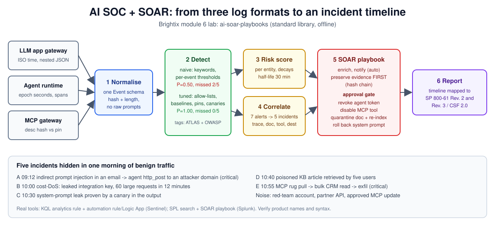
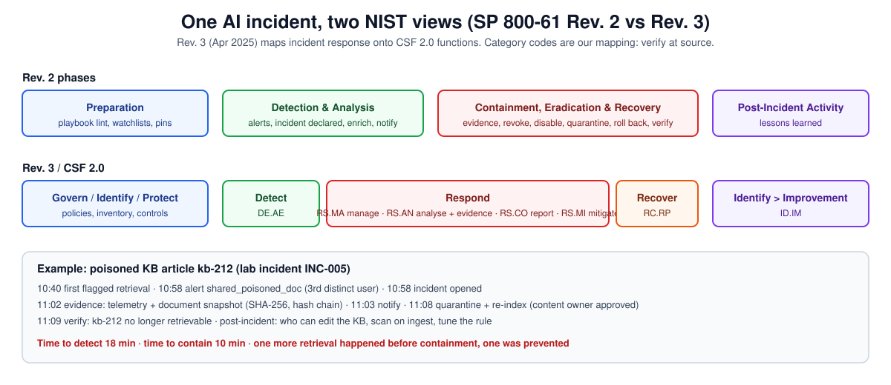

# Lab: AI SOC and SOAR playbooks, from telemetry to an incident timeline

> **Brightix module 6** · [BX 6] SIEM/SOAR Alerting & AI Incident Response Lifecycle (also: AI telemetry and audit trails, what to log, user/session behaviour monitoring, risk scoring and drift)
> **Real tools:** [Sentinel and Splunk version of this lab](../../real-tools/sentinel-splunk-ai-detections.md)
> **Study first:** [Agent monitoring and response](../../../../05-agent-security/monitoring-and-response/README.md) · [MCP logging, monitoring and detection](../../../../cmcpse-course/ch4-defending-and-hardening-mcp-servers/06-logging-monitoring-detection.md) · [SIEM, Sentinel and Splunk track](../../../../cybersecurity-track/06-siem-sentinel-splunk/README.md)
> **Builds on:** [Capstone red team and incident exercise](../../../../10-capstone-project/03-red-team-and-incident-exercise.md) · [Capstone AI SOC extension](../../../../10-capstone-project/05-ai-soc-monitoring-extension.md) · [AI incident playbook template](../../../../00-program/templates/ai-incident-playbook.md)

Offline, deterministic, standard library + `aisec_lab` only. No SIEM, no SOAR product, no network. All users, domains and secrets are fake (`.example` domains, runtime canaries). Only test systems you own or have written permission to test.

## Goal

Take one morning of telemetry from an LLM app, two agents and an MCP gateway, and run the full SOC loop on it:

1. **normalise** three log formats into one schema,
2. **detect** five hidden AI incidents with rules tagged to MITRE ATLAS and OWASP, and measure naive vs tuned rules (false positives and false negatives),
3. **score risk** per entity with time decay, and watch behaviour and drift,
4. **correlate** alerts into incidents,
5. **respond** with SOAR playbooks (enrich, notify, contain, approval gates, evidence with hashes),
6. **report** an incident timeline mapped to NIST SP 800-61 Rev. 2 phases and Rev. 3 (CSF 2.0) functions.

## Concept



**DBA analogy.** The three log sources are three tables designed by three teams (ISO time vs epoch seconds vs `@timestamp`; nested JSON vs flat). The normaliser is the view you build so every query (detection rule) is written once. Risk scoring with decay is like a moving average on a wait-event metric: one spike fades, a pattern stays high. The evidence store is archived redo: hash-chained, so you can prove nobody edited it.

### What to log in an LLM application (and what not to)

| Field (lab name) | Why the SOC needs it | Privacy note |
|---|---|---|
| `ts`, `request_id`, `trace_id`, `session`, `user`, `tenant` | Rebuild the timeline; join app, agent and gateway logs | Pseudonymise where you can |
| `prompt.sha256`, `prompt.chars`, `prompt.tokens`, short redacted `preview` | Find repeats, size anomalies, cost | **No raw prompt by default**; keep raw text in a restricted store with short retention if you must |
| `completion.tokens`, `latency_ms`, `model`, `sys_prompt_ver` | Cost-DoS, drift, which configuration answered | |
| `guardrail.input/context/output` + categories | Guardrail verdicts are detection signals | |
| `completion.flags` (for example `canary_hit`) | Deterministic proof of a leak | Canaries are fake values made at runtime |
| `retrieval.docs` | Which documents reached the model (poisoned RAG) | Doc IDs, not contents |
| Agent `tool`, `target`, `decision`, `taint`, `args_sha256`, `bytes_out`, `rows_returned` | Tool abuse and exfiltration | Hash arguments; never log tokens or keys |
| MCP `desc_sha256` vs `pinned_sha256`, `server`, `method`, `client` | Tool poisoning and rug pulls | |

### The five incidents hidden in the data

| ID | Time | Incident | Tuned rule | ATLAS technique name (verify IDs) | OWASP LLM 2026 name |
|---|---|---|---|---|---|
| A | 09:12 | Indirect prompt injection in a supplier email, agent `http_post` to an attacker domain | `exfil_untrusted_egress` | LLM Prompt Injection (indirect), Exfiltration via AI Agent Tool Invocation | Prompt Injection, Excessive Agency |
| B | 10:00 | Cost-DoS: a leaked integration key sends 60 large requests | `token_burst` | Cost Harvesting, Denial of AI Service | Unbounded Consumption |
| C | 10:30 | System-prompt leak, proven by a canary in the output | `canary_leak` | LLM Meta Prompt Extraction | Hidden Context Exposure |
| D | 10:40 | Poisoned KB article retrieved by five users | `shared_poisoned_doc` | RAG Poisoning | Vector and Embedding Weaknesses, Data and Model Poisoning |
| E | 10:55 | MCP rug pull: `read_crm` description changes after approval, bulk read, exfil | `mcp_pin_mismatch`, `bulk_tool_read`, `exfil_untrusted_egress` | AI Supply Chain Compromise | Supply Chain, Excessive Agency |

OWASP names follow the 2026 list used in this repo; the numbering differs by year, see the [2023 vs 2026 mapping](../../../../caisp-course/ch3-llm-top-10-vulnerabilities/owasp-llm-2023-vs-2026.md). ATLAS IDs in `pipeline.ATLAS_ID_HINTS` are hints; ATLAS renames and renumbers techniques, so verify at atlas.mitre.org.

### Naive vs tuned rules

| Naive rule | Why it fails | Tuned rule |
|---|---|---|
| Alert on every guardrail input block | 4 false positives (approved red-team account, one harmless blocked attempt) and blind to **indirect** injection | `repeated_guard_blocks` (3 in 30 min) with a red-team **watchlist**; `exfil_untrusted_egress` for the indirect case |
| Any tool call outside `corp.example` | Fires on the approved partner API | Egress **allow-list**; critical only if the trace was tainted |
| Prompt over 10k tokens | Flags one honest 14k-token document; misses 60 medium requests | Rolling 10-minute sum vs the user's own **baseline** |
| Prompt preview contains "system prompt" | Flags a user asking how to write one; misses the paraphrased attack | Canary in output: proof, not a keyword |
| One alert per flagged retrieval | Five alerts for one poisoned doc (alert storm), plus a how-to page | Same doc flagged for **3 distinct users** in 2 hours |
| Description differs from the last one seen | Fires on an approved, re-pinned update | Differs from the **approved pin** |

### SOAR playbooks and the NIST lifecycle

Playbooks are data in [`fixtures/playbooks.json`](fixtures/playbooks.json). The safe engine **lints** each playbook (every destructive step needs an approval gate; evidence must be preserved before the first destructive step), refuses **protected** or **empty** targets, and records every change. AI-specific containment actions: revoke the agent's token, disable an MCP tool, quarantine a document and re-index, roll back the system prompt, raise the guardrail level, rotate the canary, block egress, lower a token quota.



NIST SP 800-61 **Rev. 2** (2012) has four phases: Preparation; Detection & Analysis; Containment, Eradication & Recovery; Post-Incident Activity. **Rev. 3** (April 2025, as we understand it) replaces that lifecycle with the NIST CSF 2.0 functions (Govern, Identify, Protect, Detect, Respond, Recover), with lessons learned feeding Identify > Improvement. The report prints both columns. The CSF category codes are our best mapping: verify them against the published documents before you use them in a real report.

## Files

| File | What it does |
|---|---|
| `make_fixtures.py` | Generates the raw logs and ground truth deterministically (already committed under `fixtures/`) |
| `fixtures/llm_app.jsonl`, `agent_runtime.jsonl`, `mcp_gateway.jsonl` | Three raw sources, three formats |
| `fixtures/watchlists.json` | Egress allow-list, red-team accounts, threat intel, protected entities, user directory |
| `fixtures/playbooks.json` | Five playbooks plus one deliberately bad "naive" playbook |
| `fixtures/ground_truth.json` | The five real incidents (for FP/FN scoring) |
| `pipeline.py` | Normaliser, naive and tuned rules, evaluation, hourly drift, risk scoring with decay, correlation |
| `soar.py` | Simulated AI platform, hash-chained evidence store, playbook lint and engine |
| `ir_report.py` | Incident timeline with SP 800-61 Rev. 2 and Rev. 3 columns, time to detect / contain, exposure |
| `demo.py` | Runs everything; `--report out.md` writes the full report |
| `test_bx_m06_ai_soar.py` | 25 tests |

## Steps

1. Run the demo and the tests:

   ```powershell
   .venv/Scripts/python brightix-course/m06-ai-security-monitoring-and-soc/labs/ai-soar-playbooks/demo.py
   .venv/Scripts/python -m pytest brightix-course/m06-ai-security-monitoring-and-soc/labs/ai-soar-playbooks -v -p no:cacheprovider
   ```

2. Open one line of each file in `fixtures/` and find the same field (time, user, trace) in all three. Then read `norm_llm`, `norm_agent`, `norm_mcp` in `pipeline.py`.
3. Compare each `naive_*` rule with its tuned partner. Predict which FP disappears, then check section 2 of the output.
4. Change `half_life_min` in `build_risk` to 120 and rerun: which entity stays in INVESTIGATE longer? Is that what you want for a red-team account?
5. Edit `lab_approver` in `demo.py` to return `"deny"` for `revoke_agent_token`. What is contained and what is not? Look at the "Open items" line of the report.
6. Break it yourself: move the `quarantine` step in PB-04 above `evidence`. The lint refuses it. Then run the same playbook with `safe=False` and look at `evidence_gaps`.
7. Write the full report: `demo.py --report %TEMP%\ir.md`, and compare one incident with the [AI incident playbook template](../../../../00-program/templates/ai-incident-playbook.md).

## Real demo output

(Chain-head hashes after INC-003 change on every run, because the canary in the system-prompt snapshot is random.)

```text
1. NORMALISE  three sources, three formats -> one schema
    {'llm_app': 186, 'mcp_gateway': 32, 'agent_runtime': 22} -> 240 events; kinds: {'llm_request': 186, 'mcp_list': 4, 'mcp_call': 28, 'tool_call': 22}

2. DETECT  naive vs tuned rules against the ground truth (5 real incidents)
   naive  alerts=18  TP= 9  FP=9  precision=0.5  recall=0.6  missed=['TRUE-B-costdos', 'TRUE-C-leak']
          false positives by rule: [('naive_big_prompt', 1), ('naive_context_flag', 1), ('naive_external_tool_call', 1), ('naive_guard_block', 4), ('naive_leak_keyword', 1), ('naive_mcp_desc_changed', 1)]
          alerts per true incident: {'TRUE-A-exfil': 2, 'TRUE-D-ragdoc': 5, 'TRUE-E-rugpull': 2}
   tuned  alerts= 7  TP= 7  FP=0  precision=1.0  recall=1.0  missed=-
          alerts per true incident: {'TRUE-A-exfil': 1, 'TRUE-B-costdos': 1, 'TRUE-C-leak': 1, 'TRUE-D-ragdoc': 1, 'TRUE-E-rugpull': 3}

   tuned alerts (ATLAS technique names; verify IDs):
   09:12:05 critical exfil_untrusted_egress mail-assistant sent 18234 bytes to collect.evil.example (tainted=True)
            ATLAS: LLM Prompt Injection (indirect), Exfiltration via AI Agent Tool Invocation | OWASP: Prompt Injection, Excessive Agency
   10:01:36 high     token_burst            106200 tokens in 10 min (9 requests; limit 100000)
            ATLAS: Cost Harvesting, Denial of AI Service | OWASP: Unbounded Consumption
   10:30:00 high     canary_leak            canary from system prompt v7 in a response to mallory@acme.example
            ATLAS: LLM Meta Prompt Extraction | OWASP: Hidden Context Exposure
   10:55:00 critical mcp_pin_mismatch       crm-tools/read_crm description 7ca838e55fa1f60e != pinned 0355e76a7f0d1aa4
            ATLAS: AI Supply Chain Compromise | OWASP: Supply Chain
   10:56:00 high     bulk_tool_read         sales-assistant read 5000 rows from crm-tools/read_crm for heidi@acme.example
            ATLAS: Exfiltration via AI Agent Tool Invocation | OWASP: Excessive Agency
   10:56:04 high     exfil_untrusted_egress sales-assistant sent 912000 bytes to telemetry.evil.example (tainted=False)
            ATLAS: LLM Prompt Injection (indirect), Exfiltration via AI Agent Tool Invocation | OWASP: Prompt Injection, Excessive Agency
   10:58:00 high     shared_poisoned_doc    kb-212 flagged for 3 users
            ATLAS: RAG Poisoning | OWASP: Vector and Embedding Weaknesses, Data and Model Poisoning

3. BEHAVIOUR / DRIFT  hourly profile of the LLM app
   08:00 requests= 32 tokens=  37816 p50_latency= 1394ms guard_flag_rate=0.094 ok
   09:00 requests= 33 tokens=  58442 p50_latency= 1589ms guard_flag_rate=0.061 ok
   10:00 requests= 91 tokens= 745420 p50_latency=10947ms guard_flag_rate=0.033 ANOMALY
   11:00 requests= 30 tokens=  36301 p50_latency= 1739ms guard_flag_rate=0.100 ok

4. RISK SCORING  per entity, half-life 30 min (>=40 investigate, >=80 contain)
   user:alice@acme.example            peak=  90.0 at 09:12 [CONTAIN    ]  one hour later= 22.5
   mcp:crm-tools/read_crm             peak= 128.2 at 10:56 [CONTAIN    ]  one hour later= 32.0
   doc:kb-212                         peak=  50.0 at 10:58 [INVESTIGATE]  one hour later= 12.5
   user:grace@acme.example            peak=  11.1 at 11:07 [MONITOR    ]  one hour later=  2.8
   user:eve@acme.example              peak=  15.0 at 11:05 [MONITOR    ]  one hour later=  3.8
   user:redteam-svc@acme.example      peak=   0.0 at 00:00 [MONITOR    ]  one hour later=  0.0

5. CORRELATE  alerts -> incidents
   INC-001 critical rules=['exfil_untrusted_egress'] -> PB-01-injection-exfil
   INC-002 high     rules=['token_burst'] -> PB-02-cost-dos
   INC-003 high     rules=['canary_leak'] -> PB-03-system-prompt-leak
   INC-004 critical rules=['bulk_tool_read', 'exfil_untrusted_egress', 'mcp_pin_mismatch'] -> PB-05-mcp-rug-pull
   INC-005 high     rules=['shared_poisoned_doc'] -> PB-04-poisoned-doc

6. RESPOND  SOAR playbooks (service owner does not answer: that step stays pending)
   INC-001 / PB-01-injection-exfil
     09:16 enrich                   done              user={'dept': 'finance', 'manager': 'mgr-fin@acme.example'} dest_intel='lab in
     09:17 preserve_evidence        done              3 events, docs=['mail-4411'], chain head 0ba0b3227136
     09:18 notify                   done              [soc-high] INC-001: Exfil tool call by mail-assistant for alice@acme.example t
     09:23 revoke_agent_token       done              token for mail-assistant revoked
     09:28 block_egress             done              egress to collect.evil.example blocked
     09:33 quarantine_doc           done              mail-4411 quarantined; re-index runs=1
   INC-002 / PB-02-cost-dos
     10:05 enrich                   done              user={'dept': 'service-account', 'manager': 'owner-int@globex.example'} dest_i
     10:06 preserve_evidence        done              9 events, docs=[], chain head b8991f14fecb
     10:07 set_quota                done              quota for svc-integration@globex.example = 20000 tokens/10 min
     10:08 notify                   done              [soc-medium] INC-002: Token burst by svc-integration@globex.example; quota low
     10:13 revoke_api_key           pending_approval  waiting for service-owner: {'user': 'svc-integration@globex.example'}
   INC-003 / PB-03-system-prompt-leak
     10:34 preserve_evidence        done              1 events, docs=[], chain head 1e9da5e0b978
     10:35 notify                   done              [soc-high] INC-003: System prompt leak via mallory@acme.example
     10:36 raise_guardrail          done              guardrail level = strict
     10:41 rollback_system_prompt   done              system prompt v7 -> v6 (last approved)
     10:42 rotate_canary            done              canary rotated (old value now only useful as a detection marker)
   INC-004 / PB-05-mcp-rug-pull
     10:59 preserve_evidence        done              3 events, docs=[], chain head df727231fcfa
     11:00 notify                   done              [soc-critical] INC-004: Rug pull on crm-tools/read_crm
     11:05 disable_mcp_tool         done              MCP tool crm-tools/read_crm disabled at the gateway
     11:10 revoke_agent_token       done              token for sales-assistant revoked
     11:15 block_egress             done              egress to telemetry.evil.example blocked
   INC-005 / PB-04-poisoned-doc
     11:02 preserve_evidence        done              3 events, docs=['kb-212'], chain head c80616c52c80
     11:03 notify                   done              [soc-high] INC-005: Poisoned doc kb-212 reached 3 users
     11:08 quarantine_doc           done              kb-212 quarantined; re-index runs=2
     11:09 verify_not_retrievable   done              kb-212 retrievable=False -> PASS

   platform after response: agent_tokens={'mail-assistant': 'revoked', 'sales-assistant': 'revoked', 'soc-automation': 'active'}
   mcp_tools={'crm-tools/read_crm': 'disabled', 'docs-tools/search_docs': 'enabled', 'identity-tools/issue_token': 'enabled'}
   quarantined=['kb-212', 'mail-4411'] reindex_runs=2 egress_blocklist=['collect.evil.example', 'telemetry.evil.example']
   active_prompt=v6 guardrail=strict api_keys={'svc-integration@globex.example': 'active'}
   evidence items=8 chain verifies=True

7. NAIVE SOAR  'contain first, no gates' version of the poisoned-doc playbook
   lint says: ['quarantine: destructive action quarantine_doc has no approval gate', 'quarantine: destructive action quarantine_doc runs before evidence is preserved']
   naive engine ran it anyway -> evidence gaps: ['kb-212'] (the poisoned text is gone from evidence)

8. REPORT  NIST SP 800-61 timeline (one incident shown)
### INC-005: Poisoned RAG document retrieved by many users

- Severity: **high** · rules: shared_poisoned_doc
- ATLAS (names; verify IDs): RAG Poisoning
- OWASP (2026 LLM names): Data and Model Poisoning, Vector and Embedding Weaknesses
- Entities: doc:kb-212
- Time to detect: 18.0 min · time to first containment: 10.0 min
- Open items: none · evidence store chain head: `c80616c52c8062ef`
- Exposure after detection: 2 events (1 before containment, 1 would be stopped by it)

| Time (UTC) | SP 800-61 Rev. 2 phase | Rev. 3 / CSF 2.0 (verify) | What happened |
|---|---|---|---|
| - | Preparation | Govern / Identify / Protect | playbook PB-04-poisoned-doc linted (pass); watchlists and pins in place |
| 10:40:00 | Detection & Analysis (indicator) | Detect > DE.AE adverse event analysis | first malicious telemetry event |
| 10:58:00 | Detection & Analysis | Detect > DE.AE adverse event analysis | alert shared_poisoned_doc (high): kb-212 flagged for 3 users |
| 10:58:00 | Detection & Analysis (declared) | Respond > RS.MA incident management | INC-005 opened, severity high, playbook PB-04-poisoned-doc |
| 11:02:00 | Containment, Eradication & Recovery (evidence gathering) | Respond > RS.AN integrity and provenance | preserve_evidence [done]: 3 events, docs=['kb-212'], chain head c80616c52c80 |
| 11:03:00 | Detection & Analysis (notification) | Respond > RS.CO reporting and communication | notify [done]: [soc-high] INC-005: Poisoned doc kb-212 reached 3 users |
| 11:08:00 | Containment, Eradication & Recovery (eradication) | Respond > RS.MI incident mitigation | quarantine_doc [done] (approved by content-owner): kb-212 quarantined; re-index runs=2 |
| 11:09:00 | Containment, Eradication & Recovery (recovery) | Recover > RC.RP recovery plan execution | verify_not_retrievable [done]: kb-212 retrievable=False -> PASS |
| - | Post-Incident Activity | Identify > ID.IM improvement | lessons learned: new detection or tuning, control gap, playbook change, risk register entry |
```

## Run the real tool (hedged)

The [real-tools guide](../../real-tools/sentinel-splunk-ai-detections.md) shows the same rules as **KQL** (a Sentinel scheduled analytics rule, plus an automation rule that calls a Logic App playbook with an approval step) and as **SPL** (a Splunk correlation search, plus a Splunk SOAR playbook with a prompt block for approval), over the same field names. To try them without a cloud tenant, load `fixtures/*.jsonl` into a free Splunk trial or an Azure Data Explorer free cluster (`datatable` or ingestion). Product menus, table names and connector names change: verify with the vendor docs before you build anything.

## What you learned

- Log hashes, lengths, verdicts, tool decisions and pins. Do not log raw prompts or secrets by default.
- A rule is only good if you measure it: the naive set had 50% precision and missed two of five incidents; the tuned set used context (watchlists, allow-lists, baselines, pins) instead of keywords.
- Risk scores need decay, or every old event keeps an entity red forever.
- Correlate on strong keys (trace, session, doc, MCP tool, destination). Victims are not correlation keys, or one poisoned doc merges unrelated incidents.
- Automate the safe steps; gate the destructive ones; preserve evidence first; refuse protected and empty targets.
- Time to contain is not a vanity metric: in incident D, one more retrieval of the poisoned doc happened after containment would have stopped it.

## Interview questions

<details><summary>1. What would you log for an LLM application, and what would you NOT log?</summary>

Log who (user, tenant, session), what configuration (model, system-prompt version), the prompt hash and length, token counts, latency, guardrail verdicts, retrieved document IDs, every tool call with target, decision, provenance or taint and an argument hash, and MCP tool description hashes against pins. Do not log raw prompts, completions, tokens or keys by default: logs become a second copy of sensitive data (OWASP now treats logs as a disclosure path). If raw text is needed for investigations, keep it in a separate store with strict access and short retention.
</details>

<details><summary>2. Why did the guardrail-block rule miss the real injection?</summary>

The injection was **indirect**: it arrived inside a retrieved email, not in the user's prompt, so the input guardrail saw a harmless request and allowed it. The useful signal was the combination of a context-guard flag and an agent tool call to a host outside the egress allow-list in the same trace. Detect on the effect (the tool call), not only on the text.
</details>

<details><summary>3. How do you score risk per entity, and why add decay?</summary>

Each alert adds points to its entities by severity (victims get half); weak signals such as a single guard block add a few points. Points decay with a half-life (30 minutes in the lab), so one odd event fades below the "investigate" line while repeated behaviour accumulates. Without decay, scores only grow, and analysts learn to ignore them. Watch-listed accounts (an approved red-team test) are excluded, with an expiry date on the watchlist entry.
</details>

<details><summary>4. Which response steps would you automate in a SOAR playbook for an AI incident?</summary>

Automate enrichment, evidence preservation (with hashes), notifications, and low-risk reversible steps such as lowering a token quota or raising a guardrail level. Put an approval gate on destructive or business-impacting steps: revoking an agent token, disabling an MCP tool, quarantining a document and re-indexing, rolling back a system prompt, revoking an API key. Lint playbooks in CI so a "contain first" playbook cannot destroy evidence, and refuse protected or empty targets.
</details>

<details><summary>5. How does NIST SP 800-61 Rev. 3 differ from Rev. 2?</summary>

Rev. 2 describes a four-phase lifecycle: Preparation; Detection & Analysis; Containment, Eradication & Recovery; Post-Incident Activity. Rev. 3 (April 2025) instead maps incident response onto the CSF 2.0 functions: Govern, Identify and Protect cover preparation; Detect, Respond and Recover cover the incident itself; lessons learned feed continuous Improvement. In practice, keep your Rev. 2 runbooks but tag each step with the CSF function and category, as this lab's report does. Verify the details in the published document.
</details>
