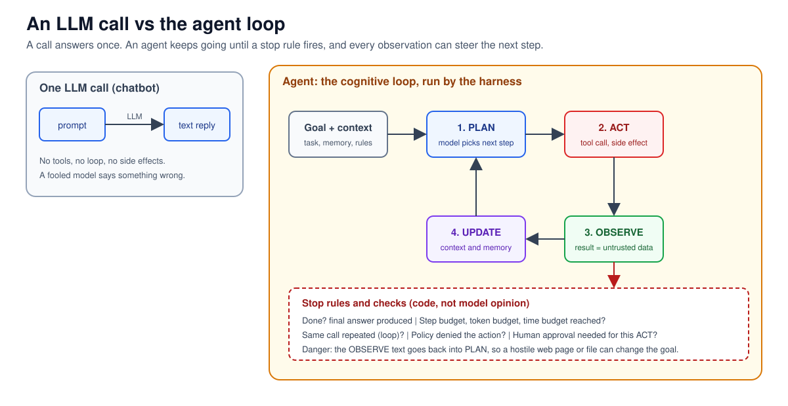

# 01: What Makes an "Agent" Different from an LLM Call

> **Chapter:** 1 · Agents, Harnesses and the Agentic Ecosystem · **Time:** ~2 hours
> **You will:** explain the plan, act, observe loop; tell chatbots, copilots, agents and autonomous agents apart; recognize six common agent design patterns and the security issue each brings; and decide when one agent is enough and when several agents add risk.

| | |
|---|---|
| **Prerequisites** | [CMCPSE lesson: the agentic ecosystem](../../cmcpse-course/ch1-introduction-to-mcp-and-agentic-ecosystem/03-agentic-ecosystem.md) (short intro; this lesson goes deeper) |
| **Lab** | [`labs/minimal-agent-harness`](labs/minimal-agent-harness/): a plan, act, observe loop with a budget; shows a naive harness letting an injected note send an email |
| **Syllabus lines** | What Makes an "Agent" Different from an LLM Call · The plan to act to observe (cognitive) loop · Agents vs. chatbots vs. copilots vs. autonomous agents · Planner-Executor-Verifier and other common agent design patterns · Single-agent vs. multi-agent systems |
| **Maps to** | OWASP LLM01, LLM03 (2026 numbering) · OWASP ASI01, ASI02, ASI08 · [05-agent-security README](../../05-agent-security/README.md) |

---

## 1. Why this matters

A language model **predicts text**. It has no hands. One LLM call is a function: text in, text out. If an attacker fools the model, you get a wrong answer.

An **agent** is a program that gives the model hands. It runs the model in a loop, lets it call tools (read a file, send mail, run a command) and feeds the results back. If an attacker fools the model inside an agent, you get a wrong **action**, possibly repeated many times, with real credentials.

So the security question changes from "what will the model say?" to "what can the system do, who decided it, and who can stop it?".



## 2. Understand it

### 2.1 What is different about an agent?

| | One LLM call | Agent |
|---|---|---|
| Steps | One | Many, until a stop rule |
| Who chooses the steps | You (the prompt) | The model, at run time |
| Side effects | None (text only) | Yes: files, mail, APIs, code |
| State | The prompt you send | Context window, notes, memory stores |
| Failure | A wrong or unsafe answer | A wrong or unsafe action, maybe repeated |
| What you must secure | Prompt, output handling | Prompt, tools, identity, memory, loop, spending, logs |

Three properties make an agent: it **plans** (chooses its next step), it **acts** (calls tools that change something) and it **observes** (reads the result and decides again).

### 2.2 The plan, act, observe (cognitive) loop

The loop is run by **code** (the harness, see [lesson 02](02-anatomy-of-an-agent-harness.md)), not by the model:

1. **Plan (think).** The harness builds a prompt: rules, goal, memory, tool list and previous results. The model replies with the next step: a tool call (JSON with a tool name and arguments) or a final answer.
2. **Act.** The harness parses the reply, checks it and runs the tool.
3. **Observe.** The tool result becomes new text in the context. This text is **data from the outside world**, and it can contain anything an attacker wrote.
4. **Update and repeat.** Memory is updated. A stop rule decides whether to continue: a final answer, a step or token budget, a repeated call, a denial, or a human stop.

Security reading of each step:

| Step | What can go wrong | Control (lesson or lab) |
|---|---|---|
| Plan | Injected text changes the goal (goal hijack, ASI01) | Separate rules from data, goal lock, taint tracking |
| Act | Valid tool, wrong target; harmful arguments (ASI02) | Allowlist, argument schema, approval for side effects |
| Observe | Tool output carries hidden instructions (indirect injection) | Treat results as data; label provenance |
| Update | Poisoned notes persist (ASI06) | Write gates, per-user scope |
| Stop | Endless loop, runaway cost (ASI08) | Step and token budgets, loop detection, kill switch |

The cognitive loop is often called **ReAct** (reason and act) in research papers. You will see "thought, action, observation" traces in many frameworks.

### 2.3 Agents vs. chatbots vs. copilots vs. autonomous agents

These words are used loosely by vendors. A useful way to separate them is **who takes the action and how much a human watches**:

| Kind | What it does | Who acts | Typical autonomy | Example shape | Main risk |
|---|---|---|---|---|---|
| **Chatbot** | Answers questions in a conversation, no tools or only read-only search | The human | Level 0 to 1: suggests only | A help-desk Q&A bot | Wrong or leaky answers |
| **Copilot** | Assists inside a tool, proposes edits or actions; the human accepts each one | The human, on each suggestion | Level 1 to 2: act after approval | Code completion, "draft this email" | Approval fatigue, over-trust |
| **Agent** | Pursues a goal across steps with tools; often acts then reports | The agent, within limits | Level 2 to 3: approval for risky actions only | A coding agent in a repo, an inbox assistant | Excessive agency, injection to action |
| **Autonomous agent** | Runs long or on a schedule with little or no human in the loop, may start its own sub-tasks | The agent | Level 3 to 4: act, then notify or never | A 24/7 personal agent with a gateway, a scheduled ops agent | Runaway behavior, rogue actions, no one watching |

Use the same level scale in your threat model (the [lab](labs/atlas-threat-model-agent/) uses it): **1** suggests only, **2** acts after human approval, **3** acts then notifies, **4** fully autonomous. Higher autonomy raises impact, because there is less time for a person to catch a mistake.

### 2.4 Common agent design patterns

| Pattern | How it works | Security notes |
|---|---|---|
| **ReAct (single loop)** | One model reasons, calls a tool, reads the result, repeats | Simplest. Every observation can steer the next step. Needs budgets and taint tracking. |
| **Plan-and-execute** | A planner writes the whole plan first; an executor runs the steps | You can show and approve the **plan**. Stop new untrusted content from adding steps. A poisoned plan drives everything. |
| **Planner-Executor-Verifier** | Planner proposes, executor acts, a verifier checks the result against the goal and rules | Good: a second check. But a **verifier that is also an LLM can be fooled by the same text.** Make the verifier deterministic where you can (schema, policy, tests) and keep it free of attacker-controlled input. |
| **Reflection (self-critique)** | The model reviews its own output and retries | Can loop forever, and "self-correction" can move toward the attacker's goal. Reflection is a quality tool, **never a security control.** |
| **Router** | A first call classifies the request and sends it to one specialist prompt, tool set or agent | Misrouting: crafted input can pick a more privileged specialist. Route on trusted signals too. |
| **Supervisor (orchestrator and workers)** | A supervisor splits the task and delegates to worker agents, then merges results | Delegation abuse, trust in worker output, cascading failure (ASI07, ASI08). Each hop is a trust boundary. |

**Planner-Executor-Verifier in one picture:**

```text
goal -> PLANNER (LLM) -> plan steps -> POLICY check -> EXECUTOR runs a step -> result
                                           ^                                    |
                                           |             VERIFIER (checks result vs goal, rules, tests)
                                           +---- fail: replan (bounded) <-------+
```

Whatever the pattern, the same habits apply: least privilege per component, human approval for risky or irreversible actions, budgets, logs, and never letting one step's output act as an instruction for the next without a check. See [05-agent-security](../../05-agent-security/README.md) for the planner and executor table and labs.

### 2.5 Single-agent vs. multi-agent systems

| | Single agent | Multi-agent |
|---|---|---|
| Shape | One model, one tool set | Several agents with roles, passing tasks and results |
| Good for | Focused tasks; easy to debug and audit | Large or parallel tasks, specialist roles, separation of duties |
| Context | One context | One context per agent plus messages between them |
| Cost and latency | Lower | Higher (many calls) |
| Security | One injection surface per input | **More injection points and more trust boundaries**; a compromised agent can mislead the others; delegated authority can widen |
| Identity | One identity to manage | One identity per agent, and a chain of who delegated to whom |

Rule of thumb: **start with a single agent, or even a fixed workflow with one LLM step.** Add agents only for a real reason (separate privileges, parallel work, different models). Treat every message between agents as untrusted input unless it is authenticated and checked. Chapter 5 of this course goes deep ([multi-agent trust lab](../../05-agent-security/multi-agent-trust/README.md)).

**Workflow vs agent:** a *workflow* has steps fixed in code with LLM calls inside; an *agent* lets the model choose the steps. The fewer decisions the model makes, the fewer it can be tricked into. Prefer the least autonomous design that does the job.

## 3. Defend it

1. **Constrain the agent's authority outside its reasoning.** The model proposes; deterministic code decides.
2. **Pick the lowest autonomy level** the task needs. Require approval for irreversible actions.
3. **Budget everything:** steps, tokens, time, money, tool calls per minute.
4. **Detect loops** (same call twice) and stop.
5. **Log every proposal and decision** in a place the agent cannot edit.
6. **Break the lethal trifecta:** private data, untrusted content and an outbound channel should not all be in one session without a hard control ([05-agent-security](../../05-agent-security/README.md#break-the-lethal-trifecta)).

## 4. Hands-on

Run the [minimal-agent-harness lab](labs/minimal-agent-harness/README.md). In it you will see:

- a clean plan, act, observe run with a scripted model;
- a **naive harness** where a note that contains an injected `send_email` directive makes the agent mail a canary to an attacker;
- the same run with a **guard**: the send is denied because a side-effect tool followed untrusted content and the recipient domain is not allowed;
- a step budget stopping a runaway model.

## 5. Scenarios

1. A copilot proposes a shell command and the developer presses accept on the 40th suggestion without reading. Which level of autonomy is this really, and what would you add? *(Answer: practically level 3; add a policy that blocks destructive commands and a diff view that shows the effect.)*
2. A planner-executor-verifier pipeline uses the same model, with the same untrusted web page in all three prompts. What is wrong? *(The verifier can be fooled by the same injected text. Give the verifier only structured results and deterministic checks.)*
3. A team replaces one agent with five specialist agents "for safety". What new risks appear? *(Five identities, message forgery, delegation chains, cascades. It helps only if each agent has a narrower scope and the messages are authenticated.)*

## 6. Interview and exam questions

<details><summary><b>Q1. What turns an LLM call into an agent?</b></summary>
A loop with tools: the model chooses the next step, the harness runs a tool, the result is fed back, and this repeats until a stop rule. The model gains side effects, so the risk moves from wrong text to wrong actions.
</details>

<details><summary><b>Q2. Why is the observe step the main entry point for attackers?</b></summary>
Tool results, web pages and files go into the context as text. The model cannot reliably separate data from instructions, so hidden instructions in an observation can change the next plan (indirect prompt injection).
</details>

<details><summary><b>Q3. Why is "reflection" not a security control?</b></summary>
The model reviews its own output using the same weak judgment, and the reviewed text may carry the attack. It improves quality, not safety. Security must come from deterministic checks outside the model.
</details>

## 7. References

- Yao et al., "ReAct: Synergizing Reasoning and Acting in Language Models" (2022), arXiv.
- Anthropic, "Building effective agents" (2024): workflows vs agents and common patterns (verify the current page).
- OWASP Top 10 for Agentic Applications 2026: <https://genai.owasp.org> (verify).
- Repo: [05-agent-security](../../05-agent-security/README.md), [CMCPSE agentic ecosystem lesson](../../cmcpse-course/ch1-introduction-to-mcp-and-agentic-ecosystem/03-agentic-ecosystem.md).
